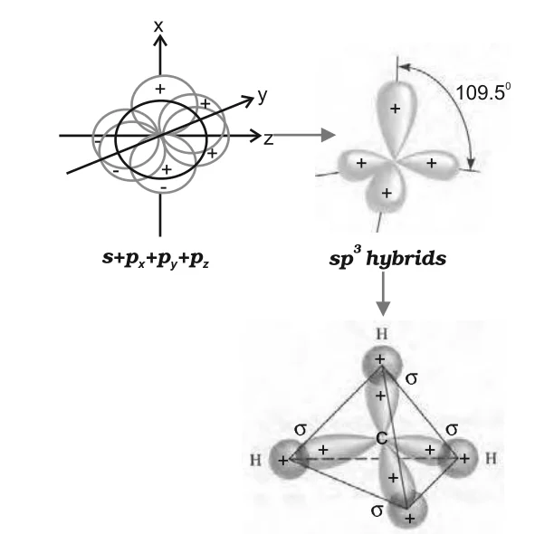
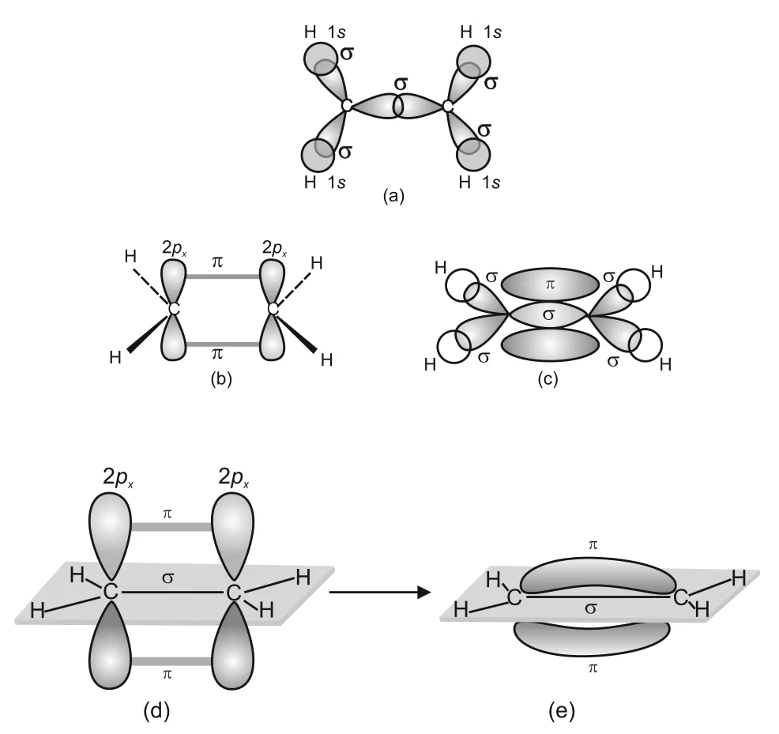

# [{ align=left, width=3.8% }](../../index.md)  Chemical Bonding | Hybridisation

Hybridisation is the process of intermixing of the orbitals of slightly different energies so as to redistribute their energies, resulting in the formation of a new set of orbitals of equivalent energies and shape.

* The concept was introduced by Pauling to explain the shapes of polyatomic molecules like CH4, NH3 and H2O.
* The new orbitals are called **hybrid orbitals**. Unlike pure orbitals, hybrid orbitals are used in bond formation.
* Example: one 2s and three 2p orbitals of carbon hybridise to form four new sp3 hybrid orbitals.

## Salient Features of Hybridisation

* The number of hybrid orbitals is equal to the number of atomic orbitals that get hybridised.
* Hybrid orbitals are always equivalent in energy and shape.
* Hybrid orbitals form more stable bonds than pure atomic orbitals.
* Hybrid orbitals point in preferred directions in space so that repulsion between electron pairs is minimum. So the type of hybridisation indicates the **geometry** of the molecule.

## Important Conditions for Hybridisation

* Only the orbitals of the **valence shell** are hybridised.
* The orbitals undergoing hybridisation should have **almost equal energy**.
* **Promotion** of an electron is not an essential condition before hybridisation.
* Not only half-filled orbitals take part; in some cases even **filled** valence orbitals hybridise.

## Types of Hybridisation

### 1. sp Hybridisation

* One s and one p orbital mix to form two equivalent sp hybrid orbitals. If the hybrids lie along the z-axis, the s and pz orbitals are used.
* Each sp hybrid has **50% s-character and 50% p-character**.
* The two hybrids point in opposite directions along the axis (180&deg;), with large positive lobes and very small negative lobes, which gives effective overlap and strong bonds.
* Molecules with an sp hybridised central atom are **linear**. It is also called **diagonal hybridisation**.

!!! example "BeCl2"

    * Ground state of Be: 1s22s2. In the excited state, one 2s electron is promoted to a vacant 2p orbital.
    * One 2s and one 2p orbital hybridise to form two sp orbitals at 180&deg;.
    * Each sp orbital overlaps axially with a 2p orbital of Cl to form two Be-Cl sigma bonds. BeCl2 is linear.

### 2. sp2 Hybridisation

* One s and two p orbitals mix to form three equivalent sp2 hybrid orbitals.
* The three hybrids are arranged in a **trigonal planar** manner at 120&deg;.

!!! example "BCl3"

    * Ground state of B: 1s22s22p1. In the excited state, one 2s electron is promoted to a 2p orbital, giving three unpaired electrons.
    * One 2s and two 2p orbitals hybridise to form three sp2 orbitals.
    * They overlap with 2p orbitals of Cl to form three B-Cl bonds. BCl3 is trigonal planar with Cl-B-Cl angle of 120&deg;.

### 3. sp3 Hybridisation

* One s and three p orbitals of the valence shell mix to form four equivalent sp3 hybrid orbitals.
* Each sp3 orbital has **25% s-character and 75% p-character**.
* The four hybrids are directed towards the four corners of a **tetrahedron**, at 109.5&deg; to each other.

!!! example "CH4"

    The four sp3 orbitals of carbon overlap with the 1s orbitals of four H atoms to form four C-H sigma bonds. CH4 is tetrahedral with H-C-H angle of 109.5&deg;.

{loading=lazy}

!!! example "NH3"

    * N has the configuration 2s22px12py12pz1. After sp3 hybridisation, three hybrid orbitals have one electron each and the fourth has a lone pair.
    * The three singly occupied orbitals overlap with 1s orbitals of H to form three N-H sigma bonds.
    * Since lp-bp repulsion > bp-bp repulsion, the angle reduces from 109.5&deg; to 107&deg;. NH3 is **pyramidal**.

!!! example "H2O"

    * The four sp3 orbitals of O include two with one electron each and two with a lone pair each.
    * Two H atoms occupy two corners of the tetrahedron and the lone pairs occupy the other two.
    * The bond angle reduces from 109.5&deg; to 104.5&deg;, and the molecule is **V-shaped (angular)**.

## Other Examples of sp3, sp2 and sp Hybridisation

### 1. Ethane, C2H6 (sp3)

* Both C atoms are sp3 hybridised. One sp3 orbital of each C overlaps axially with that of the other C to form the sp3-sp3 C-C sigma bond.
* The other three sp3 orbitals of each C form sp3-s sigma bonds with H atoms.
* C-C bond length = 154 pm and C-H bond length = 109 pm.

### 2. Ethene, C2H4 (sp2)

* Each C atom is sp2 hybridised. One sp2 orbital of each C overlaps axially to form a C-C sigma bond, and the other two form sp2-s sigma bonds with H atoms.
* The unhybridised 2p orbital (2px or 2py) of each C overlaps sideways with that of the other C to form a weak **pi bond**, made of two electron clouds above and below the plane of the molecule.
* So the C=C double bond consists of one sp2-sp2 sigma bond and one pi bond.
* C=C bond length = 134 pm, C-H bond length = 108 pm, H-C-H angle = 117.6&deg; and H-C-C angle = 121&deg;.

{loading=lazy}

### 3. Ethyne, C2H2 (sp)

* Both C atoms are sp hybridised, with two unhybridised orbitals each: 2py and 2px.
* One sp orbital of each C overlaps axially to form the C-C sigma bond. The other sp orbital of each C forms a sigma bond with the 1s orbital of H.
* The two unhybridised p orbitals of each C overlap sideways to form **two pi bonds**.
* So the C&equiv;C triple bond is made up of one sigma bond and two pi bonds. The molecule is linear.

## Hybridisation Involving d Orbitals

* Third period elements have 3d orbitals in addition to 3s and 3p. The energy of 3d orbitals is comparable to 3s and 3p, and also to 4s and 4p.
* So hybridisation involving 3s, 3p and 3d, or 3d, 4s and 4p, is possible. But since 3p and 4s differ significantly in energy, hybridisation involving 3p, 3d and 4s is not possible.

Shape of molecule/ion | Hybridisation type | Atomic orbitals | Examples |
----------------------|--------------------|-----------------|----------|
Square planar | dsp2 | d + s + p(2) | [Ni(CN)4]2-, [PtCl4]2- |
Trigonal bipyramidal | sp3d | s + p(3) + d | PF5, PCl5 |
Square pyramidal | sp3d2 | s + p(3) + d(2) | BrF5, XeOF4 |
Octahedral | sp3d2 or d2sp3 | s + p(3) + d(2) or d(2) + s + p(3) | SF6, [CrF6]3-, [Co(NH3)6]3+ |

### 1. PCl5 (sp3d hybridisation)

!!! tip ""

    $$P\ (ground\ state):\ 3s^2\ 3p^3\ 3d^0$$

    $$P\ (excited\ state):\ 3s^1\ 3p^3\ 3d^1$$

* One 3s, three 3p and one 3d orbital hybridise to give five sp3d orbitals directed towards the corners of a **trigonal bipyramid**.
* These overlap with singly occupied p orbitals of five Cl atoms to form five P-Cl sigma bonds.
* All bond angles are not equal:
    * Three **equatorial** P-Cl bonds lie in one plane at 120&deg; to each other.
    * Two **axial** P-Cl bonds lie above and below this plane, at 90&deg; to it.
* The axial bond pairs suffer more repulsion from the equatorial bond pairs. So the axial bonds are **slightly longer and weaker** than the equatorial bonds, which makes PCl5 more reactive.

### 2. SF6 (sp3d2 hybridisation)

!!! tip ""

    $$S\ (ground\ state):\ 3s^2\ 3p^4\ 3d^0$$

    $$S\ (excited\ state):\ 3s^1\ 3p^3\ 3d^2$$

* In the excited state, six orbitals (one s, three p and two d) are singly occupied. They hybridise to form six sp3d2 orbitals pointing to the six corners of a regular **octahedron**.
* These overlap with singly occupied orbitals of six F atoms to form six S-F sigma bonds. SF6 is octahedral.

## Questions

!!! question "What is meant by hybridisation of atomic orbitals? Describe the shapes of sp, sp2 and sp3 hybrid orbitals."

    * Hybridisation is the mixing of atomic orbitals of slightly different energies of the same atom to form an equal number of new, equivalent hybrid orbitals.
    * **sp:** two hybrid orbitals, linear, at 180&deg;.
    * **sp2:** three hybrid orbitals, trigonal planar, at 120&deg;.
    * **sp3:** four hybrid orbitals, tetrahedral, at 109.5&deg;.
    * Each hybrid orbital has one large lobe and one very small lobe, pointing away from the nucleus in its own direction.

!!! question "Describe the change in hybridisation (if any) of the Al atom in the following reaction:  AlCl3 + Cl- &rarr; AlCl4-"

    * In AlCl3, Al (excited state 3s13p2) uses one 3s and two 3p orbitals, so it is **sp2** hybridised and trigonal planar.
    * In AlCl4-, the empty 3p orbital of Al also takes part, accepting a lone pair from Cl-. Al becomes **sp3** hybridised and the ion is tetrahedral.

!!! question "Is there any change in the hybridisation of B and N atoms as a result of the following reaction?  BF3 + NH3 &rarr; F3B.NH3"

    * Before the reaction, B in BF3 is **sp2** hybridised (trigonal planar) and N in NH3 is **sp3** hybridised.
    * In the product, N donates its lone pair to the empty orbital of B. B now has four electron pairs and becomes **sp3** hybridised.
    * N remains **sp3** hybridised; its lone pair simply becomes a bond pair.

!!! question "What is the total number of sigma and pi bonds in the following molecules? (a) C2H2 (b) C2H4"

    * **(a) C2H2 (H-C&equiv;C-H):** Two C-H sigma bonds + one C-C sigma bond = 3 sigma bonds, and 2 pi bonds.
    * **(b) C2H4 (H2C=CH2):** Four C-H sigma bonds + one C-C sigma bond = 5 sigma bonds, and 1 pi bond.

!!! question "Which hybrid orbitals are used by carbon atoms in the following molecules?  (a) CH3-CH3 (b) CH3-CH=CH2 (c) CH3-CH2-OH (d) CH3-CHO (e) CH3COOH"

    * A carbon with only single bonds is sp3, a carbon with one double bond is sp2, and a carbon with a triple bond (or two double bonds) is sp.
    * (a) Both C atoms are sp3.
    * (b) CH3 carbon is sp3; the CH and CH2 carbons of the double bond are sp2.
    * (c) Both C atoms are sp3.
    * (d) CH3 carbon is sp3; CHO carbon is sp2.
    * (e) CH3 carbon is sp3; COOH carbon is sp2.

!!! question "Describe the hybridisation in case of PCl5. Why are the axial bonds longer as compared to equatorial bonds?"

    * P (3s23p3) promotes one 3s electron to a 3d orbital, giving five unpaired electrons (3s13p33d1).
    * These five orbitals form five sp3d hybrids arranged in a trigonal bipyramid, which overlap with p orbitals of five Cl atoms.
    * Each axial bond pair is at 90&deg; to three equatorial bond pairs, while each equatorial bond pair is at 90&deg; to only two axial bond pairs. So the axial bonds suffer more repulsion and become slightly longer (and weaker) than the equatorial bonds.
