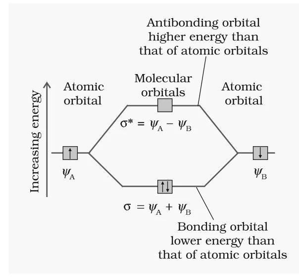
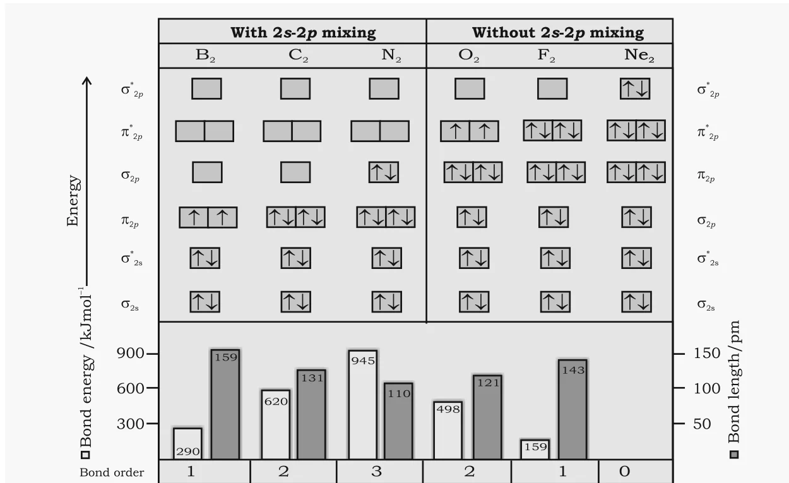

# [{ align=left, width=3.8% }](../../index.md)  Chemical Bonding | Molecular Orbital Theory

Molecular orbital theory describes bonding in terms of molecular orbitals that belong to the molecule as a whole, formed by the combination of atomic orbitals of comparable energies and proper symmetry.

* Molecular orbital (MO) theory was developed by F. Hund and R.S. Mulliken in 1932.

## Salient Features of MO Theory

* Electrons in a molecule are present in **molecular orbitals**, just as electrons of atoms are present in atomic orbitals.
* Atomic orbitals of comparable energies and proper symmetry combine to form molecular orbitals.
* An electron in an atomic orbital is influenced by one nucleus, while an electron in a molecular orbital is influenced by two or more nuclei. So an atomic orbital is **monocentric** and a molecular orbital is **polycentric**.
* The number of molecular orbitals formed is equal to the number of combining atomic orbitals. Two atomic orbitals form two molecular orbitals: a **bonding molecular orbital** and an **antibonding molecular orbital**.
* The bonding MO has **lower energy** and greater stability than the corresponding antibonding MO.
* A molecular orbital gives the electron probability distribution around the group of nuclei in a molecule.
* Molecular orbitals are filled according to the **aufbau principle**, **Pauli's exclusion principle** and **Hund's rule**.

## Linear Combination of Atomic Orbitals (LCAO)

* Atomic orbitals are wave functions ($\psi$) obtained from the Schrödinger wave equation. Since this equation cannot be solved exactly for systems with more than one electron, an approximate method called **linear combination of atomic orbitals (LCAO)** is used.
* For H2, the 1s orbitals of atoms A and B are represented by $\psi_A$ and $\psi_B$. Molecular orbitals form by addition and subtraction of these wave functions:

!!! tip ""

    $$\psi_{MO} = \psi_A \pm \psi_B$$

    $$\sigma = \psi_A + \psi_B \quad (bonding\ MO)$$

    $$\sigma^* = \psi_A - \psi_B \quad (antibonding\ MO)$$

{loading=lazy}

* In a **bonding MO**, the electron waves of the two atoms reinforce each other (**constructive interference**). Electron density is concentrated between the nuclei, which reduces repulsion between the nuclei and holds them together. So a bonding MO has lower energy than the atomic orbitals.
* In an **antibonding MO**, the electron waves cancel each other (**destructive interference**). Most of the electron density is away from the space between the nuclei, and there is a **nodal plane** (zero electron density) between them. Electrons in an antibonding MO destabilise the molecule.
* The energy of the antibonding orbital is raised above the parent atomic orbitals, and the energy of the bonding orbital is lowered by the same amount. The total energy of the two MOs is the same as that of the two original atomic orbitals.

## Conditions for the Combination of Atomic Orbitals

### 1. Same or nearly the same energy

* A 1s orbital can combine with another 1s orbital, but not with a 2s orbital, because the energy of 2s is much higher. (This is not true if the atoms are very different.)

### 2. Same symmetry about the molecular axis

* By convention, the z-axis is taken as the molecular axis. Orbitals with the same energy but different symmetry do not combine.
* Example: 2pz of one atom can combine with 2pz of the other, but **not** with 2px or 2py.

### 3. Maximum overlap

* Greater the extent of overlap, greater is the electron density between the nuclei in the molecular orbital.

## Types of Molecular Orbitals

* Molecular orbitals of diatomic molecules are named &sigma; (sigma), &pi; (pi), &delta; (delta), etc.
* **Sigma (&sigma;) molecular orbitals** are symmetrical around the bond axis. Examples: &sigma;1s and &sigma;\*1s from 1s orbitals; &sigma;2pz and &sigma;\*2pz from 2pz orbitals.
* **Pi (&pi;) molecular orbitals** are not symmetrical around the bond axis, because they have positive lobes above and negative lobes below the molecular plane. 2px and 2py orbitals form &pi; and &pi;\* orbitals.
* A &pi; bonding MO has larger electron density above and below the internuclear axis. A &pi;\* antibonding MO has a node between the nuclei.

## Energy Level Diagram for Molecular Orbitals

The 2s and 2p atomic orbitals (eight atomic orbitals on two atoms) form eight molecular orbitals:

!!! tip ""

    $$Antibonding\ MOs:\ \sigma^*2s,\ \sigma^*2p_z,\ \pi^*2p_x,\ \pi^*2p_y$$

    $$Bonding\ MOs:\ \sigma2s,\ \sigma2p_z,\ \pi2p_x,\ \pi2p_y$$

* The order of energies was found experimentally from spectroscopic data.

#### For O2 and F2

!!! tip ""

    $$\sigma1s < \sigma^*1s < \sigma2s < \sigma^*2s < \sigma2p_z < (\pi2p_x = \pi2p_y) < (\pi^*2p_x = \pi^*2p_y) < \sigma^*2p_z$$

#### For Li2, Be2, B2, C2 and N2

!!! tip ""

    $$\sigma1s < \sigma^*1s < \sigma2s < \sigma^*2s < (\pi2p_x = \pi2p_y) < \sigma2p_z < (\pi^*2p_x = \pi^*2p_y) < \sigma^*2p_z$$

* The key difference is that for these lighter molecules, the energy of **&sigma;2pz is higher than that of &pi;2px and &pi;2py**. This is due to 2s-2p mixing.

## Electronic Configuration and Molecular Behaviour

The distribution of electrons among the various molecular orbitals is called the **electronic configuration of the molecule**. Let Nb be the number of electrons in bonding orbitals and Na the number in antibonding orbitals.

### 1. Stability of molecules

* If Nb > Na, the bonding influence is stronger and the molecule is **stable**.
* If Nb < Na, the antibonding influence is stronger and the molecule is **unstable**.

### 2. Bond order

Bond order (b.o.) is defined as one half the difference between the number of electrons present in the bonding and the antibonding orbitals.

!!! tip ""

    $$Bond\ order\ (b.o.) = {1 \over 2}(N_b - N_a)$$

* A positive bond order (Nb > Na) means a stable molecule. A negative or zero bond order (Nb &le; Na) means an unstable molecule.

### 3. Nature of the bond

* Bond order values of 1, 2 and 3 correspond to single, double and triple bonds.

### 4. Bond length

* Bond length decreases as bond order increases.

### 5. Magnetic nature

* If all molecular orbitals are doubly occupied, the substance is **diamagnetic** (repelled by a magnetic field).
* If one or more molecular orbitals are singly occupied, it is **paramagnetic** (attracted by a magnetic field). Example: O2.

## Bonding in Some Homonuclear Diatomic Molecules

### 1. Hydrogen molecule (H2)

!!! tip ""

    $$H_2:\ (\sigma1s)^2$$

    $$Bond\ order = {2 - 0 \over 2} = 1$$

* The two H atoms are joined by a single covalent bond. Bond dissociation energy = 438 kJ mol-1 and bond length = 74 pm.
* There is no unpaired electron, so H2 is **diamagnetic**.

### 2. Helium molecule (He2)

!!! tip ""

    $$He_2:\ (\sigma1s)^2(\sigma^*1s)^2$$

    $$Bond\ order = {1 \over 2}(2 - 2) = 0$$

* He2 is unstable and does not exist. Similarly, Be2, with configuration (&sigma;1s)2(&sigma;\*1s)2(&sigma;2s)2(&sigma;\*2s)2, also does not exist.

### 3. Lithium molecule (Li2)

!!! tip ""

    $$Li_2:\ (\sigma1s)^2(\sigma^*1s)^2(\sigma2s)^2\ \ or\ \ KK(\sigma2s)^2$$

    $$Bond\ order = {1 \over 2}(4 - 2) = 1$$

* KK represents the closed K shell structure (&sigma;1s)2(&sigma;\*1s)2.
* Li2 is stable and **diamagnetic**. Li2 molecules are known to exist in the vapour phase.

### 4. Carbon molecule (C2)

!!! tip ""

    $$C_2:\ (\sigma1s)^2(\sigma^*1s)^2(\sigma2s)^2(\sigma^*2s)^2(\pi2p_x^2 = \pi2p_y^2)$$

    $$or\ \ KK(\sigma2s)^2(\sigma^*2s)^2(\pi2p_x^2 = \pi2p_y^2)$$

    $$Bond\ order = {1 \over 2}(8 - 4) = 2$$

* C2 is **diamagnetic** and has been detected in the vapour phase.
* Interestingly, the double bond in C2 consists of **two pi bonds**, because the four bonding electrons are in two pi molecular orbitals. In most other molecules, a double bond is one sigma + one pi bond.

### 5. Oxygen molecule (O2)

* Each O atom (1s22s22p4) has 8 electrons, so O2 has 16 electrons.

!!! tip ""

    $$O_2:\ (\sigma1s)^2(\sigma^*1s)^2(\sigma2s)^2(\sigma^*2s)^2(\sigma2p_z)^2(\pi2p_x^2 = \pi2p_y^2)(\pi^*2p_x^1 = \pi^*2p_y^1)$$

    $$or\ \ KK(\sigma2s)^2(\sigma^*2s)^2(\sigma2p_z)^2(\pi2p_x^2 = \pi2p_y^2)(\pi^*2p_x^1 = \pi^*2p_y^1)$$

    $$Bond\ order = {1 \over 2}(10 - 6) = 2$$

* So the O atoms are held by a double bond.
* O2 has **two unpaired electrons** in &pi;\*2px and &pi;\*2py. So MO theory correctly predicts that **O2 is paramagnetic**, which matches experiment. (The Lewis structure cannot explain this.)

### MO occupancy for B2 to Ne2

{loading=lazy}

Molecule | Valence electron configuration | Bond order | Magnetic nature | Bond energy (kJ mol-1) | Bond length (pm) |
---------|--------------------------------|------------|-----------------|-----------------------------------|------------------|
B2 | (&sigma;2s)2(&sigma;\*2s)2(&pi;2p)2 | 1 | Paramagnetic | 290 | 159 |
C2 | (&sigma;2s)2(&sigma;\*2s)2(&pi;2p)4 | 2 | Diamagnetic | 620 | 131 |
N2 | (&sigma;2s)2(&sigma;\*2s)2(&pi;2p)4(&sigma;2p)2 | 3 | Diamagnetic | 945 | 110 |
O2 | (&sigma;2s)2(&sigma;\*2s)2(&sigma;2p)2(&pi;2p)4(&pi;\*2p)2 | 2 | Paramagnetic | 498 | 121 |
F2 | (&sigma;2s)2(&sigma;\*2s)2(&sigma;2p)2(&pi;2p)4(&pi;\*2p)4 | 1 | Diamagnetic | 159 | 143 |
Ne2 | (&sigma;2s)2(&sigma;\*2s)2(&sigma;2p)2(&pi;2p)4(&pi;\*2p)4(&sigma;\*2p)2 | 0 | - | - | - |

!!! tip "Conclusion"

    From B2 to N2, bond order rises from 1 to 3, bond energy increases and bond length decreases. From N2 to Ne2, the extra electrons enter antibonding orbitals, so bond order falls to 0 and Ne2 does not exist.

## Questions

!!! question "Write the important conditions required for the linear combination of atomic orbitals to form molecular orbitals."

    * The combining atomic orbitals must have the **same or nearly the same energy**.
    * They must have the **same symmetry** about the molecular axis.
    * They must **overlap to the maximum extent**.

!!! question "Use molecular orbital theory to explain why the Be2 molecule does not exist."

    * Be (1s22s2) has 4 electrons, so Be2 has 8 electrons.

    $$Be_2:\ (\sigma1s)^2(\sigma^*1s)^2(\sigma2s)^2(\sigma^*2s)^2$$

    $$Bond\ order = {1 \over 2}(4 - 4) = 0$$

    * A bond order of zero means there is no net bonding. So Be2 does not exist.

!!! question "Compare the relative stability of the following species and indicate their magnetic properties: O2, O2+, O2- (superoxide), O22- (peroxide)."

    * O2 has 16 electrons: KK(&sigma;2s)2(&sigma;\*2s)2(&sigma;2pz)2(&pi;2p)4(&pi;\*2p)2. Removing or adding electrons changes only the &pi;\* occupancy.

    $$O_2^+\ (15\ e^-):\ b.o. = {1 \over 2}(10 - 5) = 2.5$$

    $$O_2\ (16\ e^-):\ b.o. = {1 \over 2}(10 - 6) = 2$$

    $$O_2^-\ (17\ e^-):\ b.o. = {1 \over 2}(10 - 7) = 1.5$$

    $$O_2^{2-}\ (18\ e^-):\ b.o. = {1 \over 2}(10 - 8) = 1$$

    * Stability increases with bond order: O22- < O2- < O2 < O2+.
    * O2+ (1 unpaired electron), O2 (2 unpaired) and O2- (1 unpaired) are **paramagnetic**. O22- has all electrons paired, so it is **diamagnetic**.

!!! question "What is meant by the term bond order? Calculate the bond order of: N2, O2, O2+ and O2-."

    * Bond order is one half of the difference between the number of electrons in bonding (Nb) and antibonding (Na) molecular orbitals.

    $$N_2:\ KK(\sigma2s)^2(\sigma^*2s)^2(\pi2p_x^2 = \pi2p_y^2)(\sigma2p_z)^2$$

    $$b.o.(N_2) = {1 \over 2}(8 - 2) = 3$$

    $$b.o.(O_2) = {1 \over 2}(8 - 4) = 2$$

    $$b.o.(O_2^+) = {1 \over 2}(8 - 3) = 2.5$$

    $$b.o.(O_2^-) = {1 \over 2}(8 - 5) = 1.5$$

    (Here only valence electrons are counted; the KK electrons cancel out.)

!!! question "Write the significance of a plus and a minus sign shown in representing the orbitals."

    * The signs show the **phase** (sign of the wave function, $\psi$) of the orbital lobes; they do not represent electric charge.
    * When lobes of the same sign overlap, the waves add (constructive interference) and a bonding MO forms. When lobes of opposite sign overlap, the waves cancel and an antibonding MO forms.
