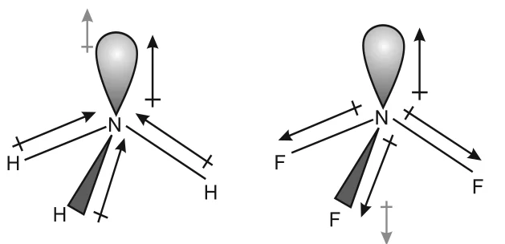

# [{ align=left, width=3.8% }](../../index.md)  Chemical Bonding | Polarity of Bonds and Dipole Moment

## Polarity of Bonds

* A 100% ionic or 100% covalent bond is an ideal situation. In reality, no bond or compound is completely ionic or completely covalent.
* When a covalent bond is formed between two **similar** atoms (H2, O2, Cl2, N2, F2), the shared pair is equally attracted by both atoms. It lies exactly between the two nuclei. Such a bond is a **non-polar covalent bond**.
* In a **heteronuclear** molecule like HF, the shared pair shifts towards fluorine, because the electronegativity of F is much greater than that of H. Such a bond is a **polar covalent bond**.

!!! tip ""

    $$\overset{\delta+}{H} - \overset{\delta-}{F}$$

## Dipole Moment

As a result of polarisation, the molecule possesses a dipole moment, which is defined as the product of the magnitude of the charge and the distance between the centres of positive and negative charge.

!!! tip ""

    $$Dipole\ moment\ (\mu) = Charge\ (Q) \times Distance\ of\ separation\ (r)$$

    $$1\ D = 3.33564 \times 10^{-30}\ C\ m$$

    Where, D = Debye, C = coulomb and m = metre.

* Dipole moment is usually expressed in **Debye (D)** units, named after Peter Debye.
* Dipole moment is a **vector quantity**. It is shown by a crossed arrow ($+\!\!\rightarrow$) above the Lewis structure, with the tail at the positive centre and the head pointing towards the negative centre. For HF, the arrow points from H to F.

### Dipole moment of polyatomic molecules

* In polyatomic molecules, the dipole moment depends on the individual **bond dipoles** and also on the **spatial arrangement** of the bonds.
* The dipole moment of the molecule is the **vector sum** of the bond dipoles.

#### 1. H2O

* H2O is bent, with the two O-H bonds at 104.5&deg;. The bond dipoles do not cancel and give a net dipole moment:

!!! tip ""

    $$\mu = 1.85\ D = 1.85 \times 3.33564 \times 10^{-30}\ C\ m = 6.17 \times 10^{-30}\ C\ m$$

#### 2. BeF2

* BeF2 is linear. The two equal Be-F bond dipoles point in opposite directions and cancel each other. So the dipole moment of BeF2 is **zero**.

#### 3. BF3

* BF3 is trigonal planar with B-F bonds at 120&deg;. The resultant of any two bond dipoles is equal and opposite to the third, so the net dipole moment is **zero**.

#### 4. NH3 and NF3

* Both are pyramidal with one lone pair on nitrogen. Even though F is more electronegative than N, the dipole moment of NH3 (4.90 &times; 10-30 C m) is much greater than that of NF3 (0.80 &times; 10-30 C m).
* In NH3, the N-H bond dipoles point towards N, in the **same direction** as the orbital dipole of the lone pair. They add up.
* In NF3, the N-F bond dipoles point away from N, **opposite** to the lone pair dipole. The lone pair dipole cancels part of the bond moments, giving a low dipole moment.

{loading=lazy}

### Dipole moments of some molecules

Type of Molecule | Example | Dipole Moment, &mu; (D) | Geometry |
-----------------|---------|-------------------------|----------|
AB | HF | 1.78 | linear |
AB | HCl | 1.07 | linear |
AB | HBr | 0.79 | linear |
AB | HI | 0.38 | linear |
AB | H2 | 0 | linear |
AB2 | H2O | 1.85 | bent |
AB2 | H2S | 0.95 | bent |
AB2 | CO2 | 0 | linear |
AB3 | NH3 | 1.47 | trigonal pyramidal |
AB3 | NF3 | 0.23 | trigonal pyramidal |
AB3 | BF3 | 0 | trigonal planar |
AB4 | CH4 | 0 | tetrahedral |
AB4 | CHCl3 | 1.04 | tetrahedral |
AB4 | CCl4 | 0 | tetrahedral |

!!! tip "Conclusion"

    Symmetrical molecules (linear AB2, trigonal planar AB3, tetrahedral AB4) with identical bonds have zero dipole moment. So dipole moment helps us predict the shape of molecules and the polarity of bonds.

## Fajans' Rules (Covalent Character of Ionic Bonds)

Just as all covalent bonds have some partial ionic character, ionic bonds also have partial covalent character. Fajans explained this with the following rules:

* **Size of ions:** The smaller the size of the cation and the larger the size of the anion, the greater is the covalent character of the ionic bond.
* **Charge on cation:** The greater the charge on the cation, the greater is the covalent character.
* **Electronic configuration of cation:** For cations of the same size and charge, a cation with configuration (n-1)dnns0 (typical of transition metals) is more polarising than one with a noble gas configuration ns2np6 (typical of alkali and alkaline earth metal cations).

* The cation **polarises** the anion: it pulls electron density of the anion towards itself, increasing electron density between the two nuclei. This is just what happens in a covalent bond.
* The polarising power of the cation, the polarisability of the anion and the extent of distortion of the anion decide the percentage covalent character of an ionic bond.

## Questions

!!! question "Although both CO2 and H2O are triatomic molecules, the shape of H2O is bent while that of CO2 is linear. Explain this on the basis of dipole moment."

    * CO2 has zero dipole moment. Since C=O bonds are polar, the two bond dipoles must be equal and opposite, which is possible only if the molecule is linear (O=C=O at 180&deg;).
    * H2O has a dipole moment of 1.85 D. The two O-H bond dipoles do not cancel, so the molecule must be bent (bond angle 104.5&deg;).

!!! question "Write the significance/applications of dipole moment."

    * It helps to decide whether a molecule is **polar or non-polar**.
    * It helps to predict the **shape** of molecules. Example: zero dipole moment of CO2 and BF3 shows they are linear and trigonal planar respectively.
    * It helps to find the **percentage ionic character** of a bond.
    * It helps to distinguish between cis and trans isomers; the cis isomer usually has a higher dipole moment.

!!! question "Explain with the help of a suitable example a polar covalent bond."

    * When a covalent bond is formed between two atoms with different electronegativities, the shared pair shifts towards the more electronegative atom.
    * Example: In HCl, chlorine is more electronegative than hydrogen. The shared pair lies closer to Cl, so Cl gets a partial negative charge (&delta;-) and H gets a partial positive charge (&delta;+). This bond is a polar covalent bond.

    $$\overset{\delta+}{H} - \overset{\delta-}{Cl}$$

!!! question "Define electronegativity. How does it differ from electron gain enthalpy?"

    * **Electronegativity** is the tendency of an atom in a chemical compound to attract the shared pair of electrons towards itself.
    * **Electron gain enthalpy** is the enthalpy change when an isolated gaseous atom accepts an electron.

    Electronegativity | Electron gain enthalpy |
    ------------------|------------------------|
    Property of a bonded atom | Property of an isolated atom |
    Relative number with no units | Measurable energy in kJ mol-1 |
    Relates to attraction for a shared pair | Relates to gain of an extra electron |

!!! question "Arrange the bonds in order of increasing ionic character in the molecules: LiF, K2O, N2, SO2 and ClF3."

    * Ionic character increases with increase in electronegativity difference between the bonded atoms. N2 has zero difference, and K-O has the largest difference.

    $$N_2 < SO_2 < ClF_3 < LiF < K_2O$$

!!! question "Explain why BeH2 molecule has a zero dipole moment although the Be-H bonds are polar."

    * BeH2 is a linear molecule (H-Be-H, 180&deg;).
    * The two Be-H bond dipoles are equal in magnitude and opposite in direction, so they cancel each other. Hence the net dipole moment is zero.

!!! question "Which out of NH3 and NF3 has higher dipole moment and why?"

    * NH3 has the higher dipole moment.
    * In NH3, the lone pair dipole on N and the resultant of the N-H bond dipoles are in the same direction, so they add up.
    * In NF3, the N-F bond dipoles point towards F, opposite to the lone pair dipole, so they partly cancel.
