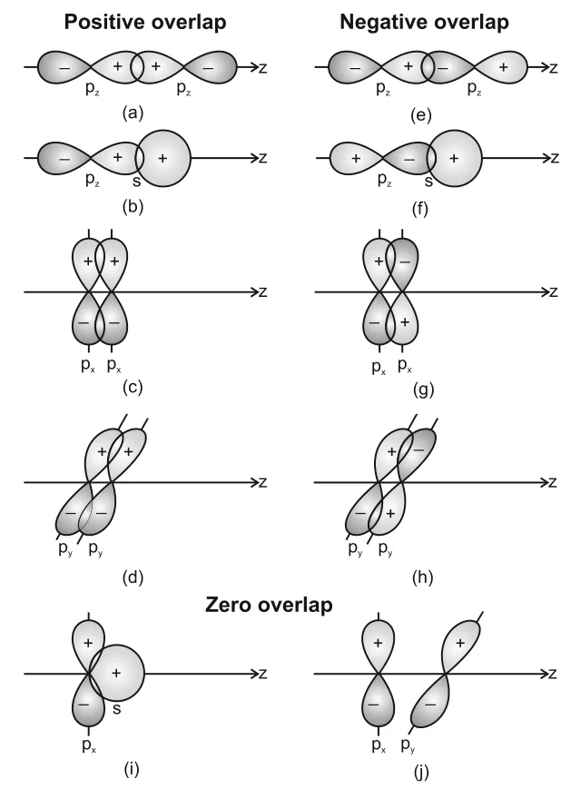

# [{ align=left, width=3.8% }](../../index.md)  Chemical Bonding | Valence Bond Theory

Valence bond theory explains the formation of a covalent bond in terms of the overlap of half-filled atomic orbitals of the bonding atoms, with pairing of electrons of opposite spins.

* The Lewis approach helps to write structures but does not explain how a bond forms. It also cannot explain why H2 (435.8 kJ mol-1, 74 pm) and F2 (150.6 kJ mol-1, 144 pm) differ in bond enthalpy and bond length, even though both have a single bond.
* VSEPR theory predicts shapes but does not explain them theoretically.
* To overcome these limitations, two quantum mechanical theories were introduced: **Valence Bond (VB) theory** and **Molecular Orbital (MO) theory**.
* VB theory was introduced by Heitler and London (1927) and developed further by Pauling and others.

## Formation of the Hydrogen Molecule

* Consider two hydrogen atoms A and B with nuclei NA, NB and electrons eA, eB.
* When they are far apart, there is no interaction. As they approach each other, new attractive and repulsive forces begin to act.

#### Attractive forces

* Between the nucleus of an atom and its own electron: NA-eA and NB-eB.
* Between the nucleus of one atom and the electron of the other: NA-eB and NB-eA.

#### Repulsive forces

* Between the electrons of the two atoms: eA-eB.
* Between the nuclei of the two atoms: NA-NB.

* Experimentally, the new attractive forces are stronger than the new repulsive forces. So as the atoms come closer, the potential energy **decreases**.
* At a certain distance, attraction balances repulsion and the system reaches **minimum energy**. The two H atoms are now bonded, with a bond length of 74 pm.
* The energy released when the bond forms is the **bond enthalpy**. Conversely, 435.8 kJ is needed to dissociate one mole of H2:

!!! tip ""

    $$H_{2(g)} + 435.8\ kJ\ mol^{-1} &rarr; H_{(g)} + H_{(g)}$$

* If the nuclei are brought still closer than 74 pm, the energy rises sharply and the molecule becomes unstable.

## Orbital Overlap Concept

* When two H atoms are close enough at the minimum energy state, their atomic orbitals partially interpenetrate. This partial merging of atomic orbitals is called **overlapping** of atomic orbitals, and it results in pairing of electrons.
* The extent of overlap decides the strength of a covalent bond. **Greater the overlap, stronger the bond.**

!!! tip "Conclusion"

    According to the orbital overlap concept, a covalent bond is formed by pairing of electrons of opposite spins present in half-filled valence shell orbitals of the two atoms.

## Directional Properties of Bonds

* In polyatomic molecules like CH4, NH3 and H2O, the shape of the molecule is also important. VB theory explains shapes using overlap and **hybridisation** of atomic orbitals.
* Overlap of orbitals can be **positive** (same sign of lobes overlapping, forms a bond), **negative** (opposite signs, no bond) or **zero** (orbitals perpendicular, no net overlap).

{loading=lazy}

### Why simple overlap cannot explain the shape of CH4

* Carbon in its ground state is [He]2s22p2, and in the excited state [He]2s12px12py12pz1. The energy for this excitation is compensated by the energy released on bond formation.
* These four half-filled orbitals can overlap with the 1s orbitals of four H atoms to form four C-H bonds.
* But the three p orbitals are at 90&deg; to each other, so three H-C-H angles would be 90&deg;. The 2s orbital is spherical, so the direction of the fourth bond cannot be fixed.
* This does not fit the actual tetrahedral angle of 109.5&deg;. Similarly, simple overlap predicts 90&deg; for NH3 and H2O, while the actual angles are 107&deg; and 104.5&deg;. This problem is solved by hybridisation.

## Types of Overlapping: Sigma and Pi Bonds

### 1. Sigma (&sigma;) Bond

A sigma bond is formed by the end to end (head-on) overlap of bonding orbitals along the internuclear axis. It is also called **axial overlap**.

* **s-s overlap:** Two half-filled s orbitals overlap along the internuclear axis. Example: H2.
* **s-p overlap:** A half-filled s orbital of one atom overlaps with a half-filled p orbital of another atom. Example: HF, HCl.
* **p-p overlap:** Half-filled p orbitals of two atoms overlap end to end. Example: Cl2, F2.

### 2. Pi (&pi;) Bond

A pi bond is formed when the atomic orbitals overlap sideways, with their axes parallel to each other and perpendicular to the internuclear axis.

* The pi bond consists of two saucer-shaped charge clouds, above and below the plane of the participating atoms.

### Strength of Sigma and Pi Bonds

* In a sigma bond, orbitals overlap to a larger extent. In a pi bond, overlap is smaller.
* So a **sigma bond is stronger than a pi bond**.
* A pi bond between two atoms is always formed **in addition to** a sigma bond. It is present in molecules with double or triple bonds.

Sigma (&sigma;) bond | Pi (&pi;) bond |
---------------------|----------------|
Formed by axial (head-on) overlap | Formed by sideways overlap |
Can form from s-s, s-p, p-p or hybrid orbitals | Forms only from unhybridised p (or d) orbitals |
Overlap is large, so bond is strong | Overlap is small, so bond is weaker |
Electron density lies along the internuclear axis | Electron density lies above and below the internuclear axis |
Can exist alone (single bond) | Always exists along with a sigma bond |
Free rotation about the bond is possible | Free rotation is restricted |

## Questions

!!! question "Explain the formation of H2 molecule on the basis of valence bond theory."

    * As two H atoms approach each other, the attraction between each nucleus and the electron of the other atom increases, along with nucleus-nucleus and electron-electron repulsion.
    * Since the new attractive forces are greater than the repulsive forces, the energy of the system decreases.
    * At an internuclear distance of 74 pm, the energy is minimum (435.8 kJ mol-1 lower than the separate atoms). Here the 1s orbitals overlap and the two electrons of opposite spin pair up to form the H-H sigma bond.

!!! question "Considering x-axis as the internuclear axis, which of the following will not form a sigma bond and why? (a) 1s and 1s (b) 1s and 2px (c) 2py and 2py (d) 1s and 2s."

    * (c) 2py and 2py will not form a sigma bond.
    * With x as the internuclear axis, the 2py orbitals are perpendicular to the axis. They can only overlap sideways and form a pi bond.
    * The pairs (a), (b) and (d) can overlap along the x-axis and form sigma bonds.

!!! question "What do you understand by bond pairs and lone pairs of electrons? Illustrate by giving one example of each type."

    * **Bond pair:** An electron pair shared between two atoms in a covalent bond. Example: each O-H bond in H2O has one bond pair.
    * **Lone pair:** A valence electron pair on an atom that is not shared in bonding. Example: O in H2O has two lone pairs and N in NH3 has one lone pair.
