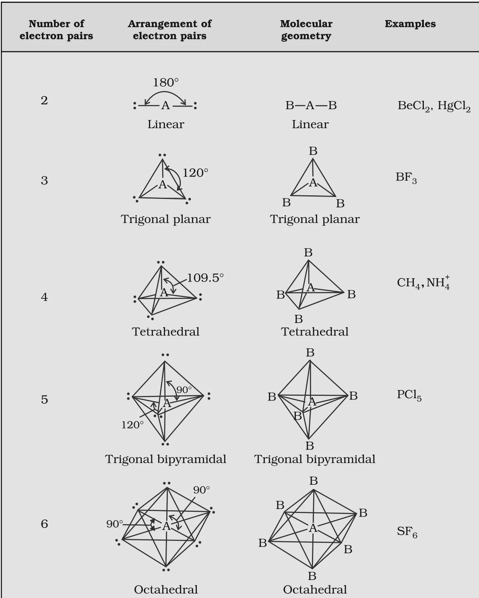

# [{ align=left, width=3.8% }](../../index.md)  Chemical Bonding | VSEPR Theory

The Valence Shell Electron Pair Repulsion (VSEPR) theory predicts the shapes of covalent molecules from the repulsions between electron pairs in the valence shell of the central atom.

* The Lewis concept cannot explain the shapes of molecules. VSEPR theory gives a simple way to predict them.
* It was proposed by Sidgwick and Powell (1940) and further developed by Nyholm and Gillespie (1957).

## Postulates of VSEPR Theory

* The shape of a molecule depends on the number of valence shell electron pairs (bonded or non-bonded) around the central atom.
* Electron pairs in the valence shell repel one another because their electron clouds are negatively charged.
* These electron pairs occupy positions in space that minimise repulsion and so maximise the distance between them.
* The valence shell is taken as a sphere, with the electron pairs placed on its surface at maximum distance from one another.
* A **multiple bond** is treated as if it were a single electron pair. The two or three electron pairs of a multiple bond act as a single **super pair**.
* Where two or more resonance structures can represent a molecule, VSEPR applies to any of them.

### Order of repulsion

!!! tip ""

    $$lone\ pair\ (lp) - lone\ pair\ (lp) > lone\ pair\ (lp) - bond\ pair\ (bp) > bond\ pair\ (bp) - bond\ pair\ (bp)$$

* A lone pair is localised on the central atom, while a bond pair is shared between two atoms.
* So a lone pair occupies **more space** than a bond pair. This causes greater repulsion involving lone pairs, which distorts the ideal shape and changes bond angles.

## Molecules with No Lone Pair on the Central Atom

* For molecules of type ABx (A = central atom, B = surrounding atoms), the shape is the same as the arrangement of electron pairs.

Number of electron pairs | Arrangement / Geometry | Bond angle | Examples |
-------------------------|------------------------|------------|----------|
2 | Linear | 180&deg; | BeCl2, HgCl2 |
3 | Trigonal planar | 120&deg; | BF3 |
4 | Tetrahedral | 109.5&deg; | CH4, NH4+ |
5 | Trigonal bipyramidal | 120&deg; and 90&deg; | PCl5 |
6 | Octahedral | 90&deg; | SF6 |

{loading=lazy}

## Molecules with Lone Pairs on the Central Atom

* For molecules of type ABxEy (E = lone pair), the arrangement of electron pairs is decided by the total number of pairs, but the **shape** is described by the positions of the atoms only.

Molecule type | Bond pairs | Lone pairs | Arrangement of electron pairs | Shape | Examples |
--------------|------------|------------|-------------------------------|-------|----------|
AB2E | 2 | 1 | Trigonal planar | Bent | SO2, O3 |
AB3E | 3 | 1 | Tetrahedral | Trigonal pyramidal | NH3 |
AB2E2 | 2 | 2 | Tetrahedral | Bent | H2O |
AB4E | 4 | 1 | Trigonal bipyramidal | See-saw | SF4 |
AB3E2 | 3 | 2 | Trigonal bipyramidal | T-shape | ClF3 |
AB5E | 5 | 1 | Octahedral | Square pyramid | BrF5 |
AB4E2 | 4 | 2 | Octahedral | Square planar | XeF4 |

## Reasons for the Distorted Shapes

### 1. SO2 (AB2E)

* With three electron "pairs" (two S=O super pairs and one lone pair), the shape should be trigonal planar with 120&deg; angles.
* Because lp-bp repulsion is greater than bp-bp repulsion, the O-S-O angle reduces to 119.5&deg; and the molecule is **bent (V-shaped)**.

### 2. NH3 (AB3E)

* With four electron pairs, NH3 would be tetrahedral if all were bond pairs.
* The one lone pair repels the bond pairs more strongly, so the H-N-H angle reduces from 109.5&deg; to 107&deg; and the shape is **trigonal pyramidal**.

### 3. H2O (AB2E2)

* With two lone pairs and two bond pairs, the arrangement is tetrahedral.
* Since lp-lp > lp-bp > bp-bp, the H-O-H angle reduces from 109.5&deg; to 104.5&deg;. The shape is **bent (angular)**, a distorted tetrahedron.

### 4. SF4 (AB4E)

* The five electron pairs have a trigonal bipyramidal arrangement. The lone pair can sit at an **axial** or an **equatorial** position.
* At an axial position, the lone pair has three lp-bp repulsions at 90&deg;. At an equatorial position, it has only two lp-bp repulsions at 90&deg;.
* So the lone pair takes the equatorial position. The shape is a distorted tetrahedron, also called a folded square or **see-saw**.

### 5. ClF3 (AB3E2)

* The five electron pairs again have a trigonal bipyramidal arrangement.
* When both lone pairs are at equatorial positions, there are the fewest lp-lp and lp-bp repulsions at 90&deg;. So this arrangement is the most stable, and the shape is **T-shaped**.

!!! note "Note"

    VSEPR theory predicts the geometry of a large number of molecules, especially compounds of p-block elements, quite accurately, even when the energy difference between possible structures is very small. However, its theoretical basis is still a subject of discussion.

## Questions

!!! question "Discuss the shape of the following molecules using the VSEPR model: BeCl2, BCl3, SiCl4, AsF5, H2S, PH3."

    Molecule | Bond pairs | Lone pairs | Type | Shape |
    ---------|------------|------------|------|-------|
    BeCl2 | 2 | 0 | AB2 | Linear (180&deg;) |
    BCl3 | 3 | 0 | AB3 | Trigonal planar (120&deg;) |
    SiCl4 | 4 | 0 | AB4 | Tetrahedral (109.5&deg;) |
    AsF5 | 5 | 0 | AB5 | Trigonal bipyramidal |
    H2S | 2 | 2 | AB2E2 | Bent |
    PH3 | 3 | 1 | AB3E | Trigonal pyramidal |

    * Be, B, Si and As use all their valence electrons in bonding, so there is no lone pair and the shape matches the electron pair arrangement.
    * S in H2S has 6 valence electrons: 2 bond pairs and 2 lone pairs. P in PH3 has 5 valence electrons: 3 bond pairs and 1 lone pair. The lone pairs distort the tetrahedral arrangement.

!!! question "Although geometries of NH3 and H2O molecules are distorted tetrahedral, bond angle in water is less than that of ammonia. Discuss."

    * In NH3, N has 3 bond pairs and 1 lone pair. The lp-bp repulsion reduces the angle from 109.5&deg; to 107&deg;.
    * In H2O, O has 2 bond pairs and 2 lone pairs. Now there is lp-lp repulsion as well, which is the strongest repulsion.
    * The two lone pairs push the bond pairs closer together, so the angle reduces further to 104.5&deg;.

!!! question "Apart from tetrahedral geometry, another possible geometry for CH4 is square planar with the four H atoms at the corners of the square and the C atom at its centre. Explain why CH4 is not square planar."

    * In a square planar arrangement, the H-C-H bond angle would be 90&deg;. In a tetrahedral arrangement it is 109.5&deg;.
    * The four bond pairs are farther apart in the tetrahedral arrangement, so repulsion between them is less and the molecule is more stable.
    * Also, carbon in CH4 is sp3 hybridised, and sp3 hybrid orbitals point towards the corners of a tetrahedron. Square planar geometry would need dsp2 hybridisation, which is not possible for carbon as it has no d orbitals.
