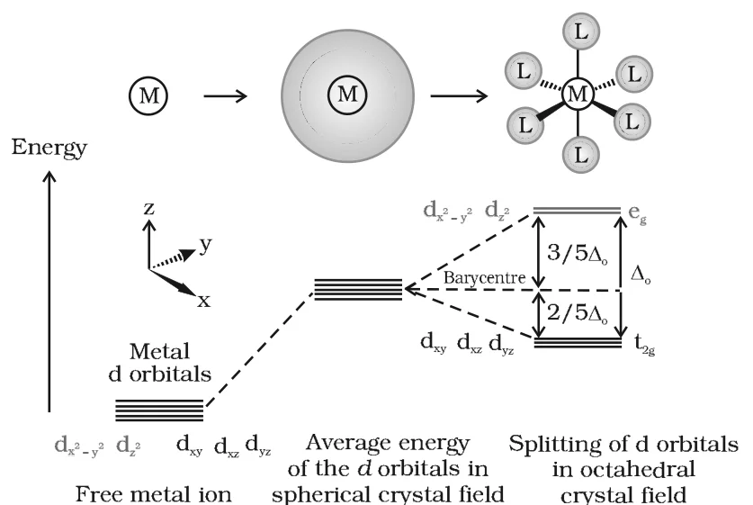
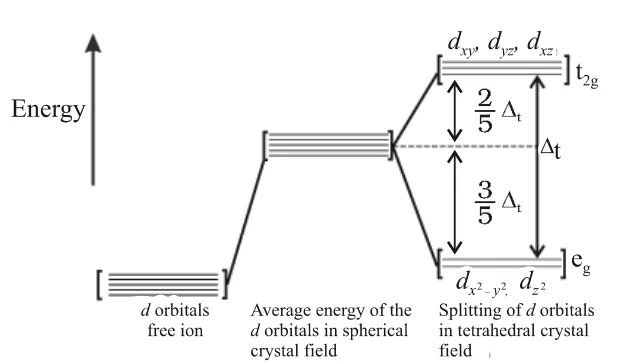

# [{ align=left, width=3.8% }](../../index.md)  Coordination Compounds | Crystal Field Theory

The crystal field theory (CFT) is an electrostatic model which considers the metal-ligand bond to be ionic, arising purely from electrostatic interactions between the metal ion and the ligand.

## Basic Idea of Crystal Field Theory

* Ligands are treated as **point charges** (if they are anions) or **dipoles** (if they are neutral molecules).
* The five d orbitals of an isolated gaseous metal atom/ion have the same energy, i.e., they are **degenerate**.
* This degeneracy is kept if a spherically symmetrical field of negative charges surrounds the metal ion.
* When the negative field is due to ligands (anions or negative ends of dipoles like NH3 and H2O), it becomes asymmetrical and the degeneracy of the d orbitals is lifted. The d orbitals split into groups of different energy.
* The pattern of splitting depends on the nature (geometry) of the crystal field.

## Crystal Field Splitting in Octahedral Complexes

* In an octahedral complex, six ligands approach the metal ion along the x, y and z axes.
* The electrons in the metal d orbitals are repelled by the electrons (negative charges) of the ligands. This repulsion is more when the d orbital points towards the ligands.
* The dx2-y2 and dz2 orbitals point along the axes, towards the ligands. They experience more repulsion and are **raised in energy**. This set of two orbitals is called the **eg set**.
* The dxy, dyz and dxz orbitals point between the axes. They are **lowered in energy** relative to the average energy in a spherical field. This set of three orbitals is called the **t2g set**.

{loading=lazy}

* The splitting of the degenerate levels due to ligands in a definite geometry is called **crystal field splitting**. The energy separation is denoted by **&Delta;o** (o for octahedral).
* The average energy (barycentre) is kept the same:

!!! tip ""

    $$Energy\ of\ e_g\ orbitals = +{3 \over 5}&Delta;_o = +0.6&Delta;_o$$

    $$Energy\ of\ t_{2g}\ orbitals = -{2 \over 5}&Delta;_o = -0.4&Delta;_o$$

    $$2(+0.6&Delta;_o) + 3(-0.4&Delta;_o) = 0$$

* The magnitude of &Delta;o depends on the field produced by the ligand and the charge on the metal ion. Strong field ligands produce a large splitting; weak field ligands produce a small splitting.

## Spectrochemical Series

The ligands arranged in order of increasing field strength (increasing &Delta;o) form the **spectrochemical series**. It is an experimentally determined series, based on the absorption of light by complexes with different ligands.

!!! tip ""

    $$I^- < Br^- < SCN^- < Cl^- < S^{2-} < F^- < OH^- < C_2O_4^{2-} < H_2O$$

    $$< NCS^- < edta^{4-} < NH_3 < en < CN^- < CO$$

* Ligands at the left end (I-, Br-, Cl-, F-) are **weak field ligands**.
* Ligands at the right end (en, CN-, CO) are **strong field ligands**.

## Filling of Electrons: High Spin and Low Spin Complexes

* In d1, d2 and d3 ions, electrons occupy the t2g orbitals singly, according to Hund's rule.
* For a d4 ion, there are two choices for the fourth electron:
    1. Enter the t2g level and pair with an existing electron. This costs the **pairing energy, P** (energy required for pairing electrons in a single orbital).
    2. Avoid pairing by entering the higher eg level. This costs energy &Delta;o.
* Which one occurs depends on the relative magnitudes of &Delta;o and P:

!!! tip ""

    $$If\ &Delta;_o < P:\ t_{2g}^3 e_g^1\ (weak\ field\ ligand,\ high\ spin\ complex)$$

    $$If\ &Delta;_o > P:\ t_{2g}^4 e_g^0\ (strong\ field\ ligand,\ low\ spin\ complex)$$

* Calculations show that d4 to d7 coordination entities are more stable for the strong field case than the weak field case.

d electrons | Weak field (&Delta;o < P), high spin | Unpaired | Strong field (&Delta;o > P), low spin | Unpaired
------------|--------------------------|---|--------------------------|---
d1 | t2g1 | 1 | t2g1 | 1
d2 | t2g2 | 2 | t2g2 | 2
d3 | t2g3 | 3 | t2g3 | 3
d4 | t2g3eg1 | 4 | t2g4 | 2
d5 | t2g3eg2 | 5 | t2g5 | 1
d6 | t2g4eg2 | 4 | t2g6 | 0
d7 | t2g5eg2 | 3 | t2g6eg1 | 1
d8 | t2g6eg2 | 2 | t2g6eg2 | 2
d9 | t2g6eg3 | 1 | t2g6eg3 | 1
d10 | t2g6eg4 | 0 | t2g6eg4 | 0

!!! note "Note"

    High spin and low spin arrangements differ only for d4 to d7 ions. For d1-d3 and d8-d10, both fields give the same arrangement.

* The energy gained by the electrons due to splitting is called the **crystal field stabilisation energy (CFSE)**. For an octahedral complex:

!!! tip ""

    $$CFSE = (-0.4\ n_{t_{2g}} + 0.6\ n_{e_g})&Delta;_o + (number\ of\ extra\ pairs)P$$

## Crystal Field Splitting in Tetrahedral Complexes

* In tetrahedral complexes, the d orbital splitting is **inverted** compared with octahedral splitting. The e set (dx2-y2, dz2) is lower and the t2 set (dxy, dyz, dxz) is higher in energy.
* The splitting is smaller than in octahedral complexes. For the same metal, same ligands and same metal-ligand distances:

!!! tip ""

    $$&Delta;_t = {4 \over 9}&Delta;_o$$

{loading=lazy}

* Since &Delta;t is small, it is usually less than the pairing energy. Therefore, **low spin tetrahedral complexes are rarely observed**.

## Colour in Coordination Compounds

* Transition metal complexes show a wide range of colours. When white light passes through a complex, some part of the visible spectrum is absorbed.
* The colour of the complex is **complementary** to the colour absorbed. For example, if green light is absorbed, the complex appears red.

Coordination entity | Wavelength absorbed (nm) | Colour of light absorbed | Colour of complex
--------------------|--------------------------|--------------------------|------------------
[CoCl(NH3)5]2+ | 535 | Yellow | Violet
[Co(NH3)5(H2O)]3+ | 500 | Blue green | Red
[Co(NH3)6]3+ | 475 | Blue | Yellow orange
[Co(CN)6]3- | 310 | Ultraviolet | Pale yellow
[Cu(H2O)4]2+ | 600 | Red | Blue
[Ti(H2O)6]3+ | 498 | Blue green | Purple

### Explanation by CFT: d-d transition

* Consider [Ti(H2O)6]3+, which is violet. It is octahedral and Ti3+ is a 3d1 system.
* In the ground state, the single electron is in the t2g level. The next higher level available is the empty eg level.
* When light of the yellow-green region is absorbed, the electron is excited from t2g to eg:

!!! tip ""

    $$t_{2g}^1 e_g^0 \xrightarrow{h&nu;} t_{2g}^0 e_g^1$$

* Hence, the complex appears violet. CFT attributes the colour of coordination compounds to this **d-d transition** of electrons.
* In the absence of ligands, crystal field splitting does not occur and the substance is colourless:
    * Removing water from [Ti(H2O)6]Cl3 by heating makes it colourless.
    * Anhydrous CuSO4 is white, but CuSO4.5H2O is blue.

### Effect of ligand on colour

* When ethane-1,2-diamine (en) is gradually added to a green solution of [Ni(H2O)6]2+ in en:Ni ratios 1:1, 2:1 and 3:1, water is replaced step by step and the colour changes:

!!! tip ""

    $$[Ni(H_2O)_6]^{2+}_{(aq)}\ (green) + en &rarr; [Ni(H_2O)_4(en)]^{2+}_{(aq)}\ (pale\ blue) + 2H_2O$$

    $$[Ni(H_2O)_4(en)]^{2+}_{(aq)} + en &rarr; [Ni(H_2O)_2(en)_2]^{2+}_{(aq)}\ (blue/purple) + 2H_2O$$

    $$[Ni(H_2O)_2(en)_2]^{2+}_{(aq)} + en &rarr; [Ni(en)_3]^{2+}_{(aq)}\ (violet) + 2H_2O$$

* en is a stronger field ligand than H2O. As more en is attached, &Delta;o increases, so light of higher energy (shorter wavelength) is absorbed and the observed colour changes.

### Colour of some gem stones

* **Ruby** is aluminium oxide (Al2O3) containing about 0.5-1% Cr3+ ions (d3) randomly placed at positions normally occupied by Al3+. These are octahedral chromium(III) complexes in the alumina lattice, and d-d transitions at these centres give the colour.
* In **emerald**, Cr3+ ions occupy octahedral sites in the mineral beryl (Be3Al2Si6O18). The absorption bands are shifted to longer wavelengths (yellow-red and blue) compared to ruby, so emerald transmits light in the green region.

## Limitations of Crystal Field Theory

* CFT explains the formation, structures, colour and magnetic properties of coordination compounds to a large extent. However:
    1. If ligands are point charges, anionic ligands should exert the greatest splitting. But anionic ligands are actually found at the **low end** of the spectrochemical series.
    2. It does not take into account the **covalent character** of the bonding between the ligand and the central atom.
* These weaknesses are explained by ligand field theory (LFT) and molecular orbital theory.

## Questions

!!! question "The hexaquo manganese(II) ion contains five unpaired electrons, while the hexacyano ion contains only one unpaired electron. Explain using Crystal Field Theory."

    Mn2+ has the configuration 3d5.

    * H2O is a weak field ligand (&Delta;o < P). The electrons do not pair and the configuration is t2g3eg2, giving **five** unpaired electrons (high spin).

    * CN- is a strong field ligand (&Delta;o > P). The electrons pair up in t2g and the configuration is t2g5eg0, giving only **one** unpaired electron (low spin).

!!! question "What is crystal field splitting energy? How does the magnitude of &Delta;o decide the actual configuration of d orbitals in a coordination entity?"

    * When ligands approach the metal ion, the degenerate d orbitals split into two sets of different energy. The energy difference between the two sets (t2g and eg in an octahedral field) is called the crystal field splitting energy, &Delta;o.

    * If &Delta;o < P (weak field ligand), electrons enter the eg orbitals before pairing, giving a high spin configuration (e.g. d4: t2g3eg1).

    * If &Delta;o > P (strong field ligand), electrons pair in the t2g orbitals first, giving a low spin configuration (e.g. d4: t2g4eg0).

!!! question "What is spectrochemical series? Explain the difference between a weak field ligand and a strong field ligand."

    The arrangement of ligands in order of increasing crystal field splitting (field strength) is called the spectrochemical series:

    $$I^- < Br^- < SCN^- < Cl^- < S^{2-} < F^- < OH^- < C_2O_4^{2-} < H_2O < NCS^- < edta^{4-} < NH_3 < en < CN^- < CO$$

    * **Weak field ligand:** Produces small splitting, &Delta;o < P. Forms high spin complexes. Examples: Cl-, F-.

    * **Strong field ligand:** Produces large splitting, &Delta;o > P. Forms low spin complexes. Examples: CN-, CO.

!!! question "A solution of [Ni(H2O)6]2+ is green but a solution of [Ni(CN)4]2- is colourless. Explain."

    * In [Ni(H2O)6]2+, Ni2+ (3d8) has two unpaired electrons with weak field H2O. A d-d transition absorbs red light and the complementary colour, green, is seen.

    * In [Ni(CN)4]2-, CN- is a strong field ligand. All electrons are paired (square planar, dsp2) and the splitting is large, so no d-d transition occurs in the visible region. Hence the solution is colourless.

!!! question "[Fe(CN)6]4- and [Fe(H2O)6]2+ are of different colours in dilute solutions. Why?"

    In both, Fe is in the +2 state (3d6). But CN- is a strong field ligand and H2O is a weak field ligand, so the magnitudes of &Delta;o are different. The complexes therefore absorb light of different wavelengths in the d-d transition and show different (complementary) colours.

!!! question "What will be the correct order for the wavelengths of absorption in the visible region for the following: [Ni(NO2)6]4-, [Ni(NH3)6]2+, [Ni(H2O)6]2+?"

    * The order of field strength of the ligands is NO2- > NH3 > H2O, so &Delta;o follows the same order.

    * Energy absorbed is inversely proportional to wavelength:

    $$E = {hc \over &lambda;}\ &rArr;\ &lambda; &Proportional; {1 \over &Delta;_o}$$

    Hence, the order of wavelength of absorption is:

    $$[Ni(H_2O)_6]^{2+} > [Ni(NH_3)_6]^{2+} > [Ni(NO_2)_6]^{4-}$$

!!! question "Calculate the CFSE (in terms of &Delta;o) and the spin-only magnetic moment of [Co(NH3)6]3+ (low spin) and [CoF6]3- (high spin)."

    Co3+ is 3d6.

    * **[Co(NH3)6]3+:** t2g6eg0, n = 0

    $$CFSE = 6(-0.4&Delta;_o) = -2.4&Delta;_o\ (+\ pairing\ energy)$$

    $$&mu; = 0\ BM\ (diamagnetic)$$

    * **[CoF6]3-:** t2g4eg2, n = 4

    $$CFSE = 4(-0.4&Delta;_o) + 2(0.6&Delta;_o) = -0.4&Delta;_o$$

    $$&mu; = \sqrt{4(4+2)} = 4.90\ BM$$
