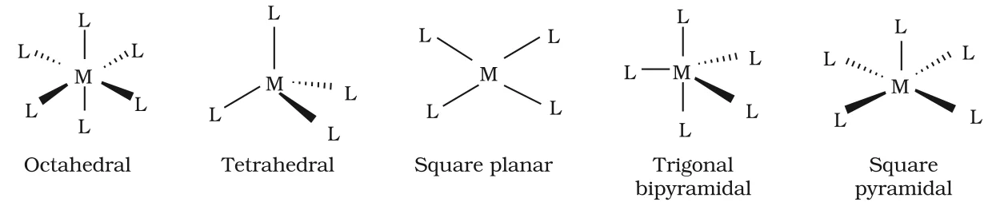

# [{ align=left, width=3.8% }](../../index.md)  Coordination Compounds | Important Terms

In this article, we will discuss the important terms used in coordination chemistry like coordination entity, ligand, denticity, coordination number and oxidation number.

## 1. Coordination Entity

* A coordination entity constitutes a central metal atom or ion bonded to a fixed number of ions or molecules.
* Example: In [CoCl3(NH3)3], the cobalt ion is surrounded by three ammonia molecules and three chloride ions.
* Other examples: [Ni(CO)4], [PtCl2(NH3)2], [Fe(CN)6]4-, [Co(NH3)6]3+.

## 2. Central Atom/Ion

* The atom or ion to which a fixed number of ions/groups are bound in a definite geometrical arrangement is called the central atom or ion.
* Example: The central atoms/ions in [NiCl2(H2O)4], [CoCl(NH3)5]2+ and [Fe(CN)6]3- are Ni2+, Co3+ and Fe3+ respectively.
* The central atom accepts electron pairs from the ligands. Hence, central atoms/ions are also called **Lewis acids**.

## 3. Ligands

* The ions or molecules bound to the central atom/ion in a coordination entity are called ligands.
* Ligands can be simple ions (Cl-), small molecules (H2O, NH3), larger molecules (H2NCH2CH2NH2, N(CH2CH2NH2)3) or even macromolecules such as proteins.
* Ligands donate electron pairs to the metal, so they act as Lewis bases.

### Classification of ligands based on number of donor atoms

#### (a) Unidentate ligands

* A ligand bound to the metal through a single donor atom is called a unidentate ligand.
* Examples: Cl-, H2O, NH3.

#### (b) Didentate ligands

* A ligand which binds through two donor atoms is called a didentate ligand.
* Examples: H2NCH2CH2NH2 (ethane-1,2-diamine, 'en') binds through two N atoms; C2O42- (oxalate, 'ox') binds through two O atoms.

#### (c) Polydentate ligands

* A ligand with several donor atoms is called a polydentate ligand.
* Example: N(CH2CH2NH2)3 has four N donor atoms.
* Ethylenediaminetetraacetate ion (EDTA4-) is an important **hexadentate** ligand. It binds to a metal ion through two nitrogen atoms and four oxygen atoms.

!!! tip ""

    $$EDTA^{4-}:\ (^-OOCCH_2)_2N-CH_2-CH_2-N(CH_2COO^-)_2$$

### Denticity and Chelate Ligands

* The number of donor (ligating) groups in a ligand is called its **denticity**. Example: denticity of NH3 = 1, en = 2, EDTA4- = 6.
* When a di- or polydentate ligand uses two or more donor atoms to bind a single metal ion, it is called a **chelate ligand**.
* The ring formed by a chelate ligand and the metal is called a chelate ring.
* Chelate complexes are more stable than similar complexes containing unidentate ligands. This extra stability is called the **chelate effect**.

### Ambidentate Ligands

* A ligand which can bind through two different donor atoms (but only one at a time) is called an ambidentate ligand.
* Examples: NO2- and SCN-.

Ligand              | Binding atom | Linkage  | Name
--------------------|--------------|----------|-------------
NO2- | N     | M &larr; NO2 | nitrito-N
NO2- | O     | M &larr; ONO | nitrito-O
SCN-     | S            | M &larr; SCN | thiocyanato
SCN-     | N            | M &larr; NCS | isothiocyanato

## 4. Coordination Number

* The coordination number (CN) of a metal ion in a complex is the number of ligand donor atoms to which the metal is directly bonded.
* The coordination number is determined only by the number of **sigma bonds** formed between the ligands and the central atom. Pi bonds, if present, are not counted.

!!! example "Examples"

    * In [PtCl6]2-, CN of Pt = 6

    * In [Ni(NH3)4]2+, CN of Ni = 4

    * In [Fe(C2O4)3]3- and [Co(en)3]3+, CN of Fe and Co is 6, because C2O42- and en are didentate ligands (3 &times; 2 = 6).

!!! tip ""

    $$Coordination\ number = \sum (Number\ of\ ligands \times Denticity)$$

## 5. Coordination Sphere

* The central atom/ion and the ligands attached to it are enclosed in a square bracket. This is collectively called the **coordination sphere**.
* The ionisable groups written outside the bracket are called **counter ions**.
* Example: In K4[Fe(CN)6], the coordination sphere is [Fe(CN)6]4- and the counter ion is K+.

## 6. Coordination Polyhedron

* The spatial arrangement of the ligand atoms directly attached to the central atom/ion defines a coordination polyhedron.
* The most common coordination polyhedra are octahedral, square planar and tetrahedral.
* Examples: [Co(NH3)6]3+ is octahedral, [Ni(CO)4] is tetrahedral and [PtCl4]2- is square planar.

{loading=lazy}

Here, M represents the central atom/ion and L a unidentate ligand.

## 7. Oxidation Number of Central Atom

* The oxidation number of the central atom is the charge it would carry if all the ligands were removed along with the electron pairs they share with the central atom.
* It is written as a Roman numeral in parentheses after the name of the coordination entity.
* Example: The oxidation number of copper in [Cu(CN)4]3- is +1, written as Cu(I).
* To calculate it, equate the sum of the charges on the metal and the ligands to the charge on the complex.

!!! example "Example"

    Oxidation number of Cu in [Cu(CN)4]3-:

    $$x + 4(-1) = -3$$

    $$x = +1$$

    Oxidation number of Fe in K3[Fe(C2O4)3]:

    $$3(+1) + x + 3(-2) = 0$$

    $$x = +3$$

## 8. Homoleptic and Heteroleptic Complexes

* **Homoleptic complexes:** The metal is bound to only one kind of donor group. Example: [Co(NH3)6]3+.
* **Heteroleptic complexes:** The metal is bound to more than one kind of donor group. Example: [Co(NH3)4Cl2]+.

## Questions

!!! question "Specify the oxidation numbers of the metals in the following coordination entities:  (i) [Co(H2O)(CN)(en)2]2+ (ii) [CoBr2(en)2]+ (iii) [PtCl4]2- (iv) K3[Fe(CN)6] (v) [Cr(NH3)3Cl3]"

    H2O, en and NH3 are neutral; CN-, Br- and Cl- carry -1 charge.

    $$(i)\ x + 0 + (-1) + 0 = +2,\ x = +3$$

    $$(ii)\ x + 2(-1) + 0 = +1,\ x = +3$$

    $$(iii)\ x + 4(-1) = -2,\ x = +2$$

    $$(iv)\ 3(+1) + x + 6(-1) = 0,\ x = +3$$

    $$(v)\ x + 0 + 3(-1) = 0,\ x = +3$$

!!! question "What is meant by unidentate, didentate and ambidentate ligands? Give two examples of each."

    * **Unidentate:** Ligand binding through a single donor atom. Examples: NH3, Cl-.

    * **Didentate:** Ligand binding through two donor atoms. Examples: ethane-1,2-diamine (en), oxalate (C2O42-).

    * **Ambidentate:** Ligand which can bind through either of two different donor atoms. Examples: NO2- (through N or O), SCN- (through S or N).

!!! question "Find the coordination number and denticity of each ligand in [Co(en)2Cl2]+."

    Denticity of en = 2 and denticity of Cl- = 1.

    $$CN = 2 \times 2 + 2 \times 1 = 6$$

    It is a heteroleptic complex with coordination number 6 (octahedral).
