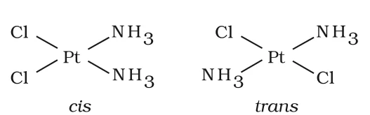
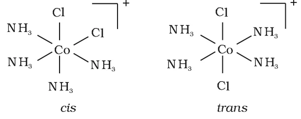
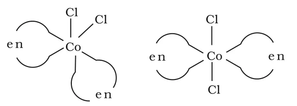
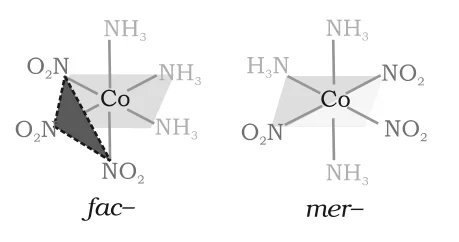
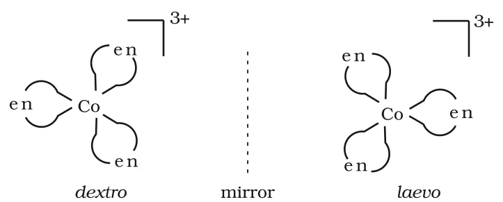
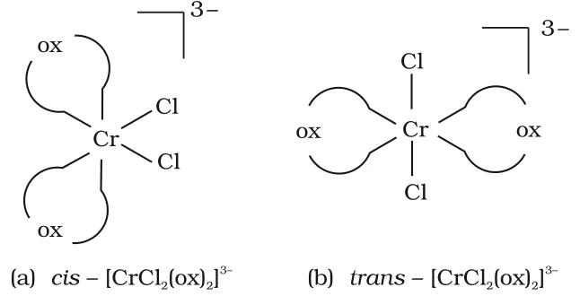

# [{ align=left, width=3.8% }](../../index.md)  Coordination Compounds | Isomerism

Isomers are two or more compounds that have the same chemical formula but a different arrangement of atoms. Because of the different arrangement, they differ in one or more physical or chemical properties.

## Types of Isomerism

Coordination compounds show two main types of isomerism:

* **Stereoisomerism:** Same chemical formula and same chemical bonds, but different spatial arrangement.
    1. Geometrical isomerism
    2. Optical isomerism
* **Structural isomerism:** Different bonds.
    1. Linkage isomerism
    2. Coordination isomerism
    3. Ionisation isomerism
    4. Solvate isomerism

## 1. Geometrical Isomerism

* Geometrical isomerism arises in heteroleptic complexes due to different possible geometrical arrangements of the ligands.
* It is mainly seen in complexes with coordination numbers 4 (square planar) and 6 (octahedral).
* When two identical ligands are adjacent to each other, the isomer is called **cis**. When they are opposite to each other, it is called **trans**.

### (a) Square planar complexes

* In a square planar complex of formula [MX2L2] (X and L are unidentate), the two X ligands can be cis or trans to each other.

{loading=lazy}

* A square planar complex of type [MABXL] (A, B, X, L are unidentate) shows **three** geometrical isomers - two cis and one trans.
* Geometrical isomerism is **not possible** for tetrahedral complexes, because all four positions are adjacent to each other.

### (b) Octahedral complexes

* Octahedral complexes of formula [MX2L4] show cis and trans isomers. Example: [Co(NH3)4Cl2]+.

{loading=lazy}

* Complexes of formula [MX2(L-L)2], where L-L is a didentate ligand like en, also show cis and trans isomers. Example: [CoCl2(en)2].

{loading=lazy}

### (c) Facial and meridional isomers

* Octahedral entities of type [Ma3b3], like [Co(NH3)3(NO2)3], show another type of geometrical isomerism.
* **Facial (fac) isomer:** The three donor atoms of the same ligand occupy adjacent positions at the corners of one octahedral face.
* **Meridional (mer) isomer:** The three donor atoms of the same ligand lie around the meridian of the octahedron.

{loading=lazy}

Complex type | Geometry | Number of geometrical isomers
-------------|----------|------------------------------
[MA4], [MA3B] | Square planar | 0
[MA2B2] | Square planar | 2 (cis, trans)
[MABCD] | Square planar | 3
Any [MAnBm] | Tetrahedral | 0
[MA4B2] | Octahedral | 2 (cis, trans)
[MA3B3] | Octahedral | 2 (fac, mer)
[M(AA)2B2] | Octahedral | 2 (cis, trans)

## 2. Optical Isomerism

* Optical isomers are mirror images that cannot be superimposed on one another. They are called **enantiomers**.
* Molecules or ions that cannot be superimposed on their mirror images are called **chiral**.
* The two forms are called **dextro (d)** and **laevo (l)**, depending on whether they rotate the plane of polarised light to the right (d) or to the left (l) in a polarimeter.
* Optical isomerism is common in octahedral complexes containing didentate ligands.

!!! example "[Co(en)3]3+"

    {loading=lazy}

    The complex has no plane of symmetry, so the d and l forms are non-superimposable mirror images.

* In entities of type [MX2(L-L)2], such as [PtCl2(en)2]2+ or [CoCl2(en)2]+, **only the cis isomer is optically active**. The trans isomer has a plane of symmetry and its mirror image is superimposable on it.

!!! tip "Conclusion"

    * Tetrahedral complexes: no geometrical isomerism.

    * Square planar complexes: generally no optical isomerism, because the plane of the molecule is a plane of symmetry.

    * Octahedral complexes with didentate ligands: show both geometrical and optical isomerism.

## 3. Linkage Isomerism

* Linkage isomerism arises in a coordination compound containing an **ambidentate ligand**.
* Example: The thiocyanate ligand NCS- may bind through nitrogen (M-NCS) or through sulphur (M-SCN).
* Jorgensen discovered this behaviour in [Co(NH3)5(NO2)]Cl2:
    * Red form: the nitrite ligand is bound through oxygen (-ONO)
    * Yellow form: the nitrite ligand is bound through nitrogen (-NO2)

!!! tip ""

    $$[Co(NH_3)_5(ONO)]Cl_2\ (red)\ \ and\ \ [Co(NH_3)_5(NO_2)]Cl_2\ (yellow)$$

## 4. Coordination Isomerism

* Coordination isomerism arises from the interchange of ligands between the cationic and anionic entities of different metal ions in a complex.
* Example: In [Co(NH3)6][Cr(CN)6], NH3 ligands are bound to Co3+ and CN- ligands to Cr3+. In its coordination isomer [Cr(NH3)6][Co(CN)6], NH3 is bound to Cr3+ and CN- to Co3+.

## 5. Ionisation Isomerism

* Ionisation isomerism arises when the counter ion in a complex salt is itself a potential ligand. It can displace a ligand, which then becomes the counter ion.
* The isomers give different ions in solution.
* Example: [Co(NH3)5SO4]Br and [Co(NH3)5Br]SO4.

!!! tip ""

    $$[Co(NH_3)_5Br]SO_4 + Ba^{2+} &rarr; BaSO_4 &darr;\ (white\ ppt.)$$

    $$[Co(NH_3)_5SO_4]Br + Ag^+ &rarr; AgBr &darr;\ (pale\ yellow\ ppt.)$$

## 6. Solvate Isomerism

* Solvate isomers differ in whether a solvent molecule is directly bonded to the metal ion or is merely present as a free solvent molecule in the crystal lattice.
* When the solvent is water, it is called **hydrate isomerism**. It is similar to ionisation isomerism.
* Example: [Cr(H2O)6]Cl3 (violet) and its solvate isomer [Cr(H2O)5Cl]Cl2.H2O (grey-green).

## Questions

!!! question "Why is geometrical isomerism not possible in tetrahedral complexes having two different types of unidentate ligands coordinated with the central metal ion?"

    In a tetrahedral complex, every position is adjacent to every other position. The relative positions of the unidentate ligands attached to the central metal atom are therefore the same with respect to each other, so cis and trans arrangements cannot exist.

!!! question "Draw structures of geometrical isomers of [Fe(NH3)2(CN)4]-."

    It is an octahedral complex of type [MA2B4], so it shows two geometrical isomers:

    * **cis isomer:** The two NH3 ligands are at adjacent positions (90&deg; apart), and the four CN- occupy the remaining positions.

    * **trans isomer:** The two NH3 ligands are at opposite positions (180&deg; apart, one above and one below Fe), and the four CN- lie in the square plane around Fe.

    These arrangements are exactly like the cis and trans forms of [Co(NH3)4Cl2]+ shown above, with NH3 in place of Cl and CN in place of NH3.

!!! question "Out of the following two coordination entities, which is chiral (optically active)?  (a) cis-[CrCl2(ox)2]3- (b) trans-[CrCl2(ox)2]3-"

    {loading=lazy}

    The trans isomer has a plane of symmetry (containing the two oxalate ligands), so it is superimposable on its mirror image. The cis isomer has no plane of symmetry.

    Hence, (a) cis-[CrCl2(ox)2]3- is chiral (optically active).

!!! question "Indicate the types of isomerism exhibited by the following complexes:  (i) K[Cr(H2O)2(C2O4)2] (ii) [Co(en)3]Cl3 (iii) [Co(NH3)5(NO2)\](NO3)2 (iv) [Pt(NH3)(H2O)Cl2]"

    * (i) Type [M(AA)2B2]: both geometrical (cis, trans) and optical isomerism. The cis form exists as d and l isomers.

    * (ii) Type [M(AA)3]: two optical isomers (d and l).

    * (iii) It shows ionisation isomerism (NO2- and NO3- can exchange places), linkage isomerism (NO2- can bind through N or O) and geometrical isomerism. There are 10 possible isomers in all.

    * (iv) Square planar [MABX2]: geometrical (cis and trans) isomers.

!!! question "Give evidence that [Co(NH3)5Cl]SO4 and [Co(NH3)5SO4]Cl are ionisation isomers."

    The two compounds give different ions in solution and so react differently with reagents:

    * [Co(NH3)5Cl]SO4 gives free SO42- ions, so it forms a white precipitate of BaSO4 with BaCl2 solution but gives no precipitate with AgNO3.

    * [Co(NH3)5SO4]Cl gives free Cl- ions, so it forms a white precipitate of AgCl with AgNO3 solution but gives no precipitate with BaCl2.

!!! question "How many geometrical isomers are possible in the following coordination entities?  (i) [Cr(C2O4)3]3- (ii) [Co(NH3)3Cl3]"

    * (i) [Cr(C2O4)3]3- is of type [M(AA)3]. It shows no geometrical isomers (only optical isomers).

    * (ii) [Co(NH3)3Cl3] is of type [MA3B3]. It shows two geometrical isomers - fac and mer.

!!! question "Write all the geometrical isomers of [Pt(NH3)(Br)(Cl)(py)] and how many of these will exhibit optical isomerism?"

    It is a square planar complex of type [MABCD], which has three geometrical isomers. Fixing NH3 at one corner, the ligand trans (opposite) to it can be Br, Cl or py:

    * Isomer 1: NH3 trans to Br (Cl trans to py)

    * Isomer 2: NH3 trans to Cl (Br trans to py)

    * Isomer 3: NH3 trans to py (Br trans to Cl)

    Square planar complexes are planar and have a plane of symmetry, so none of these isomers shows optical isomerism.

!!! question "Draw all the isomers (geometrical and optical) of [CoCl2(en)2]+."

    [CoCl2(en)2]+ shows two geometrical isomers, cis and trans (shown in the figure for [CoCl2(en)2] above).

    * The trans isomer has a plane of symmetry and is optically inactive.

    * The cis isomer is chiral and exists as a pair of enantiomers (d and l).

    Hence, there are three isomers in total: trans, d-cis and l-cis.
