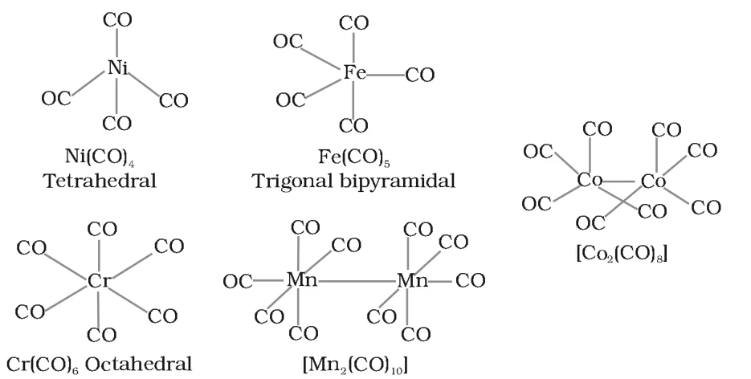
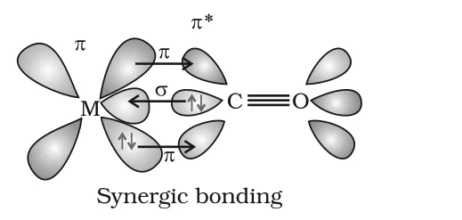

# [{ align=left, width=3.8% }](../../index.md)  Coordination Compounds | Metal Carbonyls, Stability and Applications

In this article, we will discuss bonding in metal carbonyls, stability of coordination compounds in solution and the importance of coordination compounds.

## Metal Carbonyls

* Homoleptic carbonyls are compounds containing only carbonyl (CO) ligands. Most transition metals form them.
* These carbonyls have simple, well defined structures:

Carbonyl | Name | Structure
---------|------|----------
[Ni(CO)4] | Tetracarbonylnickel(0) | Tetrahedral
[Fe(CO)5] | Pentacarbonyliron(0) | Trigonal bipyramidal
[Cr(CO)6] | Hexacarbonylchromium(0) | Octahedral
[Mn2(CO)10] | Decacarbonyldimanganese(0) | Two square pyramidal Mn(CO)5 units joined by a Mn-Mn bond
[Co2(CO)8] | Octacarbonyldicobalt(0) | Co-Co bond bridged by two CO groups

{loading=lazy}

## Bonding in Metal Carbonyls

The metal-carbon bond in metal carbonyls has both &sigma; and &pi; character.

### 1. M-C &sigma; bond

* It is formed by donation of the lone pair of electrons on the carbonyl carbon into a vacant orbital of the metal (ligand to metal donation).

### 2. M-C &pi; bond

* It is formed by donation of a pair of electrons from a filled d orbital of the metal into the vacant antibonding &pi;* orbital of carbon monoxide (metal to ligand donation). This is called **back bonding** (or back donation).

{loading=lazy}

### Synergic bonding

* &sigma; donation from CO increases the electron density on the metal, which helps the metal donate electrons back to CO through &pi; bonding. The &pi; back donation, in turn, removes electron density from the metal and makes it a better acceptor for &sigma; donation. Each bond strengthens the other.
* This mutual reinforcement is called the **synergic effect**. It strengthens the bond between CO and the metal and gives stability to metal carbonyls.

!!! note "Note"

    Since electrons enter the antibonding &pi;* orbital of CO during back bonding, the C-O bond order decreases slightly. So the C-O bond in a metal carbonyl is a little longer (weaker) than in free CO, while the M-C bond gets stronger.

## Stability of Coordination Compounds

* The stability of a complex in solution refers to the degree of association between the two species involved in the state of equilibrium.
* It is expressed quantitatively by the magnitude of the **stability (or formation) constant**. The larger the stability constant, the higher the proportion of the complex in solution.

!!! tip ""

    $$M + 4L &#8652; ML_4$$

### Stepwise stability constants

* Free metal ions rarely exist in solution; they are surrounded by solvent molecules, which are replaced step by step by the ligands L. Ignoring the solvent, the formation can be written in steps:

!!! tip ""

    $$M + L &#8652; ML,\ \ K_1 = {[ML] \over [M][L]}$$

    $$ML + L &#8652; ML_2,\ \ K_2 = {[ML_2] \over [ML][L]}$$

    $$ML_2 + L &#8652; ML_3,\ \ K_3 = {[ML_3] \over [ML_2][L]}$$

    $$ML_3 + L &#8652; ML_4,\ \ K_4 = {[ML_4] \over [ML_3][L]}$$

* K1, K2, etc. are called **stepwise stability constants**.

### Overall stability constant

!!! tip ""

    $$M + 4L &#8652; ML_4,\ \ &beta;_4 = {[ML_4] \over [M][L]^4}$$

    $$&beta;_4 = K_1 \times K_2 \times K_3 \times K_4$$

    $$In\ general:\ &beta;_n = K_1 \times K_2 \times K_3 \times ... \times K_n$$

* &beta; is called the **overall stability constant**.

!!! example "Formation of cuprammonium ion"

    $$Cu^{2+} + NH_3 &#8652; [Cu(NH_3)]^{2+},\ \ K_1 = {[Cu(NH_3)^{2+}] \over [Cu^{2+}][NH_3]}$$

    $$[Cu(NH_3)]^{2+} + NH_3 &#8652; [Cu(NH_3)_2]^{2+},\ \ K_2 = {[Cu(NH_3)_2^{2+}] \over [Cu(NH_3)^{2+}][NH_3]}$$

    $$&beta;_4 = {[Cu(NH_3)_4^{2+}] \over [Cu^{2+}][NH_3]^4}$$

    $$log K_1 = 4.0,\ log K_2 = 3.2,\ log K_3 = 2.7,\ log K_4 = 2.0$$

    $$log &beta;_4 = 4.0 + 3.2 + 2.7 + 2.0 = 11.9$$

    The successive stability constants decrease, a pattern found for most formation constants.

* The **instability constant** or **dissociation constant** of a coordination compound is the reciprocal of its formation constant.

!!! tip ""

    $$Overall\ dissociation\ constant = {1 \over &beta;_n}$$

### Chelate effect

* Complexes formed by chelating (di- or polydentate) ligands are more stable than similar complexes with unidentate ligands. The extra stability due to chelation is called the **chelate effect**.
* Example: [Ni(en)3]2+ is more stable than [Ni(NH3)6]2+, though both have six Ni-N bonds.
* The stability of coordination compounds is related to Gibbs energy, enthalpy and entropy terms. Replacing several unidentate ligands by one chelating ligand increases the number of free particles, so entropy increases and the complex is favoured.

## Importance and Applications of Coordination Compounds

### 1. Analytical chemistry

* Many qualitative and quantitative analyses are based on the colour reactions given by metal ions with ligands (especially chelating ligands), which form coordination entities.
* Examples of such reagents: EDTA, DMG (dimethylglyoxime), &alpha;-nitroso-&beta;-naphthol, cupron.
* **Hardness of water** is estimated by simple titration with Na2EDTA. Ca2+ and Mg2+ form stable complexes with EDTA. They can be estimated selectively because their complexes have different stability constants.

### 2. Metallurgy

* Extraction of silver and gold uses complex formation. Gold combines with cyanide in the presence of oxygen and water to form [Au(CN)2]-. Gold is recovered as metal by adding zinc.

!!! tip ""

    $$4Au + 8CN^- + 2H_2O + O_2 &rarr; 4[Au(CN)_2]^- + 4OH^-$$

    $$2[Au(CN)_2]^- + Zn &rarr; [Zn(CN)_4]^{2-} + 2Au$$

* Purification of metals: impure nickel is converted to [Ni(CO)4], which is decomposed to give pure nickel (Mond process).

### 3. Biological systems

* **Chlorophyll**, the pigment of photosynthesis, is a coordination compound of magnesium.
* **Haemoglobin**, the red pigment of blood which carries oxygen, is a coordination compound of iron.
* **Vitamin B12** (cyanocobalamine), the anti-pernicious anaemia factor, is a coordination compound of cobalt.
* Enzymes like carboxypeptidase A and carbonic anhydrase contain coordinated metal ions.

### 4. Industrial catalysts

* Coordination compounds are used as catalysts in many industrial processes. Example: the rhodium complex [(Ph3P)3RhCl], **Wilkinson catalyst**, is used for hydrogenation of alkenes.

### 5. Electroplating

* Articles are electroplated with silver and gold more smoothly and evenly from solutions of [Ag(CN)2]- and [Au(CN)2]- than from solutions of simple metal ions.

### 6. Photography

* In black and white photography, the developed film is fixed by washing with hypo solution. It dissolves the undecomposed AgBr by forming the complex ion [Ag(S2O3)2]3-.

!!! tip ""

    $$AgBr + 2Na_2S_2O_3 &rarr; Na_3[Ag(S_2O_3)_2] + NaBr$$

### 7. Medicinal chemistry

* **Chelate therapy:** Excess of metals in toxic amounts is removed by chelating ligands. Excess copper and iron are removed by D-penicillamine and desferrioxime B. EDTA is used in the treatment of lead poisoning.
* Some coordination compounds of platinum effectively inhibit the growth of tumours. Example: **cis-platin**, cis-[PtCl2(NH3)2], and related compounds.

## Questions

!!! question "Calculate the overall complex dissociation equilibrium constant for the [Cu(NH3)4]2+ ion, given that &beta;4 for this complex is 2.1 &times; 1013."

    The overall dissociation constant is the reciprocal of the overall stability constant:

    $$K_d = {1 \over &beta;_4} = {1 \over 2.1 \times 10^{13}}$$

    $$K_d = 4.7 \times 10^{-14}$$

!!! question "Discuss the nature of bonding in metal carbonyls."

    * The M-C bond has both &sigma; and &pi; character.

    * **&sigma; bond:** The carbon of CO donates its lone pair into a vacant orbital of the metal.

    * **&pi; bond:** The metal donates a pair of electrons from a filled d orbital into the vacant antibonding &pi;* orbital of CO (back bonding).

    * The two interactions reinforce each other (synergic effect), which strengthens the M-CO bond and makes metal carbonyls stable.

!!! question "What is meant by the chelate effect? Give an example."

    When a didentate or polydentate ligand binds to the same metal ion through two or more donor atoms, a ring (chelate) is formed. Such complexes are more stable than similar complexes with unidentate ligands. This is called the chelate effect.

    Example: [Ni(en)3]2+ is more stable than [Ni(NH3)6]2+. Similarly, EDTA4- forms very stable complexes with Ca2+ and Mg2+.

!!! question "Amongst the following, the most stable complex is:  (i) [Fe(H2O)6]3+ (ii) [Fe(NH3)6]3+ (iii) [Fe(C2O4)3]3- (iv) [FeCl6]3-"

    Oxalate is a didentate (chelating) ligand and forms three five-membered chelate rings with Fe3+. Due to the chelate effect, the most stable complex is **(iii) [Fe(C2O4)3]3-**.
