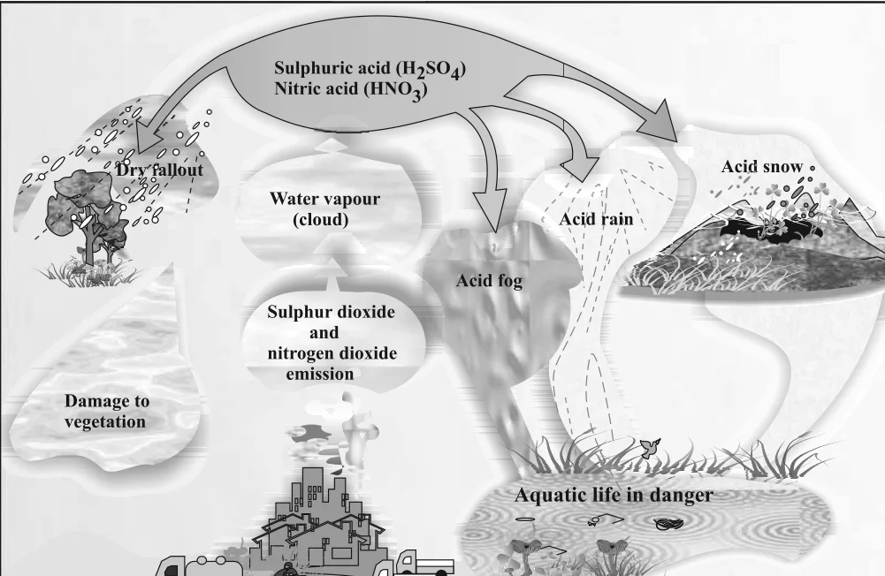

# [{ align=left, width=3.8% }](../../index.md)  Environmental Chemistry | Tropospheric Pollution

Tropospheric pollution occurs due to the presence of undesirable solid or gaseous particles in the air of the lowest region of the atmosphere.

The major pollutants present in the troposphere are of two kinds:

* **Gaseous air pollutants:** oxides of sulphur, nitrogen and carbon, hydrogen sulphide, hydrocarbons, ozone and other oxidants.
* **Particulate pollutants:** dust, mist, fumes, smoke, smog etc. These are discussed on the next page.

## Gaseous Air Pollutants

### 1. Oxides of Sulphur

* Oxides of sulphur are produced when sulphur-containing fossil fuel is burnt. The most common one is sulphur dioxide (SO2).
* SO2 is poisonous to both animals and plants.
* Even a low concentration of SO2 causes respiratory diseases in humans such as asthma, bronchitis and emphysema. It also irritates the eyes, causing tears and redness.
* A high concentration of SO2 makes flower buds stiff, and they eventually fall off the plants.
* Uncatalysed oxidation of SO2 is slow. However, particulate matter in polluted air catalyses its oxidation to sulphur trioxide:

!!! tip ""

    $$2SO_{2(g)} + O_{2(g)} &rarr; 2SO_{3(g)}$$

* The oxidation can also be promoted by ozone and hydrogen peroxide:

!!! tip ""

    $$SO_{2(g)} + O_{3(g)} &rarr; SO_{3(g)} + O_{2(g)}$$

    $$SO_{2(g)} + H_2O_{2(l)} &rarr; H_2SO_{4(aq)}$$

### 2. Oxides of Nitrogen

* Dinitrogen and dioxygen are the main constituents of air, but they do not react with each other at normal temperature.
* At high altitudes, when lightning strikes, they combine to form oxides of nitrogen. NO2 is oxidised to nitrate ion (NO3-), which is washed into the soil where it serves as a fertilizer.
* In an automobile engine, fossil fuel burns at a high temperature, and dinitrogen and dioxygen combine to give significant quantities of nitric oxide (NO) and nitrogen dioxide (NO2):

!!! tip ""

    $$N_{2(g)} + O_{2(g)} \xrightarrow{1483\ K} 2NO_{(g)}$$

    $$2NO_{(g)} + O_{2(g)} &rarr; 2NO_{2(g)}$$

* NO reacts instantly with oxygen to give NO2. The rate of production of NO2 is faster when NO reacts with ozone in the stratosphere:

!!! tip ""

    $$NO_{(g)} + O_{3(g)} &rarr; NO_{2(g)} + O_{2(g)}$$

#### Harmful effects of NOx

* The irritant red haze seen in traffic and congested places is due to oxides of nitrogen.
* High concentrations of NO2 damage the leaves of plants and slow down photosynthesis.
* NO2 is a lung irritant that can cause acute respiratory disease in children. It is toxic to living tissues.
* It also harms textile fibres and metals.

### 3. Hydrocarbons

* Hydrocarbons are compounds of only hydrogen and carbon. They are formed by incomplete combustion of fuel used in automobiles.
* They are **carcinogenic**, i.e., they cause cancer.
* They harm plants by causing ageing, breakdown of tissues and shedding of leaves, flowers and twigs.

### 4. Oxides of Carbon

#### (a) Carbon Monoxide (CO)

* CO is a colourless and odourless gas and one of the most serious air pollutants.
* It is produced by incomplete combustion of carbon. It is mainly released by automobile exhaust; incomplete burning of coal, firewood and petrol also produces it.
* Poorly maintained vehicles and vehicles with inadequate pollution control equipment release larger amounts of CO.
* **Why is CO poisonous?** It binds to haemoglobin to form **carboxyhaemoglobin**, which is about 300 times more stable than the oxygen-haemoglobin complex. So CO blocks the delivery of oxygen to the organs and tissues.

!!! tip ""

    $$Hb + CO &rarr; HbCO\ (carboxyhaemoglobin)$$

* When the concentration of carboxyhaemoglobin in blood reaches about 3-4 per cent, the oxygen-carrying capacity of blood is greatly reduced.
* The resulting oxygen deficiency causes headache, weak eyesight, nervousness and cardiovascular disorders. This is one reason people are advised not to smoke.
* In pregnant women who smoke, increased CO in blood may cause premature birth, spontaneous abortion and deformed babies.

#### (b) Carbon Dioxide (CO2)

* CO2 is released into the atmosphere by respiration, burning of fossil fuels, decomposition of limestone during cement manufacture and volcanic eruptions.
* It is confined to the troposphere only. Normally it forms about 0.03 per cent by volume of the atmosphere.
* Green plants use CO2 for photosynthesis and release oxygen, which keeps the CO2 level balanced.
* Deforestation and burning of fossil fuel increase the CO2 level and disturb this balance. This excess CO2 is mainly responsible for **global warming**.

## Global Warming and Greenhouse Effect

* About 75% of the solar energy reaching the earth is absorbed by the earth's surface, which increases its temperature. The rest of the heat radiates back to the atmosphere.
* Some of this heat is trapped by gases such as carbon dioxide, methane, ozone, chlorofluorocarbons (CFCs) and water vapour. This adds to the heating of the atmosphere and causes **global warming**.

### Natural Greenhouse Effect

* In a greenhouse (a glass-covered area used to grow plants in cold places), visible sunlight passes through the transparent glass and heats the soil and plants.
* The warm soil and plants emit infrared (heat) radiation. Glass is opaque to infrared radiation, so it partly reflects and partly absorbs it. The sun's energy stays trapped inside.
* Similarly, CO2 molecules are transparent to sunlight but not to heat radiation. So the blanket of air around the earth traps the sun's heat near the surface and keeps the earth warm.
* This is called the **natural greenhouse effect**. It maintains the temperature and makes the earth suitable for life.
* If the amount of CO2 crosses its delicate proportion of 0.03 per cent, the natural greenhouse balance gets disturbed. CO2 is the major contributor to global warming.

### Other Greenhouse Gases

| Gas | Main sources |
| :--- | :--- |
| CO2 | Burning of fossil fuels, deforestation, respiration, cement manufacture |
| Methane (CH4) | Burning, digestion or rotting of vegetation in the absence of oxygen; paddy fields, coal mines, rotting garbage dumps, fossil fuels |
| Nitrous oxide (N2O) | Occurs naturally; increased by chemical fertilizers and burning of fossil fuels |
| CFCs | Man-made chemicals used in air conditioning etc.; also damage the ozone layer |
| Ozone and water vapour | Present naturally in the atmosphere |

### Consequences of Global Warming

* If the present trend continues, the average global temperature may rise to a level which melts polar ice caps and floods low-lying areas all over the earth.
* A rise in global temperature increases the incidence of infectious diseases like dengue, malaria, yellow fever and sleeping sickness.

!!! tip "How can we reduce global warming?"

    * Use fossil fuels efficiently and judiciously, and minimise the use of automobiles (use bicycles, public transport or carpools).
    * Plant more trees to increase the green cover.
    * Avoid burning dry leaves, wood etc.
    * Avoid smoking, especially in public places.

## Acid Rain

* Normal rain water has a pH of about 5.6. This is because rain water reacts with atmospheric CO2 to form carbonic acid, which gives H+ ions:

!!! tip ""

    $$H_2O_{(l)} + CO_{2(g)} &#8652; H_2CO_{3(aq)}$$

    $$H_2CO_{3(aq)} &#8652; H^+_{(aq)} + HCO^-_{3(aq)}$$

* When the pH of rain water drops below 5.6, it is called **acid rain**.
* Acid rain refers to the ways in which acid from the atmosphere is deposited on the earth's surface. Acidic oxides of nitrogen and sulphur, carried by wind along with solid particles, settle down:
    * on the ground as **dry deposition**, or
    * in water, fog and snow as **wet deposition**.

{loading=lazy}

### Formation of Acid Rain

* Burning of fossil fuels containing sulphur and nitrogenous matter (coal and oil in power stations and furnaces, petrol and diesel in motor engines) produces SO2 and nitrogen oxides.
* After oxidation and reaction with water, SO2 and NO2 become the major contributors to acid rain. Particulate matter in polluted air catalyses this oxidation:

!!! tip ""

    $$2SO_{2(g)} + O_{2(g)} + 2H_2O_{(l)} &rarr; 2H_2SO_{4(aq)}$$

    $$4NO_{2(g)} + O_{2(g)} + 2H_2O_{(l)} &rarr; 4HNO_{3(aq)}$$

* Ammonium salts are also formed and appear as an atmospheric haze (aerosol of fine particles). Aerosol particles of oxides or ammonium salts in rain drops cause wet deposition.
* SO2 is also absorbed directly on solid and liquid ground surfaces and is thus deposited as dry deposition.

### Harmful Effects of Acid Rain

* It is harmful for agriculture, trees and plants because it dissolves and washes away the nutrients they need.
* It causes respiratory ailments in humans and animals.
* When it reaches rivers and lakes as ground water, it affects plant and animal life in the aquatic ecosystem.
* It corrodes water pipes, leading to leaching of heavy metals such as iron, lead and copper into drinking water.
* It damages buildings and structures made of stone or metal.

### Taj Mahal and Acid Rain

* The air around Agra contains fairly high levels of sulphur and nitrogen oxides due to many industries and power plants, and the use of poor quality coal, kerosene and firewood as domestic fuel.
* The resulting acid rain reacts with the marble (CaCO3) of the Taj Mahal, slowly making it discoloured and lustreless:

!!! tip ""

    $$CaCO_3 + H_2SO_4 &rarr; CaSO_4 + H_2O + CO_2$$

* Under an action plan announced in 1995 for the **'Taj Trapezium'** (Agra, Firozabad, Mathura and Bharatpur), more than 2000 polluting industries were to switch from coal or oil to natural gas or LPG, and vehicles near the Taj were encouraged to use low sulphur diesel.

### Controlling Acid Rain

* Reduce the emission of SO2 and NO2: use fewer vehicles driven by fossil fuels, use low-sulphur fuels in power plants and industries, and prefer natural gas over coal.
* Use **catalytic converters** in cars. The converter is a ceramic honeycomb coated with precious metals Pd, Pt and Rh. When exhaust gases containing unburnt fuel, CO and NOx pass through it at 573 K, they are converted into CO2 and N2.
* The acidity of soil can be reduced by adding powdered limestone to neutralise it.
