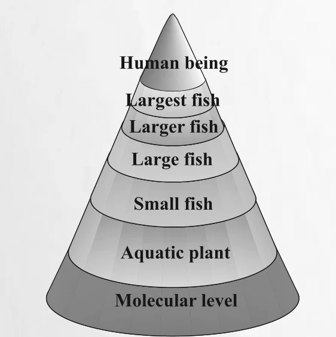

# [{ align=left, width=3.8% }](../../index.md)  Environmental Chemistry | Water and Soil Pollution

Water pollution is the contamination of surface or ground water by pathogens, organic wastes and chemicals. It originates mostly from human activities.

## Sources of Water Pollution

* **Point source:** an easily identified source or place of pollution. Example: municipal and industrial discharge pipes where pollutants enter the water source.
* **Non-point source:** a source that cannot be easily identified. Examples: agricultural run-off (from farms, animals and crop lands), acid rain, storm-water drainage (from streets, parking lots and lawns).

| Pollutant | Source |
| :--- | :--- |
| Micro-organisms | Domestic sewage |
| Organic wastes | Domestic sewage, animal excreta and waste, decaying animals and plants, discharge from food processing factories |
| Plant nutrients | Chemical fertilizers |
| Toxic heavy metals | Industries and chemical factories |
| Sediments | Erosion of soil by agriculture and strip mining |
| Pesticides | Chemicals used for killing insects, fungi and weeds |
| Radioactive substances | Mining of uranium containing minerals |
| Heat | Water used for cooling in industries |

## Causes of Water Pollution

### 1. Pathogens

* These are the most serious water pollutants. Pathogens are disease-causing agents, including bacteria and other organisms, that enter water from domestic sewage and animal excreta.
* Human excreta contain bacteria such as *Escherichia coli* and *Streptococcus faecalis*, which cause gastrointestinal diseases.

### 2. Organic Wastes

* Organic matter such as leaves, grass and trash pollutes water as a result of run-off. Excessive phytoplankton growth within water is also a cause. These wastes are biodegradable.
* Bacteria decompose this organic matter and consume the oxygen dissolved in water.
* The amount of oxygen water can hold is limited. In cold water, **dissolved oxygen (DO)** can reach up to 10 ppm, whereas oxygen in air is about 200,000 ppm. So even a moderate amount of decomposing organic matter can deplete water of its dissolved oxygen.
* If the DO of water falls below 6 ppm, the growth of fish gets inhibited.
* Oxygen reaches water from the atmosphere and from photosynthesis by aquatic plants during daylight. At night, photosynthesis stops but plants continue to respire, which lowers the DO.
* If too much organic matter is added, all the available oxygen is used up and oxygen-dependent aquatic life dies. Anaerobic bacteria then break down the waste and produce foul-smelling chemicals harmful to human health.

#### Biochemical Oxygen Demand (BOD)

* The amount of oxygen required by bacteria to break down the organic matter present in a certain volume of a water sample is called **Biochemical Oxygen Demand (BOD)**.
* BOD is a measure of the amount of organic material in water, in terms of how much oxygen is needed to break it down biologically.

| Water quality | BOD value |
| :--- | :--- |
| Clean water | Less than 5 ppm |
| Highly polluted water | 17 ppm or more |

### 3. Chemical Pollutants

* **Heavy metals:** Water-soluble inorganic chemicals including heavy metals such as cadmium, mercury and nickel are important pollutants. The body cannot excrete them, so over time they cross the tolerance limit and damage kidneys, the central nervous system, liver etc.
* **Acids and salts:** Acids (like sulphuric acid) from mine drainage and salts from many sources, including raw salt (sodium and calcium chloride) used to melt snow and ice in colder climates, are water-soluble pollutants.
* **Organic chemicals:** Petroleum products (e.g., major oil spills in oceans), pesticides drifting from sprays or run-off, and industrial chemicals like **polychlorinated biphenyls (PCBs)** used as cleansing solvents. PCBs are suspected to be carcinogenic.
* **Detergents:** Most detergents today are biodegradable, but the bacteria that degrade them grow rapidly and may use up all the dissolved oxygen, killing fish and plants.
* **Fertilizers:** They contain phosphates as additives, which enhance algae growth.

### Eutrophication

* Profuse growth of algae covers the water surface and reduces the oxygen concentration in water.
* This leads to anaerobic conditions, with accumulation of obnoxious decay and animal death. Bloom-infested water inhibits the growth of other living organisms.
* The process in which nutrient-enriched water bodies support a dense plant population, which kills animal life by depriving it of oxygen and results in loss of biodiversity, is called **eutrophication**.

## International Standards for Drinking Water

### 1. Fluoride

* Drinking water should be tested for fluoride ion concentration. Its deficiency causes diseases such as tooth decay.
* Soluble fluoride is often added to drinking water to bring its concentration up to 1 ppm or 1 mg dm-3.
* F- ions make tooth enamel much harder by converting hydroxyapatite into the much harder fluorapatite:

!!! tip ""

    $$Hydroxyapatite:\ [3(Ca_3(PO_4)_2).Ca(OH)_2]\ &rarr;\ Fluorapatite:\ [3(Ca_3(PO_4)_2).CaF_2]$$

* F- above 2 ppm causes brown mottling of teeth. Excess fluoride (over 10 ppm) harms bones and teeth, as reported from some parts of Rajasthan.

### 2. Lead

* Water gets contaminated with lead when lead pipes are used to transport it.
* The prescribed upper limit of lead in drinking water is about 50 ppb. Lead can damage the kidney, liver and reproductive system.

### 3. Sulphate

* Excessive sulphate (> 500 ppm) causes a laxative effect. At moderate levels it is harmless.

### 4. Nitrate

* The maximum limit of nitrate in drinking water is 50 ppm.
* Excess nitrate can cause methemoglobinemia ('blue baby' syndrome).

### 5. Other Metals

| Metal | Maximum concentration (ppm or mg dm-3) |
| :---: | :---: |
| Fe | 0.2 |
| Mn | 0.05 |
| Al | 0.2 |
| Cu | 3.0 |
| Zn | 5.0 |
| Cd | 0.005 |

!!! tip "What can we do?"

    * Do not dump waste into drains that lead directly to a river, pond, stream or lake.
    * Use compost instead of chemical fertilizers in gardens.
    * Avoid pesticides like DDT and malathion at home; dried neem leaves help keep insects away.
    * Add a few crystals of potassium permanganate (KMnO4) or bleaching powder to the household water tank.

## Soil Pollution

* India gives high priority to agriculture, and the surplus produce is stored for the lean season. Crops and stored food must be protected from insects, rodents, weeds and crop diseases.
* Insecticides, pesticides and herbicides used for this purpose cause soil pollution. Hence their judicious use is needed.

### Pesticides

* Before World War II, naturally occurring chemicals like nicotine (by planting tobacco in the crop field) were used as pest controllers.
* During World War II, DDT was found very useful for controlling malaria and other insect-borne diseases. After the war it was used in agriculture. Due to its adverse effects, it has been banned in India.
* Pesticides are synthetic toxic chemicals with ecological repercussions. Repeated use of the same pesticides gives rise to resistant pests, making the pesticides ineffective.
* As insects became resistant to DDT, other organic toxins such as **Aldrin** and **Dieldrin** were introduced. Most of these are water insoluble and non-biodegradable.
* These highly persistent toxins are transferred from lower to higher trophic levels through the food chain. Over time, their concentration in higher animals reaches a level that causes serious metabolic and physiological disorders.

{loading=lazy}

!!! note "Note"

    At each trophic level, the pollutant gets about 10 times more concentrated. So the organism at the top of the food chain (human beings) receives the highest concentration.

* Because chlorinated organic toxins are so persistent, less persistent, more biodegradable **organo-phosphates** and **carbamates** were introduced. But these are severe nerve toxins and more harmful to humans; deaths of agricultural field workers have been reported. Insects have become resistant to these too.

### Herbicides

* The pesticide industry has now shifted its attention to herbicides such as sodium chlorate (NaClO3) and sodium arsinite (Na3AsO3).
* Most herbicides are toxic to mammals but are not as persistent as organo-chlorides; they decompose in a few months.
* Like organo-chlorides, they too become concentrated in the food web. Some herbicides cause birth defects.
* Corn fields sprayed with herbicides are more prone to insect attack and plant disease than fields weeded manually.

## Industrial Waste

Industrial solid wastes are sorted into biodegradable and non-degradable wastes.

| Type | Source / Examples |
| :--- | :--- |
| Biodegradable | Cotton mills, food processing units, paper mills, textile factories |
| Non-biodegradable | Fly ash from thermal power plants; blast furnace slag and steel melting slag from iron and steel plants; mud and tailings from Al, Zn and Cu industries; gypsum from fertilizer industries |
| Hazardous | Inflammables, composite explosives and highly reactive substances from industries dealing in metals, chemicals, drugs, pharmaceuticals, dyes, pesticides, rubber goods etc. |

* Improper disposal of non-degradable industrial waste is a serious threat to the environment.
* Nowadays fly ash and slag from the steel industry are used by the cement industry.
* Large quantities of toxic waste are usually destroyed by controlled incineration, whereas small quantities are burnt along with factory garbage in open bins.
