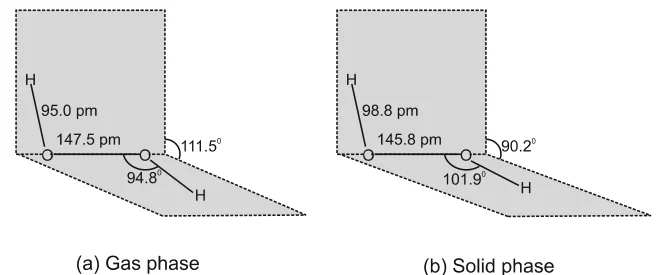

# [{ align=left, width=3.8% }](../../index.md)  Hydrogen | Hydrogen Peroxide

Hydrogen peroxide, H2O2, is an important chemical used in pollution control treatment of domestic and industrial effluents. In this article, we will discuss its preparation, physical properties, structure, chemical properties, storage and uses.

## Preparation of Hydrogen Peroxide

### 1. From barium peroxide

* Acidifying barium peroxide and removing excess water by evaporation under reduced pressure gives hydrogen peroxide.

!!! tip ""

    $$BaO_2.8H_2O_{(s)} + H_2SO_{4(aq)} &rarr; BaSO_{4(s)} + H_2O_{2(aq)} + 8H_2O_{(l)}$$

### 2. From peroxodisulphate

* Peroxodisulphate is obtained by electrolytic oxidation of acidified sulphate solutions at high current density. Its hydrolysis gives hydrogen peroxide.

!!! tip ""

    $$2HSO^-_{4(aq)} \xrightarrow{Electrolysis} HO_3SOOSO_3H_{(aq)} \xrightarrow{Hydrolysis} 2HSO^-_{4(aq)} + 2H^+_{(aq)} + H_2O_{2(aq)}$$

* This method is now used for the laboratory preparation of D2O2.

!!! tip ""

    $$K_2S_2O_{8(s)} + 2D_2O_{(l)} &rarr; 2KDSO_{4(aq)} + D_2O_{2(l)}$$

### 3. Industrial method: auto-oxidation of 2-alkylanthraquinols

* Industrially, H2O2 is prepared by auto-oxidation of 2-alkylanthraquinols, e.g., 2-ethylanthraquinol. The oxidised product is reduced back with H2/Pd and reused.

!!! tip ""

    $$2\text{-}ethylanthraquinol \underset{H_2/Pd}{\overset{O_2\ (air)}{\rightleftharpoons}} H_2O_2 + oxidised\ product$$

* This gives about 1% H2O2. It is extracted with water and concentrated to about 30% (by mass) by distillation under reduced pressure.
* It can be further concentrated to about 85% by careful distillation under low pressure. The remaining water is frozen out to obtain pure H2O2.

## Physical Properties of Hydrogen Peroxide

* In the pure state, H2O2 is an almost colourless (very pale blue) liquid.
* It is miscible with water in all proportions and forms a hydrate, H2O2.H2O (mp 221 K).

Property                                        | Value                      |
------------------------------------------------|----------------------------|
Melting point (K)                               | 272.4                      |
Boiling point, extrapolated (K)                 | 423                        |
Vapour pressure at 298 K (mm Hg)                | 1.9                        |
Density of solid at 268.5 K (g cm-3) | 1.64                       |
Density of liquid at 298 K (g cm-3)  | 1.44                       |
Viscosity at 290 K (centipoise)                 | 1.25                       |
Dielectric constant at 298 K (C2/N m2) | 70.7          |
Electrical conductivity at 298 K (&Omega;-1 cm-1) | 5.1 &times; 10-8 |

### Volume strength of H2O2

* The strength of H2O2 solutions is commonly expressed as **volume strength**.
* A 30% solution of H2O2 is marketed as **'100 volume'** hydrogen peroxide. It means that 1 mL of this solution gives 100 mL of oxygen at STP.
* Commercially it is marketed as '10 volume', which means it contains about 3% H2O2.

!!! question "Calculate the strength of 10 volume solution of hydrogen peroxide."

    10 volume H2O2 means that 1 L of this solution gives 10 L of O2 at STP.

    $$2H_2O_{2(l)} &rarr; O_{2(g)} + 2H_2O_{(l)}$$

    $$2 \times 34\ g = 68\ g\ H_2O_2\ gives\ 22.4\ L\ O_2\ at\ STP$$

    $$&Therefore;\ 10\ L\ O_2\ is\ given\ by = {68 \times 10 \over 22.4}\ g = 30.36\ g\ H_2O_2$$

    Therefore, the strength of 10 volume H2O2 = 30.36 g/L.

## Structure of Hydrogen Peroxide

* H2O2 has a **non-planar** (open book) structure. The two O-H bonds lie in different planes.
* The angle between the two planes is called the **dihedral angle**. It is 111.5&deg; in the gas phase and 90.2&deg; in the solid phase (at 110 K).

{loading=lazy}

Parameter        | Gas phase | Solid phase |
-----------------|-----------|-------------|
O-O bond length  | 147.5 pm  | 145.8 pm    |
O-H bond length  | 95.0 pm   | 98.8 pm     |
O-O-H bond angle | 94.8&deg; | 101.9&deg;  |
Dihedral angle   | 111.5&deg; | 90.2&deg;  |

## Chemical Properties of Hydrogen Peroxide

H2O2 acts as an **oxidising agent** as well as a **reducing agent** in both acidic and alkaline media. The oxidation state of oxygen in H2O2 is -1, which lies between 0 (in O2) and -2 (in H2O). So it can be either oxidised or reduced.

### 1. Oxidising action in acidic medium

!!! tip ""

    $$2Fe^{2+}_{(aq)} + 2H^+_{(aq)} + H_2O_{2(aq)} &rarr; 2Fe^{3+}_{(aq)} + 2H_2O_{(l)}$$

    $$PbS_{(s)} + 4H_2O_{2(aq)} &rarr; PbSO_{4(s)} + 4H_2O_{(l)}$$

### 2. Reducing action in acidic medium

!!! tip ""

    $$2MnO_4^- + 6H^+ + 5H_2O_2 &rarr; 2Mn^{2+} + 8H_2O + 5O_2$$

    $$HOCl + H_2O_2 &rarr; H_3O^+ + Cl^- + O_2$$

### 3. Oxidising action in basic medium

!!! tip ""

    $$2Fe^{2+} + H_2O_2 &rarr; 2Fe^{3+} + 2OH^-$$

    $$Mn^{2+} + H_2O_2 &rarr; Mn^{4+} + 2OH^-$$

### 4. Reducing action in basic medium

!!! tip ""

    $$I_2 + H_2O_2 + 2OH^- &rarr; 2I^- + 2H_2O + O_2$$

    $$2MnO_4^- + 3H_2O_2 &rarr; 2MnO_2 + 3O_2 + 2H_2O + 2OH^-$$

!!! tip "Conclusion"

    When H2O2 acts as an **oxidising agent**, it is reduced to H2O (or OH-). When it acts as a **reducing agent**, it is oxidised to O2.

## Storage of Hydrogen Peroxide

* H2O2 decomposes slowly on exposure to light.

!!! tip ""

    $$2H_2O_{2(l)} &rarr; 2H_2O_{(l)} + O_{2(g)}$$

* The decomposition is catalysed by metal surfaces or traces of alkali (present in glass containers).
* Therefore, it is stored in wax-lined glass or plastic vessels in the dark.
* Urea can be added as a stabiliser.
* It is kept away from dust, because dust can cause explosive decomposition.

## Uses of Hydrogen Peroxide

* In daily life, it is used as a hair bleach and as a mild disinfectant. As an antiseptic it is sold as **perhydrol**.
* It is used to manufacture chemicals like sodium perborate and per-carbonate, which are used in high quality detergents.
* It is used in the synthesis of hydroquinone, tartaric acid, certain food products and pharmaceuticals (cephalosporin), etc.
* It is used in industry as a bleaching agent for textiles, paper pulp, leather, oils, fats, etc.
* It is used in environmental (green) chemistry, for example in pollution control treatment of domestic and industrial effluents, oxidation of cyanides and restoring aerobic conditions to sewage wastes.

## Questions

!!! question "Compare the structures of H2O and H2O2."

    * H2O is a bent, planar molecule with an H-O-H bond angle of 104.5&deg; and O-H bond length 95.7 pm.
    * H2O2 is a non-planar (open book) molecule containing an O-O single bond. The two O-H bonds lie in different planes, with a dihedral angle of 111.5&deg; in the gas phase and 90.2&deg; in the solid phase. The O-O-H angle is 94.8&deg; (gas phase) and the O-H bond length is 95.0 pm.

!!! question "Write chemical reactions to justify that hydrogen peroxide can function as an oxidising as well as reducing agent."

    **As oxidising agent** (H2O2 is reduced to H2O or OH-):

    $$2Fe^{2+} + 2H^+ + H_2O_2 &rarr; 2Fe^{3+} + 2H_2O\ \ (acidic)$$

    $$Mn^{2+} + H_2O_2 &rarr; Mn^{4+} + 2OH^-\ \ (basic)$$

    **As reducing agent** (H2O2 is oxidised to O2):

    $$2MnO_4^- + 6H^+ + 5H_2O_2 &rarr; 2Mn^{2+} + 8H_2O + 5O_2\ \ (acidic)$$

    $$I_2 + H_2O_2 + 2OH^- &rarr; 2I^- + 2H_2O + O_2\ \ (basic)$$

!!! question "How does H2O2 behave as a bleaching agent?"

    H2O2 bleaches by oxidation. It releases nascent oxygen, which oxidises the coloured matter into colourless products.

    $$H_2O_2 &rarr; H_2O + [O]$$

    $$Coloured\ matter + [O] &rarr; Colourless\ matter$$

    Since the action is mild, it is used to bleach delicate materials like hair, silk, wool, textiles and paper pulp.

!!! question "Complete the following reactions: (i) PbS(s) + H2O2(aq) &rarr; (ii) MnO4-(aq) + H2O2(aq) &rarr; (iii) CaO(s) + H2O(g) &rarr; (iv) AlCl3(g) + H2O(l) &rarr; (v) Ca3N2(s) + H2O(l) &rarr; Classify the above into (a) hydrolysis, (b) redox and (c) hydration reactions."

    $$(i)\ PbS_{(s)} + 4H_2O_{2(aq)} &rarr; PbSO_{4(s)} + 4H_2O_{(l)}\ \ (redox)$$

    $$(ii)\ 2MnO^-_{4(aq)} + 5H_2O_{2(aq)} + 6H^+_{(aq)} &rarr; 2Mn^{2+}_{(aq)} + 8H_2O_{(l)} + 5O_{2(g)}\ \ (redox)$$

    $$(iii)\ CaO_{(s)} + H_2O_{(g)} &rarr; Ca(OH)_{2(s)}\ \ (hydration)$$

    $$(iv)\ AlCl_{3(g)} + 3H_2O_{(l)} &rarr; Al(OH)_{3(s)} + 3HCl_{(aq)}\ \ (hydrolysis)$$

    $$(v)\ Ca_3N_{2(s)} + 6H_2O_{(l)} &rarr; 3Ca(OH)_{2(aq)} + 2NH_{3(g)}\ \ (hydrolysis)$$
