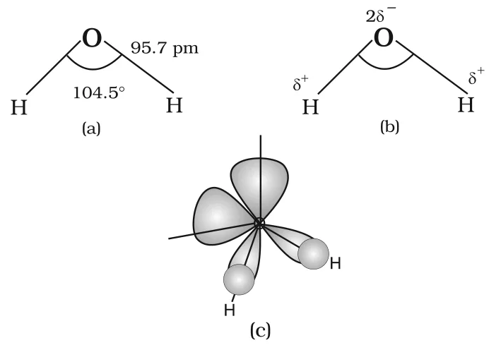
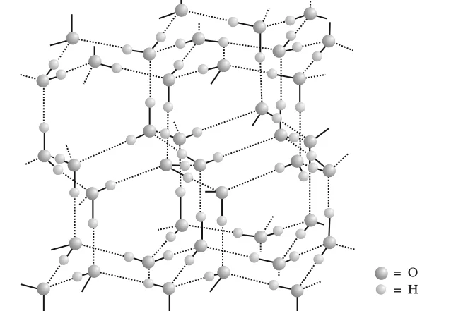

# [{ align=left, width=3.8% }](../../index.md)  Hydrogen | Water

Water is the most common and abundant compound of hydrogen. A major part of all living organisms is water: the human body has about 65% water and some plants have as much as 95%. It is a crucial compound for the survival of all life forms and a solvent of great importance.

In this article, we will discuss the physical properties, structure and chemical properties of water.

## Distribution of Water on Earth

Source                        | % of Total |
------------------------------|------------|
Oceans                        | 97.33      |
Saline lakes and inland seas  | 0.008      |
Polar ice and glaciers        | 2.04       |
Ground water                  | 0.61       |
Lakes                         | 0.009      |
Soil moisture                 | 0.005      |
Atmospheric water vapour      | 0.001      |
Rivers                        | 0.0001     |

## Physical Properties of Water

* Water is a colourless and tasteless liquid.
* Its unusual properties in the condensed phase (liquid and solid) are due to **extensive hydrogen bonding** between water molecules.
* Because of hydrogen bonding, water has a higher freezing point, boiling point, heat of vaporisation and heat of fusion than H2S and H2Se.
* Compared to other liquids, water has a higher specific heat, thermal conductivity, surface tension, dipole moment and dielectric constant.
* Its high heat of vaporisation and heat capacity moderate the climate and the body temperature of living beings.
* It is an excellent solvent for transporting ions and molecules needed for plant and animal metabolism.
* Due to hydrogen bonding with polar molecules, even covalent compounds like alcohol and carbohydrates dissolve in water.

### Physical properties of H2O and D2O

Property                                              | H2O        | D2O |
------------------------------------------------------|-----------------------|----------------|
Molecular mass (g mol-1)                   | 18.0151               | 20.0276        |
Melting point (K)                                     | 273.0                 | 276.8          |
Boiling point (K)                                     | 373.0                 | 374.4          |
Enthalpy of formation (kJ mol-1)           | -285.9                | -294.6         |
Enthalpy of vaporisation at 373 K (kJ mol-1) | 40.66               | 41.61          |
Enthalpy of fusion (kJ mol-1)              | 6.01                  | -              |
Temperature of maximum density (K)                    | 276.98                | 284.2          |
Density at 298 K (g cm-3)                  | 1.0000                | 1.1059         |
Viscosity (centipoise)                                | 0.8903                | 1.107          |
Dielectric constant (C2/N m2)   | 78.39                 | 78.06          |
Electrical conductivity at 293 K (ohm-1 cm-1) | 5.7 &times; 10-8 | - |

## Structure of Water

* In the gas phase, water is a **bent** molecule with a bond angle of 104.5&deg; and an O-H bond length of 95.7 pm.
* It is a highly polar molecule. Oxygen carries a partial negative charge (2&delta;-) and each hydrogen a partial positive charge (&delta;+).
* In the liquid phase, water molecules are associated together by hydrogen bonds.

{loading=lazy}

## Structure of Ice

* Ice is the crystalline form of water. At atmospheric pressure, ice crystallises in the **hexagonal** form, but at very low temperatures it condenses to the **cubic** form.
* Ice has a highly ordered three-dimensional hydrogen-bonded structure. X-ray studies show that each oxygen atom is surrounded **tetrahedrally** by four other oxygen atoms at a distance of 276 pm.
* Hydrogen bonding gives ice a rather **open structure with wide holes**. These holes can hold other molecules of suitable size interstitially.

{loading=lazy}

* Because of this open structure, the density of ice is less than that of water. That is why an ice cube floats on water.
* In winter, the ice formed on the surface of a lake insulates the water below and ensures the survival of aquatic life. This fact is of great ecological significance.

## Chemical Properties of Water

### 1. Amphoteric nature

* Water can act both as an acid and as a base, i.e., it is **amphoteric**.
* In the Bronsted sense, it acts as an acid with NH3 and as a base with H2S.

!!! tip ""

    $$H_2O_{(l)} + NH_{3(aq)} &#8652; OH^-_{(aq)} + NH^+_{4(aq)}$$

    $$H_2O_{(l)} + H_2S_{(aq)} &#8652; H_3O^+_{(aq)} + HS^-_{(aq)}$$

* **Auto-protolysis (self-ionization) of water:** one water molecule donates a proton to another.

!!! tip ""

    $$H_2O_{(l)} + H_2O_{(l)} &#8652; H_3O^+_{(aq)} + OH^-_{(aq)}$$

    $$acid_1\ \ \ \ base_2\ \ \ \ conjugate\ acid_2\ \ \ \ conjugate\ base_1$$

### 2. Redox reactions involving water

* Water is easily reduced to dihydrogen by highly electropositive metals. So, it is a great source of dihydrogen.

!!! tip ""

    $$2H_2O_{(l)} + 2Na_{(s)} &rarr; 2NaOH_{(aq)} + H_{2(g)}$$

* Water is oxidised to O2 during photosynthesis.

!!! tip ""

    $$6CO_{2(g)} + 12H_2O_{(l)} &rarr; C_6H_{12}O_{6(aq)} + 6H_2O_{(l)} + 6O_{2(g)}$$

* Water is also oxidised to O2 by fluorine.

!!! tip ""

    $$2F_{2(g)} + 2H_2O_{(l)} &rarr; 4H^+_{(aq)} + 4F^-_{(aq)} + O_{2(g)}$$

### 3. Hydrolysis reactions

* Due to its high dielectric constant, water has a very strong hydrating tendency and dissolves many ionic compounds.
* However, some covalent and some ionic compounds are **hydrolysed** (decomposed) by water.

!!! tip ""

    $$P_4O_{10(s)} + 6H_2O_{(l)} &rarr; 4H_3PO_{4(aq)}$$

    $$SiCl_{4(l)} + 2H_2O_{(l)} &rarr; SiO_{2(s)} + 4HCl_{(aq)}$$

    $$N^{3-}_{(s)} + 3H_2O_{(l)} &rarr; NH_{3(g)} + 3OH^-_{(aq)}$$

### 4. Hydrate formation

* Many salts crystallise from aqueous solution as hydrated salts. The water in them is associated in different ways:

1. **Coordinated water**, e.g., [Cr(H2O)6]3+3Cl-
2. **Interstitial water**, e.g., BaCl2.2H2O
3. **Hydrogen-bonded water**, e.g., [Cu(H2O)4]2+SO42-.H2O in CuSO4.5H2O

!!! question "How many hydrogen-bonded water molecule(s) are associated in CuSO4.5H2O?"

    CuSO4.5H2O is written as [Cu(H2O)4]2+SO42-.H2O. Only one water molecule, which is outside the brackets (coordination sphere), is hydrogen-bonded. The other four are coordinated to Cu2+.

!!! note "Hydrolysis vs Hydration"

    * **Hydrolysis** is a reaction in which water breaks a compound into new products, e.g., SiCl4 + 2H2O &rarr; SiO2 + 4HCl.
    * **Hydration** is the attachment of water molecules to a substance without decomposing it, e.g., formation of CuSO4.5H2O or hydrated ions like [Cr(H2O)6]3+.

## Questions

!!! question "Among NH3, H2O and HF, which would you expect to have highest magnitude of hydrogen bonding and why?"

    The strength of a single hydrogen bond depends on the electronegativity of the atom attached to hydrogen. Since F is the most electronegative element, a single H...F hydrogen bond in HF is the strongest.

    However, each H2O molecule has two H atoms and two lone pairs, so it can form up to four hydrogen bonds, while HF and NH3 are limited (HF has only one H; NH3 has only one lone pair). Hence, the overall magnitude (extent) of hydrogen bonding is highest in H2O, which is also why water has the highest boiling point of the three.

!!! question "What do you understand by the term 'auto-protolysis' of water? What is its significance?"

    Auto-protolysis (self-ionization) is the transfer of a proton from one water molecule to another, forming H3O+ and OH- ions.

    $$H_2O_{(l)} + H_2O_{(l)} &#8652; H_3O^+_{(aq)} + OH^-_{(aq)}$$

    **Significance:** It shows that water is amphoteric, i.e., it can act both as an acid and as a base. Because of this, water can react with both acids and bases, and the small concentration of ions it produces explains its very low electrical conductivity.

!!! question "Consider the reaction of water with F2 and suggest, in terms of oxidation and reduction, which species are oxidised/reduced."

    $$2F_{2(g)} + 2H_2O_{(l)} &rarr; 4H^+_{(aq)} + 4F^-_{(aq)} + O_{2(g)}$$

    * Oxidation state of O changes from -2 (in H2O) to 0 (in O2). So, **water is oxidised**.
    * Oxidation state of F changes from 0 (in F2) to -1 (in F-). So, **fluorine is reduced**.

!!! question "Write chemical reactions to show the amphoteric nature of water."

    Water acts as an acid with NH3 (donates a proton):

    $$H_2O_{(l)} + NH_{3(aq)} &#8652; OH^-_{(aq)} + NH^+_{4(aq)}$$

    Water acts as a base with H2S (accepts a proton):

    $$H_2O_{(l)} + H_2S_{(aq)} &#8652; H_3O^+_{(aq)} + HS^-_{(aq)}$$

!!! question "Describe the structure of the common form of ice."

    The common form of ice is hexagonal ice, formed at atmospheric pressure. It has a highly ordered three-dimensional hydrogen-bonded structure in which each oxygen atom is surrounded tetrahedrally by four other oxygen atoms at a distance of 276 pm. Hydrogen bonding gives ice an open structure with wide holes, which is why ice is less dense than water.

!!! question "What properties of water make it useful as a solvent? What types of compound can it (i) dissolve, and (ii) hydrolyse?"

    Water has a high dielectric constant (78.39), a high dipole moment and the ability to form hydrogen bonds. These make it an excellent solvent.

    (i) It dissolves most ionic compounds (e.g., NaCl) and polar covalent compounds that can form hydrogen bonds with it (e.g., alcohols, carbohydrates).

    (ii) It hydrolyses many covalent compounds (e.g., P4O10, SiCl4) and some ionic compounds such as nitrides.

    $$SiCl_{4(l)} + 2H_2O_{(l)} &rarr; SiO_{2(s)} + 4HCl_{(aq)}$$

!!! question "Describe the usefulness of water in biosphere and biological systems."

    * Water makes up a major part of living organisms (about 65% of the human body) and is essential for all life forms.
    * Its high specific heat and heat of vaporisation moderate the climate and the body temperature of living beings.
    * It is an excellent solvent and transports ions and molecules needed for plant and animal metabolism.
    * It takes part in photosynthesis, where it is oxidised to O2.
    * Ice floats on water and insulates the water below, which helps aquatic life survive in winter.

!!! question "Do you expect different products in solution when aluminium(III) chloride and potassium chloride are treated separately with (i) normal water (ii) acidified water, and (iii) alkaline water? Write equations wherever necessary."

    **KCl** is a salt of a strong acid and strong base. It is not hydrolysed and simply dissociates into K+ and Cl- ions in all three cases.

    $$KCl_{(s)} + H_2O &rarr; K^+_{(aq)} + Cl^-_{(aq)}$$

    **AlCl3** is a salt of a weak base and strong acid, so it behaves differently:

    (i) In normal water, it is hydrolysed, giving an acidic solution:

    $$AlCl_3 + 3H_2O &rarr; Al(OH)_3 + 3HCl$$

    (ii) In acidified water, hydrolysis is suppressed and it stays in solution as hydrated ions:

    $$AlCl_3 + 6H_2O &rarr; [Al(H_2O)_6]^{3+} + 3Cl^-$$

    (iii) In alkaline water, Al(OH)3 first forms and then dissolves in excess alkali, giving tetrahydroxoaluminate ions:

    $$AlCl_3 + 4OH^- &rarr; [Al(OH)_4]^- + 3Cl^-$$
