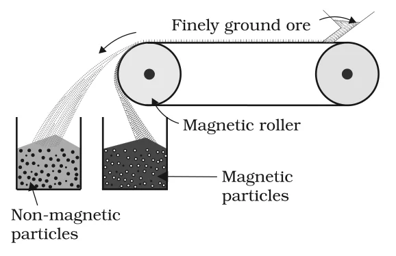
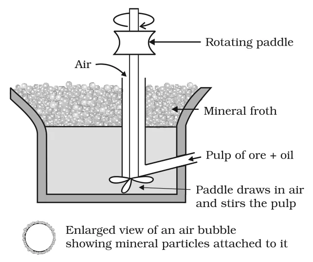

# [{ align=left, width=3.8% }](../../index.md)  Metallurgy | Concentration of Ores

Removal of the unwanted materials (gangue) like sand and clay from the ore is known as concentration, dressing or benefaction of the ore.

* Concentration involves several steps. The choice of steps depends on the differences in physical properties of the metal compound and the gangue.
* The type of metal, the available facilities and environmental factors are also taken into consideration.
* The important methods of concentration are:
    * Hydraulic washing
    * Magnetic separation
    * Froth floatation
    * Leaching

## 1. Hydraulic Washing

* It is based on the difference in densities (specific gravities) of the ore particles and the gangue particles. Hence, it is a type of **gravity separation**.
* An upward stream of running water is used to wash the powdered ore.
* The lighter gangue particles are washed away and the heavier ore particles are left behind.

!!! note "Note"

    This method works well for heavy oxide and carbonate ores, e.g., haematite and tin stone, where the ore is much heavier than the gangue.

## 2. Magnetic Separation

* It is based on the difference in magnetic properties of the ore components.
* It is used when either the ore or the gangue (one of the two) is attracted by a magnetic field, e.g., in case of iron ores.
* The ground ore is carried on a conveyer belt which passes over a magnetic roller.
* The magnetic particles are attracted by the roller and fall close to it, while the non-magnetic particles are thrown farther away. Thus they collect in two separate heaps.

{loading=lazy}

!!! example "Example"

    Ores containing iron such as haematite, magnetite, siderite and iron pyrites can be concentrated by magnetic separation.

## 3. Froth Floatation Method

* This method is used for removing gangue from **sulphide ores**.
* It is based on the principle that the mineral (ore) particles are preferentially wetted by oil, while the gangue particles are wetted by water.
* A suspension of the powdered ore is made with water. To it, collectors and froth stabilisers are added.

### Collectors

* Collectors enhance the non-wettability of the mineral particles by water, so that they stick to the oil.
* Examples: pine oils, fatty acids, xanthates.

### Froth Stabilisers

* Froth stabilisers stabilise the froth so that it does not collapse.
* Examples: cresols, aniline.

### Process

* A rotating paddle agitates the mixture and draws air into it.
* As a result, a froth is formed which carries the mineral particles with it.
* The froth is light and is skimmed off. It is then dried to recover the ore particles.
* The gangue particles, wetted by water, settle at the bottom.

{loading=lazy}

### Depressants

* It is possible to separate two sulphide ores from each other by adjusting the proportion of oil to water or by using **depressants**.
* A depressant selectively prevents one of the sulphides from coming into the froth.

!!! example "Example"

    In an ore containing ZnS and PbS, NaCN is used as a depressant. It selectively prevents ZnS from coming to the froth but allows PbS to come with the froth.

!!! note "Note"

    The froth floatation method made copper mining profitable even from low grade ores. Before it was invented, only ores containing large amounts of copper could be used. As a result, world production of copper rose sharply and the metal became cheaper.

## 4. Leaching

Leaching is used when the ore is soluble in some suitable solvent while the impurities are not.

### (a) Leaching of alumina from bauxite

* Bauxite, the principal ore of aluminium, usually contains SiO2, iron oxides and titanium oxide (TiO2) as impurities.
* The powdered ore is digested with a concentrated solution of NaOH at 473 – 523 K and 35 – 36 bar pressure.
* Al2O3 is leached out as sodium aluminate (and SiO2 too as sodium silicate), leaving the other impurities behind.

!!! tip ""

    $$Al_2O_{3(s)} + 2NaOH_{(aq)} + 3H_2O_{(l)} &rarr; 2Na[Al(OH)_4]_{(aq)}$$

* The aluminate in solution is neutralised by passing CO2 gas, and hydrated Al2O3 is precipitated.
* At this stage, the solution is seeded with freshly prepared samples of hydrated Al2O3, which induces the precipitation.

!!! tip ""

    $$2Na[Al(OH)_4]_{(aq)} + CO_{2(g)} &rarr; Al_2O_3.xH_2O_{(s)} + 2NaHCO_{3(aq)}$$

* Sodium silicate remains in the solution. The hydrated alumina is filtered, dried and heated to give back pure Al2O3.

!!! tip ""

    $$Al_2O_3.xH_2O_{(s)} \xrightarrow{1470\ K} Al_2O_{3(s)} + xH_2O_{(g)}$$

### (b) Leaching of silver and gold

* In the metallurgy of silver and gold, the metal is leached with a dilute solution of NaCN or KCN in the presence of air (for O2).
* The metal goes into solution as a soluble cyano complex. It is later recovered by displacement with a more reactive metal like zinc.

!!! tip ""

    $$4M_{(s)} + 8CN^-_{(aq)} + 2H_2O_{(aq)} + O_{2(g)} &rarr; 4[M(CN)_2]^-_{(aq)} + 4OH^-_{(aq)}$$

    $$(M = Ag\ or\ Au)$$

    $$2[M(CN)_2]^-_{(aq)} + Zn_{(s)} &rarr; [Zn(CN)_4]^{2-}_{(aq)} + 2M_{(s)}$$
