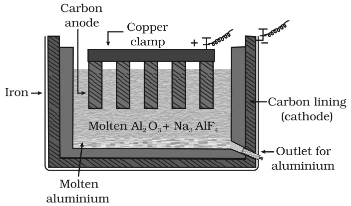

# [{ align=left, width=3.8% }](../../index.md)  Metallurgy | Electrochemical Principles and Oxidation-Reduction

Metal ions in solution or in the molten state can be reduced by electrolysis or by adding a more reactive metal. The same thermodynamic principles used in pyrometallurgy apply here, through the relation between Gibbs energy and electrode potential.

## Gibbs Energy and Electrode Potential

!!! tip ""

    $$\Delta G^0 = -nE^0F$$

    Where, n is the number of electrons exchanged and E0 is the electrode potential of the redox couple formed in the system.

* More reactive metals have large negative electrode potentials, so their reduction is difficult.
* If the difference of two E0 values gives a positive E0, then &Delta;G0 is negative. The less reactive metal then comes out of the solution and the more reactive metal goes into the solution.

!!! example "Example"

    $$Cu^{2+}_{(aq)} + Fe_{(s)} &rarr; Cu_{(s)} + Fe^{2+}_{(aq)}$$

    Iron is more reactive than copper, so it displaces copper from the solution.

* In simple electrolysis, the Mn+ ions are discharged at the negative electrode (cathode) and deposited there.
* Precautions are taken considering the reactivity of the metal produced, and suitable materials are used as electrodes.
* Sometimes a flux is added to make the molten mass more conducting.

## Extraction of Aluminium (Hall-Heroult Process)

* Purified Al2O3 (obtained by leaching bauxite) is mixed with Na3AlF6 (cryolite) or CaF2.
* Cryolite lowers the melting point of the mixture and increases its electrical conductivity.
* The fused mixture is electrolysed in an electrolytic cell using carbon electrodes:
    * **Cathode:** steel vessel with a carbon lining.
    * **Anode:** graphite rods dipped in the melt.

{loading=lazy}

* The overall reaction may be taken as:

!!! tip ""

    $$2Al_2O_3 + 3C &rarr; 4Al + 3CO_2$$

* The electrode reactions are:

!!! tip ""

    $$Cathode:\ Al^{3+}_{(melt)} + 3e^- &rarr; Al_{(l)}$$

    $$Anode:\ C_{(s)} + O^{2-}_{(melt)} &rarr; CO_{(g)} + 2e^-$$

    $$C_{(s)} + 2O^{2-}_{(melt)} &rarr; CO_{2(g)} + 4e^-$$

* The oxygen liberated at the anode reacts with the carbon of the anode, producing CO and CO2.
* So the graphite anode is slowly burnt away. For each kg of aluminium produced, about 0.5 kg of carbon anode is consumed, and the anodes have to be replaced from time to time.
* The graphite anode is useful here because it helps in the reduction of the oxide to the metal.

!!! note "Note"

    A large amount of electricity is needed for this process, so a cheap and good source of electricity is essential.

## Copper from Low Grade Ores and Scraps

* Copper is extracted from low grade ores by **hydrometallurgy**.
* The copper is leached out using acid or bacteria. The solution containing Cu2+ is then treated with scrap iron or H2:

!!! tip ""

    $$Cu^{2+}_{(aq)} + Fe_{(s)} &rarr; Cu_{(s)} + Fe^{2+}_{(aq)}$$

    $$Cu^{2+}_{(aq)} + H_{2(g)} &rarr; Cu_{(s)} + 2H^+_{(aq)}$$

!!! question "At a site, low grade copper ores are available and zinc and iron scraps are also available. Which of the two scraps would be more suitable for reducing the leached copper ore and why?"

    Zinc lies above iron in the electrochemical series (zinc is the more reactive metal), so the reduction will be faster with zinc scraps. But zinc is a costlier metal than iron, so using iron scraps is more advisable and economical.

## Oxidation-Reduction

Besides reductions, some extractions are based on oxidation, particularly for non-metals.

### 1. Extraction of chlorine from brine

* Chlorine is abundant in sea water as common salt. It is obtained by the oxidation of Cl- ions:

!!! tip ""

    $$2Cl^-_{(aq)} + 2H_2O_{(l)} &rarr; 2OH^-_{(aq)} + H_{2(g)} + Cl_{2(g)}$$

* &Delta;G0 for this reaction is +422 kJ. Converting it into E0:

!!! tip ""

    $$E^0 = -{\Delta G^0 \over nF} = -{422000 \over 2 \times 96500} = -2.2\ V$$

* So the reaction needs an external emf greater than 2.2 V. In practice, electrolysis needs an extra potential to overcome some other hindering reactions.
* Thus, Cl2 is obtained by electrolysis, with H2 and aqueous NaOH as by-products.
* Molten NaCl can also be electrolysed. But in that case, Na metal is produced and not NaOH.

### 2. Extraction of gold and silver

* Leaching of gold and silver with CN- is also an oxidation reaction (Ag &rarr; Ag+ or Au &rarr; Au+).
* The metal is later recovered by displacement, in which zinc acts as the reducing agent.

!!! tip ""

    $$4Au_{(s)} + 8CN^-_{(aq)} + 2H_2O_{(aq)} + O_{2(g)} &rarr; 4[Au(CN)_2]^-_{(aq)} + 4OH^-_{(aq)}$$

    $$2[Au(CN)_2]^-_{(aq)} + Zn_{(s)} &rarr; 2Au_{(s)} + [Zn(CN)_4]^{2-}_{(aq)}$$
