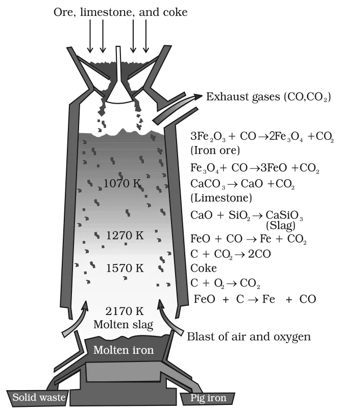

# [{ align=left, width=3.8% }](../../index.md)  Metallurgy | Extraction of Iron, Copper and Zinc

Iron, copper and zinc are extracted by reducing their oxides with coke or carbon monoxide. The Ellingham diagram explains the choice of reducing agent and the temperature used in each case.

## 1. Extraction of Iron from its Oxides

* Oxide ores of iron are first concentrated and then calcined or roasted to remove water, decompose carbonates and oxidise sulphides.
* They are then mixed with limestone and coke and fed into a **blast furnace** from its top. Here the oxide is reduced to the metal.
* One of the main reduction steps is:

!!! tip ""

    $$FeO_{(s)} + C_{(s)} &rarr; Fe_{(s/l)} + CO_{(g)}$$

* It can be seen as a coupling of two simpler reactions: the reduction of FeO and the oxidation of C to CO.

!!! tip ""

    $$FeO_{(s)} &rarr; Fe_{(s)} + {1 \over 2}O_{2(g)}\ \ \ [\Delta G_{(FeO,\ Fe)}]$$

    $$C_{(s)} + {1 \over 2}O_{2(g)} &rarr; CO_{(g)}\ \ \ [\Delta G_{(C,\ CO)}]$$

    $$\Delta_rG = \Delta G_{(C,\ CO)} + \Delta G_{(FeO,\ Fe)}$$

* The overall reaction takes place when $\Delta_rG$ is negative.
* In the &Delta;G0 vs T plot, the line for Fe &rarr; FeO goes upward while the line for C &rarr; CO goes downward.
* Above about 1073 K, the C, CO line comes below the Fe, FeO line [$\Delta G_{(C,\ CO)} < \Delta G_{(Fe,\ FeO)}$]. So in this range, coke reduces FeO and is itself oxidised to CO.
* Similarly, Fe3O4 and Fe2O3 are reduced by CO at relatively lower temperatures, because their curves intersect the CO, CO2 curve at lower temperatures.

### Reactions in the Blast Furnace

* Hot air is blown in from the bottom of the furnace and coke is burnt to give a temperature up to about 2200 K in the lower portion. The burning of coke supplies most of the heat needed.
* The CO and heat move to the upper part of the furnace. Here the temperature is lower, and the iron oxides (Fe2O3 and Fe3O4) coming from the top are reduced in steps to FeO.

{loading=lazy}

#### (a) At 500 – 800 K (lower temperature range)

!!! tip ""

    $$3Fe_2O_3 + CO &rarr; 2Fe_3O_4 + CO_2$$

    $$Fe_3O_4 + 4CO &rarr; 3Fe + 4CO_2$$

    $$Fe_2O_3 + CO &rarr; 2FeO + CO_2$$

#### (b) At 900 – 1500 K (higher temperature range)

!!! tip ""

    $$C + CO_2 &rarr; 2CO$$

    $$FeO + CO &rarr; Fe + CO_2$$

#### (c) Role of limestone

* Limestone decomposes to CaO, which acts as a flux and removes the silicate impurity of the ore as slag.
* The slag is in the molten state and separates out from the iron.

!!! tip ""

    $$CaCO_3 &rarr; CaO + CO_2$$

    $$CaO + SiO_2 &rarr; CaSiO_3\ (slag)$$

### Types of Iron

#### 1. Pig iron

* The iron obtained from the blast furnace contains about 4% carbon and smaller amounts of many impurities (e.g., S, P, Si, Mn).
* It is known as pig iron and can be cast into a variety of shapes.

#### 2. Cast iron

* Cast iron is made by melting pig iron with scrap iron and coke using a hot air blast.
* It has a slightly lower carbon content (about 3%) and is extremely hard and brittle.

#### 3. Wrought iron (malleable iron)

* It is the purest form of commercial iron.
* It is prepared from cast iron by oxidising the impurities in a reverberatory furnace lined with haematite. The haematite oxidises carbon to carbon monoxide:

!!! tip ""

    $$Fe_2O_3 + 3C &rarr; 2Fe + 3CO$$

* Limestone is added as a flux. Sulphur, silicon and phosphorus are oxidised and pass into the slag.
* The metal is removed and freed from the slag by passing it through rollers.

## 2. Extraction of Copper from Cuprous Oxide

* In the Ellingham diagram, the Cu2O line is almost at the top. So it is quite easy to reduce oxide ores of copper directly to the metal by heating with coke.
* The lines for C, CO and C, CO2 lie much lower in the diagram, particularly after 500 – 600 K.
* However, most copper ores are sulphides and some also contain iron. The sulphide ores are roasted or smelted to give oxides:

!!! tip ""

    $$2Cu_2S + 3O_2 &rarr; 2Cu_2O + 2SO_2$$

* The oxide is then easily reduced to metallic copper using coke:

!!! tip ""

    $$Cu_2O + C &rarr; 2Cu + CO$$

### Actual process

* The ore is heated in a reverberatory furnace after mixing with silica.
* Iron oxide forms a slag of iron silicate, and copper is produced in the form of **copper matte**, which contains Cu2S and FeS.

!!! tip ""

    $$FeO + SiO_2 &rarr; FeSiO_3\ (slag)$$

* The copper matte is then charged into a silica lined **converter**. Some silica is also added and a hot air blast is blown in.
* The remaining FeS, FeO and Cu2S/Cu2O are converted to metallic copper:

!!! tip ""

    $$2FeS + 3O_2 &rarr; 2FeO + 2SO_2$$

    $$FeO + SiO_2 &rarr; FeSiO_3$$

    $$2Cu_2S + 3O_2 &rarr; 2Cu_2O + 2SO_2$$

    $$2Cu_2O + Cu_2S &rarr; 6Cu + SO_2$$

* The last reaction is a **self-reduction** (auto-reduction): Cu2S itself reduces Cu2O, and no external reducing agent is needed.
* The solidified copper has a blistered appearance due to the evolution of SO2, so it is called **blister copper**.

## 3. Extraction of Zinc from Zinc Oxide

* Zinc blende (ZnS) is first roasted to ZnO, and calamine (ZnCO3) is calcined to ZnO.
* The reduction of zinc oxide is done using coke. The temperature needed is higher than that for copper.
* For heating, the oxide is made into brickettes with coke and clay.

!!! tip ""

    $$ZnO + C \xrightarrow{\Delta} Zn + CO$$

* At this high temperature zinc is formed as a vapour. The metal is distilled off and collected by rapid chilling.
