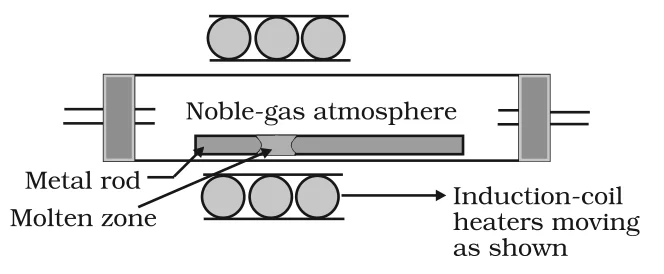
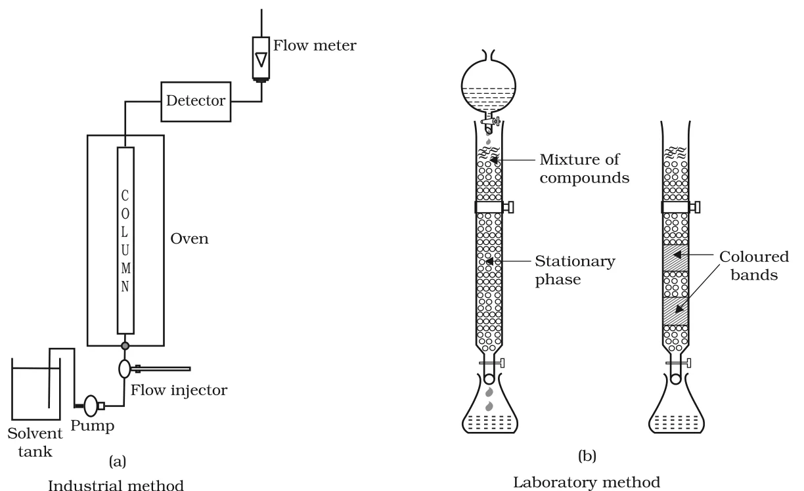

# [{ align=left, width=3.8% }](../../index.md)  Metallurgy | Refining and Uses of Metals

A metal extracted by any method is usually contaminated with some impurity. Refining is the process of removing these impurities to obtain the metal in a highly pure form. The technique chosen depends on the differences in properties of the metal and the impurity.

The common refining methods are:

* Distillation
* Liquation
* Electrolytic refining
* Zone refining
* Vapour phase refining
* Chromatographic methods

## 1. Distillation

* It is useful for low boiling metals like **zinc** and **mercury**.
* The impure metal is evaporated and the pure metal is obtained as the distillate. The non-volatile impurities are left behind.

## 2. Liquation

* In this method, a low melting metal like **tin** is made to flow on a sloping surface.
* The metal melts and flows down, and is thus separated from the higher melting impurities.

## 3. Electrolytic Refining

* The impure metal is made the **anode**, and a strip of the same metal in pure form is used as the **cathode**.
* Both are put in a suitable electrolytic bath containing a soluble salt of the same metal.
* The more basic (more reactive) metal impurities remain in the solution, and the less basic ones fall below the anode as **anode mud**.
* The process is explained using the concepts of electrode potential, overpotential and Gibbs energy.

!!! tip ""

    $$Anode:\ M &rarr; M^{n+} + ne^-$$

    $$Cathode:\ M^{n+} + ne^- &rarr; M$$

### Electrolytic refining of copper

* Anode: impure (blister) copper. Cathode: pure copper strips.
* Electrolyte: acidified solution of copper sulphate.
* The net result is the transfer of copper in pure form from the anode to the cathode.

!!! tip ""

    $$Anode:\ Cu &rarr; Cu^{2+} + 2e^-$$

    $$Cathode:\ Cu^{2+} + 2e^- &rarr; Cu$$

* Impurities from the blister copper deposit as anode mud, which contains antimony, selenium, tellurium, silver, gold and platinum. Recovery of these elements may meet the cost of refining.
* Zinc may also be refined this way.

## 4. Zone Refining

* It is based on the principle that the impurities are more soluble in the melt than in the solid state of the metal.
* A circular mobile heater is fixed at one end of a rod of the impure metal, and a molten zone is formed.
* The molten zone moves along with the heater. As the heater moves forward, the pure metal crystallises out of the melt, and the impurities pass into the adjacent molten zone.
* The process is repeated several times with the heater moving in the same direction. The impurities get concentrated at one end, which is finally cut off.
* The process is carried out in an inert (noble gas) atmosphere.

{loading=lazy}

* It is very useful for producing semiconductors and other metals of very high purity, e.g., **germanium, silicon, boron, gallium and indium**.

## 5. Vapour Phase Refining

In this method, the metal is converted into its volatile compound, which is collected elsewhere and then decomposed to give the pure metal. The two requirements are:

* The metal should form a volatile compound with an available reagent.
* The volatile compound should be easily decomposable, so that the recovery is easy.

### (a) Mond process for refining nickel

* Nickel is heated in a stream of carbon monoxide, forming a volatile complex, nickel tetracarbonyl.
* The carbonyl is then heated to a higher temperature, where it decomposes to give pure nickel.

!!! tip ""

    $$Ni + 4CO \xrightarrow{330 - 350\ K} Ni(CO)_4$$

    $$Ni(CO)_4 \xrightarrow{450 - 470\ K} Ni + 4CO$$

### (b) van Arkel method for refining zirconium or titanium

* This method is very useful for removing all the oxygen and nitrogen present as impurities in metals like Zr and Ti.
* The crude metal is heated with iodine in an evacuated vessel. The metal iodide, being more covalent, volatilises.
* The metal iodide is decomposed on a tungsten filament electrically heated to about 1800 K. The pure metal is deposited on the filament.

!!! tip ""

    $$Zr + 2I_2 &rarr; ZrI_4$$

    $$ZrI_4 \xrightarrow{1800\ K} Zr + 2I_2$$

## 6. Chromatographic Methods

* This method is based on the principle that different components of a mixture are adsorbed to different extents on an adsorbent.
* The mixture is put in a liquid or gaseous medium (mobile phase), which is moved through the adsorbent (stationary phase).
* Different components are adsorbed at different levels on the column. Later, the adsorbed components are removed (eluted) using suitable solvents called **eluants**.
* The method gets its name from the physical state of the moving medium, the adsorbent material and the way the medium passes. Examples are paper chromatography, column chromatography and gas chromatography.

### Column chromatography

* A column of Al2O3 (stationary phase) is prepared in a glass tube, and the moving medium containing a solution of the components is in liquid form.
* It is very useful for purifying elements which are available in minute quantities and whose impurities are not very different in chemical properties from the element to be purified.

{loading=lazy}

!!! note "Mobile and stationary phases"

    * The mobile phase may be a gas, a liquid or a supercritical fluid. The sample is dissolved in it.
    * The stationary phase is immobile and immiscible, like the Al2O3 column.
    * The two phases are chosen such that the components of the sample have different solubilities in them.
    * A component which is quite soluble in the stationary phase takes longer to travel through it than a component which is not very soluble in the stationary phase but very soluble in the mobile phase. Thus, the components get separated as they travel through the stationary phase.

## Uses of Aluminium, Copper, Zinc and Iron

### 1. Aluminium

* Aluminium foils are used as wrappers for chocolates.
* The fine dust of the metal is used in paints and lacquers.
* Being highly reactive, it is used in the extraction of chromium and manganese from their oxides.
* Wires of aluminium are used as electricity conductors.
* Alloys containing aluminium, being light, are very useful.

### 2. Copper

* Copper is used for making wires in the electrical industry and for water and steam pipes.
* It is used in several alloys that are tougher than the metal itself, e.g., brass (with zinc), bronze (with tin) and coinage alloy (with nickel).

### 3. Zinc

* Zinc is used for galvanising iron.
* It is used in large quantities in batteries.
* It is a constituent of many alloys, e.g., brass (Cu 60%, Zn 40%) and german silver (Cu 25-30%, Zn 25-30%, Ni 40-50%).
* Zinc dust is used as a reducing agent in the manufacture of dye-stuffs, paints, etc.

### 4. Iron

* **Cast iron**, the most important form of iron, is used for casting stoves, railway sleepers, gutter pipes, toys, etc. It is also used to make wrought iron and steel.
* **Wrought iron** is used in making anchors, wires, bolts, chains and agricultural implements.
* **Steel** finds a number of uses. Alloy steel is obtained when other metals are added to it:
    * Nickel steel: cables, automobile and aeroplane parts, pendulums, measuring tapes.
    * Chrome steel: cutting tools and crushing machines.
    * Stainless steel: cycles, automobiles, utensils, pens, etc.
