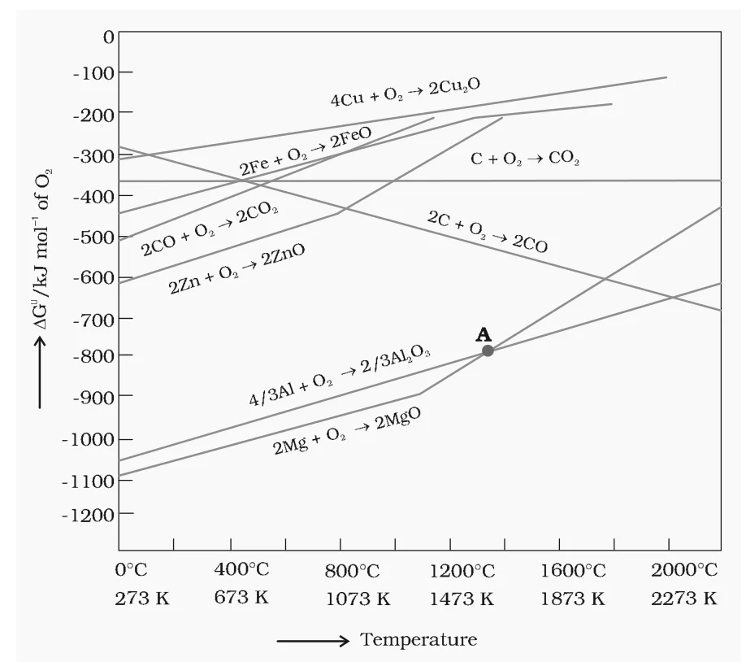

# [{ align=left, width=3.8% }](../../index.md)  Metallurgy | Thermodynamic Principles and Ellingham Diagram

Thermodynamics explains why only a certain reducing agent and a minimum specific temperature are suitable for the reduction of a metal oxide to the metal. Gibbs energy is the most important quantity here.

## Gibbs Energy and Feasibility

* The change in Gibbs energy, &Delta;G, for any process at a given temperature is:

!!! tip ""

    $$\Delta G = \Delta H - T\Delta S$$

    Where, $\Delta H$ is the enthalpy change and $\Delta S$ is the entropy change of the process.

* &Delta;G0 is also related to the equilibrium constant K of the reaction at temperature T:

!!! tip ""

    $$\Delta G^0 = -RT\ lnK$$

* A negative &Delta;G gives a large positive value of ln K, i.e., K > 1. This happens only when the reaction proceeds towards the products.

From these relations we get two important conclusions:

### 1. Effect of temperature

* A reaction proceeds only when &Delta;G is negative.
* If &Delta;S is positive, increasing the temperature increases T&Delta;S. When T&Delta;S becomes greater than &Delta;H, &Delta;G becomes negative.

### 2. Coupling of reactions

* If two reactions are put together in a system and the net &Delta;G of the two is negative, the overall reaction will occur.
* So we add up the &Delta;G values of the two reactions and look at the sign of the sum. Such coupling is easily understood through plots of &Delta;G0 vs T for the formation of oxides.

## Ellingham Diagram

The graphical representation of Gibbs energy of formation of oxides against temperature was first used by H.J.T. Ellingham, and it is known as the Ellingham diagram. It provides a sound basis for choosing a reducing agent and predicting the feasibility of thermal reduction of an ore.

* The criterion of feasibility is that at the given temperature, the Gibbs energy of the reaction must be negative.

{loading=lazy}

### Features of the Ellingham Diagram

* It consists of plots of &Delta;fG0 vs T for the formation of oxides of elements, i.e., for the reaction:

!!! tip ""

    $$2xM_{(s)} + O_{2(g)} &rarr; 2M_xO_{(s)}$$

* **Positive slope:** In this reaction, a gas (O2) is consumed, so the randomness decreases and &Delta;S is negative. This makes the term -T&Delta;S positive, so &Delta;G becomes less negative as T increases. Hence most of the MxO lines slope upwards.
* **Change in slope:** Each plot is a straight line except where a phase change (s &rarr; l or l &rarr; g) takes place. At that temperature the slope increases on the positive side. For example, in the Zn, ZnO plot, melting is shown by an abrupt change in the curve.
* **Decomposition of oxide:** There is a point in a curve below which &Delta;G is negative (MxO is stable). Above this point, MxO will decompose on its own.
* The diagram gives &Delta;fG0 values of the oxides of common metals and of some reducing agents (C, CO) at different temperatures, which makes interpretation easy.
* Similar diagrams are drawn for sulphides and halides. They show why reduction of MxS is difficult: the &Delta;fG0 of MxS is not compensated by that of the oxidised reducing agent.

### Lines for carbon

* **C &rarr; CO2:** The number of gas molecules is unchanged, so &Delta;S is nearly zero and the line is almost horizontal.
* **C &rarr; CO:** Gas molecules increase (1 mol O2 gives 2 mol CO), so &Delta;S is positive and the line slopes downwards. This is why carbon becomes a better reducing agent at high temperature.
* **CO &rarr; CO2:** Gas molecules decrease, so the line slopes upwards like the metal lines.

### Limitations of Ellingham Diagram

* It only tells whether a reduction is possible or not, i.e., the tendency of reduction with a reducing agent. It is based only on thermodynamics and says nothing about the kinetics (rate) of the reduction.
* The interpretation of &Delta;G0 is based on K ($\Delta G^0 = -RT\ lnK$). It is assumed that reactants and products are in equilibrium:

!!! tip ""

    $$M_xO + A_{red} &#8652; xM + AO_{ox}$$

* This is not always true because the reactants and products may be solids. However, it explains why reactions are sluggish when every species is in the solid state and smooth when the ore melts.

!!! note "Note"

    &Delta;H and &Delta;S of a reaction remain nearly constant with temperature, so in $\Delta G = \Delta H - T\Delta S$ the dominant variable is T. However, &Delta;S depends greatly on the physical state. Entropy increases when a compound melts (s &rarr; l) or vaporises (l &rarr; g).

## Choice of Reducing Agent

* When a metal oxide is reduced, the reducing agent itself forms its oxide.
* The role of the reducing agent is to provide a &Delta;G0 that is negative and large enough to make the sum of the two &Delta;G0 values (oxidation of the reducing agent + reduction of the metal oxide) negative.
* During reduction, the metal oxide decomposes:

!!! tip ""

    $$M_xO_{(s)} &rarr; xM_{(s\ or\ l)} + {1 \over 2}O_{2(g)}$$

* This is the reverse of the formation of the oxide:

!!! tip ""

    $$xM_{(s\ or\ l)} + {1 \over 2}O_{2(g)} &rarr; M_xO_{(s)}\ \ \ [\Delta G^0_{(M,\ M_xO)}]$$

* At the same time, the reducing agent (C or CO) is oxidised:

!!! tip ""

    $$C_{(s)} + {1 \over 2}O_{2(g)} &rarr; CO_{(g)}\ \ \ [\Delta G^0_{(C,\ CO)}]$$

    $$CO_{(g)} + {1 \over 2}O_{2(g)} &rarr; CO_{2(g)}\ \ \ [\Delta G^0_{(CO,\ CO_2)}]$$

    $${1 \over 2}C_{(s)} + {1 \over 2}O_{2(g)} &rarr; {1 \over 2}CO_{2(g)}\ \ \ [{1 \over 2}\Delta G^0_{(C,\ CO_2)}]$$

* Subtracting the metal oxide formation equation from each of these gives the actual reduction reactions:

!!! tip ""

    $$M_xO_{(s)} + C_{(s)} &rarr; xM_{(s\ or\ l)} + CO_{(g)}$$

    $$M_xO_{(s)} + CO_{(g)} &rarr; xM_{(s\ or\ l)} + CO_{2(g)}$$

    $$M_xO_{(s)} + {1 \over 2}C_{(s)} &rarr; xM_{(s\ or\ l)} + {1 \over 2}CO_{2(g)}$$

* The &Delta;rG0 of these reactions is obtained by a similar subtraction of the &Delta;fG0 values.

!!! tip "Conclusion"

    * Heating favours a negative &Delta;rG0, so the temperature is chosen such that the sum of &Delta;rG0 of the two coupled reactions is negative.
    * On the Ellingham diagram, this is shown by the point of intersection of the two curves (the MxO curve and the curve for oxidation of the reducing substance).
    * Beyond that point, &Delta;rG0 for the combined process becomes negative.
    * An element whose line lies **lower** in the diagram can reduce the oxide of an element whose line lies **higher**. The larger the gap between the two lines, the easier the reduction.

## Solved Examples

!!! question "Suggest a condition under which magnesium could reduce alumina."

    The two equations are:

    $$(a)\ {4 \over 3}Al + O_2 &rarr; {2 \over 3}Al_2O_3$$

    $$(b)\ 2Mg + O_2 &rarr; 2MgO$$

    At the point of intersection of the Al2O3 and MgO curves (marked "A" in the Ellingham diagram), &Delta;G0 becomes zero for the reaction:

    $${2 \over 3}Al_2O_3 + 2Mg &rarr; 2MgO + {4 \over 3}Al$$

    Below that temperature the MgO line lies lower, so magnesium can reduce alumina at temperatures below the point of intersection.

!!! question "Although thermodynamically feasible, in practice magnesium metal is not used for the reduction of alumina in the metallurgy of aluminium. Why?"

    Magnesium can reduce alumina only in a certain temperature range given by the Ellingham diagram. Even in that range the gap between the two lines is small, and the temperature required is so high that the process would be uneconomic and technologically difficult. Magnesium is also a costlier metal.

!!! question "Why is the reduction of a metal oxide easier if the metal formed is in liquid state at the temperature of reduction?"

    The entropy is higher if the metal is in liquid state than when it is in solid state. So the entropy change (&Delta;S) of the reduction is more positive when the metal formed is liquid and the metal oxide being reduced is solid. Thus the value of &Delta;G0 ($\Delta H - T\Delta S$) becomes more negative and the reduction becomes easier.
