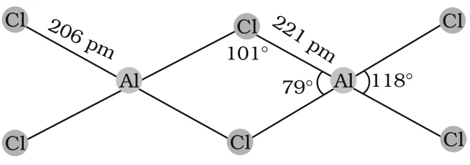

# [{ align=left, width=3.8% }](../../../index.md)  Group 13 Elements | Chemical Properties

In this article, we will discuss chemical properties of group 13 elements like oxidation states, inert pair effect, Lewis acid character, reactivity and the anomalous properties of boron.

## 1. Oxidation States and Trends in Chemical Reactivity

* Boron is very small, so the sum of its first three ionization enthalpies is very high. It cannot form B3+ ions and forms only covalent compounds.
* From B to Al, the sum of the first three ionization enthalpies decreases considerably. So aluminium readily forms Al3+ ions and is a highly electropositive metal.
* Ga, In and Tl show both +1 and +3 oxidation states.
* The relative stability of the +1 oxidation state increases down the group:

!!! tip ""

    $$Al\ <\ Ga\ <\ In\ <\ Tl$$

* In thallium, the +1 oxidation state is predominant, whereas the +3 state is highly oxidising.
* Compounds in the +1 oxidation state are more ionic than those in the +3 state.

### Inert Pair Effect

* Down the group, poor shielding by the intervening d and f orbitals increases the effective nuclear charge. This holds the ns electrons tightly and they do not readily take part in bonding.
* As a result, only the p-orbital electron may be involved in bonding, giving the +1 oxidation state.
* This reluctance of the ns2 electron pair to participate in bonding is called the **inert pair effect**.

## 2. Lewis Acid Character

* In the trivalent state, the central atom in a molecule such as BF3 has only six electrons around it. Such molecules are called **electron deficient** molecules.
* Electron deficient molecules accept a pair of electrons to complete their octet and therefore behave as **Lewis acids**.
* The tendency to behave as a Lewis acid decreases with increase in size down the group.
* BCl3 easily accepts a lone pair of electrons from ammonia. The planar BCl3 becomes tetrahedral in the adduct:

!!! tip ""

    $$BCl_3 + :NH_3 &rarr; BCl_3.NH_3$$

* AlCl3 achieves stability by forming a dimer, Al2Cl6, through chlorine bridges. Each aluminium atom is tetrahedrally surrounded by four chlorine atoms.

{loading=lazy}

### Hydrolysis of trihalides

* In the trivalent state, most compounds are covalent and are hydrolysed in water.
* The trichlorides on hydrolysis form tetrahedral [M(OH)4]- species, in which M is sp3 hybridised.
* Aluminium chloride in acidified aqueous solution forms the octahedral [Al(H2O)6]3+ ion. Here the 3d orbitals of Al are used and its hybridisation is sp3d2.

## 3. Reactivity Towards Air

* Crystalline boron is unreactive.
* Aluminium forms a very thin oxide layer on its surface which protects the metal from further attack.
* Amorphous boron and aluminium on heating in air form B2O3 and Al2O3 respectively. With dinitrogen at high temperature they form nitrides.

!!! tip ""

    $$2E_{(s)} + 3O_{2(g)} \xrightarrow{\Delta} 2E_2O_{3(s)}$$

    $$2E_{(s)} + N_{2(g)} \xrightarrow{\Delta} 2EN_{(s)}$$

    $$[E = element]$$

* The nature of these oxides varies down the group:

Oxide                                             | Nature     |
--------------------------------------------------|------------|
B2O3                        | Acidic (reacts with basic oxides to form metal borates) |
Al2O3, Ga2O3 | Amphoteric |
In2O3, Tl2O3 | Basic      |

## 4. Reactivity Towards Acids and Alkalies

* Boron does not react with acids and alkalies even at moderate temperature.
* Aluminium dissolves in mineral acids as well as aqueous alkalies, and thus shows **amphoteric** character.
* Aluminium dissolves in dilute HCl and liberates dihydrogen:

!!! tip ""

    $$2Al_{(s)} + 6HCl_{(aq)} &rarr; 2Al^{3+}_{(aq)} + 6Cl^-_{(aq)} + 3H_{2(g)}$$

* Concentrated nitric acid renders aluminium **passive** by forming a protective oxide layer on its surface.
* Aluminium also reacts with aqueous alkali and liberates dihydrogen, forming sodium tetrahydroxoaluminate(III):

!!! tip ""

    $$2Al_{(s)} + 2NaOH_{(aq)} + 6H_2O_{(l)} &rarr; 2Na^+[Al(OH)_4]^-_{(aq)} + 3H_{2(g)}$$

## 5. Reactivity Towards Halogens

* These elements react with halogens to form trihalides (except TlI3).

!!! tip ""

    $$2E_{(s)} + 3X_{2(g)} &rarr; 2EX_{3(s)}$$

    $$[X = F,\ Cl,\ Br,\ I]$$

## 6. Important Trends and Anomalous Properties of Boron

* The trichlorides, tribromides and triiodides of all group 13 elements are covalent and are hydrolysed in water.
* Species like tetrahedral [M(OH)4]- and octahedral [M(H2O)6]3+ exist in aqueous medium for all the elements **except boron**.
* The monomeric trihalides, being electron deficient, are strong Lewis acids. Boron trifluoride easily reacts with Lewis bases such as NH3 to complete the octet around boron:

!!! tip ""

    $$F_3B + :NH_3 &rarr; F_3B \leftarrow NH_3$$

* Due to the absence of d orbitals, the maximum covalence of boron is **4**. Since d orbitals are available with Al and the other elements, their maximum covalence can be expected to go beyond 4.
* Most of the other metal halides (e.g., AlCl3) are dimerised through halogen bridging (e.g., Al2Cl6). The metal completes its octet by accepting electrons from the bridging halogen.

## Questions

!!! question "Standard electrode potential values, E0 for Al3+/Al is -1.66 V and that of Tl3+/Tl is +1.26 V. Predict about the formation of M3+ ion in solution and compare the electropositive character of the two metals."

    * The large negative E0 of Al3+/Al shows that aluminium has a high tendency to form Al3+(aq) ions.
    * The positive E0 of Tl3+/Tl shows that Tl3+ is unstable in solution and is a powerful oxidising agent. Thus Tl+ is more stable in solution than Tl3+.
    * Aluminium, being able to form +3 ions easily, is more electropositive than thallium.

!!! question "White fumes appear around the bottle of anhydrous aluminium chloride. Give reason."

    Anhydrous aluminium chloride is partially hydrolysed by atmospheric moisture, liberating HCl gas. Moist HCl appears white in colour, which is seen as white fumes.

!!! question "Boron is unable to form BF63- ion. Explain."

    Boron has no d orbitals in its valence shell, so it cannot expand its octet. Its maximum covalence is 4 (as in BF4-), so it cannot bond with six fluoride ions.

!!! question "Why does boron trifluoride behave as a Lewis acid?"

    In BF3, boron has only six electrons in its valence shell, so the molecule is electron deficient. It readily accepts a pair of electrons from a donor such as NH3 to complete its octet. A species that accepts an electron pair is a Lewis acid.
