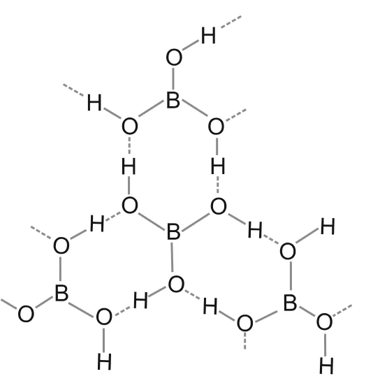
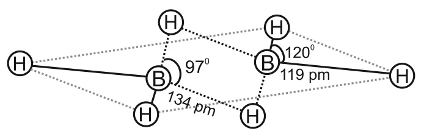
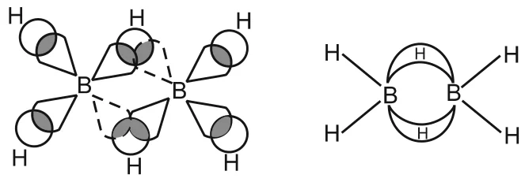

# [{ align=left, width=3.8% }](../../../index.md)  Group 13 Elements | Important Compounds of Boron

Some useful compounds of boron are borax, orthoboric acid and diborane. In this article, we will discuss their preparation, properties and structures, along with the uses of boron and aluminium.

## 1. Borax

* Borax is the most important compound of boron. It is a white crystalline solid with formula Na2B4O7.10H2O.
* It actually contains the tetranuclear unit [B4O5(OH)4]2-, so its correct formula is Na2[B4O5(OH)4].8H2O.

### Properties of Borax

#### 1. Alkaline nature

* Borax dissolves in water to give an alkaline solution, because it forms the strong base NaOH and the weak acid H3BO3:

!!! tip ""

    $$Na_2B_4O_7 + 7H_2O &rarr; 2NaOH + 4H_3BO_3$$

    $$[H_3BO_3 = Orthoboric\ acid]$$

#### 2. Action of heat

* On heating, borax first loses water molecules and swells up. On further heating, it turns into a transparent liquid which solidifies into a glass-like material known as **borax bead**.

!!! tip ""

    $$Na_2B_4O_7.10H_2O \xrightarrow{\Delta} Na_2B_4O_7 \xrightarrow{\Delta} 2NaBO_2 + B_2O_3$$

    $$[NaBO_2 = Sodium\ metaborate,\ B_2O_3 = Boric\ anhydride]$$

#### 3. Borax bead test

* The metaborates of many transition metals have characteristic colours. So the borax bead test is used to identify them in the laboratory.
* For example, when borax is heated in a Bunsen burner flame with CoO on a loop of platinum wire, a blue coloured Co(BO2)2 bead is formed.

## 2. Orthoboric Acid

* Orthoboric acid, H3BO3 (or B(OH)3), is a white crystalline solid with a soapy touch.
* It is sparingly soluble in cold water but highly soluble in hot water.

### Preparation

* It is prepared by acidifying an aqueous solution of borax:

!!! tip ""

    $$Na_2B_4O_7 + 2HCl + 5H_2O &rarr; 2NaCl + 4B(OH)_3$$

* It is also formed by the hydrolysis (reaction with water or dilute acid) of most boron compounds such as halides and hydrides.

### Structure

* Boric acid has a layer structure in which planar BO3 units are joined together by hydrogen bonds (shown by dotted lines).

{loading=lazy}

### Properties

#### 1. Acidic nature

* Boric acid is a weak **monobasic** acid.
* It is not a protonic acid (it does not release H+ on its own). Instead, it acts as a **Lewis acid** by accepting electrons from a hydroxyl ion of water:

!!! tip ""

    $$B(OH)_3 + 2HOH &rarr; [B(OH)_4]^- + H_3O^+$$

#### 2. Action of heat

* On heating above 370 K, orthoboric acid forms metaboric acid (HBO2), which on further heating gives boric oxide (B2O3):

!!! tip ""

    $$H_3BO_3 \xrightarrow{\Delta} HBO_2 \xrightarrow{\Delta} B_2O_3$$

## 3. Diborane, B2H6

* Diborane is the simplest boron hydride known.

### Preparation

* By treating boron trifluoride with LiAlH4 in diethyl ether:

!!! tip ""

    $$4BF_3 + 3LiAlH_4 &rarr; 2B_2H_6 + 3LiF + 3AlF_3$$

* **Laboratory method:** Oxidation of sodium borohydride with iodine:

!!! tip ""

    $$2NaBH_4 + I_2 &rarr; B_2H_6 + 2NaI + H_2$$

* **Industrial method:** Reaction of BF3 with sodium hydride:

!!! tip ""

    $$2BF_3 + 6NaH \xrightarrow{450\ K} B_2H_6 + 6NaF$$

### Properties

* Diborane is a colourless, highly toxic gas with a boiling point of 180 K.
* It catches fire spontaneously on exposure to air and burns in oxygen releasing an enormous amount of energy. Most of the higher boranes are also spontaneously flammable in air.

!!! tip ""

    $$B_2H_6 + 3O_2 &rarr; B_2O_3 + 3H_2O;\ &Delta;_cH^0 = -1976\ kJ\ mol^{-1}$$

* Boranes are readily hydrolysed by water to give boric acid:

!!! tip ""

    $$B_2H_{6(g)} + 6H_2O_{(l)} &rarr; 2B(OH)_{3(aq)} + 6H_{2(g)}$$

* Diborane undergoes cleavage reactions with Lewis bases (L) to give borane adducts, BH3.L:

!!! tip ""

    $$B_2H_6 + 2NMe_3 &rarr; 2BH_3.NMe_3$$

    $$B_2H_6 + 2CO &rarr; 2BH_3.CO$$

* Reaction with ammonia first gives B2H6.2NH3, formulated as [BH2(NH3)2]+[BH4]-. Further heating gives **borazine**, B3N3H6, known as "inorganic benzene" because of its ring structure with alternate BH and NH groups.

!!! tip ""

    $$3B_2H_6 + 6NH_3 &rarr; 3[BH_2(NH_3)_2]^+[BH_4]^-$$

    $$3[BH_2(NH_3)_2]^+[BH_4]^- \xrightarrow{Heat} 2B_3N_3H_6 + 12H_2$$

### Structure of Diborane

{loading=lazy}

* The four terminal hydrogen atoms and the two boron atoms lie in one plane.
* Above and below this plane there are two **bridging** hydrogen atoms.
* The four terminal B-H bonds (119 pm) are normal **two-centre-two-electron (2c-2e)** bonds.
* The two bridge B-H-B bonds (134 pm) are different. Each is a **three-centre-two-electron (3c-2e)** bond, in which one pair of electrons holds three atoms (B, H, B) together. These are also called **banana bonds**.
* Each boron atom is sp3 hybridised. Of its four sp3 hybrid orbitals, one is empty (shown by broken lines below). Two hybrids form terminal bonds, while the remaining two (one filled, one empty) take part in the bridges.

{loading=lazy}

### Borohydrides

* Boron also forms a series of hydridoborates. The most important is the tetrahedral [BH4]- ion.
* Lithium and sodium tetrahydridoborates, also known as **borohydrides**, are prepared by reacting metal hydrides with B2H6 in diethyl ether:

!!! tip ""

    $$2MH + B_2H_6 &rarr; 2M^+[BH_4]^-$$

    $$[M = Li\ or\ Na]$$

* Both LiBH4 and NaBH4 are used as reducing agents in organic synthesis and as starting materials for preparing other metal borohydrides.

## 4. Uses of Boron and its Compounds

* Boron is an extremely hard refractory solid with high melting point, low density and very low electrical conductivity.
* Boron fibres are used in making bullet-proof vests and light composite materials for aircraft.
* The boron-10 (10B) isotope has a high ability to absorb neutrons. So metal borides are used in the nuclear industry as protective shields and control rods.
* Borax and boric acid are mainly used in the manufacture of heat resistant glasses (e.g., Pyrex), glass-wool and fibreglass.
* Borax is used as a flux for soldering metals, for heat, scratch and stain resistant glazed coatings on earthenware, and as a constituent of medicinal soaps.
* An aqueous solution of orthoboric acid is used as a mild antiseptic.

## 5. Uses of Aluminium and its Compounds

* Aluminium is a bright silvery-white metal with high tensile strength and high electrical and thermal conductivity.
* On a weight-to-weight basis, the electrical conductivity of aluminium is twice that of copper.
* It forms alloys with Cu, Mn, Mg, Si and Zn.
* Aluminium and its alloys can be shaped into pipes, tubes, rods, wires, plates and foils. They are used in packing, utensil making, construction, aeroplane and transportation industries.
* The use of aluminium and its compounds for domestic purposes is now much reduced because of their toxic nature.

## Questions

!!! question "Why is boric acid considered as a weak acid?"

    Boric acid cannot release H+ ions on its own. It accepts an OH- ion from a water molecule to complete its octet, and in turn releases an H+ (as H3O+) ion. Since very few H+ ions are produced this way, it is a weak acid.

!!! question "Explain the structures of diborane and boric acid."

    * **Diborane:** Two boron atoms and four terminal hydrogen atoms lie in one plane; two bridging hydrogen atoms lie above and below this plane. The four terminal B-H bonds are normal 2c-2e bonds, while the two B-H-B bridge bonds are 3c-2e (banana) bonds. Each boron is sp3 hybridised.
    * **Boric acid:** It has a layer structure in which planar BO3 units are linked to each other by hydrogen bonds. Hydrogen bonding is the reason boric acid is polymeric.
