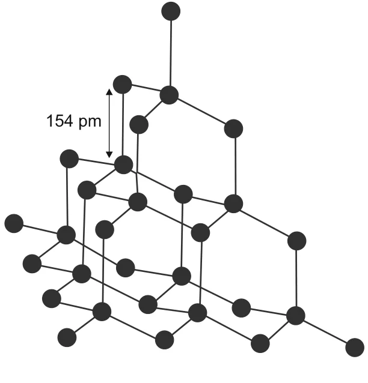
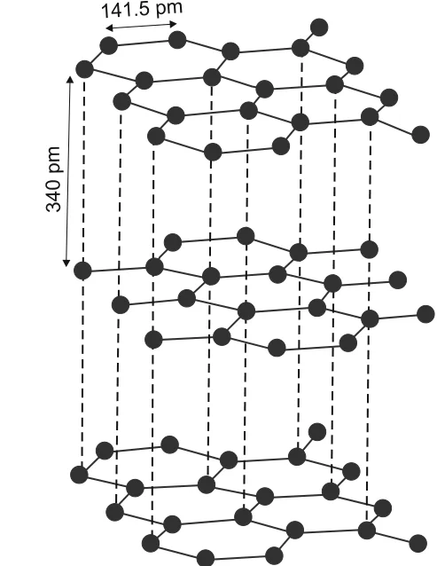
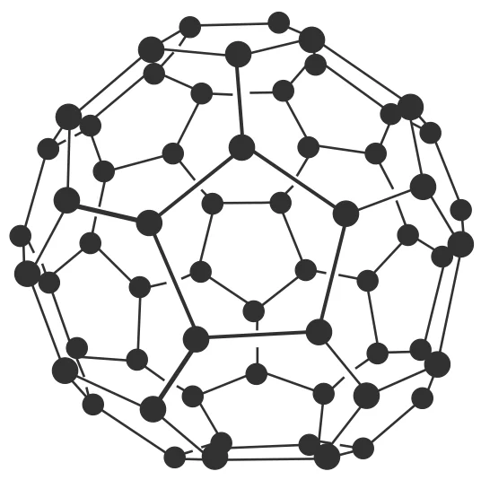

# [{ align=left, width=3.8% }](../../../index.md)  Group 14 Elements | Allotropes of Carbon

## Introduction

* The existence of an element in two or more forms having different physical properties but similar chemical properties is called **allotropy**.
* Carbon exhibits many allotropic forms, both crystalline and amorphous. This is possible because of its property of catenation and its ability to form pπ-pπ bonds.
* Diamond and graphite are the two well-known crystalline forms of carbon.
* A third form, **fullerenes**, was discovered in 1985 by H.W. Kroto, E. Smalley and R.F. Curl, who were awarded the Nobel Prize in 1996 for this discovery.

## 1. Diamond

{loading=lazy}

* Diamond has a crystalline lattice in which each carbon atom is **sp3 hybridised** and linked to four other carbon atoms in a tetrahedral fashion.
* The C-C bond length is **154 pm**.
* The structure extends in space to form a rigid **three-dimensional network** of carbon atoms, with directional covalent bonds throughout the lattice.
* It is very difficult to break this extended covalent bonding, so diamond is the **hardest substance** on earth.

### Uses of diamond

* As an abrasive for sharpening hard tools.
* In making dies and in the manufacture of tungsten filaments for electric light bulbs.
* As a precious stone in jewellery. It is measured in carats (1 carat = 200 mg).

## 2. Graphite

{loading=lazy}

* Graphite has a **layered structure**. Each layer is made up of planar hexagonal rings of carbon atoms.
* The C-C bond length within a layer is **141.5 pm**, and the distance between two layers is **340 pm**.
* The layers are held together by weak **van der Waals forces**.
* Each carbon atom in a hexagonal ring is **sp2 hybridised** and forms three sigma bonds with three neighbouring carbon atoms. The fourth electron forms a π bond.
* These π electrons are **delocalised** over the whole sheet. Since the electrons are mobile, graphite **conducts electricity** along the sheet.
* Graphite cleaves easily between the layers, so it is very soft and slippery.

### Uses of graphite

* As a dry lubricant in machines running at high temperature, where oil cannot be used.
* Graphite fibres embedded in plastic form high strength, lightweight composites used in tennis rackets, fishing rods, aircraft and canoes.
* Being a good conductor, it is used for electrodes in batteries and industrial electrolysis.
* Crucibles made from graphite are inert to dilute acids and alkalies.

### Diamond vs Graphite

Property              | Diamond                                   | Graphite                                       |
----------------------|-------------------------------------------|------------------------------------------------|
Hybridisation         | sp3                            | sp2                                 |
Structure             | Three-dimensional tetrahedral network     | Layers of hexagonal rings                      |
C-C bond length       | 154 pm                                    | 141.5 pm (within a layer)                      |
Hardness              | Hardest natural substance                 | Soft and slippery                              |
Electrical conduction | Non-conductor (no free electrons)         | Good conductor (delocalised π electrons)       |
Density               | 3.51 g cm-3                    | 2.22 g cm-3                         |

## 3. Fullerenes

{loading=lazy}

* Fullerenes are made by heating graphite in an electric arc in the presence of inert gases such as helium or argon.
* The sooty material formed by condensation of vaporised Cn small molecules consists mainly of C60, with a smaller quantity of C70 and traces of fullerenes with an even number of carbon atoms up to 350 or above.
* Fullerenes are the **only pure form of carbon**, because they have a smooth structure without any 'dangling' bonds.
* Fullerenes are cage-like molecules. The C60 molecule has a shape like a soccer ball and is called **Buckminsterfullerene**. Spherical fullerenes are also called **bucky balls**.

### Structure of C60

* It contains **twenty six-membered rings and twelve five-membered rings**.
* A six-membered ring is fused with six or five membered rings, but a five-membered ring can fuse only with six-membered rings.
* All the carbon atoms are equal and are **sp2 hybridised**. Each carbon forms three sigma bonds with three other carbon atoms. The remaining electron on each carbon is delocalised in molecular orbitals, which gives the molecule **aromatic character**.
* The ball-shaped molecule has 60 vertices, each occupied by one carbon atom.
* It contains both single and double bonds, with C-C distances of **143.5 pm** and **138.3 pm** respectively.

## Thermodynamic Stability of Allotropes

* **Graphite** is the thermodynamically most stable allotrope of carbon. Therefore, &Delta;fH0 of graphite is taken as zero.
* The &Delta;fH0 values of diamond and fullerene (C60) are 1.90 and 38.1 kJ mol-1 respectively.

## Amorphous Forms of Carbon

* Carbon black, coke and charcoal are impure forms of graphite or fullerenes.
* **Carbon black** is obtained by burning hydrocarbons in a limited supply of air. It is used as a black pigment in black ink and as a filler in automobile tyres.
* **Charcoal** and **coke** are obtained by heating wood or coal respectively at high temperatures in the absence of air.
* Being highly porous, **activated charcoal** is used to adsorb poisonous gases, in water filters to remove organic contaminants, and in air conditioning systems to control odour.
* **Coke** is used as a fuel and largely as a reducing agent in metallurgy.

## Questions

!!! question "Diamond is covalent, yet it has high melting point. Why?"

    Diamond has a three-dimensional network of strong C-C covalent bonds extending throughout the crystal. To melt diamond, a very large number of these strong bonds must be broken, which needs a lot of energy. Hence its melting point is very high.

!!! question "Explain the difference in properties of diamond and graphite on the basis of their structures."

    * In diamond, each carbon is sp3 hybridised and bonded to four others in a rigid 3D network. All electrons are localised in bonds. So diamond is extremely hard and a non-conductor of electricity.
    * In graphite, each carbon is sp2 hybridised and bonded to three others in flat hexagonal layers. The fourth electron is delocalised over the layer, so graphite conducts electricity. The layers are held by weak van der Waals forces and slide over each other, so graphite is soft and slippery.

!!! question "Thermodynamically the most stable form of carbon is  (a) diamond (b) graphite (c) fullerenes (d) coal"

    **(b) graphite.** Its &Delta;fH0 is taken as zero, while diamond (1.90 kJ mol-1) and C60 (38.1 kJ mol-1) have positive values.
