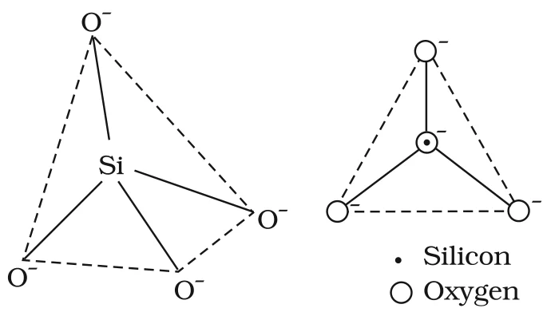

# [{ align=left, width=3.8% }](../../../index.md)  Group 14 Elements | Important Compounds of Carbon and Silicon

The two important oxides of carbon are carbon monoxide (CO) and carbon dioxide (CO2). In this article, we will also discuss silicon dioxide, silicones, silicates and zeolites.

## 1. Carbon Monoxide (CO)

### Preparation

* **Direct oxidation** of carbon in a limited supply of oxygen or air:

!!! tip ""

    $$2C_{(s)} + O_{2(g)} \xrightarrow{\Delta} 2CO_{(g)}$$

* **Laboratory method:** On a small scale, pure CO is prepared by dehydration of formic acid with concentrated H2SO4 at 373 K:

!!! tip ""

    $$HCOOH \xrightarrow[conc.\ H_2SO_4]{373\ K} H_2O + CO$$

* **Commercial method:** By passing steam over hot coke. The mixture of CO and H2 produced is called **water gas** or **synthesis gas**:

!!! tip ""

    $$C_{(s)} + H_2O_{(g)} \xrightarrow{473-1273\ K} \underbrace{CO_{(g)} + H_{2(g)}}_{Water\ gas}$$

* When air is used instead of steam, a mixture of CO and N2 called **producer gas** is formed:

!!! tip ""

    $$2C_{(s)} + O_{2(g)} + 4N_{2(g)} \xrightarrow{1273\ K} \underbrace{2CO_{(g)} + 4N_{2(g)}}_{Producer\ gas}$$

* Water gas and producer gas are very important industrial fuels. The CO in them burns further to CO2 with liberation of heat.

### Properties

* CO is a colourless, odourless and almost water-insoluble gas.
* It is a powerful **reducing agent** and reduces almost all metal oxides except those of the alkali and alkaline earth metals, aluminium and a few transition metals. This is used in the extraction of many metals from their oxide ores:

!!! tip ""

    $$Fe_2O_{3(s)} + 3CO_{(g)} \xrightarrow{\Delta} 2Fe_{(s)} + 3CO_{2(g)}$$

    $$ZnO_{(s)} + CO_{(g)} \xrightarrow{\Delta} Zn_{(s)} + CO_{2(g)}$$

### Structure

* In the CO molecule, there is one sigma bond and two π bonds between carbon and oxygen:

!!! tip ""

    $$:C \equiv O:$$

* Because of the lone pair on carbon, CO acts as a **donor** and reacts with certain metals on heating to form **metal carbonyls**.

### Poisonous nature of CO

* CO is highly poisonous because it forms a **complex with haemoglobin** which is about 300 times more stable than the oxygen-haemoglobin complex.
* This prevents haemoglobin in red blood corpuscles from carrying oxygen around the body, ultimately resulting in death.

## 2. Carbon Dioxide (CO2)

### Preparation

* By complete combustion of carbon and carbon-containing fuels in excess of air:

!!! tip ""

    $$C_{(s)} + O_{2(g)} \xrightarrow{\Delta} CO_{2(g)}$$

    $$CH_{4(g)} + 2O_{2(g)} \xrightarrow{\Delta} CO_{2(g)} + 2H_2O_{(g)}$$

* **Laboratory method:** By the action of dilute HCl on calcium carbonate:

!!! tip ""

    $$CaCO_{3(s)} + 2HCl_{(aq)} &rarr; CaCl_{2(aq)} + CO_{2(g)} + H_2O_{(l)}$$

* **Commercial method:** By heating limestone.

### Properties

* CO2 is a colourless and odourless gas. Its low solubility in water makes it of immense biochemical and geochemical importance.
* With water, it forms carbonic acid, H2CO3, a weak **dibasic** acid which dissociates in two steps:

!!! tip ""

    $$H_2CO_{3(aq)} + H_2O_{(l)} &#8652; HCO^-_{3(aq)} + H_3O^+_{(aq)}$$

    $$HCO^-_{3(aq)} + H_2O_{(l)} &#8652; CO^{2-}_{3(aq)} + H_3O^+_{(aq)}$$

* The H2CO3/HCO3- buffer system helps to maintain the pH of blood between 7.26 and 7.42.
* Being acidic, CO2 combines with alkalies to form metal carbonates.

### Photosynthesis and the greenhouse effect

* CO2 is present to the extent of about 0.03% by volume in the atmosphere. It is removed by **photosynthesis**, the process by which green plants convert atmospheric CO2 into carbohydrates such as glucose:

!!! tip ""

    $$6CO_2 + 12H_2O \xrightarrow[Chlorophyll]{h\nu} C_6H_{12}O_6 + 6O_2 + 6H_2O$$

* Unlike CO, CO2 is not poisonous. However, increased combustion of fossil fuels and decomposition of limestone for cement manufacture seem to be increasing the CO2 content of the atmosphere. This may increase the **greenhouse effect** and raise the temperature of the atmosphere, with serious consequences.

### Uses

* **Dry ice:** Solid CO2, obtained by allowing liquified CO2 to expand rapidly. It is used as a refrigerant for ice-cream and frozen food.
* Gaseous CO2 is used to carbonate soft drinks.
* Being heavy and a non-supporter of combustion, it is used as a fire extinguisher.
* A large amount of CO2 is used to manufacture urea.

### Structure

* In CO2, the carbon atom is **sp hybridised**. Its two sp hybrid orbitals overlap with two p orbitals of the oxygen atoms to form two sigma bonds. The other two electrons of carbon form pπ-pπ bonds with the oxygen atoms.
* This gives a **linear** molecule with both C-O bonds of equal length (115 pm) and **no dipole moment**.
* CO2 is a resonance hybrid of the following structures:

!!! tip ""

    $$^-:\ddot{O}-C \equiv O:^+ \leftrightarrow\ :\ddot{O}=C=\ddot{O}:\ \leftrightarrow\ ^+:O \equiv C-\ddot{O}:^-$$

## 3. Silicon Dioxide (SiO2)

* 95% of the earth's crust is made up of silica and silicates.
* Silicon dioxide, commonly known as **silica**, occurs in several crystallographic forms. Quartz, cristobalite and tridymite are crystalline forms of silica, and they are interconvertible at suitable temperatures.

### Structure

* SiO2 is a covalent, **three-dimensional network solid**.
* Each silicon atom is covalently bonded in a tetrahedral manner to four oxygen atoms, and each oxygen atom is in turn bonded to another silicon atom. Each corner is shared with another tetrahedron.
* The entire crystal may be considered as a giant molecule in which eight-membered rings are formed with alternate silicon and oxygen atoms.

### Properties

* Silica in its normal form is almost non-reactive because of the very high Si-O bond enthalpy. It resists attack by halogens, dihydrogen and most acids and metals, even at elevated temperatures.
* However, it is attacked by HF and NaOH:

!!! tip ""

    $$SiO_2 + 2NaOH &rarr; Na_2SiO_3 + H_2O$$

    $$SiO_2 + 4HF &rarr; SiF_4 + 2H_2O$$

### Uses

* Quartz is extensively used as a **piezoelectric** material. It has made possible extremely accurate clocks, modern radio and television broadcasting and mobile radio communications.
* **Silica gel** is used as a drying agent and as a support for chromatographic materials and catalysts.
* **Kieselghur**, an amorphous form of silica, is used in filtration plants.

## 4. Silicones

* Silicones are a group of organosilicon polymers which have $-(R_2SiO)-$ as a repeating unit.
* The starting materials are alkyl or aryl substituted silicon chlorides, RnSiCl(4-n), where R is an alkyl or aryl group.

### Preparation

* When methyl chloride reacts with silicon in the presence of copper as a catalyst at 573 K, various methyl substituted chlorosilanes (MeSiCl3, Me2SiCl2, Me3SiCl and small amounts of Me4Si) are formed.
* Hydrolysis of dimethyldichlorosilane, (CH3)2SiCl2, followed by condensation polymerisation gives straight chain polymers:

!!! tip ""

    $$2CH_3Cl + Si \xrightarrow[573\ K]{Cu\ powder} (CH_3)_2SiCl_2$$

    $$(CH_3)_2SiCl_2 + 2H_2O &rarr; (CH_3)_2Si(OH)_2 + 2HCl$$

    $$n(CH_3)_2Si(OH)_2 \xrightarrow{Polymerisation} -[O-Si(CH_3)_2]_n- + nH_2O$$

* The chain length of the polymer can be controlled by adding (CH3)3SiCl, which blocks the ends. Its hydrolysis product (CH3)3SiOH has only one OH group, so the chain cannot grow beyond it:

!!! tip ""

    $$n(CH_3)_2Si(OH)_2 + (CH_3)_3SiOH \xrightarrow{-H_2O} -O-[Si(CH_3)_2-O]_n-Si(CH_3)_3$$

### Properties and uses

* Silicones are surrounded by non-polar alkyl groups, so they are **water repelling** in nature.
* They have high thermal stability, high dielectric strength and resistance to oxidation and chemicals.
* They are used as sealants, greases, electrical insulators and for water proofing of fabrics.
* Being biocompatible, they are also used in surgical and cosmetic plants.

## 5. Silicates

* A large number of silicate minerals exist in nature, for example feldspar, zeolites, mica and asbestos.
* The basic structural unit of silicates is **SiO44-**, in which a silicon atom is bonded to four oxygen atoms in a tetrahedral fashion.

{loading=lazy}

* In silicates, either the discrete unit is present or a number of such units are joined together via corners by sharing 1, 2, 3 or 4 oxygen atoms per silicate unit.
* When silicate units are linked together, they form chain, ring, sheet or three-dimensional structures.
* The negative charge on the silicate structure is neutralised by positively charged metal ions.
* If all four corners are shared with other tetrahedral units, a three-dimensional network is formed.
* Two important man-made silicates are **glass** and **cement**.

## 6. Zeolites

* If aluminium atoms replace a few silicon atoms in the three-dimensional network of silicon dioxide, the overall structure, known as an **aluminosilicate**, acquires a negative charge.
* Cations such as Na+, K+ or Ca2+ balance this negative charge. Examples are feldspar and zeolites.
* Zeolites are widely used as catalysts in the petrochemical industry for cracking of hydrocarbons and isomerisation. For example, **ZSM-5** (a type of zeolite) is used to convert alcohols directly into gasoline.
* Hydrated zeolites are used as ion exchangers in the softening of "hard" water.

## Questions

!!! question "What are silicones?"

    Simple silicones consist of $-(R_2SiO)_n-$ chains in which alkyl or phenyl groups occupy the remaining bonding positions on each silicon. They are hydrophobic (water repellent) in nature.

!!! question "Suggest a reason as to why CO is poisonous."

    CO forms a complex with haemoglobin (carboxyhaemoglobin) which is about 300 times more stable than the oxygen-haemoglobin complex. So haemoglobin in red blood cells can no longer carry oxygen to the body tissues, which leads to suffocation and ultimately death.
