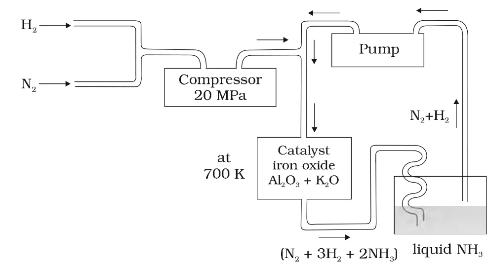

# [{ align=left, width=3.8% }](../../../index.md)  Group 15 Elements | Dinitrogen and Ammonia

## Dinitrogen (N2)

### 1. Preparation

#### (a) Commercial method

* Dinitrogen is produced commercially by the liquefaction and fractional distillation of air.
* Liquid dinitrogen (b.p. 77.2 K) distils out first, leaving behind liquid oxygen (b.p. 90 K).

#### (b) Laboratory method

* In the laboratory, dinitrogen is prepared by treating an aqueous solution of ammonium chloride with sodium nitrite.

!!! tip ""

    $$NH_4Cl_{(aq)} + NaNO_{2(aq)} &rarr; N_{2(g)} + 2H_2O_{(l)} + NaCl_{(aq)}$$

* Small amounts of NO and HNO3 are also formed. These impurities are removed by passing the gas through aqueous sulphuric acid containing potassium dichromate.

#### (c) From ammonium dichromate

!!! tip ""

    $$(NH_4)_2Cr_2O_7 \xrightarrow{Heat} N_2 + 4H_2O + Cr_2O_3$$

#### (d) Very pure dinitrogen

* Very pure nitrogen is obtained by the thermal decomposition of sodium or barium azide.

!!! tip ""

    $$Ba(N_3)_2 &rarr; Ba + 3N_2$$

    $$2NaN_3 &rarr; 2Na + 3N_2$$

### 2. Properties

* Dinitrogen is a colourless, odourless, tasteless and non-toxic gas.
* It has two stable isotopes: 14N and 15N.
* It has very low solubility in water (23.2 cm3 per litre of water at 273 K and 1 bar pressure) and low freezing and boiling points.
* Dinitrogen is rather inert at room temperature because of the very high bond enthalpy of the N&equiv;N bond.
* Its reactivity increases rapidly with rise in temperature. At high temperatures it combines directly with some metals to form predominantly ionic nitrides, and with non-metals to form covalent nitrides.

!!! tip ""

    $$6Li + N_2 \xrightarrow{Heat} 2Li_3N$$

    $$3Mg + N_2 \xrightarrow{Heat} Mg_3N_2$$

* It combines with hydrogen at about 773 K in the presence of a catalyst (Haber's process) to form ammonia.

!!! tip ""

    $$N_{2(g)} + 3H_{2(g)} \overset{773\ K}{&#8652;} 2NH_{3(g)};\ \ &Delta;_fH^0 = -46.1\ kJ\ mol^{-1}$$

* It combines with dioxygen only at very high temperature (about 2000 K) to form nitric oxide.

!!! tip ""

    $$N_2 + O_{2(g)} \overset{Heat}{&#8652;} 2NO_{(g)}$$

### 3. Uses

* The main use of dinitrogen is in the manufacture of ammonia and other industrial chemicals containing nitrogen (e.g., calcium cyanamide).
* It is used where an inert atmosphere is needed (e.g., in the iron and steel industry, and as an inert diluent for reactive chemicals).
* Liquid dinitrogen is used as a refrigerant to preserve biological materials and food items, and in cryosurgery.

## Ammonia (NH3)

### 1. Preparation

* Ammonia is present in small quantities in air and soil, where it is formed by the decay of nitrogenous organic matter such as urea.

!!! tip ""

    $$NH_2CONH_2 + 2H_2O &rarr; (NH_4)_2CO_3 &#8652; 2NH_3 + H_2O + CO_2$$

* On a small scale, ammonia is obtained by treating ammonium salts with caustic soda or lime.

!!! tip ""

    $$2NH_4Cl + Ca(OH)_2 &rarr; 2NH_3 + 2H_2O + CaCl_2$$

    $$(NH_4)_2SO_4 + 2NaOH &rarr; 2NH_3 + 2H_2O + Na_2SO_4$$

### 2. Haber's Process

* On a large scale, ammonia is manufactured by Haber's process.

!!! tip ""

    $$N_{2(g)} + 3H_{2(g)} &#8652; 2NH_{3(g)};\ \ &Delta;_fH^0 = -46.1\ kJ\ mol^{-1}$$

* The forward reaction decreases the number of gaseous moles (4 &rarr; 2) and is exothermic. So, according to Le Chatelier's principle, **high pressure** favours the formation of ammonia.
* The optimum conditions are:
    * **Pressure:** 200 &times; 105 Pa (about 200 atm)
    * **Temperature:** about 700 K
    * **Catalyst:** iron oxide with small amounts of K2O and Al2O3, used to increase the rate of attainment of equilibrium.
* The temperature is a compromise: a lower temperature would give a better yield, but the reaction would be too slow.
* The gas mixture coming out of the catalyst chamber is cooled so that ammonia liquefies, and the unreacted N2 and H2 are pumped back.

{loading=lazy}

### 3. Properties

* Ammonia is a colourless gas with a pungent odour. Its freezing and boiling points are 198.4 K and 239.7 K respectively.
* In the solid and liquid states, ammonia molecules are associated through hydrogen bonds, as in water. This accounts for its higher melting and boiling points than expected from its molecular mass.
* **Structure:** The ammonia molecule is trigonal pyramidal with the nitrogen atom at the apex. It has three bond pairs and one lone pair of electrons. The N-H bond length is 101.7 pm and the H-N-H bond angle is 107.8&deg;.

#### (a) Basic nature

* Ammonia is highly soluble in water. Its aqueous solution is weakly basic due to the formation of OH- ions.

!!! tip ""

    $$NH_{3(g)} + H_2O_{(l)} &#8652; NH^+_{4(aq)} + OH^-_{(aq)}$$

* It forms ammonium salts with acids, e.g., NH4Cl, (NH4)2SO4.

#### (b) Precipitation of metal hydroxides

* As a weak base, it precipitates the hydroxides of many metals from their salt solutions.

!!! tip ""

    $$2FeCl_{3(aq)} + 3NH_4OH_{(aq)} &rarr; Fe_2O_3.xH_2O_{(s)} + 3NH_4Cl_{(aq)}$$

    $$[Brown\ ppt]$$

    $$ZnSO_{4(aq)} + 2NH_4OH_{(aq)} &rarr; Zn(OH)_{2(s)} + (NH_4)_2SO_{4(aq)}$$

    $$[White\ ppt]$$

#### (c) Complex formation (Lewis base)

* The lone pair on nitrogen makes ammonia a Lewis base. It donates this electron pair to metal ions to form complexes. This is used to detect metal ions such as Cu2+ and Ag+.

!!! tip ""

    $$Cu^{2+}_{(aq)} + 4NH_{3(aq)} &#8652; [Cu(NH_3)_4]^{2+}_{(aq)}$$

    $$[Blue]\ \ \ \ \ \ \ \ \ \ \ \ \ \ [Deep\ blue]$$

    $$Ag^+_{(aq)} + Cl^-_{(aq)} &rarr; AgCl_{(s)}$$

    $$[Colourless]\ \ \ \ \ \ \ \ \ \ \ \ [White\ ppt]$$

    $$AgCl_{(s)} + 2NH_{3(aq)} &rarr; [Ag(NH_3)_2]Cl_{(aq)}$$

    $$[White\ ppt]\ \ \ \ \ \ \ \ \ \ \ \ [Colourless]$$

### 4. Uses

* Ammonia is used to produce nitrogenous fertilisers such as ammonium nitrate, urea, ammonium phosphate and ammonium sulphate.
* It is used in the manufacture of some inorganic nitrogen compounds, the most important being nitric acid.
* Liquid ammonia is used as a refrigerant.

## Questions

!!! question "Write the reaction of thermal decomposition of sodium azide."

    Thermal decomposition of sodium azide gives dinitrogen gas.

    $$2NaN_3 &rarr; 2Na + 3N_2$$

!!! question "Why is N2 less reactive at room temperature?"

    The two nitrogen atoms in N2 are joined by a triple bond (N&equiv;N), which has a very high bond dissociation enthalpy (941.4 kJ mol-1). A lot of energy is needed to break this bond, so N2
    is rather inert at room temperature.

!!! question "Why does NH3 act as a Lewis base?"

    The nitrogen atom in NH3 has one lone pair of electrons which is available for donation. Therefore, it acts as a Lewis base.

!!! question "Mention the conditions required to maximise the yield of ammonia."

    $$N_{2(g)} + 3H_{2(g)} &#8652; 2NH_{3(g)};\ \ &Delta;_fH^0 = -46.1\ kJ\ mol^{-1}$$

    * The reaction proceeds with a decrease in gaseous moles, so a **high pressure** (about 200 atm) favours ammonia.
    * The reaction is exothermic, so a **low temperature** favours ammonia. In practice, about 700 K is used so that the rate is reasonable.
    * A **catalyst** of iron oxide with small amounts of K2O and Al2O3 is used to reach equilibrium quickly.
    * Removing ammonia as it forms (by liquefaction) also shifts the equilibrium forward.

!!! question "How does ammonia react with a solution of Cu2+?"

    Ammonia acts as a Lewis base and forms a deep blue complex, tetraamminecopper(II) ion, with Cu2+.

    $$Cu^{2+}_{(aq)} + 4NH_{3(aq)} &#8652; [Cu(NH_3)_4]^{2+}_{(aq)}$$
