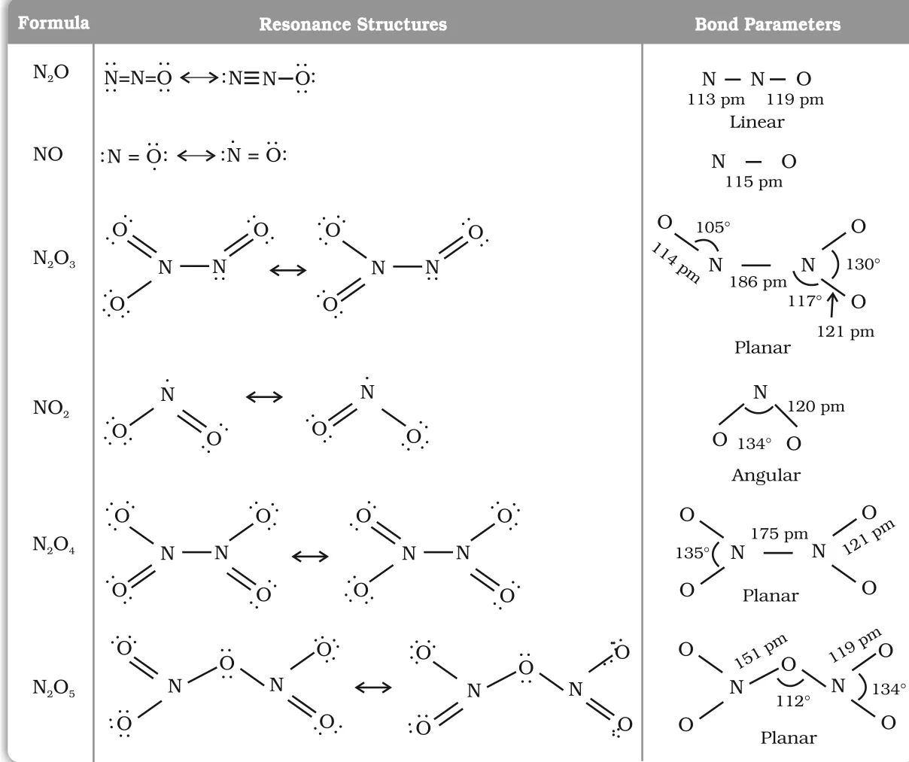
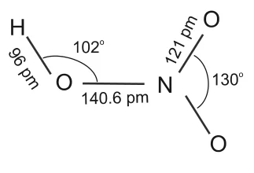

# [{ align=left, width=3.8% }](../../../index.md)  Group 15 Elements | Oxides of Nitrogen and Nitric Acid

## Oxides of Nitrogen

* Nitrogen forms a number of oxides in which it shows different oxidation states, from +1 to +5.
* Their names, formulas, common methods of preparation and physical appearance are given below.

Name                                           | Formula                       | Oxidation state of N | Common method of preparation                                                                                                   | Physical appearance and chemical nature |
-----------------------------------------------|-------------------------------|----------------------|--------------------------------------------------------------------------------------------------------------------------------|-----------------------------------------|
Dinitrogen oxide [Nitrogen(I) oxide]           | N2O                | +1                   | NH4NO3 &rarr; N2O + 2H2O (on heating)                                              | Colourless gas, neutral                 |
Nitrogen monoxide [Nitrogen(II) oxide]         | NO                            | +2                   | 2NaNO2 + 2FeSO4 + 3H2SO4 &rarr; Fe2(SO4)3 + 2NaHSO4 + 2H2O + 2NO | Colourless gas, neutral |
Dinitrogen trioxide [Nitrogen(III) oxide]      | N2O3    | +3                   | 2NO + N2O4 &rarr; 2N2O3 (at 250 K)                                                 | Blue solid, acidic                      |
Nitrogen dioxide [Nitrogen(IV) oxide]          | NO2                | +4                   | 2Pb(NO3)2 &rarr; 4NO2 + 2PbO (at 673 K)                                                       | Brown gas, acidic                       |
Dinitrogen tetroxide [Nitrogen(IV) oxide]      | N2O4    | +4                   | 2NO2 &#8652; N2O4 (forms on cooling, reverts on heating)                                     | Colourless solid/liquid, acidic         |
Dinitrogen pentoxide [Nitrogen(V) oxide]       | N2O5    | +5                   | 4HNO3 + P4O10 &rarr; 4HPO3 + 2N2O5                           | Colourless solid, acidic                |

### Preparation reactions

!!! tip ""

    $$NH_4NO_3 \xrightarrow{Heat} N_2O + 2H_2O$$

    $$2NaNO_2 + 2FeSO_4 + 3H_2SO_4 &rarr; Fe_2(SO_4)_3 + 2NaHSO_4 + 2H_2O + 2NO$$

    $$2NO + N_2O_4 \xrightarrow{250\ K} 2N_2O_3$$

    $$2Pb(NO_3)_2 \xrightarrow{673\ K} 4NO_2 + 2PbO$$

    $$2NO_2 \overset{Cool}{\underset{Heat}{&#8652;}} N_2O_4$$

    $$4HNO_3 + P_4O_{10} &rarr; 4HPO_3 + 2N_2O_5$$

### Structures of oxides of nitrogen

* The main resonance structures (Lewis dot) and bond parameters of the oxides of nitrogen are shown below.
* N2O is linear, NO2 is angular (bond angle 134&deg;) and N2O3, N2O4 and N2O5 are planar.
* NO and NO2 contain an odd number of valence electrons, so they are odd-electron molecules (paramagnetic).

{loading=lazy}

## Nitric Acid (HNO3)

* Nitrogen forms oxoacids such as H2N2O2 (hyponitrous acid), HNO2 (nitrous acid) and HNO3 (nitric acid). Amongst them, HNO3 is the most important.

### 1. Laboratory Preparation

* In the laboratory, nitric acid is prepared by heating KNO3 or NaNO3 with concentrated H2SO4 in a glass retort.

!!! tip ""

    $$NaNO_3 + H_2SO_4 &rarr; NaHSO_4 + HNO_3$$

### 2. Ostwald's Process

* On a large scale, nitric acid is prepared mainly by Ostwald's process. This method is based on the catalytic oxidation of NH3 by atmospheric oxygen.

#### Step 1: Catalytic oxidation of ammonia

!!! tip ""

    $$4NH_{3(g)} + 5O_{2(g)} \xrightarrow[500\ K,\ 9\ bar]{Pt/Rh\ gauze\ catalyst} 4NO_{(g)} + 6H_2O_{(g)}$$

#### Step 2: Oxidation of nitric oxide

!!! tip ""

    $$2NO_{(g)} + O_{2(g)} &#8652; 2NO_{2(g)}$$

#### Step 3: Absorption of NO2 in water

!!! tip ""

    $$3NO_{2(g)} + H_2O_{(l)} &rarr; 2HNO_{3(aq)} + NO_{(g)}$$

* The NO formed in step 3 is recycled.
* The aqueous HNO3 can be concentrated by distillation up to about 68% by mass. Further concentration to 98% is achieved by dehydration with concentrated H2SO4.

### 3. Physical Properties

* Nitric acid is a colourless liquid (f.p. 231.4 K and b.p. 355.6 K).
* Laboratory grade nitric acid contains about 68% HNO3 by mass and has a specific gravity of 1.504.
* **Structure:** In the gaseous state, HNO3 exists as a planar molecule.

{loading=lazy}

### 4. Chemical Properties

#### (a) Acidic nature

* In aqueous solution, nitric acid behaves as a strong acid, giving hydronium and nitrate ions.

!!! tip ""

    $$HNO_{3(aq)} + H_2O_{(l)} &rarr; H_3O^+_{(aq)} + NO^-_{3(aq)}$$

#### (b) Oxidising nature: reaction with metals

* Concentrated nitric acid is a strong oxidising agent and attacks most metals except noble metals such as gold and platinum.
* The products of oxidation depend on the concentration of the acid, the temperature and the nature of the material being oxidised.

!!! tip ""

    $$3Cu + 8HNO_3(dilute) &rarr; 3Cu(NO_3)_2 + 2NO + 4H_2O$$

    $$Cu + 4HNO_3(conc.) &rarr; Cu(NO_3)_2 + 2NO_2 + 2H_2O$$

* Zinc reacts with dilute nitric acid to give N2O and with concentrated acid to give NO2.

!!! tip ""

    $$4Zn + 10HNO_3(dilute) &rarr; 4Zn(NO_3)_2 + 5H_2O + N_2O$$

    $$Zn + 4HNO_3(conc.) &rarr; Zn(NO_3)_2 + 2H_2O + 2NO_2$$

* Some metals, like Cr and Al, do not dissolve in concentrated nitric acid because a passive film of oxide forms on their surface. This is called **passivity**.

#### (c) Oxidising nature: reaction with non-metals

* Concentrated nitric acid oxidises non-metals and their compounds. Iodine is oxidised to iodic acid, carbon to carbon dioxide, sulphur to H2SO4 and phosphorus to phosphoric acid.

!!! tip ""

    $$I_2 + 10HNO_3 &rarr; 2HIO_3 + 10NO_2 + 4H_2O$$

    $$C + 4HNO_3 &rarr; CO_2 + 2H_2O + 4NO_2$$

    $$S_8 + 48HNO_3(conc.) &rarr; 8H_2SO_4 + 48NO_2 + 16H_2O$$

    $$P_4 + 20HNO_3(conc.) &rarr; 4H_3PO_4 + 20NO_2 + 4H_2O$$

### 5. Brown Ring Test for Nitrates

* The brown ring test depends on the ability of Fe2+ to reduce nitrate to nitric oxide, which then combines with Fe2+ to form a brown coloured complex.
* **Procedure:** Dilute ferrous sulphate solution is added to an aqueous solution containing nitrate ion. Then concentrated sulphuric acid is carefully added along the sides of the test tube.
* A brown ring at the interface between the solution and the sulphuric acid layer indicates the presence of nitrate ion.

!!! tip ""

    $$NO^-_3 + 3Fe^{2+} + 4H^+ &rarr; NO + 3Fe^{3+} + 2H_2O$$

    $$[Fe(H_2O)_6]^{2+} + NO &rarr; [Fe(H_2O)_5(NO)]^{2+} + H_2O$$

    $$[Brown]$$

### 6. Uses

* Manufacture of ammonium nitrate for fertilisers and of other nitrates for explosives and pyrotechnics.
* Preparation of nitroglycerin, trinitrotoluene (TNT) and other organic nitro compounds.
* Pickling of stainless steel, etching of metals, and as an oxidiser in rocket fuels.

## Questions

!!! question "Why does NO2 dimerise?"

    NO2 contains an odd number of valence electrons and behaves as a typical odd-electron molecule. On dimerisation, it is converted into the stable N2O4 molecule, which has an even number
    of electrons.

    $$2NO_2 &#8652; N_2O_4$$

!!! question "What is the covalency of nitrogen in N2O5?"

    In N2O5, each nitrogen atom forms one N=O double bond (2 shared pairs), one N-O single bond to the bridging oxygen (1 shared pair) and one coordinate bond to the other oxygen (1 shared pair).
    So each nitrogen shares four electron pairs, and the covalency of nitrogen in N2O5 is **4**.

!!! question "Why does copper give different products with dilute and concentrated nitric acid?"

    The product of reduction of HNO3 depends on its concentration. Concentrated HNO3 is reduced only to NO2, while dilute HNO3 is reduced further to NO.

    $$3Cu + 8HNO_3(dilute) &rarr; 3Cu(NO_3)_2 + 2NO + 4H_2O$$

    $$Cu + 4HNO_3(conc.) &rarr; Cu(NO_3)_2 + 2NO_2 + 2H_2O$$

!!! question "Why does aluminium not dissolve in concentrated nitric acid?"

    Concentrated nitric acid forms a thin, protective (passive) film of oxide on the surface of aluminium. This film prevents further reaction, so the metal does not dissolve.
