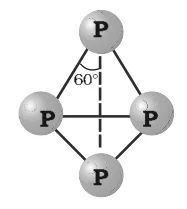
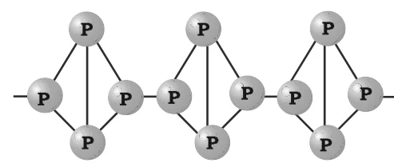

# [{ align=left, width=3.8% }](../../../index.md)  Group 15 Elements | Allotropes of Phosphorus and Phosphine

## Allotropic Forms of Phosphorus

* Phosphorus is found in many allotropic forms. The important ones are **white**, **red** and **black** phosphorus.

### 1. White Phosphorus

* White phosphorus is a translucent, white, waxy solid.
* It is poisonous, insoluble in water but soluble in carbon disulphide (CS2).
* It glows in the dark. This is called **chemiluminescence**.
* It dissolves in boiling NaOH solution in an inert atmosphere to give phosphine.

!!! tip ""

    $$P_4 + 3NaOH + 3H_2O &rarr; PH_3 + 3NaH_2PO_2$$

    $$[NaH_2PO_2 = Sodium\ hypophosphite]$$

* **Structure:** It consists of discrete tetrahedral P4 molecules, with each P-P-P bond angle only 60&deg;.

{loading=lazy}

* White phosphorus is less stable, and therefore more reactive, than the other solid forms under normal conditions. This is because of the **angular strain** in the P4 molecule, where the angles are only 60&deg;.
* It readily catches fire in air, giving dense white fumes of P4O10.

!!! tip ""

    $$P_4 + 5O_2 &rarr; P_4O_{10}$$

### 2. Red Phosphorus

* Red phosphorus is obtained by heating white phosphorus at 573 K in an inert atmosphere for several days.
* It has an iron grey lustre. It is odourless, non-poisonous and insoluble in water as well as in carbon disulphide.
* Chemically, red phosphorus is much less reactive than white phosphorus. It does not glow in the dark.
* **Structure:** It is polymeric, consisting of chains of P4 tetrahedra linked together.

{loading=lazy}

* When red phosphorus is heated under high pressure, a series of phases of black phosphorus are formed.

### 3. Black Phosphorus

* Black phosphorus has two forms: &alpha;-black phosphorus and &beta;-black phosphorus.
* **&alpha;-Black phosphorus** is formed when red phosphorus is heated in a sealed tube at 803 K. It can be sublimed in air and has opaque monoclinic or rhombohedral crystals. It does not oxidise in air.
* **&beta;-Black phosphorus** is prepared by heating white phosphorus at 473 K under high pressure. It does not burn in air up to 673 K.

### Comparison of White and Red Phosphorus

Property                     | White Phosphorus                     | Red Phosphorus                          |
-----------------------------|--------------------------------------|-----------------------------------------|
Appearance                   | Translucent white waxy solid         | Iron grey lustre                        |
Toxicity                     | Poisonous                            | Non-poisonous                           |
Solubility in CS2 | Soluble                              | Insoluble                               |
Glow in dark                 | Glows (chemiluminescence)            | Does not glow                           |
Structure                    | Discrete P4 tetrahedra    | Polymeric chains of P4 units |
Reactivity                   | Very reactive, catches fire in air   | Much less reactive                      |

## Phosphine (PH3)

### 1. Preparation

* Phosphine is prepared by the reaction of calcium phosphide with water or dilute HCl.

!!! tip ""

    $$Ca_3P_2 + 6H_2O &rarr; 3Ca(OH)_2 + 2PH_3$$

    $$Ca_3P_2 + 6HCl &rarr; 3CaCl_2 + 2PH_3$$

* **Laboratory method:** In the laboratory, it is prepared by heating white phosphorus with concentrated NaOH solution in an inert atmosphere of CO2.

!!! tip ""

    $$P_4 + 3NaOH + 3H_2O &rarr; PH_3 + 3NaH_2PO_2$$

* **Purification:** Pure phosphine is non-inflammable, but it becomes inflammable because of the presence of P2H4 or P4 vapours. To purify it, phosphine is absorbed in HI to form phosphonium iodide (PH4I), which on treatment with KOH gives off pure phosphine.

!!! tip ""

    $$PH_4I + KOH &rarr; KI + H_2O + PH_3$$

### 2. Properties

* Phosphine is a colourless gas with a rotten fish smell and is highly poisonous.
* It explodes in contact with traces of oxidising agents like HNO3, Cl2 and Br2 vapours.
* It is slightly soluble in water. In the presence of light, its aqueous solution decomposes to give red phosphorus and H2.
* When absorbed in copper sulphate or mercuric chloride solution, the corresponding phosphides are obtained.

!!! tip ""

    $$3CuSO_4 + 2PH_3 &rarr; Cu_3P_2 + 3H_2SO_4$$

    $$3HgCl_2 + 2PH_3 &rarr; Hg_3P_2 + 6HCl$$

* **Basic nature:** Phosphine is weakly basic and, like ammonia, gives phosphonium compounds with acids.

!!! tip ""

    $$PH_3 + HBr &rarr; PH_4Br$$

### 3. Uses

* The spontaneous combustion of phosphine is used in **Holme's signals**. Containers holding calcium carbide and calcium phosphide are pierced and thrown into the sea. The gases evolved (acetylene and phosphine) catch fire and serve as a signal.
* It is also used in **smoke screens**.

## Questions

!!! question "In what way can it be proved that PH3 is basic in nature?"

    PH3 reacts with acids like HI to form PH4I, which shows that it is basic in nature.

    $$PH_3 + HI &rarr; PH_4I$$

    Due to the lone pair on the phosphorus atom, PH3 acts as a Lewis base in this reaction.

!!! question "Bond angle in PH4+ is higher than that in PH3. Why?"

    In PH3, phosphorus has three bond pairs and one lone pair. The lone pair repels the bond pairs more strongly than bond pairs repel each other, so the bond angle is small (93.6&deg;). 
    In PH4+, the lone pair is used to bond with H+, so there are four bond pairs and no lone pair. The ion is regular tetrahedral with a bond angle of 109&deg;28'. Hence the bond angle
    in PH4+ is higher.

!!! question "What happens when white phosphorus is heated with concentrated NaOH solution in an inert atmosphere of CO2?"

    Phosphine gas is evolved along with sodium hypophosphite.

    $$P_4 + 3NaOH + 3H_2O &rarr; PH_3 + 3NaH_2PO_2$$

!!! question "Why is white phosphorus more reactive than red phosphorus?"

    White phosphorus consists of discrete P4 tetrahedra in which the P-P-P bond angle is only 60&deg;. This causes large angular strain, which makes the molecule unstable and highly reactive. Red phosphorus
    is polymeric, with P4 units linked into chains, so it is more stable and much less reactive.
