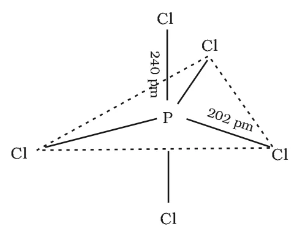
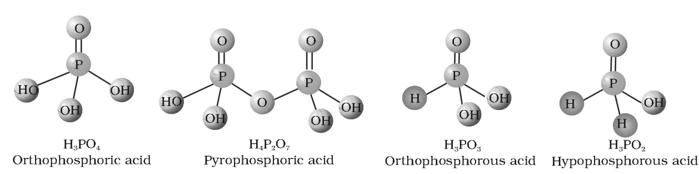
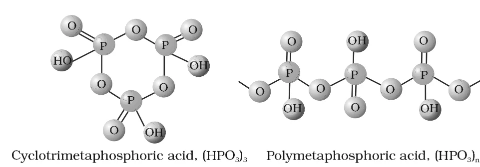

# [{ align=left, width=3.8% }](../../../index.md)  Group 15 Elements | Phosphorus Halides and Oxoacids

## Phosphorus Halides

* Phosphorus forms two types of halides: PX3 (X = F, Cl, Br, I) and PX5 (X = F, Cl, Br).

## 1. Phosphorus Trichloride (PCl3)

### Preparation

* It is obtained by passing dry chlorine over heated white phosphorus.

!!! tip ""

    $$P_4 + 6Cl_2 &rarr; 4PCl_3$$

* It is also obtained by the action of thionyl chloride on white phosphorus.

!!! tip ""

    $$P_4 + 8SOCl_2 &rarr; 4PCl_3 + 4SO_2 + 2S_2Cl_2$$

### Properties

* It is a colourless oily liquid.
* It hydrolyses in the presence of moisture, giving fumes of HCl.

!!! tip ""

    $$PCl_3 + 3H_2O &rarr; H_3PO_3 + 3HCl$$

* It reacts with organic compounds containing an -OH group, such as CH3COOH and C2H5OH, replacing -OH by -Cl.

!!! tip ""

    $$3CH_3COOH + PCl_3 &rarr; 3CH_3COCl + H_3PO_3$$

    $$3C_2H_5OH + PCl_3 &rarr; 3C_2H_5Cl + H_3PO_3$$

* **Structure:** PCl3 has a pyramidal shape. Phosphorus is sp3 hybridised, with three bond pairs and one lone pair.

## 2. Phosphorus Pentachloride (PCl5)

### Preparation

* It is prepared by the reaction of white phosphorus with excess of dry chlorine.

!!! tip ""

    $$P_4 + 10Cl_2 &rarr; 4PCl_5$$

* It can also be prepared by the action of SO2Cl2 on phosphorus.

!!! tip ""

    $$P_4 + 10SO_2Cl_2 &rarr; 4PCl_5 + 10SO_2$$

### Properties

* PCl5 is a yellowish white powder.
* In moist air, it hydrolyses to POCl3 and finally gets converted to phosphoric acid.

!!! tip ""

    $$PCl_5 + H_2O &rarr; POCl_3 + 2HCl$$

    $$POCl_3 + 3H_2O &rarr; H_3PO_4 + 3HCl$$

* When heated, it sublimes but decomposes on stronger heating.

!!! tip ""

    $$PCl_5 \xrightarrow{Heat} PCl_3 + Cl_2$$

* It reacts with organic compounds containing an -OH group, converting them to chloro derivatives.

!!! tip ""

    $$C_2H_5OH + PCl_5 &rarr; C_2H_5Cl + POCl_3 + HCl$$

    $$CH_3COOH + PCl_5 &rarr; CH_3COCl + POCl_3 + HCl$$

* Finely divided metals on heating with PCl5 give the corresponding chlorides.

!!! tip ""

    $$2Ag + PCl_5 &rarr; 2AgCl + PCl_3$$

    $$Sn + 2PCl_5 &rarr; SnCl_4 + 2PCl_3$$

* It is used in the synthesis of some organic compounds, e.g., C2H5Cl and CH3COCl.

### Structure

* In the gaseous and liquid phases, PCl5 has a **trigonal bipyramidal** structure (sp3d hybridisation of P).
* The three equatorial P-Cl bonds (202 pm) are equivalent, while the two axial bonds (240 pm) are longer than the equatorial bonds. This is because the axial bond pairs suffer more repulsion than the equatorial bond pairs.

{loading=lazy}

* In the solid state, PCl5 exists as an ionic solid, [PCl4]+[PCl6]-, in which the cation [PCl4]+ is tetrahedral and the anion [PCl6]- is octahedral.

## Oxoacids of Phosphorus

* Phosphorus forms a number of oxoacids. The important ones, with their oxidation states, characteristic bonds and methods of preparation, are given below.

Name                                  | Formula                                     | Oxidation state of P | Characteristic bonds and their number         | Preparation                                         |
--------------------------------------|---------------------------------------------|----------------------|-----------------------------------------------|-----------------------------------------------------|
Hypophosphorous (Phosphinic)          | H3PO2                 | +1                   | One P-OH, Two P-H, One P=O                    | White P4 + alkali                        |
Orthophosphorous (Phosphonic)         | H3PO3                 | +3                   | Two P-OH, One P-H, One P=O                    | P2O3 + H2O         |
Pyrophosphorous                       | H4P2O5     | +3                   | Two P-OH, Two P-H, Two P=O                    | PCl3 + H3PO3       |
Hypophosphoric                        | H4P2O6     | +4                   | Four P-OH, Two P=O, One P-P                   | Red P4 + alkali                          |
Orthophosphoric                       | H3PO4                 | +5                   | Three P-OH, One P=O                           | P4O10 + H2O        |
Pyrophosphoric                        | H4P2O7     | +5                   | Four P-OH, Two P=O, One P-O-P                 | Heat phosphoric acid                                |
Metaphosphoric                        | (HPO3)n               | +5                   | Three P-OH, Three P=O, Three P-O-P (for (HPO3)3) | Phosphorous acid + Br2, heat in a sealed tube |

* Metaphosphoric acid exists in polymeric forms only.
* The compositions of the oxoacids are interrelated by the loss or gain of H2O molecules or O atoms.

### Structures of oxoacids of phosphorus

{loading=lazy}

{loading=lazy}

### Important features

* In the oxoacids, phosphorus is tetrahedrally surrounded by other atoms.
* All these acids contain one P=O bond and at least one P-OH bond.
* Oxoacids in which phosphorus has an oxidation state less than +5 also contain either P-P bonds (e.g., in H4P2O6) or P-H bonds (e.g., in H3PO2), but not both.

#### 1. Disproportionation

* Acids in the +3 oxidation state of phosphorus tend to disproportionate into higher and lower oxidation states. For example, orthophosphorous acid (phosphorous acid) on heating gives orthophosphoric acid (phosphoric acid) and phosphine.

!!! tip ""

    $$4H_3PO_3 &rarr; 3H_3PO_4 + PH_3$$

#### 2. Reducing nature

* Acids containing P-H bonds have strong reducing properties. Hypophosphorous acid, with two P-H bonds, is a good reducing agent. For example, it reduces AgNO3 to metallic silver.

!!! tip ""

    $$4AgNO_3 + 2H_2O + H_3PO_2 &rarr; 4Ag + 4HNO_3 + H_3PO_4$$

#### 3. Basicity

* The P-H bonds are not ionisable and play no role in basicity. Only the H atoms attached to oxygen (in P-OH) are ionisable and cause basicity.

Acid                         | Number of P-OH bonds | Basicity  |
-----------------------------|----------------------|-----------|
H3PO2  | 1                    | Monobasic |
H3PO3  | 2                    | Dibasic   |
H3PO4  | 3                    | Tribasic  |

## Questions

!!! question "Why does PCl3 fume in moisture?"

    PCl3 hydrolyses in the presence of moisture, giving fumes of HCl.

    $$PCl_3 + 3H_2O &rarr; H_3PO_3 + 3HCl$$

!!! question "Are all the five bonds in PCl5 molecule equivalent? Justify your answer."

    No. PCl5 has a trigonal bipyramidal structure. The three equatorial P-Cl bonds are equivalent, while the two axial bonds are different and longer than the equatorial bonds, because the axial bond
    pairs suffer more repulsion from the other bond pairs.

!!! question "What happens when PCl5 is heated?"

    On heating, PCl5 first sublimes, and on stronger heating it decomposes into phosphorus trichloride and chlorine.

    $$PCl_5 \xrightarrow{Heat} PCl_3 + Cl_2$$

!!! question "Write a balanced equation for the hydrolytic reaction of PCl5 in heavy water."

    With a limited amount of heavy water (D2O), PCl5 gives POCl3 and DCl:

    $$PCl_5 + D_2O &rarr; POCl_3 + 2DCl$$

    With excess heavy water, complete hydrolysis takes place:

    $$PCl_5 + 4D_2O &rarr; D_3PO_4 + 5DCl$$

!!! question "How do you account for the reducing behaviour of H3PO2 on the basis of its structure?"

    In H3PO2, two H atoms are bonded directly to the P atom. These P-H bonds impart reducing character to the acid.

!!! question "What is the basicity of H3PO4?"

    H3PO4 contains three P-OH bonds, and all three hydrogen atoms are ionisable. So, H3PO4 is **tribasic**.

!!! question "What happens when H3PO3 is heated?"

    On heating, H3PO3 (phosphorus in +3 state) disproportionates to give orthophosphoric acid (+5) and phosphine (-3).

    $$4H_3PO_3 &rarr; 3H_3PO_4 + PH_3$$
