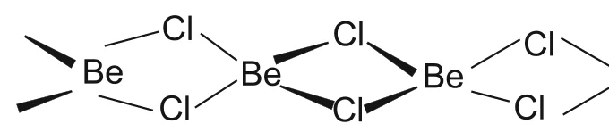

# [{ align=left, width=3.8% }](../../../index.md)  Alkaline Earth Metals | Compounds of alkaline earth metals

* The dipositive oxidation state (M2+) is the predominant valence of group 2 elements.
* The alkaline earth metals form compounds which are predominantly ionic but **less ionic** than the corresponding compounds of alkali metals. This is due to their increased nuclear charge and smaller size.
* The oxides and other compounds of beryllium and magnesium are more covalent than those formed by the heavier, larger members (Ca, Sr, Ba).

## Oxides of alkaline earth metals

* The alkaline earth metals burn in oxygen to form the monoxide, MO.

!!! tip ""

    $$2M + O_2 &rarr; 2MO$$

### Properties of oxides of alkaline earth metals

* Except for BeO, these oxides have a **rock-salt** structure.
* BeO is essentially covalent in nature.
* The enthalpies of formation of these oxides are quite high and consequently they are very stable to heat.
* BeO is **amphoteric**, while the oxides of the other elements are ionic and basic in nature.
* All these oxides except BeO react with water to form sparingly soluble hydroxides.

!!! tip ""

    $$MO + H_2O &rarr; M(OH)_2$$

## Hydroxides of alkaline earth metals

* Hydroxides are obtained when the oxides react with water.

### Properties of hydroxides of alkaline earth metals

* The solubility, thermal stability and basic character of these hydroxides **increase** with increasing atomic number from Mg(OH)2 to Ba(OH)2.

!!! tip "Solubility, thermal stability and basic strength"

    $$Be(OH)_2 < Mg(OH)_2 < Ca(OH)_2 < Sr(OH)_2 < Ba(OH)_2$$

* Alkaline earth metal hydroxides are less basic and less stable than alkali metal hydroxides.
* Beryllium hydroxide is **amphoteric** in nature as it reacts with both acid and alkali.

!!! tip ""

    $$Be(OH)_2 + 2OH^- &rarr; [Be(OH)_4]^{2-}$$

    $$(Beryllate\ ion)$$

    $$Be(OH)_2 + 2HCl + 2H_2O &rarr; [Be(OH)_4]Cl_2$$

## Halides of alkaline earth metals

* Except for beryllium halides, all other halides of alkaline earth metals are ionic in nature.
* Beryllium halides are essentially **covalent** and soluble in organic solvents.

### Structure of Beryllium Chloride

* In the solid state, beryllium chloride has a **chain structure** in which each Be atom is bonded to four Cl atoms through chlorine bridges.

{loading=lazy}

* In the vapour phase, BeCl2 tends to form a **chloro-bridged dimer**, which dissociates into the linear monomer at high temperatures of the order of 1200 K.

!!! tip "Linear monomer in vapour phase"

    $$Cl - Be - Cl$$

### Properties of halides of alkaline earth metals

* The tendency to form halide hydrates gradually **decreases** down the group.

!!! example "Example"

    MgCl2.8H2O, CaCl2.6H2O, SrCl2.6H2O and BaCl2.2H2O

* The hydrated chlorides, bromides and iodides of Ca, Sr and Ba can be dehydrated by heating. However, the corresponding hydrated halides of Be and Mg undergo **hydrolysis** on heating.
* The fluorides are relatively less soluble than the chlorides owing to their high lattice energies.

## Salts of oxoacids of alkaline earth metals

* The alkaline earth metals also form salts of oxoacids, such as carbonates, sulphates and nitrates.

### 1. Carbonates

* Carbonates of alkaline earth metals are **insoluble** in water. They can be precipitated by adding a sodium or ammonium carbonate solution to a solution of a soluble salt of these metals.
* The solubility of carbonates in water **decreases** as the atomic number of the metal ion increases.
* All the carbonates decompose on heating to give carbon dioxide and the oxide.

!!! tip ""

    $$MCO_3 + Heat &rarr; MO + CO_2$$

* Beryllium carbonate is unstable and can be kept only in an atmosphere of CO2.
* The thermal stability of carbonates **increases** with increasing cationic size.

!!! tip "Thermal stability"

    $$BeCO_3 < MgCO_3 < CaCO_3 < SrCO_3 < BaCO_3$$

### 2. Sulphates

* The sulphates of alkaline earth metals are all white solids and stable to heat.
* BeSO4 and MgSO4 are readily soluble in water. The solubility decreases from CaSO4 to BaSO4.
* The greater hydration enthalpies of Be2+ and Mg2+ ions overcome the lattice enthalpy factor and therefore their sulphates are soluble in water.

!!! tip "Solubility"

    $$BeSO_4 > MgSO_4 > CaSO_4 > SrSO_4 > BaSO_4$$

### 3. Nitrates

* Nitrates are made by dissolving the carbonates in dilute nitric acid.
* Magnesium nitrate crystallizes with six molecules of water, whereas barium nitrate crystallizes as the anhydrous salt. This again shows the decreasing tendency to form hydrates with increasing size and decreasing hydration enthalpy.
* All of them decompose on heating to give the oxide, like lithium nitrate.

!!! tip ""

    $$2M(NO_3)_2 + Heat &rarr; 2MO + 4NO_2 + O_2$$

    Here, M = Be, Mg, Ca, Sr, Ba

## Questions

!!! question "Why does the solubility of alkaline earth metal hydroxides in water increase down the group?"

    * Among alkaline earth metal hydroxides, the anion (OH-) is common. So the cationic radius decides the lattice enthalpy.
    * Lattice enthalpy decreases much more than the hydration enthalpy as the ionic size increases.
    * Since |hydration enthalpy| increasingly exceeds |lattice enthalpy| down the group, the solubility increases as we go down the group.

!!! question "Why does the solubility of alkaline earth metal carbonates and sulphates in water decrease down the group?"

    * The anions (CO32- and SO42-) are much larger than the cations. So the lattice enthalpy remains almost constant within the group.
    * Since the hydration enthalpies of the cations decrease down the group, the solubility of alkaline earth metal carbonates and sulphates decreases down the group.

!!! question "Which one of the following alkaline earth metal carbonates is thermally the most stable? (a) MgCO3 (b) CaCO3 (c) SrCO3 (d) BaCO3"

    The thermal stability of carbonates increases with increasing cationic size. Ba2+ is the largest cation, so BaCO3 is thermally the most stable.

    Answer: (d) BaCO3
