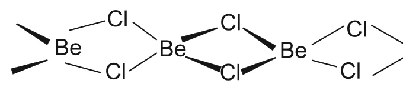

# [{ align=left, width=3.8% }](../../../index.md)  Alkaline Earth Metals | Questions

## Questions

!!! question "Compare the alkali metals and alkaline earth metals with respect to (i) ionization enthalpy (ii) basicity of oxides and (iii) solubility of hydroxides."

    * **Ionization enthalpy:** The first ionization enthalpy of alkaline earth metals is higher than that of the corresponding alkali metals because of their smaller size and higher nuclear charge. However, their second ionization enthalpy is lower than that of alkali metals, since an alkali metal has to lose its second electron from a stable noble gas core.
    * **Basicity of oxides:** Alkali metal oxides are more basic than alkaline earth metal oxides. Alkali metals are more electropositive, so their oxides are more ionic. BeO is even amphoteric.
    * **Solubility of hydroxides:** Alkali metal hydroxides are highly soluble in water, while alkaline earth metal hydroxides are only sparingly soluble. The M2+ ions are smaller and doubly charged, so the lattice enthalpies of their hydroxides are much higher.

!!! question "Explain why alkali and alkaline earth metals cannot be obtained by chemical reduction methods."

    * Alkali and alkaline earth metals are themselves among the strongest reducing agents (large negative E0 values).
    * Their oxides and halides are very stable, so no common chemical reducing agent is strong enough to reduce them to the metal.
    * Therefore, these metals are obtained by electrolysis of their fused chlorides.

!!! question "Beryllium and magnesium do not give colour to flame whereas other alkaline earth metals do so. Why?"

    Be and Mg are small atoms with high ionization enthalpies. Their valence electrons are held so strongly that the energy of the flame is not enough to excite them to higher energy levels. Hence, no visible light is emitted and they do not colour the flame. In Ca, Sr and Ba, the electrons are excited easily and emit visible light (brick red, crimson and apple green respectively) when they return to the ground state.

!!! question "Compare the solubility and thermal stability of the following compounds of the alkali metals with those of the alkaline earth metals: (a) Nitrates (b) Carbonates (c) Sulphates."

    * **Nitrates:** Nitrates of both groups are soluble in water. Alkali metal nitrates (except LiNO3) decompose on heating to give nitrites, while alkaline earth metal nitrates decompose to give oxides.

    $$2NaNO_3 &rarr; 2NaNO_2 + O_2$$

    $$2M(NO_3)_2 &rarr; 2MO + 4NO_2 + O_2$$

    * **Carbonates:** Alkali metal carbonates are soluble in water and thermally stable (except Li2CO3). Alkaline earth metal carbonates are insoluble in water and decompose on heating to give the oxide and CO2. Their thermal stability increases down the group.

    $$MCO_3 &rarr; MO + CO_2$$

    * **Sulphates:** Alkali metal sulphates are soluble in water and thermally stable. Among alkaline earth metal sulphates, BeSO4 and MgSO4 are soluble, but the solubility decreases from CaSO4 to BaSO4. They are also stable to heat.

!!! question "What happens when (i) magnesium is burnt in air (ii) quick lime is heated with silica (iii) chlorine reacts with slaked lime (iv) calcium nitrate is heated?"

    * (i) Magnesium burns with dazzling brilliance to form magnesium oxide and magnesium nitride.

    $$2Mg + O_2 &rarr; 2MgO$$

    $$3Mg + N_2 &rarr; Mg_3N_2$$

    * (ii) Calcium silicate is formed.

    $$CaO + SiO_2 &rarr; CaSiO_3$$

    * (iii) Bleaching powder is formed.

    $$2Ca(OH)_2 + 2Cl_2 &rarr; CaCl_2 + Ca(OCl)_2 + 2H_2O$$

    * (iv) Calcium oxide, nitrogen dioxide and oxygen are formed.

    $$2Ca(NO_3)_2 &rarr; 2CaO + 4NO_2 + O_2$$

!!! question "Draw the structure of (i) BeCl2 (vapour) (ii) BeCl2 (solid)."

    * (i) In the vapour phase, BeCl2 exists as a chloro-bridged dimer, which dissociates at about 1200 K into a linear monomer:

    $$Cl - Be - Cl$$

    * (ii) In the solid state, BeCl2 has a polymeric chain structure in which each Be is bonded to four Cl atoms through chlorine bridges:

    {loading=lazy}

!!! question "The hydroxides and carbonates of sodium and potassium are easily soluble in water while the corresponding salts of magnesium and calcium are sparingly soluble in water. Explain."

    * A salt dissolves when its hydration enthalpy is greater than its lattice enthalpy.
    * Mg2+ and Ca2+ are smaller and carry a double charge compared with Na+ and K+. Hence the lattice enthalpies of their hydroxides and carbonates are much higher.
    * For Mg and Ca salts, the high lattice enthalpy is not overcome by hydration enthalpy, so they are sparingly soluble. For Na and K salts, the lattice enthalpy is lower and hydration enthalpy wins, so they dissolve easily.

!!! question "Describe the importance of the following: (i) limestone (ii) cement (iii) plaster of paris."

    * (i) **Limestone (CaCO3):** It is used as a building material (marble), in the manufacture of quick lime and cement, as a flux in the extraction of iron, and (when specially precipitated) in paper making, tooth paste, antacids and cosmetics.
    * (ii) **Cement:** It is a commodity of national necessity next to iron and steel. It is used in concrete and reinforced concrete, in plastering and in the construction of bridges, dams and buildings.
    * (iii) **Plaster of Paris:** It sets into a hard mass with water. It is used in the building industry and in plasters, for immobilizing fractured bones, in dentistry, in ornamental work and for making casts of statues and busts.

!!! question "Explain the significance of magnesium and calcium in biological fluids."

    * **Magnesium:** All enzymes that use ATP in phosphate transfer require Mg2+ as a cofactor. Chlorophyll in plants contains magnesium.
    * **Calcium:** About 99% of body calcium is in bones and teeth. Ca2+ plays important roles in neuromuscular function, interneuronal transmission, cell membrane integrity and blood coagulation. Its plasma concentration (about 100 mg L-1) is maintained by calcitonin and parathyroid hormone.

!!! question "Comment on the observation: E0 for M2+(aq) + 2e- &rarr; M(s) (where M = Ca, Sr or Ba) is nearly constant."

    * The electrode potential depends on the sublimation enthalpy, ionization enthalpy and hydration enthalpy of the metal.
    * From Ca to Ba, the sublimation and ionization enthalpies decrease, which favours oxidation. At the same time, the hydration enthalpy of M2+ also decreases, which opposes it.
    * These effects nearly cancel each other, so E0 values for Ca, Sr and Ba are nearly constant (-2.84 V, -2.89 V and -2.92 V).

!!! question "How would you explain the following observations? (i) BeO is almost insoluble but BeSO4 is soluble in water. (ii) BaO is soluble but BaSO4 is insoluble in water."

    * (i) Be2+ and O2- are both small, so BeO has a very high lattice enthalpy (and is largely covalent). Its hydration enthalpy cannot overcome this, so BeO is almost insoluble. In BeSO4, the large SO42- ion lowers the lattice enthalpy, while the very high hydration enthalpy of the small Be2+ ion is enough to overcome it. Hence BeSO4 is soluble.
    * (ii) In BaO, the large Ba2+ and small O2- give a relatively low lattice enthalpy, which is overcome by hydration; BaO also reacts with water to form soluble Ba(OH)2. In BaSO4, the large SO42- ion keeps the lattice enthalpy almost constant, but the hydration enthalpy of the large Ba2+ ion is too small to overcome it. Hence BaSO4 is insoluble.
