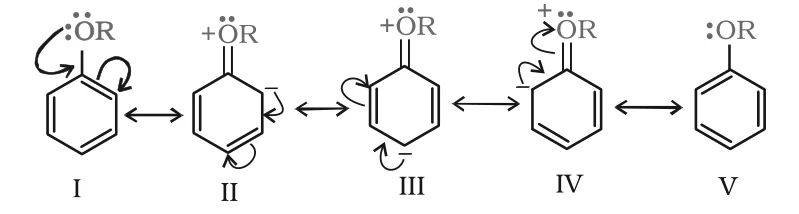

# [{ align=left, width=3.8% }](../../index.md)  Alcohols, Phenols and Ethers | Ethers

In this article, we will discuss the preparation, physical properties and chemical reactions of ethers (R–O–R', Ar–O–R).

## Preparation of Ethers

### 1. By Dehydration of Alcohols

* Alcohols are dehydrated by protic acids (H2SO4, H3PO4). Whether an alkene or an ether is formed depends on the conditions.
* For example, ethanol gives ethene with H2SO4 at 443 K, but at 413 K ethoxyethane is the main product.

!!! tip ""

    $$CH_3CH_2OH \xrightarrow{H_2SO_4,\ 443\ K} CH_2=CH_2$$

    $$CH_3CH_2OH \xrightarrow{H_2SO_4,\ 413\ K} C_2H_5OC_2H_5$$

**Mechanism:** Formation of ether is a nucleophilic bimolecular reaction (SN2), in which an alcohol molecule attacks a protonated alcohol.

!!! tip ""

    $$(i)\ CH_3-CH_2-\ddot{O}-H + H^+ &rarr; CH_3-CH_2-\overset{+}{O}H_2$$

    $$(ii)\ CH_3CH_2-\ddot{O}H + CH_3-CH_2-\overset{+}{O}H_2 &rarr; CH_3CH_2-\overset{+}{O}(H)-CH_2CH_3 + H_2O$$

    $$(iii)\ CH_3CH_2-\overset{+}{O}(H)-CH_2CH_3 &rarr; CH_3CH_2-O-CH_2CH_3 + H^+$$

* Acidic dehydration of alcohols to alkenes is always accompanied by this substitution reaction giving an ether.
* This method is suitable only for ethers with **primary** alkyl groups. The alkyl group should be unhindered and the temperature kept low; otherwise alkene formation is favoured.
* With secondary and tertiary alcohols, the reaction follows an SN1 pathway, and elimination competes over substitution. So alkenes are formed easily and the method fails for such ethers.
* The method is also not suitable for unsymmetrical ethers such as ethyl methyl ether. A mixture of two different alcohols would give a mixture of three ethers (dimethyl, diethyl and ethyl methyl ether).

### 2. Williamson Synthesis

* This is an important laboratory method for preparing both **symmetrical and unsymmetrical** ethers.
* An alkyl halide is allowed to react with a sodium alkoxide.

!!! tip ""

    $$R-X + R'-\ddot{O}Na &rarr; R-\ddot{O}-R' + NaX$$

* Ethers containing secondary or tertiary alkyl groups can also be made. The reaction involves **SN2 attack of an alkoxide ion on a primary alkyl halide**.

!!! tip ""

    $$(CH_3)_3C-O^-Na^+ + CH_3-Br &rarr; CH_3-O-C(CH_3)_3 + NaBr$$

* Best results are obtained with **primary** alkyl halides. With secondary and tertiary alkyl halides, elimination competes over substitution.
* With a tertiary alkyl halide, an alkene is the **only** product. For example, CH3ONa with (CH3)3C–Br gives only 2-methylpropene:

!!! tip ""

    $$(CH_3)_3C-Br + Na^+\ ^-O-CH_3 &rarr; CH_3-C(CH_3)=CH_2 + NaBr + CH_3OH$$

* This happens because alkoxides are not only nucleophiles but also **strong bases**, and they bring about elimination with hindered alkyl halides.

!!! tip "Conclusion"

    In Williamson synthesis, the bulky (secondary/tertiary) group should come from the alkoxide, and the alkyl halide should be primary (or methyl).

* Phenols are also converted to ethers by this method, using the phenoxide ion as the nucleophile.

!!! tip ""

    $$C_6H_5OH + NaOH &rarr; C_6H_5O^-Na^+ + H_2O$$

    $$C_6H_5O^-Na^+ + R-X &rarr; C_6H_5-O-R + NaX$$

* An aryl halide cannot be used as the halide component, because aryl halides do not undergo SN2 reactions easily.

## Physical Properties of Ethers

* The C–O bonds in ethers are polar, so ethers have a net dipole moment. However, this weak polarity hardly affects their boiling points.
* Boiling points of ethers are comparable to those of alkanes of similar molecular mass, and much lower than those of alcohols:

Compound        | Formula                                                     | b.p./K
----------------|-------------------------------------------------------------|-------
n-Pentane       | CH3(CH2)3CH3    | 309.1
Ethoxyethane    | C2H5–O–C2H5     | 307.6
Butan-1-ol      | CH3(CH2)3–OH               | 390

* The large difference between alcohols and ethers is due to hydrogen bonding in alcohols, which is absent between ether molecules.
* **Solubility:** Miscibility of ethers with water is similar to that of alcohols of the same molecular mass. Ethoxyethane and butan-1-ol dissolve to almost the same extent (7.5 g and 9 g per 100 mL of water respectively), while pentane is essentially immiscible.
* This is because the oxygen of an ether can form hydrogen bonds with water molecules (R2O···H–O–H), just as alcohols do.

!!! note "Note"

    Diethyl ether was widely used as an inhalation anaesthetic. Due to its slow effect and unpleasant recovery period, it has been replaced by other compounds.

## Chemical Reactions of Ethers

### 1. Cleavage of C–O Bond in Ethers

* Ethers are the **least reactive** of these functional groups. Their C–O bond is cleaved only under drastic conditions, with excess hydrogen halide.
* A dialkyl ether gives two molecules of alkyl halide:

!!! tip ""

    $$R-O-R + HX &rarr; RX + R-OH$$

    $$R-OH + HX &rarr; R-X + H_2O$$

* Ethers with two different alkyl groups are cleaved in the same manner:

!!! tip ""

    $$R-O-R' + HX &rarr; R-X + R'-OH$$

* Order of reactivity of hydrogen halides: HI > HBr > HCl. Cleavage is carried out with concentrated HI or HBr at high temperature.

#### Mechanism (reaction of an ether with concentrated HI)

* **Step 1:** The ether is protonated. HBr and HI are acidic enough for this.

!!! tip ""

    $$CH_3-\ddot{O}-CH_2CH_3 + H-I &#8652; CH_3-\overset{+}{O}(H)-CH_2CH_3 + I^-$$

* **Step 2:** Iodide is a good nucleophile. It attacks the **least substituted carbon** of the oxonium ion and displaces an alcohol molecule by SN2 mechanism.

!!! tip ""

    $$I^- + CH_3-\overset{+}{O}(H)-CH_2CH_3 &rarr; [I\cdots CH_3\cdots \overset{+}{O}(H)CH_2CH_3]^{-} &rarr; CH_3-I + CH_3CH_2-OH$$

* **Step 3:** With excess HI at high temperature, the ethanol formed reacts with another HI molecule to give ethyl iodide.

!!! tip ""

    $$CH_3CH_2-OH + H-I &#8652; CH_3CH_2-\overset{+}{O}H_2 + I^-$$

    $$I^- + CH_3CH_2-\overset{+}{O}H_2 &rarr; CH_3CH_2I + H_2O$$

* So in mixed ethers with primary or secondary alkyl groups, it is the **smaller alkyl group** that forms the alkyl iodide (SN2).

#### When one group is tertiary

* If one alkyl group is tertiary, the halide formed is a **tertiary halide**.

!!! tip ""

    $$(CH_3)_3C-O-CH_3 + HI &rarr; CH_3OH + (CH_3)_3C-I$$

* Here, in step 2, the leaving group (HO–CH3) departs to give a stable tertiary carbocation, (CH3)3C+, so the reaction follows an **SN1** mechanism.

!!! tip ""

    $$(CH_3)_3C-\overset{+}{O}(H)-CH_3 \xrightarrow{slow} (CH_3)_3C^+ + CH_3OH$$

    $$(CH_3)_3C^+ + I^- \xrightarrow{fast} (CH_3)_3C-I$$

#### Alkyl aryl ethers

* Alkyl aryl ethers are cleaved at the **alkyl–oxygen bond**, giving a phenol and an alkyl halide.

!!! tip ""

    $$C_6H_5-O-R + H-X &rarr; C_6H_5OH + R-X$$

* In anisole, protonation gives the methylphenyl oxonium ion, C6H5–O+(H)–CH3. The O–C6H5 bond is stronger than the O–CH3 bond, because the phenyl carbon is sp2 hybridised and the bond has partial double bond character. So I- breaks the O–CH3 bond to form CH3I.
* The phenol formed does not react further to give an aryl halide, because the sp2 carbon of phenol cannot undergo the nucleophilic substitution needed.

### 2. Electrophilic Substitution in Aromatic Ethers

* The alkoxy group (–OR) **activates** the aromatic ring towards electrophilic substitution and is **ortho, para directing**, in the same way as the –OH group in phenol. Resonance increases the electron density at ortho and para positions:

{loading=lazy}

#### (i) Halogenation

* Anisole undergoes bromination with bromine in ethanoic acid even without an iron(III) bromide catalyst, because the methoxy group strongly activates the ring. The para isomer is obtained in 90% yield.

!!! tip ""

    $$C_6H_5OCH_3 \xrightarrow{Br_2\ in\ ethanoic\ acid} p-BrC_6H_4OCH_3\ (major) + o-BrC_6H_4OCH_3\ (minor)$$

#### (ii) Friedel-Crafts reaction

* Alkyl and acyl groups are introduced at ortho and para positions by reaction with an alkyl halide or acyl halide, in the presence of anhydrous AlCl3 (a Lewis acid) as catalyst.

!!! tip ""

    $$C_6H_5OCH_3 + CH_3Cl \xrightarrow{Anhyd.\ AlCl_3,\ CS_2} p-CH_3C_6H_4OCH_3\ (major) + o-CH_3C_6H_4OCH_3\ (minor)$$

    $$(4-Methoxytoluene\ and\ 2-methoxytoluene)$$

    $$C_6H_5OCH_3 + CH_3COCl \xrightarrow{Anhyd.\ AlCl_3} p-CH_3COC_6H_4OCH_3\ (major) + o-CH_3COC_6H_4OCH_3\ (minor)$$

    $$(4-Methoxyacetophenone\ and\ 2-methoxyacetophenone)$$

#### (iii) Nitration

* Anisole reacts with a mixture of concentrated H2SO4 and HNO3 to give a mixture of ortho- and para-nitroanisole.

!!! tip ""

    $$C_6H_5OCH_3 \xrightarrow{H_2SO_4,\ HNO_3} p-O_2NC_6H_4OCH_3\ (major) + o-O_2NC_6H_4OCH_3\ (minor)$$

    $$(4-Nitroanisole\ and\ 2-nitroanisole)$$
