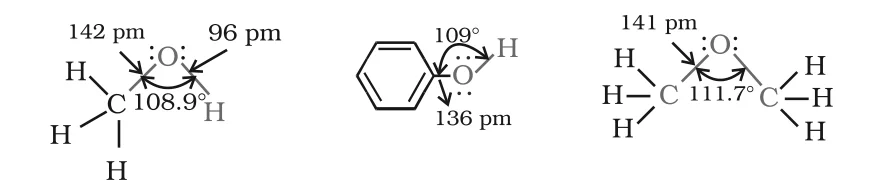

# [{ align=left, width=3.8% }](../../index.md)  Alcohols, Phenols and Ethers | Introduction and Nomenclature

## Introduction

* When a hydrogen atom of a hydrocarbon is replaced by an –OH group, we get an alcohol (if the hydrocarbon is aliphatic) or a phenol (if the hydrocarbon is aromatic).
* An **alcohol** contains one or more hydroxyl (–OH) groups directly attached to carbon atom(s) of an aliphatic system. Example: CH3OH.
* A **phenol** contains –OH group(s) directly attached to carbon atom(s) of an aromatic ring. Example: C6H5OH.
* When a hydrogen atom of a hydrocarbon is replaced by an alkoxy or aryloxy group (R–O– or Ar–O–), we get an **ether**. Example: CH3OCH3 (dimethyl ether).
* An ether can also be pictured as an alcohol or phenol in which the hydrogen of the –OH group has been replaced by an alkyl or aryl group.
* These compounds are everywhere: ethanol is the main component of spirit used for polishing furniture, and sugar, cotton and paper are all made of compounds containing –OH groups. Alcohols, phenols and ethers are also the basic compounds used for making detergents, antiseptics and fragrances respectively.

## Classification of Alcohols and Phenols

### 1. Mono, Di, Tri or Polyhydric Compounds

Alcohols and phenols are classified as mono-, di-, tri- or polyhydric depending on whether they contain one, two, three or many –OH groups.

Type        | Alcohol example                                                              | Phenol example
------------|------------------------------------------------------------------------------|----------------------------------------
Monohydric  | C2H5OH                                                 | Phenol, C6H5OH
Dihydric    | HOCH2–CH2OH (ethane-1,2-diol)                          | Benzene-1,2-diol (catechol)
Trihydric   | HOCH2–CH(OH)–CH2OH (glycerol)                          | Benzene-1,2,4-triol

### 2. Classification based on hybridisation of carbon bearing –OH

Monohydric alcohols are further classified according to the hybridisation of the carbon atom to which the –OH group is attached.

#### (i) Compounds containing Csp3–OH bond

The –OH group is attached to an sp3 hybridised carbon of an alkyl group. These are of the following types:

* **Primary (1°), secondary (2°) and tertiary (3°) alcohols:** The –OH group is attached to a primary, secondary or tertiary carbon atom respectively.

!!! tip ""

    $$Primary\ (1^0):\ RCH_2-OH$$

    $$Secondary\ (2^0):\ R_2CH-OH$$

    $$Tertiary\ (3^0):\ R_3C-OH$$

* **Allylic alcohols:** The –OH group is attached to an sp3 carbon next to a C=C double bond, i.e. to an allylic carbon. Example: CH2=CH–CH2–OH (a primary allylic alcohol).
* **Benzylic alcohols:** The –OH group is attached to an sp3 carbon next to an aromatic ring. Example: C6H5CH2OH (a primary benzylic alcohol).
* Allylic and benzylic alcohols can themselves be primary, secondary or tertiary, depending on how many carbons are attached to the carbinol carbon (the carbon carrying –OH).

#### (ii) Compounds containing Csp2–OH bond

* Here the –OH group is attached to a carbon of a C=C double bond (a vinylic carbon) or to an aryl carbon. These are known as vinylic alcohols.
* Vinylic alcohol: CH2=CH–OH
* Phenols: C6H5OH, o-CH3C6H4OH (o-cresol), etc.

## Classification of Ethers

* **Simple or symmetrical ethers:** Both groups attached to oxygen are the same. Example: diethyl ether, C2H5OC2H5.
* **Mixed or unsymmetrical ethers:** The two groups attached to oxygen are different. Examples: C2H5OCH3 and C2H5OC6H5.

## Nomenclature of Alcohols

* **Common name:** Name of the alkyl group followed by the word "alcohol". Example: CH3OH is methyl alcohol.
* **IUPAC name:** Replace the ending 'e' of the parent alkane with the suffix 'ol'.
* The longest carbon chain containing the –OH group is the parent chain. It is numbered from the end nearest to the –OH group, and positions of –OH and other substituents are shown by locants.
* For polyhydric alcohols, the 'e' of the alkane is retained and a multiplicative prefix (di, tri, ...) is added before 'ol'. Example: HO–CH2–CH2–OH is ethane-1,2-diol.
* Cyclic alcohols use the prefix cyclo, and the carbon carrying –OH is taken as C-1. Examples: cyclohexanol, 2-methylcyclopentanol.

Compound                                                              | Common name          | IUPAC name
----------------------------------------------------------------------|----------------------|----------------------
CH3–OH                                                     | Methyl alcohol       | Methanol
CH3–CH2–CH2–OH                       | n-Propyl alcohol     | Propan-1-ol
CH3–CH(OH)–CH3                                  | Isopropyl alcohol    | Propan-2-ol
CH3–CH2–CH2–CH2–OH        | n-Butyl alcohol      | Butan-1-ol
CH3–CH(OH)–CH2–CH3                   | sec-Butyl alcohol    | Butan-2-ol
(CH3)2CH–CH2–OH                      | Isobutyl alcohol     | 2-Methylpropan-1-ol
(CH3)3C–OH                                      | tert-Butyl alcohol   | 2-Methylpropan-2-ol
HOCH2–CH(OH)–CH2OH                              | Glycerol             | Propane-1,2,3-triol

## Nomenclature of Phenols

* The simplest hydroxy derivative of benzene is phenol. "Phenol" is both its common name and an accepted IUPAC name.
* In common names of substituted phenols, the terms ortho (1,2-), meta (1,3-) and para (1,4-) are used.

Compound                                                     | Common name                 | IUPAC name
-------------------------------------------------------------|-----------------------------|-------------------
C6H5OH                                 | Phenol                      | Phenol
o-CH3C6H4OH                 | o-Cresol                    | 2-Methylphenol
m-CH3C6H4OH                 | m-Cresol                    | 3-Methylphenol
p-CH3C6H4OH                 | p-Cresol                    | 4-Methylphenol
o-C6H4(OH)2                 | Catechol                    | Benzene-1,2-diol
m-C6H4(OH)2                 | Resorcinol                  | Benzene-1,3-diol
p-C6H4(OH)2                 | Hydroquinone or quinol      | Benzene-1,4-diol

## Nomenclature of Ethers

* **Common name:** Names of the two alkyl/aryl groups are written as separate words in alphabetical order, followed by the word "ether". Example: CH3OC2H5 is ethylmethyl ether. If both groups are the same, the prefix 'di' is used, e.g. diethyl ether.
* **IUPAC name:** An ether is treated as a hydrocarbon in which one hydrogen is replaced by an –OR or –OAr group (alkoxy or aryloxy). The larger group is chosen as the parent hydrocarbon, and the smaller one is named as the alkoxy substituent.

Compound                                                                                  | Common name                 | IUPAC name
------------------------------------------------------------------------------------------|-----------------------------|------------------------------
CH3OCH3                                                             | Dimethyl ether              | Methoxymethane
C2H5OC2H5                                     | Diethyl ether               | Ethoxyethane
CH3OCH2CH2CH3                                 | Methyl n-propyl ether       | 1-Methoxypropane
C6H5OCH3                                                 | Methylphenyl ether (Anisole)| Methoxybenzene (Anisole)
C6H5OCH2CH3                                   | Ethylphenyl ether (Phenetole)| Ethoxybenzene
C6H5O(CH2)6–CH3                    | Heptylphenyl ether          | 1-Phenoxyheptane
CH3O–CH(CH3)–CH3                                         | Methyl isopropyl ether      | 2-Methoxypropane
C6H5–O–CH2–CH2–CH(CH3)–CH3 | Phenylisopentyl ether      | 3-Methylbutoxybenzene
CH3–O–CH2–CH2–OCH3                            | –                           | 1,2-Dimethoxyethane

## Structures of Functional Groups

{loading=lazy}

### 1. Alcohols

* The oxygen of the –OH group is bonded to carbon by a sigma bond formed by overlap of an sp3 hybrid orbital of carbon with an sp3 hybrid orbital of oxygen.
* The C–O–H bond angle (108.9° in methanol) is slightly less than the tetrahedral angle (109°28'). This is because the two lone pairs on oxygen repel the bond pairs and squeeze the angle.
* In methanol, C–O bond length = 142 pm and O–H bond length = 96 pm.

### 2. Phenols

* The –OH group is attached to an sp2 hybridised carbon of the aromatic ring.
* The C–O bond length in phenol (136 pm) is slightly less than in methanol. This is due to:
    * partial double bond character, because the lone pair of oxygen is in conjugation with the aromatic ring, and
    * the sp2 hybridised state of the carbon to which oxygen is attached.

### 3. Ethers

* The four electron pairs on oxygen (two bond pairs and two lone pairs) are arranged approximately tetrahedrally.
* The C–O–C bond angle (111.7° in methoxymethane) is slightly greater than the tetrahedral angle, because of repulsion between the two bulky –R groups.
* The C–O bond length (141 pm) is almost the same as in alcohols.
