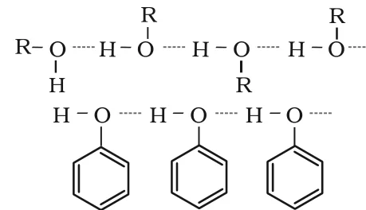
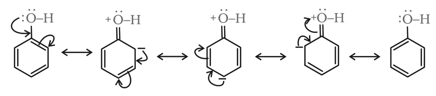
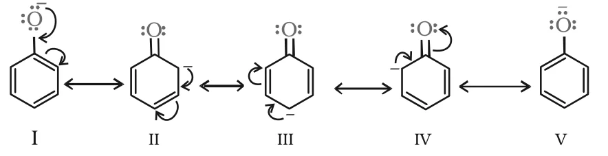

# [{ align=left, width=3.8% }](../../index.md)  Alcohols, Phenols and Ethers | Physical Properties and Acidity

Alcohols and phenols consist of two parts: an alkyl/aryl group and a hydroxyl group. Their properties are chiefly due to the –OH group; the alkyl or aryl group only modifies these properties.

## Physical Properties of Alcohols and Phenols

### 1. Boiling Points

* Boiling points increase with increase in the number of carbon atoms, because van der Waals forces increase.
* In alcohols, boiling points decrease with increase in branching. Branching reduces the surface area and hence the van der Waals forces.
* The –OH group of alcohols and phenols takes part in **intermolecular hydrogen bonding**:

{loading=lazy}

* Because of this hydrogen bonding, alcohols and phenols boil at much higher temperatures than hydrocarbons, ethers, haloalkanes and haloarenes of comparable molecular masses.

Compound          | Formula                                       | Molecular mass | Boiling point
------------------|-----------------------------------------------|----------------|--------------
Ethanol           | CH3CH2OH                | 46             | 351 K
Methoxymethane    | CH3OCH3                 | 46             | 248 K
Propane           | CH3CH2CH3    | 44             | 231 K

* Ethanol and propane have similar molecular masses but very different boiling points. Methoxymethane (polar, but with no O–H hydrogen) lies in between.

### 2. Solubility

* Alcohols and phenols are soluble in water because they can form hydrogen bonds with water molecules.
* Solubility decreases as the size of the alkyl/aryl (hydrophobic) group increases.
* Several lower alcohols are miscible with water in all proportions.

## Chemical Reactions: An Overview

Alcohols are versatile: they can react both as nucleophiles and as electrophiles.

* **As nucleophiles**, the O–H bond breaks. The lone pair on oxygen attacks an electrophilic carbon and a proton is then lost.

!!! tip ""

    $$R-\ddot{O}-H + \overset{+}{C}< &rarr; R-\overset{+}{O}(H)-C< &rarr; R-O-C< + H^+$$

* **As electrophiles**, the C–O bond breaks. Protonated alcohols react in this manner, since –OH2+ leaves easily as water.

!!! tip ""

    $$R-CH_2-OH + H^+ &rarr; R-CH_2-\overset{+}{O}H_2$$

    $$Br^- + R-CH_2-\overset{+}{O}H_2 &rarr; Br-CH_2-R + H_2O$$

So the reactions of alcohols and phenols can be divided into two groups: (a) those involving cleavage of the O–H bond and (b) those involving cleavage of the C–O bond. This page covers group (a).

## Reactions Involving Cleavage of O–H Bond

### 1. Acidity of Alcohols and Phenols

#### (i) Reaction with metals

* Alcohols and phenols react with active metals such as sodium, potassium and aluminium to give alkoxides/phenoxides and hydrogen gas.

!!! tip ""

    $$2R-O-H + 2Na &rarr; 2R-O-Na + H_2\ \ (sodium\ alkoxide)$$

    $$6(CH_3)_3C-OH + 2Al &rarr; 2[(CH_3)_3C-O]_3Al + 3H_2$$

    $$(aluminium\ tert-butoxide)$$

    $$2C_6H_5OH + 2Na &rarr; 2C_6H_5ONa + H_2\ \ (sodium\ phenoxide)$$

* In addition, phenols (but not alcohols) react with aqueous sodium hydroxide to form sodium phenoxide:

!!! tip ""

    $$C_6H_5OH + NaOH &rarr; C_6H_5ONa + H_2O$$

* These reactions show that alcohols and phenols are **Brönsted acids**, i.e. they can donate a proton to a stronger base (B:-).

!!! tip ""

    $$B:^- + H-O-R &rarr; B-H + R-O:^-$$

    $$(Base)\ \ (Acid)\ \ \ \ (Conjugate\ acid)\ \ (Conjugate\ base)$$

#### (ii) Acidity of alcohols

* The acidic character of alcohols is due to the **polar nature of the O–H bond**.
* Electron-releasing alkyl groups (–CH3, –C2H5) increase the electron density on oxygen. This decreases the polarity of the O–H bond and hence the acid strength.
* More alkyl groups on the carbinol carbon means weaker acid. So the order of acid strength is:

!!! tip ""

    $$RCH_2OH\ (1^0) > R_2CHOH\ (2^0) \gg R_3COH\ (3^0)$$

* **Alcohols are weaker acids than water.** This is shown by the reaction of an alkoxide with water:

!!! tip ""

    $$R-O^- + H-O-H &rarr; R-O-H + OH^-$$

* Here water acts as the proton donor (acid) and alkoxide as the proton acceptor (base). Thus water is a stronger acid than an alcohol, and an alkoxide ion is a stronger base than hydroxide ion. For example, sodium ethoxide is a stronger base than sodium hydroxide.
* Alcohols can also act as **Brönsted bases**, because the lone pairs on oxygen can accept a proton.

#### (iii) Acidity of phenols

* The reactions of phenol with metals and with aqueous NaOH show that phenols are **stronger acids than alcohols and water**.
* In phenol, the –OH group is attached to an sp2 hybridised carbon of the benzene ring, which acts as an electron withdrawing group. Resonance pushes the lone pair of oxygen into the ring, making the oxygen partially positive:

{loading=lazy}

* The ionisation of an alcohol and a phenol can be written as:

!!! tip ""

    $$R-O-H &#8652; R-O^- + H^+$$

    $$C_6H_5-OH &#8652; C_6H_5-O^- + H^+$$

Phenol is more acidic than an alcohol for two reasons:

* **Polarity of O–H bond:** The sp2 carbon attached to –OH in phenol is more electronegative than the sp3 carbon in alcohols. Electron density on oxygen decreases, the O–H bond becomes more polar, and ionisation is easier.
* **Stability of the anion:** In an alkoxide ion, the negative charge is localised on oxygen. In a phenoxide ion, the negative charge is **delocalised** over the ring (structures I–V), which makes phenoxide more stable and favours ionisation of phenol.

{loading=lazy}

* Phenol itself also shows resonance, but its resonance structures involve charge separation, so phenol is less stabilised than phenoxide ion.

#### (iv) Effect of substituents on acidity of phenols

* **Electron withdrawing groups** such as –NO2 increase the acid strength of phenol. The effect is stronger when the group is at the ortho or para position, because the negative charge of the phenoxide ion can then be delocalised onto the nitro group.
* **Electron releasing groups** such as alkyl groups do not favour formation of the phenoxide ion, so they decrease the acid strength. For example, cresols are less acidic than phenol.
* Remember: the greater the pKa value, the weaker the acid.

Compound        | Formula                                                          | pKa
----------------|------------------------------------------------------------------|------
o-Nitrophenol   | o-O2N–C6H4–OH                   | 7.2
m-Nitrophenol   | m-O2N–C6H4–OH                   | 8.3
p-Nitrophenol   | p-O2N–C6H4–OH                   | 7.1
Phenol          | C6H5–OH                                    | 10.0
o-Cresol        | o-CH3–C6H4–OH                   | 10.2
m-Cresol        | m-CH3–C6H4–OH                   | 10.1
p-Cresol        | p-CH3–C6H4–OH                   | 10.2
Ethanol         | C2H5OH                                     | 15.9

!!! tip "Conclusion"

    * The pKa of phenol (10.0) is about 6 units lower than that of ethanol (15.9), so phenol is about a million times more acidic than ethanol.

    * 2,4,6-Trinitrophenol (picric acid) is a strong acid, because its three electron withdrawing –NO2 groups make release of H+ very easy.

    * Order of acidity: alkanol < water < cresols < phenol < m-nitrophenol < o-/p-nitrophenol.

### 2. Esterification

* Alcohols and phenols react with carboxylic acids, acid chlorides and acid anhydrides to form esters.

!!! tip ""

    $$Ar/RO-H + R'-COOH \overset{H^+}{&#8652;} Ar/ROCOR' + H_2O$$

    $$Ar/R-OH + (R'CO)_2O \overset{H^+}{&#8652;} Ar/ROCOR' + R'COOH$$

    $$R/ArOH + R'COCl \xrightarrow{Pyridine} R/ArOCOR' + HCl$$

* With carboxylic acids and anhydrides, a small amount of concentrated H2SO4 is used as catalyst. The reaction is reversible, so water is removed as soon as it forms.
* With acid chlorides, a base (pyridine) is added to neutralise the HCl formed. This shifts the equilibrium to the right.
* Introduction of an acetyl (CH3CO–) group into an alcohol or phenol is called **acetylation**. Acetylation of salicylic acid gives **aspirin**, which has analgesic, anti-inflammatory and antipyretic properties.

!!! tip ""

    $$o-HOC_6H_4COOH + (CH_3CO)_2O \xrightarrow{H^+} o-CH_3COOC_6H_4COOH + CH_3COOH$$

    $$(Salicylic\ acid)\ \ \ \ \ \ \ \ (Acetylsalicylic\ acid\ or\ aspirin)$$
