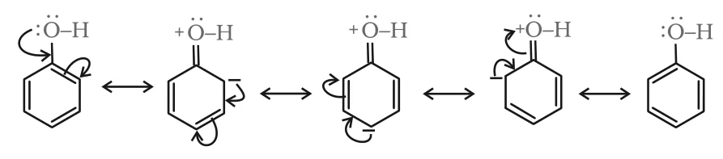
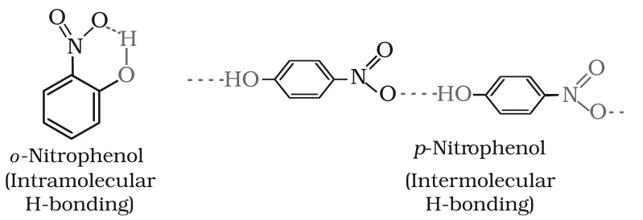
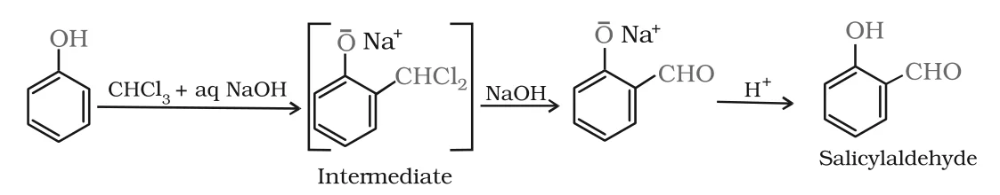

# [{ align=left, width=3.8% }](../../index.md)  Alcohols, Phenols and Ethers | Reactions of Phenols

Apart from the O–H cleavage reactions (acidity and esterification) common to alcohols and phenols, phenols show some reactions of their own, mostly on the aromatic ring.

## 1. Electrophilic Aromatic Substitution

* The –OH group attached to the benzene ring **activates** it towards electrophilic substitution.
* It also **directs** the incoming group to the **ortho and para** positions. The resonance structures of phenol show that these positions become electron rich, because the lone pair of oxygen is delocalised into the ring.

{loading=lazy}

### (i) Nitration

* With **dilute nitric acid** at low temperature (298 K), phenol gives a mixture of ortho- and para-nitrophenols.

!!! tip ""

    $$C_6H_5OH \xrightarrow{Dilute\ HNO_3} o-O_2NC_6H_4OH + p-O_2NC_6H_4OH$$
* The two isomers are separated by **steam distillation**:
    * o-Nitrophenol is **steam volatile** because of **intramolecular** hydrogen bonding (the –OH and –NO2 groups of the same molecule are hydrogen bonded), so its molecules do not associate.
    * p-Nitrophenol is less volatile because of **intermolecular** hydrogen bonding, which causes association of molecules.

{loading=lazy}

* With **concentrated nitric acid**, phenol is converted to **2,4,6-trinitrophenol (picric acid)**, but the yield is poor.

!!! tip ""

    $$C_6H_5OH \xrightarrow{Conc.\ HNO_3} 2,4,6-(NO_2)_3C_6H_2OH$$

* Nowadays, picric acid is prepared by first treating phenol with concentrated H2SO4, which gives phenol-2,4-disulphonic acid, and then with concentrated HNO3.

!!! tip ""

    $$C_6H_5OH \xrightarrow{Conc.\ H_2SO_4} 2,4-(HO_3S)_2C_6H_3OH$$

    $$2,4-(HO_3S)_2C_6H_3OH + 3HNO_3 &rarr; 2,4,6-(NO_2)_3C_6H_2OH + 2H_2SO_4 + H_2O$$

### (ii) Halogenation

The product of bromination depends on the conditions.

* **(a) In a solvent of low polarity** (CHCl3 or CS2) at low temperature (273 K), monobromophenols are formed. p-Bromophenol is the major product and o-bromophenol the minor product.

!!! tip ""

    $$C_6H_5OH \xrightarrow{Br_2\ in\ CS_2,\ 273\ K} p-BrC_6H_4OH\ (major) + o-BrC_6H_4OH\ (minor)$$

* Normally, halogenation of benzene needs a Lewis acid such as FeBr3 to polarise the halogen molecule. In phenol, the bromine molecule is polarised even without a Lewis acid, because the –OH group strongly activates the ring.

* **(b) With bromine water**, 2,4,6-tribromophenol is formed as a **white precipitate**.

!!! tip ""

    $$C_6H_5OH + 3Br_2 \xrightarrow{H_2O} 2,4,6-Br_3C_6H_2OH\ &darr; + 3HBr$$

* In water (a polar solvent), phenol partly ionises to phenoxide ion, which is even more strongly activating. So all three ortho and para positions get substituted.

## 2. Kolbe's Reaction

* Phenoxide ion, obtained by treating phenol with NaOH, is even more reactive than phenol towards electrophilic substitution.
* So it reacts even with carbon dioxide, a weak electrophile. **Ortho-hydroxybenzoic acid (salicylic acid)** is the main product.

!!! tip ""

    $$C_6H_5OH \xrightarrow{NaOH} C_6H_5ONa \xrightarrow{(i)\ CO_2,\ (ii)\ H^+} o-HOC_6H_4COOH$$

    The product is 2-hydroxybenzoic acid (salicylic acid).

## 3. Reimer-Tiemann Reaction

* When phenol is treated with chloroform in the presence of sodium hydroxide, a –CHO group is introduced at the **ortho** position of the ring.
* The intermediate (a substituted benzal chloride, –CHCl2) is hydrolysed by the alkali, and acidification finally gives **salicylaldehyde** (2-hydroxybenzaldehyde).

{loading=lazy}

!!! tip ""

    $$C_6H_5OH \xrightarrow{(i)\ CHCl_3 + aq\ NaOH,\ (ii)\ H^+} o-HOC_6H_4CHO$$

## 4. Reaction with Zinc Dust

* Phenol is converted to benzene on heating with zinc dust. This is the only reaction in which phenol shows cleavage of the C–O bond.

!!! tip ""

    $$C_6H_5OH + Zn &rarr; C_6H_6 + ZnO$$

## 5. Oxidation

* Oxidation of phenol with chromic acid (Na2Cr2O7 / H2SO4) gives a conjugated diketone called **benzoquinone** (p-benzoquinone, O=C6H4=O).

!!! tip ""

    $$C_6H_5OH \xrightarrow{Na_2Cr_2O_7,\ H_2SO_4} C_6H_4O_2\ (benzoquinone)$$

* In the presence of air, phenols are slowly oxidised to dark coloured mixtures containing quinones. This is why old samples of phenol turn pink or brown.

## Reactions of Phenols at a Glance

Reaction            | Reagent                                   | Main product
--------------------|-------------------------------------------|---------------------------------
Nitration (dilute)  | Dilute HNO3, 298 K             | o- and p-Nitrophenol
Nitration (conc.)   | Conc. HNO3                     | 2,4,6-Trinitrophenol (picric acid)
Bromination         | Br2 in CS2, 273 K   | p-Bromophenol (major) + o-bromophenol
Bromination         | Bromine water                             | 2,4,6-Tribromophenol (white ppt)
Kolbe's reaction    | NaOH, then CO2, H+  | Salicylic acid
Reimer-Tiemann      | CHCl3 + aq NaOH, then H+ | Salicylaldehyde
Zinc dust           | Zn, heat                                  | Benzene
Oxidation           | Na2Cr2O7, H2SO4 | Benzoquinone
