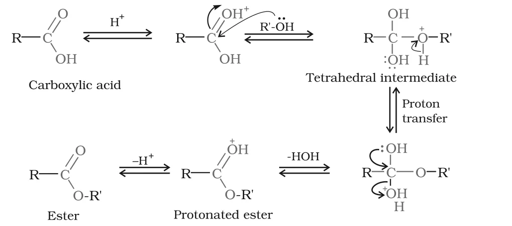

# [{ align=left, width=3.8% }](../../index.md)  Aldehydes, Ketones and Carboxylic Acids | Acidity and Reactions of Carboxylic Acids

The reactions of carboxylic acids can be grouped into four types: reactions involving cleavage of the O–H bond, reactions involving cleavage of the C–OH bond, reactions of the –COOH group as a whole, and substitution in the hydrocarbon part.

## Reactions Involving Cleavage of O–H Bond (Acidity)

### 1. Reactions with metals and alkalies

* Like alcohols, carboxylic acids evolve hydrogen with electropositive metals. Like phenols, they form salts with alkalies.
* Unlike phenols, they also react with weaker bases such as carbonates and hydrogencarbonates and evolve CO2. This brisk effervescence with NaHCO3 is used to **detect the carboxyl group**.

!!! tip ""

    $$2RCOOH + 2Na &rarr; 2RCOO^-Na^+ + H_2$$

    $$RCOOH + NaOH &rarr; RCOO^-Na^+ + H_2O$$

    $$RCOOH + NaHCO_3 &rarr; RCOO^-Na^+ + H_2O + CO_2 &uarr;$$

### 2. Dissociation in water

* Carboxylic acids dissociate in water to give a resonance stabilised carboxylate anion and the hydronium ion.
* In the carboxylate ion, the negative charge is shared equally between the two oxygen atoms, so both C–O bonds are identical.

!!! tip ""

    $$RCOOH + H_2O &#8652; H_3O^+ + RCOO^-$$

    $$R-C(=O)-O^- \longleftrightarrow R-C(-O^-)=O$$

!!! tip ""

    $$K_{eq} = {[H_3O^+][RCOO^-] \over [H_2O][RCOOH]}$$

    $$K_a = K_{eq}[H_2O] = {[H_3O^+][RCOO^-] \over [RCOOH]}$$

    $$pK_a = -\log K_a$$

* Ka is the acid dissociation constant. Acid strength is usually expressed by pKa. **Smaller the pKa, stronger the acid.**

Acid strength            | pKa range
-------------------------|---------------------
Strong acids             | < 1
Moderately strong acids  | 1 to 5
Weak acids               | 5 to 15
Extremely weak acids     | > 15

Acid                                   | pKa
---------------------------------------|---------------
Hydrochloric acid                      | –7.0
Trifluoroacetic acid (strongest organic acid) | 0.23
Benzoic acid                           | 4.19
Acetic acid                            | 4.76
Phenol                                 | 10
Ethanol                                | ~16

### 3. Why carboxylic acids are more acidic than phenols

* Carboxylic acids are weaker than mineral acids but stronger than alcohols and most simple phenols.
* The carboxylate ion is stabilised by **two equivalent resonance structures**, with the negative charge on the more electronegative oxygen atom in each.
* The phenoxide ion has **non-equivalent** resonance structures, several of which put the negative charge on the less electronegative carbon atoms of the ring. These contribute less.
* In the carboxylate ion the negative charge is spread over two electronegative oxygens, while in phenoxide it is spread less effectively over one oxygen and some carbons.

!!! tip "Conclusion"

    The carboxylate ion is more stable than the phenoxide ion, so carboxylic acids are more acidic than phenols, even though phenoxide has more resonance structures.

### 4. Effect of substituents on acidity

* Any substituent that stabilises the carboxylate ion (conjugate base) increases acidity, and any that destabilises it decreases acidity.
* **Electron withdrawing groups (EWG)** disperse the negative charge by inductive and/or resonance effects, stabilise the anion and **increase acidity**.
* **Electron donating groups (EDG)** intensify the negative charge, destabilise the anion and **decrease acidity**.
* The effect of common groups in order of increasing acidity is:

!!! tip ""

    $$Ph < I < Br < Cl < F < CN < NO_2 < CF_3$$

* So, the following acids are in order of **decreasing acidity** (based on pKa):

!!! tip ""

    $$CF_3COOH > CCl_3COOH > CHCl_2COOH > NO_2CH_2COOH > NC-CH_2COOH >$$

    $$FCH_2COOH > ClCH_2COOH > BrCH_2COOH > HCOOH > ClCH_2CH_2COOH >$$

    $$C_6H_5COOH > C_6H_5CH_2COOH > CH_3COOH > CH_3CH_2COOH$$

From this order we can see that:

* More halogen atoms means greater acidity (CCl3COOH > CHCl2COOH > ClCH2COOH).
* More electronegative halogens give greater acidity (F > Cl > Br).
* The inductive effect weakens with distance, so ClCH2CH2COOH is weaker than ClCH2COOH.
* Alkyl groups are electron donating, so CH3COOH is weaker than HCOOH and CH3CH2COOH is weaker still.

### 5. Effect of phenyl and vinyl groups

* Directly attaching a phenyl or vinyl group to –COOH **increases** acidity, even though resonance would be expected to decrease it.
* This is because the carboxyl carbon is attached to an **sp2 hybridised carbon**, which is more electronegative than an sp3 carbon. So benzoic acid (pKa 4.19) is stronger than acetic acid (pKa 4.76).
* In aromatic acids, electron withdrawing groups on the ring increase acidity, while electron donating groups decrease it:

Acid                    | pKa
------------------------|---------------
4-Methoxybenzoic acid   | 4.46
Benzoic acid            | 4.19
4-Nitrobenzoic acid     | 3.41

## Reactions Involving Cleavage of C–OH Bond

### 1. Formation of anhydride

* Carboxylic acids give anhydrides on heating with mineral acids such as H2SO4, or with P2O5.

!!! tip ""

    $$2CH_3COOH \xrightarrow{H^+,\ &Delta;\ or\ P_2O_5,\ &Delta;} (CH_3CO)_2O + H_2O$$

    $$Ethanoic\ acid \qquad \qquad Ethanoic\ anhydride$$

### 2. Esterification

* Carboxylic acids react with alcohols or phenols in the presence of a mineral acid catalyst (conc. H2SO4 or HCl gas) to form esters.

!!! tip ""

    $$RCOOH + R'OH \overset{H^+}{&#8652;} RCOOR' + H_2O$$

#### Mechanism of esterification

* Esterification is a **nucleophilic acyl substitution**.
* Protonation of the carbonyl oxygen activates the carbonyl group towards nucleophilic addition of the alcohol.
* A proton transfer in the tetrahedral intermediate converts an –OH group into an –OH2+ group, which is a better leaving group and is lost as a neutral water molecule.
* The protonated ester finally loses a proton to give the ester.

{loading=lazy}

### 3. Reactions with PCl5, PCl3 and SOCl2

* The –OH group of carboxylic acids is replaced by a chlorine atom, just as in alcohols, giving acyl chlorides.
* **Thionyl chloride is preferred** because the other two products (SO2 and HCl) are gases that escape, which makes purification of the acyl chloride easier.

!!! tip ""

    $$RCOOH + PCl_5 &rarr; RCOCl + POCl_3 + HCl$$

    $$3RCOOH + PCl_3 &rarr; 3RCOCl + H_3PO_3$$

    $$RCOOH + SOCl_2 &rarr; RCOCl + SO_2 &uarr; + HCl &uarr;$$

### 4. Reaction with ammonia

* Carboxylic acids react with ammonia to form ammonium salts, which on further heating at high temperature lose water to give amides.

!!! tip ""

    $$CH_3COOH + NH_3 &#8652; CH_3COONH_4 \xrightarrow[-H_2O]{&Delta;} CH_3CONH_2$$

    $$Ammonium\ acetate \qquad Acetamide$$

    $$C_6H_5COOH + NH_3 &#8652; C_6H_5COONH_4 \xrightarrow[-H_2O]{&Delta;} C_6H_5CONH_2$$

    $$Ammonium\ benzoate \qquad Benzamide$$

* Phthalic acid gives ammonium phthalate, which on heating gives phthalamide. Strong heating of phthalamide removes NH3 to give the cyclic imide, **phthalimide**.

!!! tip ""

    $$C_6H_4(COOH)_2 + 2NH_3 &#8652; C_6H_4(COONH_4)_2 \xrightarrow[-2H_2O]{&Delta;} C_6H_4(CONH_2)_2 \xrightarrow[-NH_3]{strong\ heating} C_6H_4(CO)_2NH$$

## Reactions Involving the –COOH Group

### 1. Reduction

* Carboxylic acids are reduced to primary alcohols by lithium aluminium hydride, or better by **diborane** (B2H6).
* Diborane does not easily reduce groups like ester, nitro and halo groups.
* Sodium borohydride does **not** reduce the carboxyl group.

!!! tip ""

    $$R-COOH \xrightarrow{(i)\ LiAlH_4/ether\ or\ B_2H_6\ \ (ii)\ H_3O^+} R-CH_2OH$$

### 2. Decarboxylation

* Sodium salts of carboxylic acids lose CO2 to form hydrocarbons when heated with **sodalime** (NaOH and CaO in the ratio 3 : 1). This is called decarboxylation.

!!! tip ""

    $$R-COONa \xrightarrow[Heat]{NaOH\ \&\ CaO} R-H + Na_2CO_3$$

* Alkali metal salts of carboxylic acids also undergo decarboxylation when their aqueous solutions are electrolysed. The hydrocarbon formed has twice the number of carbon atoms present in the alkyl group of the acid. This is **Kolbe electrolysis**.

!!! tip ""

    $$2CH_3COONa + 2H_2O \xrightarrow{electrolysis} CH_3-CH_3 + 2CO_2 + 2NaOH + H_2$$

## Substitution Reactions in the Hydrocarbon Part

### 1. Halogenation: Hell-Volhard-Zelinsky (HVZ) reaction

* Carboxylic acids having an α-hydrogen are halogenated at the α-position when treated with chlorine or bromine in the presence of a small amount of red phosphorus, giving α-halocarboxylic acids.

!!! tip ""

    $$R-CH_2-COOH \xrightarrow{(i)\ X_2/Red\ phosphorus\ \ (ii)\ H_2O} R-CH(X)-COOH \qquad (X = Cl,\ Br)$$

### 2. Ring substitution

* Aromatic carboxylic acids undergo electrophilic substitution. The –COOH group is **deactivating and meta-directing**.

!!! tip ""

    $$C_6H_5COOH \xrightarrow{conc.\ HNO_3 + conc.\ H_2SO_4} m-NO_2C_6H_4COOH \qquad (m-Nitrobenzoic\ acid)$$

    $$C_6H_5COOH \xrightarrow{Br_2/FeBr_3} m-BrC_6H_4COOH \qquad (m-Bromobenzoic\ acid)$$

* Aromatic acids do **not** undergo Friedel-Crafts reaction, because the carboxyl group is deactivating and the Lewis acid catalyst AlCl3 gets bonded to the carboxyl group.

## Uses of Carboxylic Acids

* **Methanoic acid**: used in the rubber, textile, dyeing, leather and electroplating industries.
* **Ethanoic acid**: used as a solvent and as vinegar in the food industry.
* **Hexanedioic acid** (adipic acid): used in the manufacture of nylon-6,6.
* **Esters of benzoic acid**: used in perfumery.
* **Sodium benzoate**: used as a food preservative.
* **Higher fatty acids**: used for making soaps and detergents.
