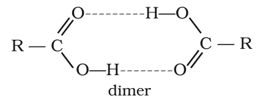

# [{ align=left, width=3.8% }](../../index.md)  Aldehydes, Ketones and Carboxylic Acids | Carboxylic Acids - Nomenclature and Preparation

## Carboxylic Acids

Carboxylic acids are carbon compounds containing the carboxyl functional group, –COOH, which is a **carb**onyl group attached to a hydr**oxyl** group (hence the name carboxyl).

* They may be **aliphatic** (RCOOH) or **aromatic** (ArCOOH), depending on whether an alkyl or aryl group is attached to the carboxylic carbon.
* Many carboxylic acids occur in nature. Higher aliphatic acids (C12 – C18), called **fatty acids**, occur in natural fats as esters of glycerol.
* Carboxylic acids are starting materials for anhydrides, esters, acid chlorides, amides, etc.

## Nomenclature of Carboxylic Acids

### 1. Common names

* Carboxylic acids were among the earliest organic compounds isolated from nature, so many are known by common names ending in **–ic acid**, taken from the Latin or Greek names of their natural sources.
* Formic acid (HCOOH) was first obtained from red ants (Latin *formica* = ant), acetic acid (CH3COOH) from vinegar (Latin *acetum* = vinegar), and butyric acid (CH3CH2CH2COOH) from rancid butter (Latin *butyrum* = butter).

### 2. IUPAC names

* The ending **–e** of the corresponding alkane is replaced by **–oic acid**.
* The carboxylic carbon is numbered 1.
* For compounds with more than one –COOH group, the ending –e of the alkane is retained and the number of carboxyl groups is shown by di, tri, etc. before **oic** (e.g. ethanedioic acid). Positions of the –COOH groups are shown by numbers before the multiplying prefix.

Structure                                                         | Common name        | IUPAC name
------------------------------------------------------------------|--------------------|-------------------------------------
HCOOH                                                             | Formic acid        | Methanoic acid
CH3COOH                                                | Acetic acid        | Ethanoic acid
CH3CH2COOH                                  | Propionic acid     | Propanoic acid
CH3CH2CH2COOH                    | Butyric acid       | Butanoic acid
(CH3)2CHCOOH                                | Isobutyric acid    | 2-Methylpropanoic acid
HOOC–COOH                                                         | Oxalic acid        | Ethanedioic acid
HOOC–CH2–COOH                                          | Malonic acid       | Propanedioic acid
HOOC–(CH2)2–COOH                            | Succinic acid      | Butanedioic acid
HOOC–(CH2)3–COOH                            | Glutaric acid      | Pentanedioic acid
HOOC–(CH2)4–COOH                            | Adipic acid        | Hexanedioic acid
HOOC–CH2–CH(COOH)–CH2–COOH                  | –                  | Propane-1,2,3-tricarboxylic acid
C6H5COOH                                    | Benzoic acid       | Benzenecarboxylic acid (Benzoic acid)
C6H5CH2COOH                      | Phenylacetic acid  | 2-Phenylethanoic acid
o-C6H4(COOH)2                    | Phthalic acid      | Benzene-1,2-dicarboxylic acid

## Structure of the Carboxyl Group

* The bonds to the carboxyl carbon lie in one plane and are separated by about 120°.
* The carboxylic carbon is **less electrophilic** than the carbonyl carbon of aldehydes and ketones. This is because the lone pair on the –OH oxygen is delocalised into the C=O group by resonance:

!!! tip ""

    $$-C(=O)-\ddot{O}H \longleftrightarrow -\overset{+}{C}(O^-)-\ddot{O}H \longleftrightarrow -C(O^-)=\overset{+}{O}H$$

## Methods of Preparation of Carboxylic Acids

### 1. From primary alcohols and aldehydes

* Primary alcohols are oxidised to carboxylic acids by KMnO4 (in neutral, acidic or alkaline medium), or by K2Cr2O7 or CrO3 in acidic medium.

!!! tip ""

    $$RCH_2OH \xrightarrow{1.\ alkaline\ KMnO_4\ \ 2.\ H_3O^+} RCOOH$$

    $$CH_3(CH_2)_8CH_2OH \xrightarrow{CrO_3-H_2SO_4} CH_3(CH_2)_8COOH$$

    $$1-Decanol \qquad \qquad Decanoic\ acid$$

* Aldehydes are oxidised to carboxylic acids even by mild oxidising agents such as Tollens' reagent.

### 2. From alkylbenzenes

* Vigorous oxidation of alkylbenzenes with chromic acid or acidic/alkaline KMnO4 gives aromatic carboxylic acids.
* The **entire side chain** is oxidised to –COOH, whatever its length.
* Primary and secondary alkyl groups are oxidised in this way, but a **tertiary** alkyl group is not affected.
* Suitably substituted alkenes are also oxidised to carboxylic acids by these reagents.

!!! tip ""

    $$C_6H_5CH_3 \xrightarrow[heat]{KMnO_4-KOH} C_6H_5COOK \xrightarrow{H_3O^+} C_6H_5COOH$$

    $$C_6H_5CH_2CH_2CH_3 \xrightarrow[&Delta;]{KMnO_4-KOH} C_6H_5COOK \xrightarrow{H_3O^+} C_6H_5COOH$$

### 3. From nitriles and amides

* Nitriles are hydrolysed first to amides and then to acids in the presence of H+ or OH- as catalyst.
* Mild conditions stop the reaction at the amide stage.

!!! tip ""

    $$R-CN \xrightarrow[H_2O]{H^+\ or\ OH^-} R-CONH_2 \xrightarrow[&Delta;]{H^+\ or\ OH^-} RCOOH$$

    $$CH_3CONH_2 \xrightarrow[&Delta;]{H_3O^+} CH_3COOH + NH_3$$

    $$C_6H_5CONH_2 \xrightarrow[&Delta;]{H_3O^+} C_6H_5COOH + NH_3$$

### 4. From Grignard reagents

* Grignard reagents react with carbon dioxide (dry ice) to form salts of carboxylic acids, which on acidification with mineral acid give the carboxylic acids.

!!! tip ""

    $$R-MgX + O=C=O \xrightarrow{dry\ ether} R-COO^-MgX^+ \xrightarrow{H_3O^+} RCOOH$$

!!! note "Note"

    Grignard reagents and nitriles are both made from alkyl halides. So methods 3 and 4 convert an alkyl halide into a carboxylic acid with **one carbon atom more** than the alkyl halide (ascending the series).

### 5. From acyl halides and anhydrides

* Acid chlorides are hydrolysed by water to carboxylic acids. They are hydrolysed more readily by aqueous base to carboxylate ions, which on acidification give the acids.
* Anhydrides are hydrolysed by water to the corresponding acid(s).

!!! tip ""

    $$RCOCl \xrightarrow{H_2O} RCOOH + Cl^-$$

    $$RCOCl \xrightarrow{OH^-/H_2O} RCOO^- + Cl^- \xrightarrow{H_3O^+} RCOOH$$

    $$(C_6H_5CO)_2O \xrightarrow{H_2O} 2C_6H_5COOH$$

    $$C_6H_5COOCOCH_3 \xrightarrow{H_2O} C_6H_5COOH + CH_3COOH$$

### 6. From esters

* Acidic hydrolysis of esters gives carboxylic acids directly.
* Basic hydrolysis gives carboxylates, which on acidification give the carboxylic acids.

!!! tip ""

    $$C_6H_5COOC_2H_5 \overset{H_3O^+}{&#8652;} C_6H_5COOH + C_2H_5OH$$

    $$CH_3CH_2CH_2COOC_2H_5 \xrightarrow{NaOH} CH_3CH_2CH_2COONa + C_2H_5OH$$

    $$CH_3CH_2CH_2COONa \xrightarrow{H_3O^+} CH_3CH_2CH_2COOH$$

## Physical Properties of Carboxylic Acids

### 1. Physical state and odour

* Aliphatic carboxylic acids with up to nine carbon atoms are colourless liquids with unpleasant odours at room temperature.
* Higher acids are wax-like solids and are almost odourless because of their low volatility.

### 2. Boiling points

* Carboxylic acids boil at higher temperatures than aldehydes, ketones and even alcohols of comparable molecular mass.
* This is due to more extensive association of the molecules through **intermolecular hydrogen bonding**.
* These hydrogen bonds are not broken completely even in the vapour phase. Most carboxylic acids exist as **dimers** in the vapour phase or in aprotic solvents.

{loading=lazy}

### 3. Solubility

* Simple aliphatic acids with up to four carbon atoms are miscible with water, because they form hydrogen bonds with water.
* Solubility decreases as the number of carbon atoms increases, because the hydrophobic hydrocarbon part becomes larger. Higher acids are practically insoluble in water.
* Benzoic acid, the simplest aromatic acid, is nearly insoluble in cold water.
* Carboxylic acids dissolve in less polar organic solvents such as benzene, ether, alcohol and chloroform.
