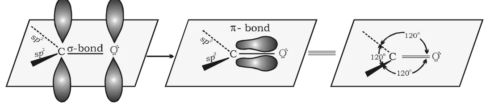

# [{ align=left, width=3.8% }](../../index.md)  Aldehydes, Ketones and Carboxylic Acids | Introduction and Nomenclature

## Introduction

Aldehydes, ketones and carboxylic acids are organic compounds containing the carbon-oxygen double bond (>C=O), called the carbonyl group. It is one of the most important functional groups in organic chemistry.

* In **aldehydes**, the carbonyl group is bonded to one carbon and one hydrogen.
* In **ketones**, the carbonyl group is bonded to two carbon atoms.
* In **carboxylic acids**, the carbonyl carbon is bonded to an –OH group. Their derivatives such as esters and anhydrides also have the carbonyl carbon bonded to oxygen.
* When the carbonyl carbon is bonded to nitrogen, the compound is an **amide**; when it is bonded to a halogen, it is an **acyl halide**.

Class               | General formula        | Example
--------------------|------------------------|-------------------------------------------
Aldehyde            | R–CHO                  | CH3CHO
Ketone              | R–CO–R'                | CH3COCH3
Carboxylic acid     | R–COOH                 | CH3COOH
Acyl halide         | R–COX (X = halogen)    | CH3COCl
Acid anhydride      | R–CO–O–CO–R'           | (CH3CO)2O
Ester               | R–COOR'                | CH3COOC2H5
Amide               | R–CONH2     | CH3CONH2

* These compounds are widespread in plants and animals and play an important role in biochemical processes.
* Many have pleasant fragrances: vanillin (from vanilla beans), salicylaldehyde (from meadow sweet) and cinnamaldehyde (from cinnamon, C6H5CH=CHCHO).
* They are used in food products and pharmaceuticals as flavours, as solvents (e.g. acetone), and for making adhesives, paints, resins, perfumes, plastics and fabrics.

## Nomenclature of Aldehydes and Ketones

There are two systems of naming aldehydes and ketones: common names and IUPAC names.

### 1. Common names

* The common name of an aldehyde is derived from the common name of the corresponding carboxylic acid by replacing the ending **–ic acid** with **aldehyde**. For example, formic acid &rarr; formaldehyde, acetic acid &rarr; acetaldehyde.
* The position of a substituent is indicated by Greek letters $\alpha$, $\beta$, $\gamma$, $\delta$, etc. The $\alpha$-carbon is the one directly linked to the aldehyde group, the $\beta$-carbon is the next one, and so on.

!!! example "Example"

    $$\overset{\gamma}{C}H_3-\overset{\beta}{C}H(Br)-\overset{\alpha}{C}H_2-CHO$$

    This compound is called $\beta$-bromobutyraldehyde.

* The common name of a ketone is derived by naming the two alkyl or aryl groups attached to the carbonyl group, followed by the word ketone (e.g. methyl n-propyl ketone).
* In ketones, positions are indicated as $\alpha$, $\alpha'$, $\beta$, $\beta'$, and so on, starting from the carbons on either side of the carbonyl group.
* Some ketones have historical names. The simplest one, dimethyl ketone, is called **acetone**.
* Alkyl phenyl ketones are named by adding the acyl group as a prefix to **phenone**:

!!! example "Examples"

    * C6H5COCH3 : Acetophenone
    * C6H5COCH2CH3 : Propiophenone
    * C6H5COC6H5 : Benzophenone

### 2. IUPAC names

* The IUPAC names of open chain aliphatic aldehydes and ketones are derived from the name of the parent alkane by replacing the ending **–e** with **–al** (aldehydes) and **–one** (ketones).
* For aldehydes, the longest chain is numbered starting from the carbon of the –CHO group.
* For ketones, numbering starts from the end nearer to the carbonyl group.
* Substituents are written as prefixes in alphabetical order with numbers showing their positions.
* In cyclic ketones, the carbonyl carbon is numbered 1.
* When the –CHO group is attached to a ring, the suffix **carbaldehyde** is added after the full name of the ring (e.g. cyclohexanecarbaldehyde). Numbering of the ring starts from the carbon carrying the –CHO group.
* The simplest aromatic aldehyde, C6H5CHO, is benzenecarbaldehyde, but its common name **benzaldehyde** is also accepted by IUPAC. Other aromatic aldehydes are named as substituted benzaldehydes.

!!! example "Examples"

    * CH3CH2CH2CH(Br)CH(CH3)CH2CHO : 4-Bromo-3-methylheptanal
    * CH3CH2CH=CHCHO : Pent-2-enal
    * CH3CH2COCH2CHO : 3-Oxopentanal
    * C6H5COCH2CH3 : 1-Phenylpropan-1-one
    * Cyclopentanone with a CH3 group on C-3 : 3-Methylcyclopentanone
    * p-NO2C6H4CHO : 4-Nitrobenzenecarbaldehyde or 4-Nitrobenzaldehyde
    * OHC–CH2–CH(CHO)–CH2–CHO : Propane-1,2,3-tricarbaldehyde

!!! note "Note"

    In propane-1,2,3-tricarbaldehyde, all three –CHO groups are treated identically by naming them as carbaldehyde substituents on a propane chain, rather than including two of them in the main chain.

### Common and IUPAC names of some aldehydes and ketones

Structure                                                          | Common name                         | IUPAC name
-------------------------------------------------------------------|-------------------------------------|----------------------------------------
HCHO                                                               | Formaldehyde                        | Methanal
CH3CHO                                                  | Acetaldehyde                        | Ethanal
(CH3)2CHCHO                                  | Isobutyraldehyde                    | 2-Methylpropanal
3-Methyl substituted C6H11CHO                | $\gamma$-Methylcyclohexanecarbaldehyde | 3-Methylcyclohexanecarbaldehyde
CH3CH(OCH3)CHO                               | $\alpha$-Methoxypropionaldehyde     | 2-Methoxypropanal
CH3CH2CH2CH2CHO        | Valeraldehyde                       | Pentanal
CH2=CHCHO                                               | Acrolein                            | Prop-2-enal
o-C6H4(CHO)2                      | Phthaldehyde                        | Benzene-1,2-dicarbaldehyde
m-BrC6H4CHO                                  | m-Bromobenzaldehyde                 | 3-Bromobenzaldehyde (3-Bromobenzenecarbaldehyde)
CH3COCH2CH2CH3         | Methyl n-propyl ketone              | Pentan-2-one
(CH3)2CHCOCH(CH3)2     | Diisopropyl ketone                  | 2,4-Dimethylpentan-3-one
Cyclohexanone with CH3 on C-2                           | $\alpha$-Methylcyclohexanone        | 2-Methylcyclohexanone
(CH3)2C=CHCOCH3                   | Mesityl oxide                       | 4-Methylpent-3-en-2-one

## Structure of the Carbonyl Group

* The carbonyl carbon is **sp2 hybridised** and forms three sigma ($\sigma$) bonds.
* Its fourth valence electron stays in an unhybridised p-orbital, which overlaps sideways with a p-orbital of oxygen to form a $\pi$-bond.
* The oxygen atom also carries two non-bonding (lone) pairs of electrons.
* So the carbonyl carbon and the three atoms attached to it lie in one plane, and the $\pi$-electron cloud lies above and below this plane.
* The bond angles are about 120°, as expected for a trigonal planar arrangement.

{loading=lazy}

### Polarity of the carbonyl group

* Oxygen is more electronegative than carbon, so the C=O bond is polarised. The carbonyl carbon is an **electrophilic centre** (Lewis acid) and the carbonyl oxygen is a **nucleophilic centre** (Lewis base).
* Carbonyl compounds therefore have large dipole moments and are more polar than ethers.
* This high polarity is explained by resonance between a neutral structure (A) and a dipolar structure (B):

!!! tip ""

    $$\underset{(A)}{>C=O} \longleftrightarrow \underset{(B)}{>\overset{+}{C}-\overset{-}{O}}$$

!!! tip "Conclusion"

    The electron-poor carbonyl carbon is the site attacked by nucleophiles. This explains why the typical reactions of aldehydes and ketones are nucleophilic addition reactions.
