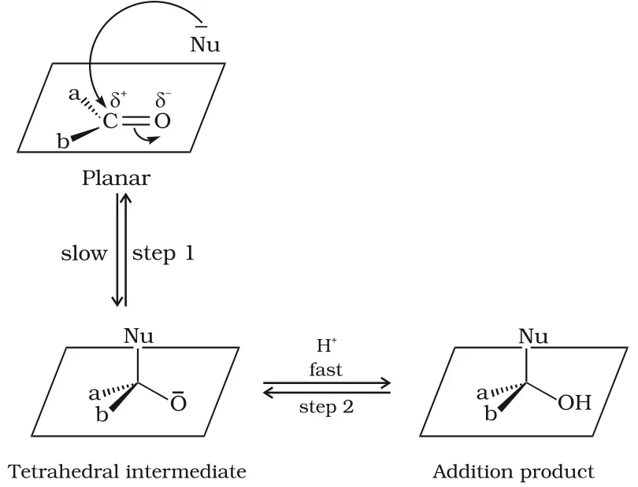

# [{ align=left, width=3.8% }](../../index.md)  Aldehydes, Ketones and Carboxylic Acids | Physical Properties and Nucleophilic Addition

## Physical Properties of Aldehydes and Ketones

### 1. Physical state

* Methanal is a gas at room temperature and ethanal is a volatile liquid.
* Other aldehydes and ketones are liquids or solids at room temperature.

### 2. Boiling points

* Boiling points of aldehydes and ketones are **higher** than those of hydrocarbons and ethers of comparable molecular mass. This is because the polar carbonyl groups attract each other through dipole-dipole interactions, giving weak molecular association.
* Their boiling points are **lower** than those of alcohols of similar molecular mass, because aldehydes and ketones cannot form intermolecular hydrogen bonds with each other.

Compound        | Molecular mass | b.p. (K)
----------------|----------------|---------
n-Butane        | 58             | 273
Methoxyethane   | 60             | 281
Propanal        | 58             | 322
Acetone         | 58             | 329
Propan-1-ol     | 60             | 370

### 3. Solubility

* Methanal, ethanal and propanone are miscible with water in all proportions because they form hydrogen bonds with water molecules.
* Solubility in water falls rapidly as the alkyl chain gets longer.
* All aldehydes and ketones are fairly soluble in organic solvents such as benzene, ether, methanol and chloroform.

### 4. Odour

* Lower aldehydes have sharp, pungent odours. As molecular size increases, the odour becomes less pungent and more fragrant.
* Many naturally occurring aldehydes and ketones are used in perfumes and flavouring agents.

## Chemical Reactions: Nucleophilic Addition

Since aldehydes and ketones both contain the carbonyl group, they show similar chemical reactions. Unlike alkenes, which undergo electrophilic addition, aldehydes and ketones undergo **nucleophilic addition** reactions.

### 1. Mechanism of nucleophilic addition

* A nucleophile attacks the electrophilic carbonyl carbon from a direction roughly perpendicular to the plane of its sp2 hybrid orbitals.
* During this attack, the hybridisation of carbon changes from sp2 to sp3 and a **tetrahedral alkoxide intermediate** is formed. This is the slow step.
* The intermediate then picks up a proton from the reaction medium (fast step) to give the neutral addition product.
* The overall result is the addition of Nu- and H+ across the C=O double bond.

{loading=lazy}

### 2. Reactivity

Aldehydes are generally more reactive than ketones in nucleophilic addition for two reasons:

* **Steric reason:** a ketone has two relatively large groups on the carbonyl carbon, which hinder the approach of the nucleophile more than the single group in an aldehyde.
* **Electronic reason:** alkyl groups are electron releasing. Two alkyl groups in a ketone reduce the electrophilicity (positive character) of the carbonyl carbon more than one alkyl group in an aldehyde.

!!! example "Example"

    Benzaldehyde is less reactive than propanal in nucleophilic addition. The benzene ring donates electrons to the carbonyl group by resonance, which reduces the polarity of the carbonyl group and makes the carbonyl carbon less electrophilic.

    $$C_6H_5-CH=O \longleftrightarrow \overset{+}{C_6H_5}=CH-\overset{-}{O}$$

## Important Nucleophilic Addition Reactions

### 1. Addition of hydrogen cyanide (HCN)

* Aldehydes and ketones react with HCN to form **cyanohydrins**.
* With pure HCN the reaction is very slow, so it is catalysed by a base. The base generates the cyanide ion (CN-), a much stronger nucleophile, which adds readily to the carbonyl group.
* Cyanohydrins are useful synthetic intermediates.

!!! tip ""

    $$HCN + OH^- &#8652; CN^- + H_2O$$

    $$>C=O + CN^- &#8652; >C(O^-)CN \xrightarrow{H^+} >C(OH)CN$$

    $$CH_3CHO + HCN &rarr; CH_3CH(OH)CN$$

### 2. Addition of sodium hydrogensulphite (NaHSO3)

* Sodium hydrogensulphite adds to aldehydes and ketones to form crystalline **bisulphite addition compounds**.

!!! tip ""

    $$>C=O + NaHSO_3 &#8652; >C(ONa)OSO_2H &#8652; >C(OH)SO_3Na$$

* The equilibrium lies largely to the right for most aldehydes and to the left for most ketones, for steric reasons.
* The addition compound is water soluble and gives back the original carbonyl compound when treated with dilute mineral acid or alkali. So this reaction is used for **separation and purification of aldehydes**.

### 3. Addition of Grignard reagents

* Grignard reagents (RMgX) add to the carbonyl group, and hydrolysis of the adduct gives alcohols. Methanal gives primary alcohols, other aldehydes give secondary alcohols and ketones give tertiary alcohols.

!!! tip ""

    $$>C=O + RMgX &rarr; >C(R)OMgX \xrightarrow{H_2O} >C(R)OH + Mg(OH)X$$

### 4. Addition of alcohols

* An aldehyde reacts with one equivalent of a monohydric alcohol in the presence of dry HCl to give an alkoxyalcohol called a **hemiacetal**.
* The hemiacetal reacts with one more molecule of alcohol to give a gem-dialkoxy compound called an **acetal**.

!!! tip ""

    $$RCHO \underset{HCl\ gas}{\overset{R'OH}{&#8652;}} RCH(OH)OR' \underset{H^+}{\overset{R'OH}{&#8652;}} RCH(OR')_2 + H_2O$$

    $$\qquad \qquad Hemiacetal \qquad \qquad Acetal$$

* Ketones react with ethylene glycol under similar conditions to give cyclic products called **ethylene glycol ketals**.

!!! tip ""

    $$R_2C=O + HOCH_2CH_2OH \underset{dil.\ HCl}{\overset{HCl\ gas}{&#8652;}} R_2C(OCH_2)_2 + H_2O$$

* Dry HCl protonates the carbonyl oxygen, increasing the electrophilicity of the carbonyl carbon and making the attack by the alcohol easier.
* Acetals and ketals are hydrolysed by aqueous mineral acids back to the aldehydes and ketones.

### 5. Addition of ammonia and its derivatives

* Ammonia and its derivatives, H2N–Z, add to the carbonyl group. The reaction is reversible and acid catalysed.
* The equilibrium favours the product because the intermediate rapidly loses water to form >C=N–Z. This is an **addition-elimination** reaction.

!!! tip ""

    $$>C=O + H_2N-Z &#8652; >C(OH)NHZ &rarr; >C=N-Z + H_2O$$

    $$Z = alkyl,\ aryl,\ OH,\ NH_2,\ C_6H_5NH,\ NHCONH_2,\ etc.$$

Z                                                  | Reagent                         | Carbonyl derivative                                          | Product name
---------------------------------------------------|---------------------------------|--------------------------------------------------------------|-----------------------------------
–H                                                 | Ammonia                         | >C=NH                                                        | Imine
–R                                                 | Amine                           | >C=NR                                                        | Substituted imine (Schiff's base)
–OH                                                | Hydroxylamine                   | >C=N–OH                                                      | Oxime
–NH2                                    | Hydrazine                       | >C=N–NH2                                          | Hydrazone
–NHC6H5                      | Phenylhydrazine                 | >C=N–NHC6H5                            | Phenylhydrazone
–NHC6H3(NO2)2 | 2,4-Dinitrophenylhydrazine (2,4-DNP) | >C=N–NHC6H3(NO2)2 | 2,4-Dinitrophenylhydrazone
–NHCONH2                                | Semicarbazide                   | >C=N–NHCONH2                                      | Semicarbazone

!!! note "Note"

    2,4-DNP derivatives are yellow, orange or red solids. They are used to identify (characterise) aldehydes and ketones.

!!! example "Example"

    $$CH_3CHO + NH_2OH \xrightarrow{H^+} CH_3CH=N-OH + H_2O$$

    $$Ethanal \qquad \qquad Acetaldoxime$$
