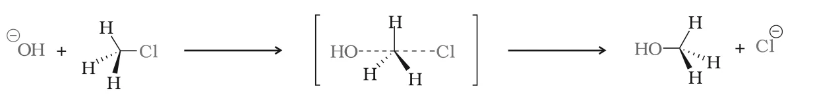
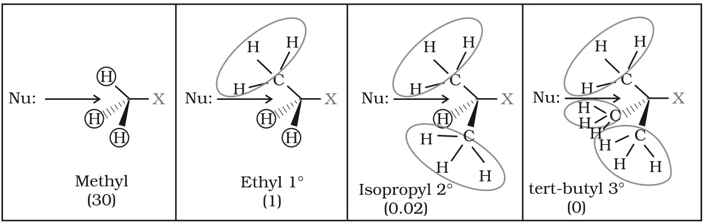
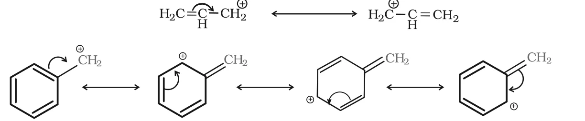

# [{ align=left, width=3.8% }](../../index.md)  Alkyl Halides | Nucleophilic Substitution Reactions

The reactions of haloalkanes can be divided into three categories:

* Nucleophilic substitution
* Elimination reactions
* Reaction with metals

In this article, we will discuss nucleophilic substitution and its two mechanisms, SN2 and SN1.

## Nucleophilic Substitution

* In a haloalkane, the carbon bonded to the halogen carries a partial positive charge.
* A nucleophile (an electron-rich species, Nu-) attacks this carbon. The halogen departs as a halide ion, called the **leaving group**.
* Since the reaction is started by a nucleophile, it is called a **nucleophilic substitution reaction**.

!!! tip ""

    $$Nu^- + R-X &rarr; R-Nu + X^-$$

* This is one of the most useful reactions of alkyl halides, in which halogen is bonded to an sp3 hybridised carbon.

Reagent | Nucleophile (Nu-) | Product (R-Nu) | Class of main product
--------|-------------------------------|----------------|----------------------
NaOH (KOH) | HO- | ROH | Alcohol
H2O | H2O | ROH | Alcohol
NaOR' | R'O- | ROR' | Ether
NaI | I- | R-I | Alkyl iodide
NH3 | NH3 | RNH2 | Primary amine
R'NH2 | R'NH2 | RNHR' | Secondary amine
R'R''NH | R'R''NH | RNR'R'' | Tertiary amine
KCN | C&equiv;N- | RCN | Nitrile (cyanide)
AgCN | Ag-CN: | RNC | Isonitrile (isocyanide)
KNO2 | O=N-O- | R-O-N=O | Alkyl nitrite
AgNO2 | Ag-O-N=O | R-NO2 | Nitroalkane
R'COOAg | R'COO- | R'COOR | Ester
LiAlH4 | H- | RH | Hydrocarbon
R'-M+ | R'- | RR' | Alkane

## Ambident Nucleophiles

* Nucleophiles that have two nucleophilic centres (two atoms that can donate an electron pair) are called **ambident nucleophiles**. Examples: cyanide and nitrite ions.
* The cyanide ion is a resonance hybrid of two structures, so it can attack through carbon (giving alkyl cyanides) or through nitrogen (giving isocyanides).

!!! tip ""

    $$^-:C&equiv;N: \ \ &harr; \ \ :C=\ddot{N}:^-$$

* The nitrite ion can attack through oxygen (giving alkyl nitrites, R-O-N=O) or through nitrogen (giving nitroalkanes, R-NO2).

!!! example "Why does KCN give alkyl cyanides but AgCN gives isocyanides?"

    * KCN is predominantly ionic and provides free cyanide ions in solution. Although both C and N can donate an electron pair, attack occurs mainly through carbon, because a C-C bond is more stable than a C-N bond. So, alkyl cyanide (RCN) is the main product.
    * AgCN is mainly covalent. The carbon is bonded to silver, so only the nitrogen is free to donate its electron pair. So, isocyanide (RNC) is the main product.

    $$R-X + KCN &rarr; R-CN + KX$$

    $$R-X + AgCN &rarr; R-NC + AgX$$

## Mechanism of Nucleophilic Substitution

Nucleophilic substitution proceeds by two different mechanisms: SN2 and SN1.

### 1. Substitution Nucleophilic Bimolecular (SN2)

* The reaction between CH3Cl and hydroxide ion to give methanol follows **second order kinetics**: the rate depends on the concentration of both reactants.

!!! tip ""

    $$Rate = k[CH_3Cl][OH^-]$$

* The nucleophile attacks the carbon from the side opposite to the halogen (backside attack). The C-OH bond forms and the C-Cl bond breaks **simultaneously, in a single step**. No intermediate is formed.

!!! tip "Mechanism"

    {loading=lazy}

* In the transition state, the carbon is partially bonded to five atoms (the incoming OH and the outgoing Cl). Such a structure is unstable and cannot be isolated.
* As the reaction proceeds, the three other groups on carbon flip over, like an umbrella turning inside out in strong wind. This is called **inversion of configuration**.
* The SN2 mechanism was proposed by Edward Davies Hughes and Sir Christopher Ingold in 1937.

#### Reactivity order in SN2

* The nucleophile must approach the carbon carrying the halogen. Bulky groups on or near this carbon block the approach (steric hindrance) and slow down the reaction.
* Methyl halides react fastest because there are only three small H atoms around the carbon. Tertiary halides are the least reactive.

!!! tip "Steric effects in SN2 (relative rates in brackets)"

    {loading=lazy}

!!! tip ""

    $$CH_3X > 1^0\ halide > 2^0\ halide > 3^0\ halide$$

### 2. Substitution Nucleophilic Unimolecular (SN1)

* SN1 reactions are generally carried out in polar protic solvents like water, alcohol or acetic acid.
* The reaction of *tert*-butyl bromide with hydroxide ion follows **first order kinetics**: the rate depends only on the concentration of *tert*-butyl bromide.

!!! tip ""

    $$(CH_3)_3CBr + OH^- &rarr; (CH_3)_3COH + Br^-$$

    $$(2-Bromo-2-methylpropane) \ \ \ \ (2-Methylpropan-2-ol)$$

    $$Rate = k[(CH_3)_3CBr]$$

* It occurs in **two steps**:

!!! tip ""

    $$Step\ I\ (slow):\ (CH_3)_3C-Br &#8652; (CH_3)_3C^+ + Br^-$$

    $$Step\ II\ (fast):\ (CH_3)_3C^+ + OH^- &rarr; (CH_3)_3COH$$

* **Step I** is the slowest and reversible step. The polarised C-Br bond breaks to form a carbocation and a bromide ion. The energy for breaking the bond comes from solvation of the halide ion by the protic solvent.
* **Step II**: the carbocation is quickly attacked by the nucleophile.
* The rate depends only on the slowest step, so it depends only on [alkyl halide] and not on [OH-].

#### Reactivity order in SN1

* The more stable the carbocation, the more easily it forms and the faster the reaction.
* 30 carbocations are the most stable, so 30 alkyl halides undergo SN1 reaction very fast.

!!! tip ""

    $$3^0\ halide > 2^0\ halide > 1^0\ halide > CH_3X$$

* For the same reason, **allylic and benzylic halides** are highly reactive towards SN1. The carbocation they form is stabilised by resonance:

!!! tip "Resonance in allyl and benzyl carbocations"

    {loading=lazy}

## Comparison of SN1 and SN2

Feature | SN2 | SN1
--------|----------------|----------------
Kinetics | Second order: rate = k[RX][Nu-] | First order: rate = k[RX]
Number of steps | One step, no intermediate | Two steps, via carbocation
Controlling factor | Steric hindrance | Stability of carbocation
Reactivity order | CH3X > 10 > 20 > 30 | 30 > 20 > 10 > CH3X
Stereochemistry | Complete inversion | Racemisation

* For a given alkyl group, the reactivity of the halide follows the same order in **both** mechanisms, because the weakest C-X bond breaks most easily (iodide is the best leaving group):

!!! tip ""

    $$R-I > R-Br > R-Cl >> R-F$$

!!! example "Example"

    * C6H11CH2Cl (a primary halide) undergoes SN2 faster than C6H11Cl (a secondary halide, chlorocyclohexane), because there is less steric hindrance.
    * CH3CH2CH2CH2I undergoes SN2 faster than CH3CH2CH2CH2Cl, because iodide, being large, is the better leaving group.
