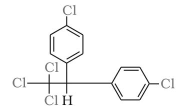

# [{ align=left, width=3.8% }](../../index.md)  Alkyl Halides | Polyhalogen Compounds

Carbon compounds containing more than one halogen atom are called polyhalogen compounds. Many of them are useful in industry and agriculture, but several are toxic or harmful to the environment. In this article, we will discuss some important polyhalogen compounds.

## 1. Dichloromethane (Methylene chloride), CH2Cl2

### Uses

* Solvent, for example as a paint remover.
* Propellant in aerosols.
* Process solvent in the manufacture of drugs.
* Metal cleaning and finishing solvent.

### Harmful effects

* It harms the human central nervous system.
* Low levels in air can slightly impair hearing and vision. Higher levels cause dizziness, nausea, and tingling and numbness in the fingers and toes.
* Direct skin contact causes intense burning and mild redness. Direct contact with the eyes can burn the cornea.

## 2. Trichloromethane (Chloroform), CHCl3

### Uses

* Solvent for fats, alkaloids, iodine and other substances.
* Its major use today is in the production of the freon refrigerant **R-22**.
* It was once used as a general anaesthetic in surgery, but has been replaced by safer anaesthetics such as ether.

### Harmful effects

* Inhaling chloroform vapours depresses the central nervous system. Breathing about 900 ppm of chloroform in air for a short time can cause dizziness, fatigue and headache.
* Chronic exposure may damage the liver (where chloroform is metabolised to phosgene) and the kidneys. Some people develop sores when skin is immersed in chloroform.

### Storage

* Chloroform is slowly oxidised by air in the presence of light to an extremely poisonous gas, **carbonyl chloride (phosgene)**.

!!! tip ""

    $$2CHCl_3 + O_2 \xrightarrow{light} 2COCl_2 + 2HCl$$

    $$(Phosgene)$$

* So, chloroform is stored in **closed, dark coloured bottles filled completely**, so that air and light are kept out.

## 3. Triiodomethane (Iodoform), CHI3

* It was used earlier as an **antiseptic**. However, the antiseptic property is due to the free iodine it liberates, not due to iodoform itself.
* Because of its objectionable smell, it has been replaced by other formulations containing iodine.

## 4. Tetrachloromethane (Carbon tetrachloride), CCl4

### Uses

* Manufacture of refrigerants and propellants for aerosol cans.
* Feedstock in the synthesis of chlorofluorocarbons and other chemicals.
* Pharmaceutical manufacturing and general solvent use.
* Until the mid 1960s, it was widely used as a cleaning fluid, as a degreasing agent in industry, as a spot remover at home and in fire extinguishers.

### Harmful effects

* There is some evidence that exposure causes liver cancer in humans.
* Common effects are dizziness, light-headedness, nausea and vomiting, which can permanently damage nerve cells. Severe cases can lead to stupor, coma, unconsciousness or death.
* It can make the heart beat irregularly or stop, and may irritate the eyes.
* When released into air, it rises to the atmosphere and **depletes the ozone layer**. Ozone depletion increases exposure to UV rays, leading to skin cancer, eye diseases and possible disruption of the immune system.

## 5. Freons

* The chlorofluorocarbon (CFC) compounds of methane and ethane are collectively called **freons**.
* They are extremely stable, unreactive, non-toxic, non-corrosive and easily liquefiable gases.
* **Freon 12 (CCl2F2)** is one of the most common freons in industrial use. It is manufactured from tetrachloromethane by the **Swarts reaction**.

!!! tip ""

    $$CCl_4 \xrightarrow{SbF_3} CCl_2F_2$$

### Uses

* Aerosol propellants, refrigeration and air conditioning.

### Environmental effect

* By 1974, world freon production was about 2 billion pounds a year.
* Most freon, even that used in refrigeration, eventually escapes into the atmosphere and diffuses unchanged into the stratosphere.
* In the stratosphere, freon initiates radical chain reactions that upset the natural ozone balance (ozone depletion).

## 6. p,p'-Dichlorodiphenyltrichloroethane (DDT)

* DDT was the first chlorinated organic insecticide. It was first prepared in 1873, but its effectiveness as an insecticide was discovered only in 1939 by Paul Muller (Geigy Pharmaceuticals, Switzerland). He received the Nobel Prize in Medicine and Physiology in 1948 for this discovery.

!!! tip "Structure of DDT"

    {loading=lazy}

    $$(p-ClC_6H_4)_2CH-CCl_3$$

### Uses

* After World War II, its use increased enormously, mainly against the **mosquito that spreads malaria** and **lice that carry typhus**.

### Problems

* Many species of insects developed resistance to DDT.
* It is highly toxic towards fish.
* DDT is chemically stable and fat soluble. It is not metabolised quickly by animals; instead, it is deposited and stored in fatty tissues. With steady intake, it builds up in the animal over time.
* Its use was banned in the United States in 1973, although it is still used in some other parts of the world.

!!! tip "Conclusion"

    Many polyhalogen compounds are very useful, but because they do not decompose easily, some of them accumulate in living organisms or deplete the ozone layer and are proving to be environmental hazards.
