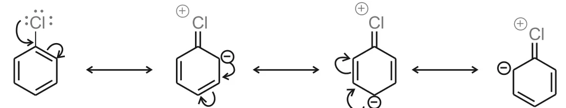
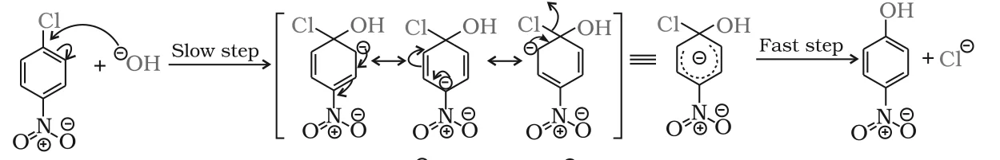
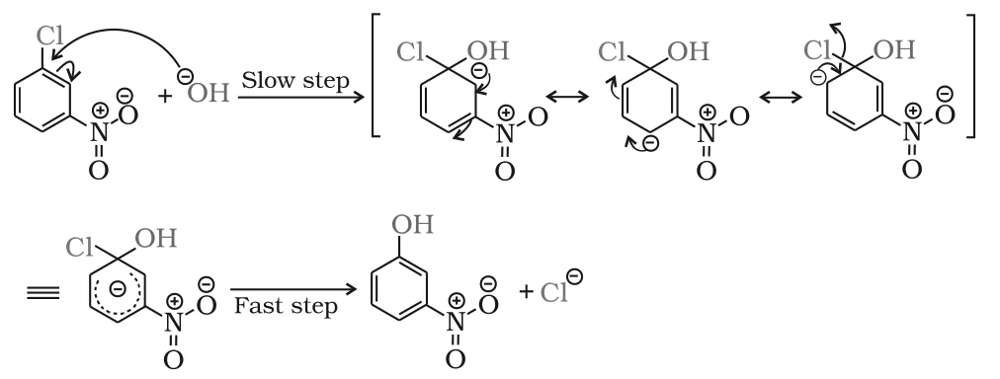

# [{ align=left, width=3.8% }](../../index.md)  Haloarenes | Chemical Reactions

Haloarenes (aryl halides) have the halogen attached to an sp2 hybridised carbon of a benzene ring. In this article, we will discuss their three main types of reactions: nucleophilic substitution, electrophilic substitution and reaction with metals.

## 1. Nucleophilic Substitution

Aryl halides are **extremely less reactive** towards nucleophilic substitution than alkyl halides. The reasons are:

### (i) Resonance effect

* The lone pairs on the halogen are in conjugation with the &pi;-electrons of the ring. The following resonating structures are possible:

!!! tip "Resonance in chlorobenzene"

    {loading=lazy}

* Due to resonance, the C-Cl bond acquires **partial double bond character**. It is therefore harder to break than the C-Cl bond of a haloalkane.

### (ii) Difference in hybridisation of carbon in C-X bond

* In a haloalkane, the carbon attached to halogen is sp3 hybridised. In a haloarene, it is sp2 hybridised.
* An sp2 carbon has greater s-character (33%) than an sp3 carbon (25%). So it is more electronegative and holds the electron pair of the C-X bond more tightly.
* As a result, the C-X bond in haloarenes is shorter and stronger:

Compound | C-Cl bond length
---------|------------------
Haloalkane | 177 pm
Haloarene | 169 pm

* A shorter bond is more difficult to break, so haloarenes are less reactive.

### (iii) Instability of phenyl cation

* If a haloarene ionised on its own, it would form a phenyl cation (C6H5+). This cation is not stabilised by resonance. So the SN1 mechanism is ruled out.

### (iv) Repulsion between nucleophile and ring

* The electron-rich nucleophile is repelled by the electron-rich benzene ring, so it is less likely to approach it.

### Replacement by hydroxyl group

* Chlorobenzene can be converted to phenol only under drastic conditions: heating with aqueous NaOH at **623 K and 300 atm**, followed by acidification.

!!! tip ""

    $$C_6H_5Cl \xrightarrow[(ii)\ H^+]{(i)\ NaOH,\ 623\ K,\ 300\ atm} C_6H_5OH$$

### Effect of -NO2 group (activation)

* The presence of an electron withdrawing group like -NO2 at the **ortho and para positions** increases the reactivity of haloarenes. The more such groups, the milder the conditions needed:

!!! tip ""

    $$Chlorobenzene \xrightarrow[(ii)\ H^+]{(i)\ NaOH,\ 623\ K,\ 300\ atm} Phenol$$

    $$4-Nitrochlorobenzene \xrightarrow[(ii)\ H^+]{(i)\ NaOH,\ 443\ K} 4-Nitrophenol$$

    $$2,4-Dinitrochlorobenzene \xrightarrow[(ii)\ H^+]{(i)\ NaOH,\ 368\ K} 2,4-Dinitrophenol$$

    $$2,4,6-Trinitrochlorobenzene \xrightarrow[H_2O]{warm} 2,4,6-Trinitrophenol$$

* An -NO2 group at the **meta** position has no such effect on reactivity.

#### Mechanism

* The OH- attacks the carbon carrying Cl in a **slow step**, forming a negatively charged intermediate (a carbanion) stabilised by resonance.
* In a **fast step**, Cl- is lost and the aromatic ring is restored.

!!! tip "Para-nitrochlorobenzene"

    {loading=lazy}

!!! tip "Meta-nitrochlorobenzene"

    {loading=lazy}

!!! question "Why does the NO2 group show its effect only at ortho- and para-positions and not at meta-position?"

    * The -NO2 group at ortho and para positions withdraws electron density from the ring, which makes the attack of the nucleophile easier.
    * In the carbanion intermediate, the negative charge appears at the ortho and para positions with respect to the halogen. When -NO2 is at one of these positions, one resonating structure puts the negative charge directly on the carbon bearing -NO2, and the charge can then be spread onto the nitro group. This strongly stabilises the intermediate.
    * In meta-nitrochlorobenzene, none of the resonating structures has the negative charge on the carbon bearing -NO2. So the nitro group cannot stabilise the charge, and there is no effect on reactivity.

## 2. Electrophilic Substitution

* Haloarenes undergo the usual electrophilic substitution reactions of benzene: halogenation, nitration, sulphonation and Friedel-Crafts reactions.
* The halogen is **slightly deactivating** but **ortho, para-directing**. So further substitution occurs at the ortho and para positions with respect to the halogen.

### Why is halogen o, p-directing yet deactivating?

* **Resonance (+R effect):** The resonating structures of halobenzene (same as shown above) place a negative charge (higher electron density) at the ortho and para positions. So the electrophile attacks there.
* **Inductive (-I effect):** Being electronegative, the halogen withdraws electrons from the ring. This deactivates the ring compared to benzene, so reactions are slower and need more drastic conditions.
* The inductive effect is stronger than resonance, so there is net deactivation. But the resonance effect stabilises the intermediate carbocation for ortho and para attack, so the deactivation is less at those positions.

!!! tip "Conclusion"

    Reactivity is controlled by the stronger **inductive effect**, and orientation is controlled by the **resonance effect**.

### (i) Halogenation

!!! tip ""

    $$C_6H_5Cl + Cl_2 \xrightarrow{Anhyd.\ FeCl_3} \underset{(Major)}{1,4-Dichlorobenzene} + \underset{(Minor)}{1,2-Dichlorobenzene}$$

### (ii) Nitration

!!! tip ""

    $$C_6H_5Cl \xrightarrow[conc.\ H_2SO_4]{HNO_3} \underset{(Major)}{1-Chloro-4-nitrobenzene} + \underset{(Minor)}{1-Chloro-2-nitrobenzene}$$

### (iii) Sulphonation

!!! tip ""

    $$C_6H_5Cl \xrightarrow[&Delta;]{conc.\ H_2SO_4} \underset{(Major)}{4-Chlorobenzenesulphonic\ acid} + \underset{(Minor)}{2-Chlorobenzenesulphonic\ acid}$$

### (iv) Friedel-Crafts reaction

!!! tip ""

    $$C_6H_5Cl + CH_3Cl \xrightarrow{Anhyd.\ AlCl_3} \underset{(Major)}{1-Chloro-4-methylbenzene} + \underset{(Minor)}{1-Chloro-2-methylbenzene}$$

    $$C_6H_5Cl + CH_3COCl \xrightarrow{Anhyd.\ AlCl_3} \underset{(Major)}{4-Chloroacetophenone} + \underset{(Minor)}{2-Chloroacetophenone}$$

* In each case the para product is major. The ortho position is more crowded because it is next to the halogen.

## 3. Reaction with Metals

### (i) Wurtz-Fittig reaction

* A mixture of an alkyl halide and an aryl halide gives an **alkylarene** when treated with sodium in dry ether.

!!! tip ""

    $$C_6H_5X + 2Na + RX \xrightarrow{dry\ ether} C_6H_5-R + 2NaX$$

### (ii) Fittig reaction

* Aryl halides alone, when treated with sodium in dry ether, give compounds in which two aryl groups are joined together.

!!! tip ""

    $$2C_6H_5X + 2Na \xrightarrow{dry\ ether} C_6H_5-C_6H_5 + 2NaX$$

    $$(Biphenyl)$$
