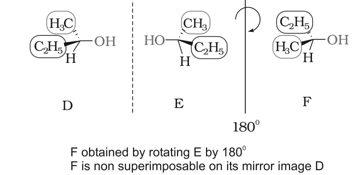
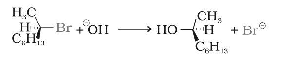
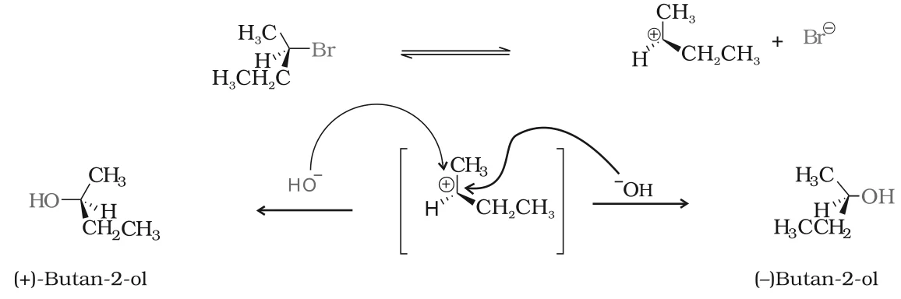

# [{ align=left, width=3.8% }](../../index.md)  Alkyl Halides | Stereochemistry of Nucleophilic Substitution

An SN2 reaction proceeds with complete stereochemical inversion while an SN1 reaction proceeds with racemisation. To understand why, we first need some basic ideas of stereochemistry: optical activity, chirality, retention, inversion and racemisation.

## 1. Plane Polarised Light and Optical Activity

* Ordinary light vibrates in all planes. When it is passed through a Nicol prism, light vibrating in only one plane comes out. This is called **plane polarised light**.
* Certain compounds rotate the plane of polarised light when it passes through their solutions. These are called **optically active compounds**.
* The angle of rotation is measured with an instrument called a **polarimeter**.

Type | Direction of rotation | Representation
-----|-----------------------|---------------
Dextrorotatory (d-form) | To the right (clockwise) | (+) sign before degree of rotation
Laevorotatory (l-form) | To the left (anticlockwise) | (-) sign before degree of rotation

* Such (+) and (-) isomers of a compound are called **optical isomers**, and the phenomenon is called **optical isomerism**.

## 2. Molecular Asymmetry and Chirality

* Louis Pasteur (1848) observed that crystals of certain compounds exist as mirror images. Solutions of the two kinds of crystals rotated plane polarised light by equal amounts but in opposite directions. He linked this to the three-dimensional arrangement of atoms (**configuration**).
* In 1874, van't Hoff and Le Bel independently proposed that the four groups around a carbon are arranged tetrahedrally.
* If all four groups attached to a carbon are different, that carbon is called an **asymmetric carbon** or **stereocentre**. A molecule containing it lacks symmetry and is called an asymmetric molecule. This asymmetry is responsible for optical activity.

### Chiral and achiral objects

* An object which is **non-superimposable** on its mirror image is called **chiral**, and the property is called **chirality**. Example: left and right hands.
* An object which is **superimposable** on its mirror image is called **achiral**. Examples: a sphere, a cube, a cone.
* A simple test for a chiral molecule is the presence of a single asymmetric carbon atom.

!!! example "Propan-2-ol and butan-2-ol"

    * **Propan-2-ol**, CH3CH(OH)CH3: the central carbon carries two identical CH3 groups. It has no asymmetric carbon, and it is superimposable on its mirror image. So it is **achiral**.
    * **Butan-2-ol**, CH3CH(OH)CH2CH3: the central carbon carries four different groups (H, OH, CH3, C2H5). Even after rotation, it cannot be superimposed on its mirror image. So it is **chiral**.

    {loading=lazy}

* Other examples of chiral molecules: 2-chlorobutane, 2,3-dihydroxypropanal (OHC-CHOH-CH2OH), bromochloroiodomethane (BrClCHI), 2-bromopropanoic acid (H3C-CHBr-COOH).

## 3. Enantiomers and Racemic Mixture

* Stereoisomers that are non-superimposable mirror images of each other are called **enantiomers**.
* Enantiomers have identical physical properties (melting point, boiling point, solubility, refractive index, etc.). They differ only in the direction in which they rotate plane polarised light: if one is dextrorotatory, the other is laevorotatory.

!!! note "Note"

    The sign of optical rotation, (+) or (-), is not necessarily related to the absolute configuration (actual 3D arrangement) of the molecule.

* A mixture containing two enantiomers in **equal proportions** has zero optical rotation, because the rotation of one cancels the other. It is called a **racemic mixture** or **racemic modification**.
* A racemic mixture is shown by prefixing *dl* or (&plusmn;) before the name, e.g. (&plusmn;)-butan-2-ol.
* The conversion of an enantiomer into a racemic mixture is called **racemisation**.

## 4. Retention, Inversion and Racemisation

Consider a reaction at an asymmetric carbon in which a group X is replaced by Y. There are three possible outcomes:

Outcome | Product obtained | Meaning
--------|------------------|--------
Retention | Only A | Y takes the same position that X occupied; relative configuration is preserved
Inversion | Only B | Y comes in from the side opposite to X; configuration is turned inside out
Racemisation | 50:50 mixture of A and B | Product is optically inactive

### Retention of configuration

* Retention is the preservation of the spatial arrangement of bonds around an asymmetric centre during a reaction. XCabc is converted into YCabc with the same relative configuration.
* In general, if no bond to the stereocentre is broken during a reaction, the product keeps the same configuration as the reactant.

!!! example "Example"

    When (-)-2-methylbutan-1-ol is heated with concentrated HCl, the bond that breaks is the CH2-OH bond, not a bond to the stereocentre. So the product, (+)-1-chloro-2-methylbutane, has the same configuration.

    $$\underset{(-)-2-Methylbutan-1-ol}{CH_3CH_2CH(CH_3)CH_2OH} + HCl \xrightarrow{heat} \underset{(+)-1-Chloro-2-methylbutane}{CH_3CH_2CH(CH_3)CH_2Cl} + H_2O$$

    Note that the sign of rotation changes from (-) to (+), even though the configuration is retained.

## 5. Stereochemistry of SN2 Reactions: Inversion

* In SN2, the nucleophile attaches itself on the side **opposite** to the halogen. So, the product from an optically active alkyl halide has the **inverted configuration**.
* Example: (-)-2-bromooctane reacts with sodium hydroxide to form (+)-octan-2-ol, with -OH occupying the position opposite to where Br was.

!!! tip ""

    {loading=lazy}

!!! tip "Conclusion"

    SN2 reactions of optically active halides are accompanied by **inversion of configuration**.

## 6. Stereochemistry of SN1 Reactions: Racemisation

* In SN1, the carbocation formed in the slow step is sp2 hybridised and therefore **planar (achiral)**.
* The nucleophile can attack this flat carbocation from either face:
    * Attack from the same side as the departed halide gives the product with the same configuration (retention).
    * Attack from the opposite side gives the product with the opposite configuration (inversion).
* Both happen equally, so a racemic mixture is formed.
* Example: hydrolysis of optically active 2-bromobutane gives (&plusmn;)-butan-2-ol.

!!! tip ""

    {loading=lazy}

!!! tip "Conclusion"

    SN1 reactions of optically active halides are accompanied by **racemisation**.
