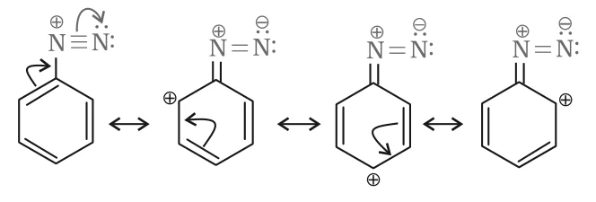
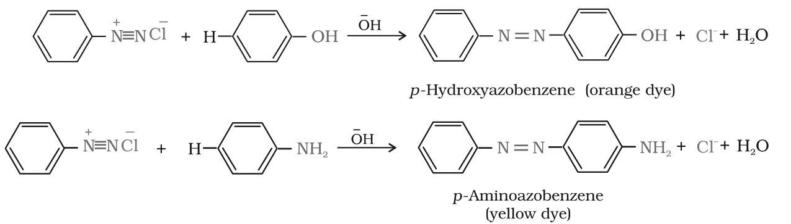

# [{ align=left, width=3.8% }](../../index.md)  Amines | Diazonium Salts

## Introduction

Diazonium salts have the general formula R$\overset{+}{N}_2\overset{-}{X}$, where R is an aryl group and X- is an anion such as Cl-, Br-, HSO4- or BF4-. The -N2+ group is called the **diazonium group**.

* They are named by adding "diazonium" to the name of the parent hydrocarbon, followed by the name of the anion.

!!! example "Examples"

    * C6H5N2+Cl- : benzenediazonium chloride
    * C6H5N2+HSO4- : benzenediazonium hydrogensulphate

## Stability of Arenediazonium Salts

* Primary aliphatic amines form alkyldiazonium salts that are highly unstable and decompose at once.
* Primary aromatic amines form **arenediazonium salts**, which are stable for a short time in solution at low temperature (273-278 K).
* The extra stability of the arenediazonium ion is due to **resonance**: the positive charge is delocalised over the benzene ring.

{loading=lazy}

## Preparation of Diazonium Salts

* Benzenediazonium chloride is prepared by reacting aniline with nitrous acid at 273-278 K. Nitrous acid is generated in the reaction mixture from sodium nitrite and hydrochloric acid.
* The conversion of a primary aromatic amine into a diazonium salt is called **diazotisation**.

!!! tip ""

    $$NaNO_2 + HCl &rarr; HNO_2 + NaCl$$

    $$C_6H_5NH_2 + NaNO_2 + 2HCl \xrightarrow{273-278\ K} C_6H_5\overset{+}{N}_2\overset{-}{Cl} + NaCl + 2H_2O$$

* Because it is unstable, the diazonium salt is usually not stored. It is used immediately after preparation.

## Physical Properties

* Benzenediazonium chloride is a colourless crystalline solid.
* It is readily soluble in water and is stable in the cold, but reacts with water when warmed.
* It decomposes easily in the dry state.
* Benzenediazonium fluoroborate (C6H5N2+BF4-) is insoluble in water and stable at room temperature.

## Chemical Reactions

The reactions of diazonium salts fall into two groups: (A) reactions in which nitrogen is displaced, and (B) reactions in which the diazo group is retained.

## A. Reactions Involving Displacement of Nitrogen

The diazonium group is a very good leaving group. It is replaced by groups like Cl-, Br-, I-, CN- and OH-, and the nitrogen escapes from the reaction mixture as a gas.

### 1. Replacement by halide or cyanide ion

#### (a) Sandmeyer reaction

* Cl-, Br- and CN- can be introduced into the ring in the presence of Cu(I) ions.

!!! tip ""

    $$Ar\overset{+}{N}_2\overset{-}{X} \xrightarrow{CuCl/HCl} ArCl + N_2$$

    $$Ar\overset{+}{N}_2\overset{-}{X} \xrightarrow{CuBr/HBr} ArBr + N_2$$

    $$Ar\overset{+}{N}_2\overset{-}{X} \xrightarrow{CuCN/KCN} ArCN + N_2$$

#### (b) Gattermann reaction

* Chlorine or bromine can also be introduced by treating the diazonium salt with the corresponding halogen acid in the presence of **copper powder**.

!!! tip ""

    $$Ar\overset{+}{N}_2\overset{-}{X} \xrightarrow{Cu/HCl} ArCl + N_2 + CuX$$

    $$Ar\overset{+}{N}_2\overset{-}{X} \xrightarrow{Cu/HBr} ArBr + N_2 + CuX$$

!!! note "Note"

    The yield in the Sandmeyer reaction is better than in the Gattermann reaction.

### 2. Replacement by iodide ion

* Iodine cannot easily be introduced into the ring directly. But when a diazonium salt solution is warmed with potassium iodide, iodobenzene is formed.

!!! tip ""

    $$Ar\overset{+}{N}_2\overset{-}{Cl} + KI &rarr; ArI + KCl + N_2$$

### 3. Replacement by fluoride ion (Balz-Schiemann reaction)

* When an arenediazonium chloride is treated with fluoroboric acid (HBF4), arenediazonium fluoroborate precipitates. On heating, it decomposes to give the aryl fluoride.

!!! tip ""

    $$Ar\overset{+}{N}_2\overset{-}{Cl} + HBF_4 &rarr; Ar-\overset{+}{N}_2\overset{-}{B}F_4 \xrightarrow{&Delta;} Ar-F + BF_3 + N_2$$

### 4. Replacement by H

* Mild reducing agents like **hypophosphorous acid (phosphinic acid, H3PO2)** or **ethanol** reduce diazonium salts to arenes. They themselves are oxidised to phosphorous acid and ethanal respectively.

!!! tip ""

    $$Ar\overset{+}{N}_2\overset{-}{Cl} + H_3PO_2 + H_2O &rarr; ArH + N_2 + H_3PO_3 + HCl$$

    $$Ar\overset{+}{N}_2\overset{-}{Cl} + CH_3CH_2OH &rarr; ArH + N_2 + CH_3CHO + HCl$$

* This reaction is useful for removing an -NH2 group from a ring after it has been used to direct other substituents.

### 5. Replacement by hydroxyl group

* If the temperature of the diazonium salt solution is allowed to rise up to 283 K, the salt is hydrolysed to phenol.

!!! tip ""

    $$Ar\overset{+}{N}_2\overset{-}{Cl} + H_2O &rarr; ArOH + N_2 + HCl$$

### 6. Replacement by -NO2 group

* When diazonium fluoroborate is heated with aqueous sodium nitrite in the presence of copper, the diazonium group is replaced by -NO2.

!!! tip ""

    $$C_6H_5\overset{+}{N}_2\overset{-}{Cl} + HBF_4 &rarr; C_6H_5\overset{+}{N}_2\overset{-}{B}F_4 \xrightarrow{NaNO_2,\ Cu,\ &Delta;} C_6H_5NO_2 + N_2 + NaBF_4$$

## B. Reactions Involving Retention of Diazo Group: Coupling Reactions

* Benzenediazonium chloride reacts with phenol: the phenol molecule is attacked at its **para position** by the diazonium ion to form **p-hydroxyazobenzene** (an orange dye). This is called a **coupling reaction**.
* Similarly, with aniline it gives **p-aminoazobenzene** (a yellow dye).
* The diazonium ion acts as an electrophile, so coupling is an example of **electrophilic substitution**.

{loading=lazy}

* The products contain two aromatic rings joined through an -N=N- (azo) bond. This extended conjugated system makes them coloured, so azo compounds are used as **dyes**.

## Importance of Diazonium Salts in Synthesis

* Diazonium salts are excellent intermediates for introducing -F, -Cl, -Br, -I, -CN, -OH and -NO2 groups into an aromatic ring.
* Aryl fluorides and iodides cannot be made by direct halogenation, but are easily made from diazonium salts.
* The cyano group cannot be introduced by nucleophilic substitution of chlorine in chlorobenzene, but cyanobenzene is easily made from a diazonium salt.
* So, by replacing the diazo group, we can prepare substituted aromatic compounds that **cannot be prepared by direct substitution** in benzene or substituted benzene.

!!! example "Example: Convert 4-nitrotoluene into 2-bromobenzoic acid."

    * Bromine is introduced ortho to CH3. The -NO2 group is then reduced to -NH2, diazotised, and removed with H3PO2. Finally CH3 is oxidised to COOH.

    $$4-CH_3C_6H_4NO_2 \xrightarrow{Br_2} 2-Br-4-nitrotoluene \xrightarrow{Sn/HCl} 2-Br-4-aminotoluene$$

    $$\xrightarrow{NaNO_2/HCl,\ 273-278\ K} 2-Br-4-(N_2^+Cl^-)toluene \xrightarrow{H_3PO_2,\ H_2O} 2-bromotoluene$$

    $$\xrightarrow{KMnO_4/\overset{-}{O}H} 2-bromobenzoic\ acid$$
