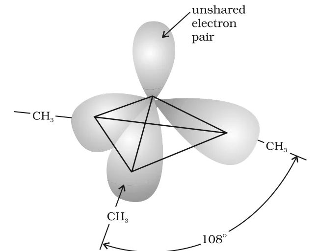

# [{ align=left, width=3.8% }](../../index.md)  Amines | Introduction and Nomenclature

## Introduction

Amines are derivatives of ammonia obtained by replacing one, two or all three hydrogen atoms of NH3 by alkyl and/or aryl groups.

!!! example "Examples"

    CH3-NH2, C6H5-NH2, CH3-NH-CH3, (CH3)3N

* Amines occur widely in nature in proteins, vitamins, alkaloids and hormones. Synthetic amines are found in polymers, dyestuffs and drugs.
* Adrenaline and ephedrine (both secondary amines) are used to raise blood pressure. Novocain, a synthetic amine, is used as an anaesthetic in dentistry, and the antihistamine Benadryl contains a tertiary amino group.
* Quaternary ammonium salts are used as surfactants, and diazonium salts are key intermediates in making dyes and many other aromatic compounds.

## Structure of Amines

* Like ammonia, the nitrogen atom in an amine is trivalent and carries one unshared (lone) pair of electrons.
* Nitrogen is sp3 hybridised. Three sp3 orbitals overlap with orbitals of hydrogen or carbon, and the fourth sp3 orbital holds the lone pair.
* So the geometry of amines is **pyramidal**.
* The lone pair repels the bond pairs more strongly than they repel each other, so the C-N-E angle (E = C or H) is less than the tetrahedral angle of 109.5°. In trimethylamine it is 108°.

{loading=lazy}

## Classification of Amines

Amines are classified as primary (1°), secondary (2°) or tertiary (3°) depending on how many hydrogen atoms of ammonia have been replaced by alkyl or aryl groups.

### 1. Primary amine (1°)

One hydrogen of NH3 is replaced by R or Ar. General formula: RNH2 or ArNH2.

### 2. Secondary amine (2°)

Two hydrogens of NH3 are replaced. General formula: R-NH-R'.

### 3. Tertiary amine (3°)

All three hydrogens are replaced. General formula: R3N or RR'NR''.

!!! tip ""

    $$NH_3 &rarr; RNH_2\ (1^0) &rarr; R_2NH\ (2^0) &rarr; R_3N\ (3^0)$$

* Secondary and tertiary amines are called **simple amines** when all the alkyl/aryl groups are the same, e.g. (CH3)3N, and **mixed amines** when they are different, e.g. CH3-NH-C2H5.
* Note that the classification of amines depends on the number of groups on **nitrogen**, not on the type of carbon (unlike alcohols and alkyl halides). For example, (CH3)3C-NH2 is a primary amine.

## Nomenclature of Amines

### 1. Common system

* An aliphatic amine is named by writing the name of the alkyl group followed by "amine" as one word, i.e. **alkylamine**. Example: CH3NH2 is methylamine.
* In secondary and tertiary amines, if two or more groups are the same, the prefix di or tri is added before the alkyl group. Example: (CH3)2NH is dimethylamine.

### 2. IUPAC system

* Amines are named as **alkanamines**: the final 'e' of the alkane is replaced by 'amine'. Example: CH3NH2 is methanamine.
* In secondary and tertiary amines, the longest alkyl chain is taken as the parent; the other groups on nitrogen are written as prefixes with the locant **N**. Example: CH3-NH-C2H5 is N-methylethanamine.
* When more than one -NH2 group is present, their positions are given by numbers and prefixes like di, tri are used. Here the 'e' of the hydrocarbon is retained. Example: H2N-CH2-CH2-NH2 is ethane-1,2-diamine.

### 3. Arylamines

* In arylamines, the -NH2 group is directly attached to the benzene ring. The simplest arylamine is C6H5NH2, commonly called **aniline** (also an accepted IUPAC name).
* In the IUPAC system, the 'e' of the arene is replaced by 'amine'. So C6H5NH2 is **benzenamine**.

### Common and IUPAC names of some amines

Amine                                                                                               | Common name              | IUPAC name
----------------------------------------------------------------------------------------------------|--------------------------|----------------------------------
CH3-CH2-NH2                                                       | Ethylamine               | Ethanamine
CH3-CH2-CH2-NH2                                        | n-Propylamine            | Propan-1-amine
CH3-CH(NH2)-CH3                                                   | Isopropylamine           | Propan-2-amine
CH3-NH-CH2-CH3                                                    | Ethylmethylamine         | N-Methylethanamine
(CH3)3N                                                                      | Trimethylamine           | N,N-Dimethylmethanamine
(C2H5)2N-CH2CH2CH2CH3  | N,N-Diethylbutylamine    | N,N-Diethylbutan-1-amine
NH2-CH2-CH=CH2                                                    | Allylamine               | Prop-2-en-1-amine
NH2-(CH2)6-NH2                                         | Hexamethylenediamine     | Hexane-1,6-diamine
C6H5-NH2                                                          | Aniline                  | Aniline or Benzenamine
o-CH3-C6H4-NH2                                         | o-Toluidine              | 2-Aminotoluene
p-Br-C6H4-NH2                                                     | p-Bromoaniline           | 4-Bromobenzenamine or 4-Bromoaniline
C6H5-N(CH3)2                                           | N,N-Dimethylaniline      | N,N-Dimethylbenzenamine

## Questions

!!! question "Classify the following amines as primary, secondary or tertiary: (i) 1-Naphthylamine (NH2 on a naphthalene ring) (ii) N,N-Dimethyl-1-naphthylamine (iii) (C2H5)2CHNH2 (iv) (C2H5)2NH"

    * (i) Only one aryl group on nitrogen (-NH2): primary amine.
    * (ii) -N(CH3)2: nitrogen carries three carbon groups, so it is a tertiary amine.
    * (iii) Nitrogen is attached to only one carbon group (-NH2): primary amine.
    * (iv) Nitrogen carries two ethyl groups and one H: secondary amine.

!!! question "Write structures and IUPAC names of the isomeric amines with molecular formula C4H11N. What type of isomerism do they show?"

    **Primary amines:**

    * CH3CH2CH2CH2NH2 - Butan-1-amine
    * CH3CH2CH(NH2)CH3 - Butan-2-amine
    * (CH3)2CHCH2NH2 - 2-Methylpropan-1-amine
    * (CH3)3CNH2 - 2-Methylpropan-2-amine

    **Secondary amines:**

    * CH3CH2CH2NHCH3 - N-Methylpropan-1-amine
    * (CH3)2CHNHCH3 - N-Methylpropan-2-amine
    * CH3CH2NHCH2CH3 - N-Ethylethanamine

    **Tertiary amine:**

    * (CH3)2NCH2CH3 - N,N-Dimethylethanamine

    **Isomerism:**

    * Butan-1-amine and butan-2-amine (or the two N-methylpropanamines) differ in the position of the amino group: **position isomerism**.
    * Butan-1-amine and 2-methylpropan-1-amine differ in the carbon skeleton: **chain isomerism**.
    * N-Ethylethanamine and N-methylpropan-1-amine have different alkyl groups on either side of the same functional group: **metamerism**.
    * A primary, a secondary and a tertiary amine of the same formula (e.g. butan-1-amine, N-ethylethanamine and N,N-dimethylethanamine) have different types of amino groups: **functional isomerism**.
