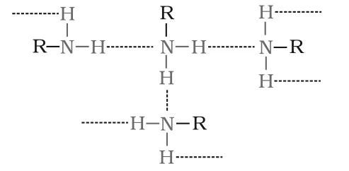
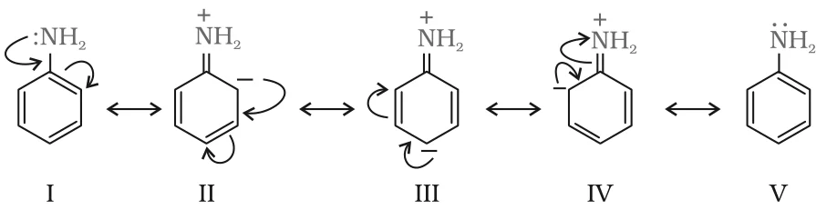

# [{ align=left, width=3.8% }](../../index.md)  Amines | Physical Properties and Basic Character

## Physical Properties of Amines

### 1. Physical state and colour

* Lower aliphatic amines are gases with a fishy odour.
* Primary amines with three or more carbon atoms are liquids, and higher ones are solids.
* Aniline and other arylamines are usually colourless when pure, but they become coloured on storage due to atmospheric oxidation.

### 2. Solubility

* Lower aliphatic amines are soluble in water because they form hydrogen bonds with water molecules.
* Solubility decreases as molar mass increases, because the hydrophobic alkyl part becomes larger. Higher amines are practically insoluble in water.
* Amines are soluble in organic solvents like alcohol, ether and benzene.
* Nitrogen (electronegativity 3.0) is less electronegative than oxygen (3.5). So alcohols are more polar than amines and form stronger hydrogen bonds. For example, butan-1-ol is more soluble in water than butan-1-amine.

### 3. Boiling point

* Primary and secondary amines show **intermolecular hydrogen bonding** between the N of one molecule and the H of another.
* A primary amine has two H atoms on nitrogen, so its association is greater than that of a secondary amine (one H). A tertiary amine has no H on nitrogen and so shows no intermolecular hydrogen bonding.

{loading=lazy}

* Therefore, for isomeric amines, the order of boiling points is:

!!! tip ""

    $$Primary\ >\ Secondary\ >\ Tertiary$$

* Amines boil higher than alkanes of similar molar mass (no H-bonding in alkanes) but lower than alcohols (O-H...O bonds are stronger than N-H...N bonds).

Compound                                                       | Molar mass | b.p. (K)
---------------------------------------------------------------|------------|---------
n-C4H9NH2 (1° amine)         | 73         | 350.8
(C2H5)2NH (2° amine)        | 73         | 329.3
C2H5N(CH3)2 (3° amine) | 73   | 310.5
C2H5CH(CH3)2 (alkane) | 72    | 300.8
n-C4H9OH (alcohol)                      | 74         | 390.3

## Basic Character of Amines

* The difference in electronegativity between N and H and the lone pair on nitrogen make amines reactive. Because of the lone pair, amines act as **Lewis bases** and as nucleophiles.
* Amines react with acids to form salts:

!!! tip ""

    $$R-\ddot{N}H_2 + HX &#8652; R-\overset{+}{N}H_3\overset{-}{X}\ (salt)$$

    $$C_6H_5NH_2 + HCl &#8652; C_6H_5\overset{+}{N}H_3\overset{-}{Cl}\ (anilinium\ chloride)$$

* A base like NaOH regenerates the parent amine from its salt:

!!! tip ""

    $$R\overset{+}{N}H_3\overset{-}{X} + \overset{-}{O}H &rarr; R\ddot{N}H_2 + H_2O + \overset{-}{X}$$

* Amine salts are soluble in water but insoluble in organic solvents like ether. This is used to **separate amines** from non-basic organic compounds that are insoluble in water.

### Kb and pKb of amines

* In water, an amine accepts a proton from water:

!!! tip ""

    $$R-NH_2 + H_2O &#8652; R-\overset{+}{N}H_3 + \overset{-}{O}H$$

    $$K = {[R-\overset{+}{N}H_3][\overset{-}{O}H] \over [R-NH_2][H_2O]}$$

    $$K[H_2O] = K_b = {[R-\overset{+}{N}H_3][\overset{-}{O}H] \over [R-NH_2]}$$

    $$pK_b = -log\ K_b$$

* **Larger the Kb (or smaller the pKb), stronger is the base.**
* pKb of ammonia is 4.75. Aliphatic amines (pKb 3 to 4.22) are stronger bases than ammonia, while aromatic amines are much weaker.

Name of amine            | Formula                                                          | pKb
-------------------------|------------------------------------------------------------------|------
Methanamine              | CH3NH2                                     | 3.38
N-Methylmethanamine      | (CH3)2NH                                   | 3.27
N,N-Dimethylmethanamine  | (CH3)3N                                    | 4.22
Ethanamine               | C2H5NH2                         | 3.29
N-Ethylethanamine        | (C2H5)2NH                       | 3.00
N,N-Diethylethanamine    | (C2H5)3N                        | 3.25
Benzenamine              | C6H5NH2                         | 9.38
Phenylmethanamine        | C6H5CH2NH2          | 4.70
N-Methylaniline          | C6H5NHCH3                       | 9.30
N,N-Dimethylaniline      | C6H5N(CH3)2          | 8.92

## Structure-Basicity Relationship

The basic strength of an amine depends on how easily it accepts a proton to form a cation. **The more stable the cation relative to the amine, the more basic the amine.**

### 1. Alkanamines versus ammonia

!!! tip ""

    $$R-\ddot{N}H_2 + H^+ &#8652; R-\overset{+}{N}H_3$$

    $$H-\ddot{N}H_2 + H^+ &#8652; H-\overset{+}{N}H_3$$

* The alkyl group is electron releasing (+I effect). It pushes electron density towards nitrogen, making the lone pair more available for the proton.
* The +I effect also disperses the positive charge of the substituted ammonium ion and stabilises it.
* Hence **alkylamines are stronger bases than ammonia**.

#### (a) Gas phase

* Only the inductive effect operates, so basicity increases with the number of alkyl groups:

!!! tip ""

    $$3^0\ amine\ >\ 2^0\ amine\ >\ 1^0\ amine\ >\ NH_3$$

#### (b) Aqueous phase

In water the order is not regular (see the pKb table). Three factors act together:

* **Inductive effect:** favours 3° > 2° > 1°.
* **Solvation effect:** the ammonium cation is stabilised by hydrogen bonding with water. A 1° cation (RNH3+) has three H atoms for H-bonding, a 2° cation has two and a 3° cation only one. Also, the larger the ion, the less it is solvated. So stability by solvation is 1° > 2° > 3°, which is opposite to the inductive order.
* **Steric hindrance:** small groups like -CH3 hardly hinder H-bonding, but bigger groups like -C2H5 do. So changing the alkyl group changes the order.

The balance of these effects gives the following orders in aqueous solution:

!!! tip ""

    $$(C_2H_5)_2NH\ >\ (C_2H_5)_3N\ >\ C_2H_5NH_2\ >\ NH_3$$

    $$(CH_3)_2NH\ >\ CH_3NH_2\ >\ (CH_3)_3N\ >\ NH_3$$

### 2. Arylamines versus ammonia

* pKb of aniline (9.38) is much higher than that of ammonia (4.75), so aniline is a much weaker base.
* In aniline the -NH2 group is attached directly to the benzene ring. The lone pair on nitrogen is in **conjugation** with the ring, so it is less available for protonation.
* Aniline is a resonance hybrid of five structures:

{loading=lazy}

* The anilinium ion (C6H5NH3+) has no lone pair on nitrogen to delocalise, so it has only two (Kekule) resonance structures.
* More resonance structures means more stability. So aniline is stabilised more than the anilinium ion, and it has little tendency to accept a proton. Hence **aniline is a weaker base than ammonia**.

!!! tip "Effect of substituents on the ring"

    * Electron releasing groups like -OCH3 and -CH3 **increase** the basic strength of aniline.
    * Electron withdrawing groups like -NO2, -SO3H, -COOH and -X **decrease** it.

!!! note "Note"

    In benzylamine (C6H5CH2NH2), the -NH2 is attached to a CH2 group, not to the ring. Its lone pair is not delocalised, so it behaves like an aliphatic amine (pKb 4.70) and is much more basic than aniline.

## Questions

!!! question "Arrange in decreasing order of basic strength: C6H5NH2, C2H5NH2, (C2H5)2NH, NH3"

    Aliphatic amines are stronger than NH3 (+I effect), and in the ethyl series the 2° amine is the strongest in water. Aniline is the weakest because its lone pair is delocalised into the ring.

    $$(C_2H_5)_2NH\ >\ C_2H_5NH_2\ >\ NH_3\ >\ C_6H_5NH_2$$

!!! question "Arrange in increasing order of basic strength: (i) C2H5NH2, C6H5NH2, NH3, C6H5CH2NH2, (C2H5)2NH (ii) C2H5NH2, (C2H5)2NH, (C2H5)3N, C6H5NH2 (iii) CH3NH2, (CH3)2NH, (CH3)3N, C6H5NH2, C6H5CH2NH2"

    Using pKb values (lower pKb = stronger base):

    $$(i)\ C_6H_5NH_2 < NH_3 < C_6H_5CH_2NH_2 < C_2H_5NH_2 < (C_2H_5)_2NH$$

    $$(ii)\ C_6H_5NH_2 < C_2H_5NH_2 < (C_2H_5)_3N < (C_2H_5)_2NH$$

    $$(iii)\ C_6H_5NH_2 < C_6H_5CH_2NH_2 < (CH_3)_3N < CH_3NH_2 < (CH_3)_2NH$$

!!! question "Complete the following acid-base reactions and name the products: (i) CH3CH2CH2NH2 + HCl &rarr; (ii) (C2H5)3N + HCl &rarr;"

    $$(i)\ CH_3CH_2CH_2NH_2 + HCl &rarr; CH_3CH_2CH_2\overset{+}{N}H_3\overset{-}{Cl}$$

    Product: propan-1-aminium chloride (n-propylammonium chloride).

    $$(ii)\ (C_2H_5)_3N + HCl &rarr; (C_2H_5)_3\overset{+}{N}H\overset{-}{Cl}$$

    Product: N,N-diethylethanaminium chloride (triethylammonium chloride).

!!! question "Why do primary amines have higher boiling points than tertiary amines?"

    Primary amines have two H atoms on nitrogen and form strong intermolecular hydrogen bonds. Tertiary amines have no H on nitrogen and cannot form intermolecular hydrogen bonds. More energy is needed to separate the associated molecules of a primary amine, so its boiling point is higher.

!!! question "Why are amines less acidic than alcohols of comparable molecular masses?"

    Loss of a proton from an amine gives RNH-, and from an alcohol gives RO-. Oxygen is more electronegative than nitrogen, so it holds the negative charge better and RO- is more stable than RNH-. Therefore alcohols lose a proton more easily and are more acidic than amines.
