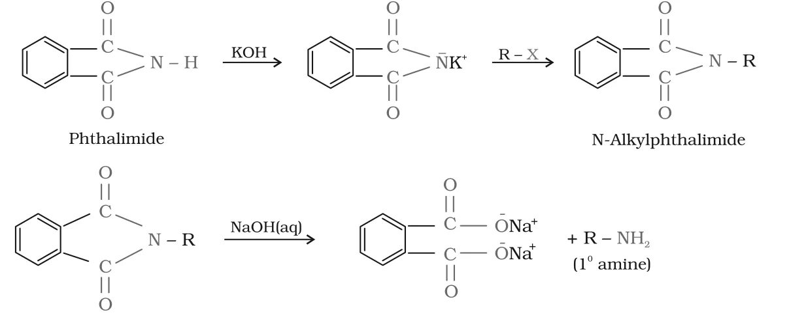

# [{ align=left, width=3.8% }](../../index.md)  Amines | Preparation of Amines

Amines can be prepared by reduction of nitro compounds, nitriles and amides, by ammonolysis of alkyl halides, by Gabriel phthalimide synthesis and by Hoffmann bromamide degradation. Let us look at each method.

## 1. Reduction of Nitro Compounds

* Nitro compounds are reduced to amines either by passing hydrogen gas in the presence of finely divided Ni, Pd or Pt (catalytic hydrogenation), or by metals in acidic medium (Sn + HCl or Fe + HCl).
* Nitroalkanes are reduced in the same way to the corresponding alkanamines.

!!! tip ""

    $$C_6H_5NO_2 + 3H_2 \xrightarrow{Pd,\ ethanol} C_6H_5NH_2 + 2H_2O$$

    $$C_6H_5NO_2 \xrightarrow{Sn + HCl\ or\ Fe + HCl} C_6H_5NH_2$$

    $$R-NO_2 + 6[H] &rarr; R-NH_2 + 2H_2O$$

* Reduction with **iron scrap and HCl** is preferred industrially. The FeCl2 formed gets hydrolysed and releases HCl during the reaction, so only a small amount of HCl is needed to start the reaction.

## 2. Ammonolysis of Alkyl Halides

* The C-X bond in alkyl or benzyl halides is easily broken by a nucleophile. When an alkyl or benzyl halide is heated with an ethanolic solution of ammonia, the halogen is replaced by -NH2 by nucleophilic substitution.
* This cleavage of the C-X bond by ammonia is called **ammonolysis**. It is carried out in a sealed tube at 373 K.

!!! tip ""

    $$\ddot{N}H_3 + R-X &rarr; R-\overset{+}{N}H_3\overset{-}{X}\ (substituted\ ammonium\ salt)$$

* The primary amine formed is itself a nucleophile. It reacts with more alkyl halide to give secondary and tertiary amines and finally a quaternary ammonium salt:

!!! tip ""

    $$RNH_2\ (1^0) \xrightarrow{RX} R_2NH\ (2^0) \xrightarrow{RX} R_3N\ (3^0) \xrightarrow{RX} R_4\overset{+}{N}\overset{-}{X}\ (quaternary\ salt)$$

* The free amine is liberated from its ammonium salt by a strong base:

!!! tip ""

    $$R-\overset{+}{N}H_3\overset{-}{X} + NaOH &rarr; R-NH_2 + H_2O + NaX$$

!!! note "Note"

    * The main drawback of ammonolysis is that it gives a **mixture** of 1°, 2° and 3° amines along with the quaternary salt.
    * The primary amine can be made the major product by using a **large excess of ammonia**.
    * Order of reactivity of halides: RI > RBr > RCl.

## 3. Reduction of Nitriles

* Nitriles are reduced to primary amines by LiAlH4, by catalytic hydrogenation (H2/Ni) or by sodium amalgam in ethanol.

!!! tip ""

    $$R-C \equiv N \xrightarrow{H_2/Ni\ or\ Na(Hg)/C_2H_5OH} R-CH_2-NH_2$$

* Since a nitrile is made from an alkyl halide (R-X + CN-), this route adds one carbon. It is used for the **ascent of the amine series**, i.e. to make an amine with one carbon atom more than the starting compound.

## 4. Reduction of Amides

* Amides are reduced to amines by lithium aluminium hydride. The carbonyl group becomes CH2, so the number of carbon atoms stays the same.

!!! tip ""

    $$R-CO-NH_2 \xrightarrow{(i)\ LiAlH_4,\ (ii)\ H_2O} R-CH_2-NH_2$$

## 5. Gabriel Phthalimide Synthesis

* Gabriel synthesis is used to prepare **pure primary amines** (free from 2° and 3° amines).
* Steps:
    1. Phthalimide is treated with ethanolic KOH. The acidic N-H proton is removed and potassium phthalimide is formed.
    2. Potassium phthalimide is heated with an alkyl halide. The phthalimide anion acts as a nucleophile and gives N-alkylphthalimide.
    3. N-alkylphthalimide is hydrolysed with aqueous NaOH, giving the primary amine and sodium phthalate.

{loading=lazy}

* Since nitrogen is attached to only one alkyl group in N-alkylphthalimide, no further alkylation is possible. That is why only the primary amine is obtained.

!!! note "Note"

    Aromatic primary amines (like aniline) **cannot** be prepared by this method, because aryl halides do not undergo nucleophilic substitution with the phthalimide anion.

## 6. Hoffmann Bromamide Degradation Reaction

* A primary amide is heated with bromine in an aqueous or ethanolic solution of sodium hydroxide to give a primary amine.
* During the reaction, the alkyl or aryl group **migrates** from the carbonyl carbon to the nitrogen atom, and the carbonyl carbon is lost as carbonate.
* Hence the amine formed contains **one carbon atom less** than the amide. This reaction is used for the **descent of series**.

!!! tip ""

    $$R-CO-NH_2 + Br_2 + 4NaOH &rarr; R-NH_2 + Na_2CO_3 + 2NaBr + 2H_2O$$

!!! example "Example"

    $$CH_3CH_2CH_2CONH_2\ (butanamide) \xrightarrow{Br_2/NaOH} CH_3CH_2CH_2NH_2\ (propan-1-amine)$$

    $$C_6H_5CONH_2\ (benzamide) \xrightarrow{Br_2/NaOH} C_6H_5NH_2\ (aniline)$$

## Questions

!!! question "Write chemical equations for: (i) Reaction of ethanolic NH3 with C2H5Cl. (ii) Ammonolysis of benzyl chloride and reaction of the amine so formed with two moles of CH3Cl."

    (i) Ammonia gives ethanamine, which reacts further with chloroethane:

    $$C_2H_5Cl \xrightarrow{NH_3} C_2H_5NH_2 \xrightarrow{C_2H_5Cl} (C_2H_5)_2NH \xrightarrow{C_2H_5Cl} (C_2H_5)_3N$$

    Chloroethane &rarr; Ethanamine &rarr; N-Ethylethanamine &rarr; N,N-Diethylethanamine

    (ii)

    $$C_6H_5CH_2Cl \xrightarrow{NH_3} C_6H_5CH_2NH_2 \xrightarrow{2CH_3Cl} C_6H_5CH_2N(CH_3)_2$$

    Benzyl chloride &rarr; Benzylamine &rarr; N,N-Dimethylphenylmethanamine

!!! question "Write chemical equations for the following conversions: (i) CH3-CH2-Cl into CH3-CH2-CH2-NH2 (ii) C6H5-CH2-Cl into C6H5-CH2-CH2-NH2"

    One carbon has to be added in each case, so we go through the nitrile and then reduce it.

    $$(i)\ CH_3CH_2Cl \xrightarrow{ethanolic\ NaCN} CH_3CH_2C \equiv N \xrightarrow{reduction} CH_3CH_2CH_2NH_2$$

    Chloroethane &rarr; Propanenitrile &rarr; Propan-1-amine

    $$(ii)\ C_6H_5CH_2Cl \xrightarrow{ethanolic\ NaCN} C_6H_5CH_2C \equiv N \xrightarrow{H_2/Ni} C_6H_5CH_2CH_2NH_2$$

    Benzyl chloride &rarr; Phenylethanenitrile (benzyl cyanide) &rarr; 2-Phenylethanamine

!!! question "Write structures and IUPAC names of (i) the amide which gives propanamine by Hoffmann bromamide reaction, (ii) the amine produced by Hoffmann degradation of benzamide."

    (i) Propanamine has three carbons. Hoffmann degradation removes one carbon, so the amide must have four carbons: CH3CH2CH2CONH2, **butanamide**.

    (ii) Benzamide (C6H5CONH2) has seven carbons, so the amine has six carbons: C6H5NH2, **aniline (benzenamine)**.

!!! question "How will you convert (i) Benzene into aniline (ii) Benzene into N,N-dimethylaniline (iii) Cl-(CH2)4-Cl into hexane-1,6-diamine?"

    $$(i)\ C_6H_6 \xrightarrow{conc.\ HNO_3 + conc.\ H_2SO_4} C_6H_5NO_2 \xrightarrow{Sn/HCl} C_6H_5NH_2$$

    $$(ii)\ C_6H_6 &rarr; C_6H_5NO_2 &rarr; C_6H_5NH_2 \xrightarrow{2CH_3Cl} C_6H_5N(CH_3)_2$$

    $$(iii)\ Cl-(CH_2)_4-Cl \xrightarrow{ethanolic\ NaCN} NC-(CH_2)_4-CN \xrightarrow{H_2/Ni} H_2N-(CH_2)_6-NH_2$$

    In (iii), each -CN adds one carbon, so the four-carbon dichloride gives a six-carbon diamine.

!!! question "Why cannot aromatic primary amines be prepared by Gabriel phthalimide synthesis?"

    The key step of Gabriel synthesis is nucleophilic substitution of the halide by the phthalimide anion. Aryl halides do not undergo nucleophilic substitution easily because the C-X bond has partial double bond character (resonance with the ring) and the sp2 carbon holds the halogen strongly. So aryl halides do not react with potassium phthalimide, and aromatic primary amines cannot be made this way.
