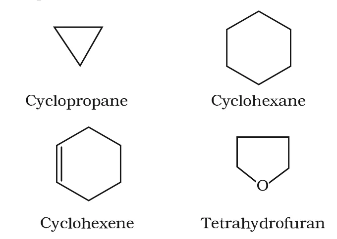
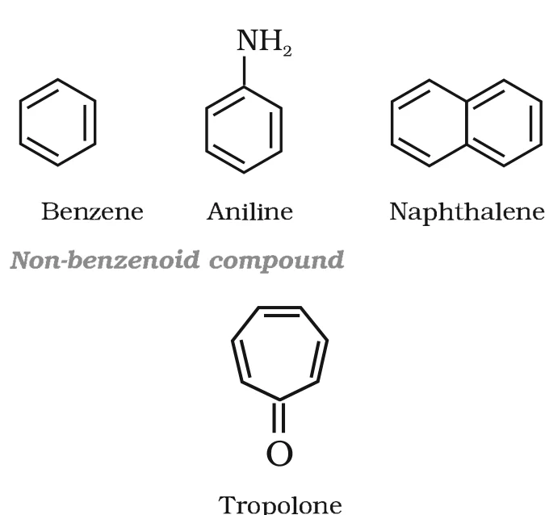
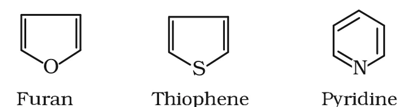

# [{ align=left, width=3.8% }](../../index.md)  Basic Principles of Organic Chemistry | Classification and Isomerism

Organic compounds are broadly classified on the basis of their structure into acyclic (open chain) and cyclic (closed chain or ring) compounds, and on the basis of functional groups into homologous series.

## Classification of Organic Compounds

The classification of organic compounds on the basis of structure can be summarised as:

* **Organic compounds**
    * I. Acyclic or open chain compounds (aliphatic)
    * II. Cyclic or closed chain or ring compounds
        * Homocyclic or carbocyclic compounds
            * Alicyclic compounds
            * Aromatic compounds
                * Benzenoid compounds
                * Non-benzenoid compounds
        * Heterocyclic compounds

### I. Acyclic or open chain compounds

* These are also called **aliphatic compounds**. They contain straight or branched chains of carbon atoms.

!!! example "Examples"

    * Ethane: CH3CH3
    * Isobutane: CH3CH(CH3)CH3
    * Acetaldehyde: CH3CHO
    * Acetic acid: CH3COOH

### II. Alicyclic or closed chain compounds

* Alicyclic (aliphatic cyclic) compounds have carbon atoms joined in the form of a ring (**homocyclic**).
* Sometimes atoms other than carbon are also present in the ring (**heterocyclic**), e.g. tetrahydrofuran.
* They show some properties similar to those of aliphatic compounds.

!!! example "Examples"

    {loading=lazy}

### III. Aromatic compounds

* Aromatic compounds are special ring compounds. They include benzene and related ring compounds (**benzenoid**).
* Aromatic compounds without a benzene ring are called **non-benzenoid** aromatic compounds, e.g. tropolone.
* Like alicyclic compounds, aromatic compounds may also contain a heteroatom in the ring. These are called **heterocyclic aromatic compounds**.

!!! example "Benzenoid and non-benzenoid aromatic compounds"

    {loading=lazy}

!!! example "Heterocyclic aromatic compounds"

    {loading=lazy}

## Functional Group

* A functional group is an atom or group of atoms joined in a specific manner which is responsible for the characteristic chemical properties of an organic compound.
* Examples: hydroxyl group (-OH), aldehyde group (-CHO) and carboxylic acid group (-COOH).
* Compounds having the same functional group undergo similar reactions. For example, CH3OH, CH3CH2OH and (CH3)2CHOH all contain -OH and all liberate hydrogen with sodium metal.

## Homologous Series

* A group or series of organic compounds containing the same functional group is called a **homologous series**, and its members are called **homologues**.
* Members of a homologous series:
    * can be represented by a general molecular formula,
    * differ from each other in molecular formula by a -CH2 unit,
    * show similar chemical properties and a gradation in physical properties.
* Examples of homologous series: alkanes, alkenes, alkynes, haloalkanes, alkanols, alkanals, alkanones, alkanoic acids, amines etc.

!!! example "Example: Alkanol series"

    CH3OH, CH3CH2OH, CH3CH2CH2OH, ... (general formula CnH2n+1OH)

## Isomerism

* The phenomenon of existence of two or more compounds having the same molecular formula but different properties is called **isomerism**. Such compounds are called **isomers**.
* Isomerism is of two main types:
    * **Structural isomerism:** chain, position, functional group isomerism and metamerism.
    * **Stereoisomerism:** geometrical and optical isomerism.

## Structural Isomerism

Compounds having the same molecular formula but different structures (i.e. different ways in which the atoms are linked) are called structural isomers.

### 1. Chain isomerism

When two or more compounds have the same molecular formula but different carbon skeletons, they are called chain isomers.

!!! example "Example: C5H12"

    * Pentane: CH3CH2CH2CH2CH3
    * Isopentane (2-Methylbutane): CH3CH(CH3)CH2CH3
    * Neopentane (2,2-Dimethylpropane): C(CH3)4

### 2. Position isomerism

When two or more compounds differ in the position of a substituent atom or functional group on the same carbon skeleton, they are called position isomers.

!!! example "Example: C3H8O"

    * Propan-1-ol: CH3CH2CH2OH
    * Propan-2-ol: CH3CH(OH)CH3

### 3. Functional group isomerism

Two or more compounds having the same molecular formula but different functional groups are called functional isomers.

!!! example "Example: C3H6O"

    * Propanone (a ketone): CH3COCH3
    * Propanal (an aldehyde): CH3CH2CHO

### 4. Metamerism

Metamerism arises due to different alkyl chains on either side of the functional group in the molecule.

!!! example "Example: C4H10O"

    * Methoxypropane: CH3OC3H7
    * Ethoxyethane: C2H5OC2H5

## Stereoisomerism

* Compounds that have the same constitution and sequence of covalent bonds but differ in the relative positions of their atoms or groups in space are called **stereoisomers**.
* This type of isomerism is called stereoisomerism. It is classified as **geometrical isomerism** and **optical isomerism**.
* Geometrical isomerism arises due to restricted rotation about a C=C bond, e.g. cis- and trans-but-2-ene.
