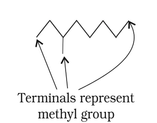
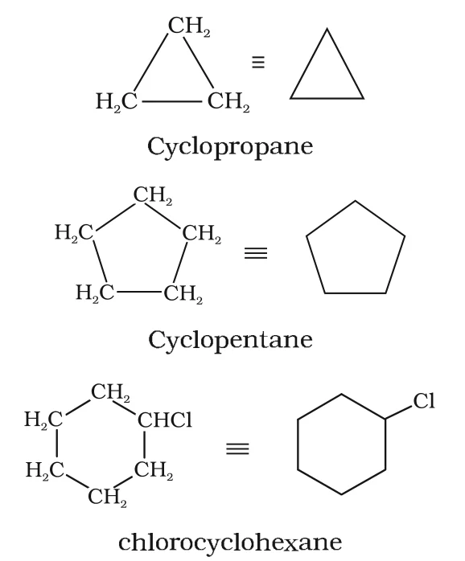

# [{ align=left, width=3.8% }](../../index.md)  Basic Principles of Organic Chemistry | Introduction and Structural Representation

Organic chemistry is the branch of chemistry which deals with the study of compounds of carbon formed by covalent bonding with other carbon atoms and with elements like hydrogen, oxygen, nitrogen, sulphur, phosphorus and halogens.

## Introduction

* Carbon has a unique property called **catenation**, i.e. the ability to form covalent bonds with other carbon atoms to give long chains and rings. This is the reason for the huge number of organic compounds.
* Organic compounds are essential for life. DNA (which carries genetic information) and proteins (found in blood, muscles and skin) are organic compounds.
* Clothing, fuels, polymers, dyes and medicines are also made up of organic compounds.

### Vital force theory and its rejection

* Around 1780, chemists started distinguishing between organic compounds (obtained from plants and animals) and inorganic compounds (obtained from minerals).
* Berzelius, a Swedish chemist, proposed that a 'vital force' present in living organisms was necessary to make organic compounds.
* This idea was rejected in 1828 when F. Wohler prepared urea, an organic compound, by heating ammonium cyanate, an inorganic compound.

!!! tip ""

    $$\underset{Ammonium\ cyanate}{NH_4CNO} \xrightarrow{Heat} \underset{Urea}{NH_2CONH_2}$$

* Later, the synthesis of acetic acid by Kolbe (1845) and of methane by Berthelot (1856) proved that organic compounds can be made in the laboratory from inorganic sources.

## Tetravalence of Carbon and Shapes of Organic Compounds

* Carbon has the electronic configuration 1s2 2s2 2p2. In its compounds it shows a valency of four (tetravalence), which is explained by hybridisation of its s and p orbitals.
* The shapes of methane (CH4), ethene (C2H4) and ethyne (C2H2) are explained by sp3, sp2 and sp hybridisation of carbon respectively.

Hybridisation of carbon | s character | Shape         | Bond angle | Example
------------------------|-------------|---------------|------------|---------------------------------
sp3          | 25%         | Tetrahedral   | 109.5&deg; | CH4, C2H6
sp2          | 33.3%       | Trigonal planar | 120&deg;  | C2H4, HCHO
sp                      | 50%         | Linear        | 180&deg;   | C2H2, HCN

### Effect of hybridisation on bond length, bond strength and electronegativity

* An sp hybrid orbital has more s character, so it is held closer to the nucleus. Hence, it forms **shorter and stronger** bonds than an sp3 orbital.
* An sp2 orbital is intermediate in s character, so the length and strength of its bonds are also intermediate between those of sp and sp3.
* Greater the s character of a hybrid orbital, greater is the electronegativity of the carbon atom. So, an sp hybridised carbon (50% s character) is more electronegative than an sp2 or sp3 hybridised carbon.

!!! tip ""

    $$Electronegativity\ of\ carbon:\ sp > sp^2 > sp^3$$

    $$Bond\ length:\ C(sp)-H < C(sp^2)-H < C(sp^3)-H$$

### Some characteristic features of &pi; bonds

* A &pi; (pi) bond is formed by the sideways overlap of two parallel p orbitals on adjacent atoms.
* For proper sideways overlap, the p orbitals must be parallel. Therefore, in H2C=CH2, all six atoms lie in the same plane and both p orbitals are perpendicular to this plane.
* Rotation of one CH2 group with respect to the other would destroy the overlap of p orbitals. Hence, **rotation about a C=C double bond is restricted**.
* The electron cloud of a &pi; bond lies above and below the plane of the bonded atoms. These electrons are easily available to attacking reagents, so **&pi; bonds are the most reactive centres** in molecules containing multiple bonds.

## Structural Representations of Organic Compounds

Organic compounds can be represented in several ways: Lewis (dot) structures, dash structures, condensed structures and bond-line structures.

### 1. Complete structural formula

* In a complete structural formula, every covalent bond is shown by a dash (-). A single dash means a single bond, a double dash (=) a double bond and a triple dash (&equiv;) a triple bond.
* Lone pairs on heteroatoms (O, N, S, halogens) may or may not be shown.

!!! example "Examples"

    * Ethane: H3C-CH3 written with all six C-H bonds and the C-C bond drawn as dashes.
    * Ethene: H2C=CH2 with each carbon bonded to two H atoms by dashes.
    * Ethyne: H-C&equiv;C-H
    * Methanol: H3C-O-H, with the three C-H bonds and the O-H bond drawn as dashes.

### 2. Condensed structural formula

* Here, some or all of the dashes are omitted, and the number of identical groups attached to an atom is shown by a subscript.

!!! example "Examples"

    * Ethane: CH3CH3
    * Ethene: H2C=CH2
    * Ethyne: HC&equiv;CH
    * Methanol: CH3OH
    * CH3CH2CH2CH2CH2CH2CH2CH3 can be further condensed to CH3(CH2)6CH3.

### 3. Bond-line structural formula

* In a bond-line formula, carbon and hydrogen atoms are not written. Carbon-carbon bonds are drawn as lines in a **zig-zag** fashion.
* Only heteroatoms like oxygen, chlorine and nitrogen are written specifically.
* The **terminals** (line ends) represent methyl (-CH3) groups, unless a functional group is shown there.
* Every **line junction** represents a carbon atom carrying enough hydrogens to complete its valency of four.

!!! example "Example: 3-Methyloctane"

    * Condensed formula: CH3CH2CH(CH3)CH2CH2CH2CH2CH3
    * Bond-line formula:

    {loading=lazy}

!!! example "Example: 2-Bromobutane"

    * Condensed formula: CH3CHBrCH2CH3
    * In the bond-line formula, a four-carbon zig-zag is drawn and Br is written on the line going down from the second carbon.

* In cyclic compounds, the ring is drawn as a polygon. Each corner is a carbon atom.

!!! example "Bond-line formulas of cyclic compounds"

    {loading=lazy}

## Three-Dimensional Representation of Organic Molecules

* The 3-D structure of a molecule can be shown on paper using the **wedge-and-dash** formula.
* A **solid wedge** shows a bond projecting out of the plane of the paper, towards the observer.
* A **dashed wedge** shows a bond projecting behind the plane of the paper, away from the observer.
* Bonds lying in the plane of the paper are shown by normal lines. The broad end of a wedge is towards the observer.
* For example, in methane, two C-H bonds are drawn in the plane of the paper, one as a solid wedge and one as a dashed wedge, giving the tetrahedral shape.

### Molecular models

Molecular models are physical devices made of wood, plastic or metal that help to visualise the 3-D shapes of molecules. Three common types are:

1. **Framework model:** Only the bonds are shown, not the atoms. It shows the pattern of bonds and ignores the size of atoms.
2. **Ball-and-stick model:** Balls represent atoms and sticks represent bonds. Molecules containing C=C (e.g. ethene) are better shown using springs in place of sticks (ball-and-spring model).
3. **Space-filling model:** It shows the relative size of each atom based on its van der Waals radius. Bonds are not shown. It conveys the volume occupied by each atom.

Computer graphics are also used today for molecular modelling.
