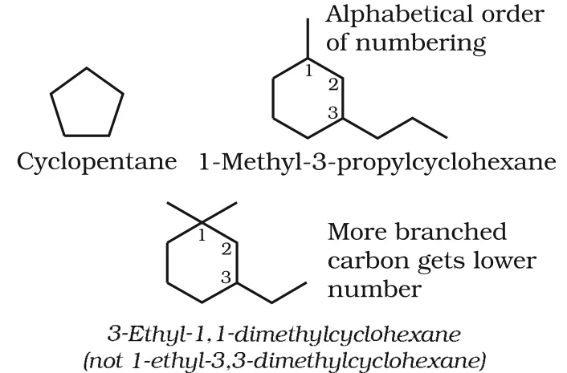
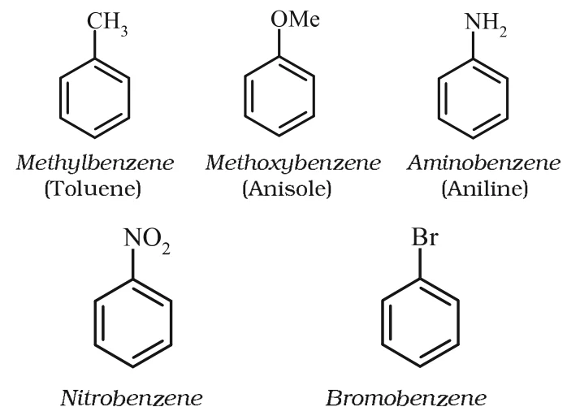
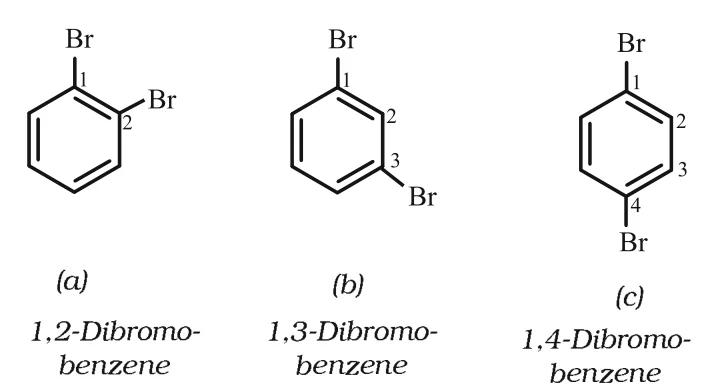
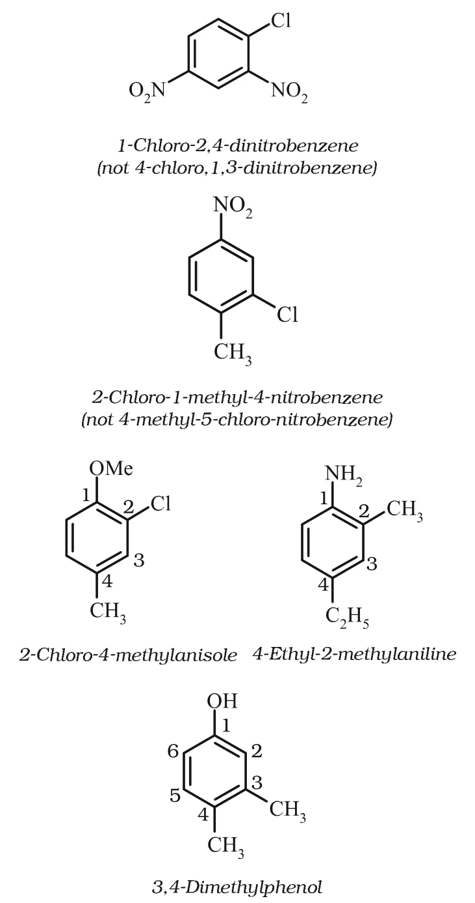

# [{ align=left, width=3.8% }](../../index.md)  Basic Principles of Organic Chemistry | IUPAC Nomenclature

The IUPAC (International Union of Pure and Applied Chemistry) system of nomenclature is a systematic method of naming organic compounds in which the name is correlated with the structure, so that the structure can be deduced from the name.

## Common or Trivial Names

* Before the IUPAC system, compounds were named after their origin or properties. For example, citric acid is found in citrus fruits and formic acid in red ants (Latin *formica* = ant).
* Such names are called **trivial** or **common names**. Many are still used, e.g. Buckminsterfullerene for the C60 cluster.

Compound                                                         | Common name
-----------------------------------------------------------------|------------------------
CH4                                                   | Methane
H3CCH2CH2CH3         | n-Butane
(H3C)2CHCH3                     | Isobutane
(H3C)4C                                    | Neopentane
H3CCH2CH2OH                     | n-Propyl alcohol
HCHO                                                             | Formaldehyde
(H3C)2CO                                   | Acetone
CHCl3                                                 | Chloroform
CH3COOH                                               | Acetic acid
C6H6                                       | Benzene
C6H5OCH3                        | Anisole
C6H5NH2                         | Aniline
C6H5COCH3                       | Acetophenone
CH3OCH2CH3                      | Ethyl methyl ether

## The IUPAC System

* An IUPAC name is built by identifying the **parent hydrocarbon** (parent chain) and the **functional group(s)** attached to it, and then adding suitable **prefixes** and **suffixes**.
* Compounds of carbon and hydrogen only are called **hydrocarbons**. A hydrocarbon containing only C-C single bonds is **saturated** (alkane, earlier called paraffin, Latin: little affinity). One with at least one C=C or C&equiv;C bond is **unsaturated**.

## Nomenclature of Alkanes

### Straight chain alkanes

* The name has a prefix showing the number of carbon atoms and the suffix **-ane**. (The names from CH4 to C4H10 come from trivial names.)
* Successive members differ by a -CH2 group; they are homologues.

Name     | Molecular formula            | Name        | Molecular formula
---------|------------------------------|-------------|---------------------------------
Methane  | CH4               | Heptane     | C7H16
Ethane   | C2H6   | Octane      | C8H18
Propane  | C3H8   | Nonane      | C9H20
Butane   | C4H10  | Decane      | C10H22
Pentane  | C5H12  | Icosane     | C20H42
Hexane   | C6H14  | Triacontane | C30H62

### Alkyl groups

* An **alkyl group** is obtained by removing one hydrogen atom from an alkane. It is named by replacing '-ane' with '-yl'. Thus, CH4 becomes -CH3 (methyl).

Alkane                          | Alkyl group                                           | Name   | Abbreviation
--------------------------------|-------------------------------------------------------|--------|-------------
CH4 (Methane)        | -CH3                                       | Methyl | Me
C2H6 (Ethane)  | -CH2CH3                    | Ethyl  | Et
C3H8 (Propane) | -CH2CH2CH3      | Propyl | Pr
C4H10 (Butane) | -CH2CH2CH2CH3 | Butyl | Bu
C10H22 (Decane) | -CH2(CH2)8CH3 | Decyl | -

* Branched alkyl groups have common names:

Branched alkyl group | Structure
---------------------|------------------------------------------------------------
Isopropyl            | (CH3)2CH-
sec-Butyl            | CH3CH2CH(CH3)-
Isobutyl             | (CH3)2CHCH2-
tert-Butyl           | (CH3)3C-
Neopentyl            | (CH3)3CCH2-

### Rules for naming branched chain alkanes

#### 1. Select the longest chain

* The **longest carbon chain** in the molecule is identified as the parent (root) chain, even if it is not written in a straight line.
* If two chains of equal length are possible, the chain with **more side chains** is selected.

#### 2. Number the chain (lowest locant rule)

* The chain is numbered from the end which gives the **lowest possible numbers to the branched carbon atoms**.
* For example, branches at carbons 2 and 6 (numbering from left) is preferred over 4 and 8 (numbering from right).

#### 3. Name and position the substituents

* Names of alkyl groups are prefixed to the parent alkane with their position numbers. Different alkyl groups are written in **alphabetical order**.
* Numbers are separated from words by hyphens, and there is no gap between the substituent name and the parent name, e.g. **6-ethyl-2-methylnonane**.

#### 4. Identical substituents

* If two or more identical groups are present, their positions are separated by commas and the prefixes di, tri, tetra, penta, hexa etc. are used.
* These multiplying prefixes are **not considered** in alphabetical order.

!!! example "Examples"

    * (CH3)2CHCH2CH(CH3)2: 2,4-Dimethylpentane
    * (CH3)3CCH2CH(CH3)2: 2,2,4-Trimethylpentane
    * CH3CH2CH(C2H5)C(CH3)2CH2CH2CH3: 3-Ethyl-4,4-dimethylheptane

#### 5. Substituents at equivalent positions

* If two substituents are at equivalent positions, the **lower number is given to the one coming first in alphabetical order**.
* Thus, CH3CH2CH(C2H5)CH2CH2CH(CH3)CH2CH3 is **3-ethyl-6-methyloctane** and not 6-ethyl-3-methyloctane.

#### 6. Branched (complex) substituents

* A branched substituent is numbered starting from the carbon that is attached to the parent chain (this carbon gets number 1). For example, -CH(CH3)CH2CH(CH3)CH3 is 1,3-dimethylbutyl.
* Its name is written in **parentheses**.
* In alphabetical ordering, the prefixes **iso-** and **neo-** are part of the alkyl group name, but **sec-** and **tert-** are not.

!!! example "Examples"

    * 5-(2-Ethylbutyl)-3,3-dimethyldecane [not 5-(2,2-dimethylbutyl)-3-ethyldecane]
    * 5-sec-Butyl-4-isopropyldecane
    * 5-(2,2-Dimethylpropyl)nonane

### Cyclic compounds

* A saturated monocyclic compound is named by adding the prefix **cyclo** to the name of the straight chain alkane with the same number of carbons.
* Side chains are named using the above rules. When there is a choice, the substituent first in alphabetical order, or the more branched carbon, gets the lower number.

!!! example "Examples"

    {loading=lazy}

## Nomenclature of Compounds Having Functional Groups

* First, the functional group is identified. It decides the **suffix** of the name.
* The **longest chain containing the functional group** is numbered so that the functional group gets the **lowest possible number**.

Class of compounds | Functional group | IUPAC prefix | IUPAC suffix | Example
-------------------|------------------|--------------|--------------|--------------------------------------------
Alkanes            | -                | -            | -ane         | Butane, CH3(CH2)2CH3
Alkenes            | >C=C<            | -            | -ene         | But-1-ene, CH2=CHCH2CH3
Alkynes            | -C&equiv;C-      | -            | -yne         | But-1-yne, CH&equiv;CCH2CH3
Arenes             | -                | -            | -            | Benzene, C6H6
Halides            | -X (X = F, Cl, Br, I) | halo-   | -            | 1-Bromobutane, CH3(CH2)2CH2Br
Alcohols           | -OH              | hydroxy-     | -ol          | Butan-2-ol, CH3CH2CHOHCH3
Aldehydes          | -CHO             | formyl or oxo | -al         | Butanal, CH3(CH2)2CHO
Ketones            | >C=O             | oxo-         | -one         | Butan-2-one, CH3CH2COCH3
Nitriles           | -C&equiv;N       | cyano        | nitrile      | Pentanenitrile, CH3CH2CH2CH2CN
Ethers             | -R-O-R-          | alkoxy-      | -            | Ethoxyethane, CH3CH2OCH2CH3
Carboxylic acids   | -COOH            | carboxy      | -oic acid    | Butanoic acid, CH3(CH2)2CO2H
Carboxylate ions   | -COO- | -            | -oate        | Sodium butanoate, CH3(CH2)2CO2-Na+
Esters             | -COOR            | alkoxycarbonyl | -oate      | Methyl propanoate, CH3CH2COOCH3
Acyl halides       | -COX (X = F, Cl, Br, I) | halocarbonyl | -oyl halide | Butanoyl chloride, CH3(CH2)2COCl
Amines             | -NH2, >NH, >N- | amino- | -amine     | Butan-2-amine, CH3CHNH2CH2CH3
Amides             | -CONH2, -CONHR, -CONR2 | carbamoyl | -amide | Butanamide, CH3(CH2)2CONH2
Nitro compounds    | -NO2  | nitro        | -            | 1-Nitrobutane, CH3(CH2)3NO2

### Polyfunctional compounds

* When more than one functional group is present, one is chosen as the **principal functional group** and decides the suffix. The others are named as substituents using prefixes.
* The principal group is chosen by the following **order of decreasing priority**:

!!! tip ""

    $$-COOH > -SO_3H > -COOR > -COCl > -CONH_2 > -CN > -CHO > >C=O > -OH > -NH_2 > >C=C< > -C&equiv;C-$$

* The groups -R, C6H5-, halogens (F, Cl, Br, I), -NO2 and alkoxy (-OR) are **always written as prefixes**.

!!! example "Examples"

    * HOCH2(CH2)3CH2COCH3 is **7-hydroxyheptan-2-one** (not 2-oxoheptan-7-ol), since a keto group has higher priority than -OH.
    * BrCH2CH=CH2 is **3-bromoprop-1-ene** (not 1-bromoprop-2-ene).

### More than one functional group of the same type

* Their number is shown by di, tri etc. before the class suffix. The full name of the parent alkane is kept before the suffix, e.g. CH2(OH)CH2(OH) is **ethane-1,2-diol**.
* However, the ending '-ne' of the parent alkane is dropped for compounds having more than one double or triple bond, e.g. CH2=CH-CH=CH2 is **buta-1,3-diene**.

## Nomenclature of Substituted Benzene Compounds

* For monosubstituted benzene, the substituent is written as a prefix to the word benzene. Common names (in brackets) are also widely used.

!!! example "Examples"

    {loading=lazy}

### Disubstituted benzene

* The ring carbons are numbered so that the substituents get the **lowest possible numbers**. So, compound (b) below is 1,3-dibromobenzene and not 1,5-dibromobenzene.
* In the trivial system, **ortho (o-)**, **meta (m-)** and **para (p-)** are used for the 1,2-, 1,3- and 1,4- positions respectively.

!!! example "Examples"

    {loading=lazy}

    * 1,2-Dibromobenzene = o-dibromobenzene
    * 1,3-Dibromobenzene = m-dibromobenzene
    * 1,4-Dibromobenzene = p-dibromobenzene

### Tri- or higher substituted benzene

* The o-, m-, p- prefixes cannot be used. The compound is named by the lowest locant rule.
* Sometimes the common name of a benzene derivative (anisole, aniline, phenol, toluene) is used as the base compound. Its substituent gets number 1, and numbering is done in the direction which gives the next substituent the lowest number.
* Substituents appear in alphabetical order.

!!! example "Examples"

    {loading=lazy}

### Phenyl group

* When a benzene ring is attached to an alkane chain carrying a functional group, the benzene ring is treated as a substituent. Benzene as a substituent is called **phenyl** (C6H5-, abbreviated as Ph). For example, C6H5CH2CHBrCHBrCH2CH3 is 2,3-dibromo-1-phenylpentane.
