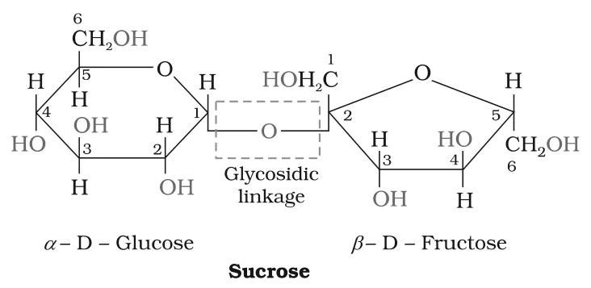
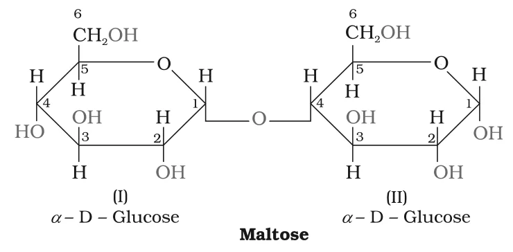
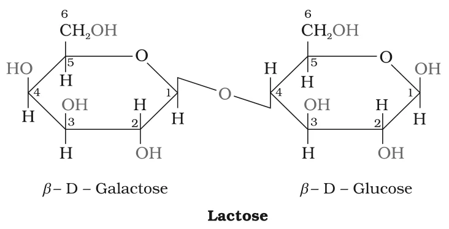

# [{ align=left, width=3.8% }](../../index.md)  Biomolecules | Disaccharides and Polysaccharides

## Glycosidic Linkage

* Disaccharides, on hydrolysis with dilute acids or enzymes, give two molecules of the same or different monosaccharides.
* The two monosaccharide units are joined by an **oxide linkage** formed by the loss of a water molecule.
* Such a linkage between two monosaccharide units through an oxygen atom is called a **glycosidic linkage**.

## Disaccharides

### 1. Sucrose

* Sucrose (cane sugar) on hydrolysis gives an equimolar mixture of D-(+)-glucose and D-(-)-fructose.

!!! tip ""

    $$\underset{Sucrose}{C_{12}H_{22}O_{11}} + H_2O &rarr; \underset{D-(+)-Glucose}{C_6H_{12}O_6} + \underset{D-(-)-Fructose}{C_6H_{12}O_6}$$

* The two units are held together by a glycosidic linkage between **C-1 of &alpha;-glucose** and **C-2 of &beta;-fructose**.
* Since the reducing groups of **both** glucose (C-1) and fructose (C-2) are used up in the glycosidic bond, sucrose is a **non-reducing sugar**.

{loading=lazy}

#### Invert sugar

* Sucrose is **dextrorotatory**. After hydrolysis it gives dextrorotatory glucose (+52.5°) and laevorotatory fructose (-92.4°).
* Since the laevorotation of fructose is greater than the dextrorotation of glucose, the mixture is **laevorotatory**.
* So hydrolysis of sucrose changes the sign of rotation from dextro (+) to laevo (-). The product is called **invert sugar**.

### 2. Maltose

* Maltose is made up of two **&alpha;-D-glucose** units, in which **C-1 of one glucose (I)** is linked to **C-4 of the other glucose (II)**.
* A free aldehyde group can be produced at C-1 of the second glucose unit in solution, so maltose shows reducing properties. It is a **reducing sugar**.

{loading=lazy}

### 3. Lactose

* Lactose is commonly called **milk sugar** because it is found in milk.
* It is composed of **&beta;-D-galactose** and **&beta;-D-glucose**. The linkage is between **C-1 of galactose** and **C-4 of glucose**.
* C-1 of the glucose unit is free, so lactose is also a **reducing sugar**.

{loading=lazy}

### Comparison of disaccharides

Disaccharide | Monosaccharide units                    | Glycosidic linkage                 | Reducing?
-------------|-----------------------------------------|------------------------------------|----------
Sucrose      | &alpha;-D-glucose + &beta;-D-fructose   | C-1 (glucose) - C-2 (fructose)     | No
Maltose      | &alpha;-D-glucose + &alpha;-D-glucose   | C-1 - C-4                          | Yes
Lactose      | &beta;-D-galactose + &beta;-D-glucose   | C-1 (galactose) - C-4 (glucose)    | Yes

## Polysaccharides

* Polysaccharides contain a large number of monosaccharide units joined together by glycosidic linkages.
* They are the most commonly found carbohydrates in nature and mainly act as **food storage** or **structural** materials.

### 1. Starch

* Starch is the main **storage polysaccharide of plants** and the most important dietary source for human beings.
* Cereals, roots, tubers and some vegetables have a high starch content.
* It is a polymer of **&alpha;-glucose** and consists of two components: **amylose** and **amylopectin**.

#### Amylose

* Water-soluble component; about **15-20%** of starch.
* A long **unbranched** chain of 200-1000 &alpha;-D-(+)-glucose units held by **C1-C4** glycosidic linkages.

#### Amylopectin

* Water-insoluble component; about **80-85%** of starch.
* A **branched** chain polymer of &alpha;-D-glucose units. The chain is formed by **C1-C4** glycosidic linkages, while branching occurs through **C1-C6** glycosidic linkages.

### 2. Cellulose

* Cellulose occurs exclusively in plants and is the most abundant organic substance in the plant kingdom. It is the main constituent of the cell wall of plant cells.
* It is a **straight chain** polysaccharide made up only of **&beta;-D-glucose** units joined by glycosidic linkages between C-1 of one unit and C-4 of the next.

!!! note "Note"

    Starch and cellulose are both polymers of glucose. The key structural difference is that starch is made of &alpha;-D-glucose units (with branching in amylopectin), while cellulose is an unbranched chain of &beta;-D-glucose units.

### 3. Glycogen

* Carbohydrates are stored in the animal body as **glycogen**.
* It is called **animal starch** because its structure is similar to amylopectin, but it is even **more highly branched**.
* It is present in the liver, muscles and brain. When the body needs glucose, enzymes break glycogen down to glucose.
* Glycogen is also found in yeast and fungi.

## Importance of Carbohydrates

* Carbohydrates are essential for life in both plants and animals and form a major portion of our food.
* Honey has long been used as an instant source of energy by 'Vaids' in the ayurvedic system of medicine.
* They act as **storage molecules**: starch in plants and glycogen in animals.
* The cell walls of bacteria and plants are made up of cellulose. We build furniture from cellulose in the form of wood and clothe ourselves with cellulose in the form of cotton fibre.
* They provide raw materials for industries like textiles, paper, lacquers and breweries.
* Two aldopentoses, **D-ribose** and **2-deoxy-D-ribose**, are present in nucleic acids.
* Carbohydrates are found in biosystems in combination with many proteins and lipids.
