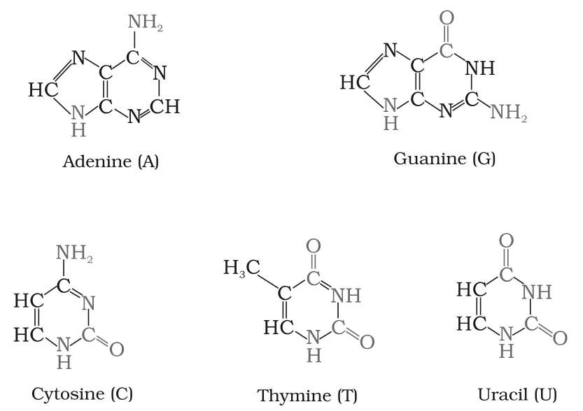
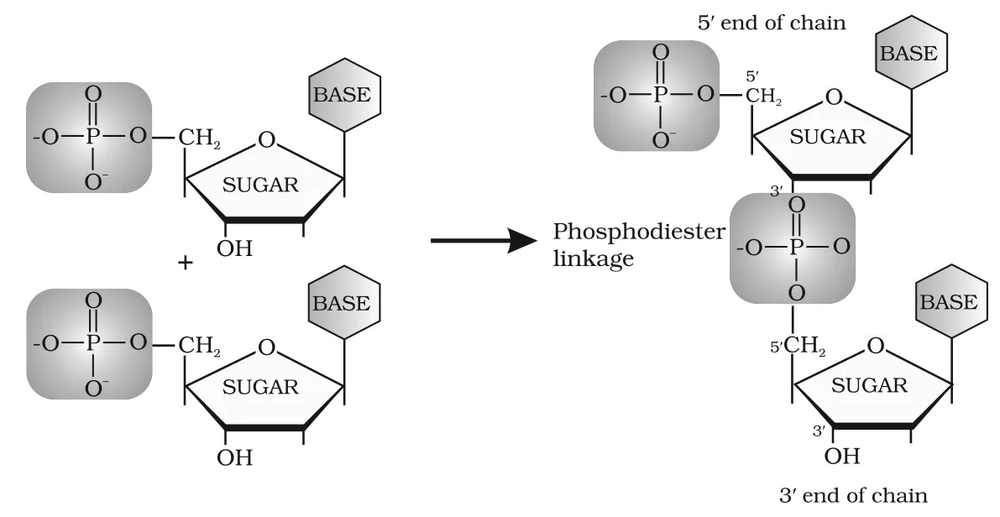

# [{ align=left, width=3.8% }](../../index.md)  Biomolecules | Nucleic Acids

## Nucleic Acids

* Every generation of a species resembles its ancestors. The transmission of inherent characters from one generation to the next is called **heredity**, and the **nucleus** of a living cell is responsible for it.
* The particles in the nucleus responsible for heredity are called **chromosomes**. They are made up of proteins and another type of biomolecule called **nucleic acids**.
* Nucleic acids are of two main types: **deoxyribonucleic acid (DNA)** and **ribonucleic acid (RNA)**.
* Nucleic acids are long chain polymers of nucleotides, so they are also called **polynucleotides**.

## Chemical Composition of Nucleic Acids

Complete hydrolysis of DNA or RNA gives three components:

### 1. A pentose sugar

* In DNA, the sugar is **&beta;-D-2-deoxyribose**.
* In RNA, the sugar is **&beta;-D-ribose**.
* 2-deoxyribose differs from ribose in having -H in place of -OH at C-2.

### 2. Phosphoric acid

### 3. Nitrogenous bases

* These are nitrogen-containing heterocyclic compounds.
* **DNA** contains adenine (A), guanine (G), cytosine (C) and thymine (T).
* **RNA** contains adenine (A), guanine (G), cytosine (C) and uracil (U). So the fourth base in RNA is uracil instead of thymine.
* Adenine and guanine are **purines** (two fused rings); cytosine, thymine and uracil are **pyrimidines** (single ring).

{loading=lazy}

## Structure of Nucleic Acids

### Nucleoside

* A unit formed by attachment of a base to the **1' position** of the sugar is called a **nucleoside**.
* In nucleosides, the sugar carbons are numbered 1', 2', 3', etc. to distinguish them from the atoms of the base.

!!! tip ""

    $$Nucleoside = Base + Sugar$$

### Nucleotide

* When a nucleoside is linked to phosphoric acid at the **5' position** of the sugar, a **nucleotide** is formed.

!!! tip ""

    $$Nucleotide = Base + Sugar + Phosphate$$

### Phosphodiester linkage

* Nucleotides are joined together by **phosphodiester linkages** between the **5'** and **3'** carbon atoms of the pentose sugars.
* The formation of a dinucleotide is shown below. The chain has a free 5' end and a free 3' end.

{loading=lazy}

* A simplified version of a nucleic acid chain is:

!!! tip ""

    $$\begin{array}{c} Base \\ | \\ -Sugar- \end{array} Phosphate \left[ \begin{array}{c} Base \\ | \\ -Sugar- \end{array} Phosphate \right]_n \begin{array}{c} Base \\ | \\ -Sugar- \end{array}$$

### Primary structure

* The sequence of nucleotides in the chain of a nucleic acid is called its **primary structure**.

### Secondary structure of DNA

* **James Watson** and **Francis Crick** proposed the **double strand helix** structure of DNA.
* Two nucleic acid chains are wound about each other and held together by **hydrogen bonds** between pairs of bases.
* The two strands are **complementary** (not identical) because hydrogen bonds form only between specific pairs of bases:
    * Adenine pairs with **thymine** (A = T).
    * Cytosine pairs with **guanine** (C &equiv; G).
* So the sequence of bases on one strand fixes the sequence on the other.

!!! note "Note"

    Watson, Crick and Maurice Wilkins shared the 1962 Nobel Prize in Physiology and Medicine for the double helix model. It resembles a gently twisted ladder: the rails are alternating phosphate and deoxyribose units, and the rungs are pairs of purine/pyrimidine bases. Complementary base pairing explains how identical copies of parental DNA pass to two daughter cells.

### Secondary structure of RNA

* In RNA, the helices are only **single stranded**. Sometimes they fold back on themselves to form a double helix structure.
* RNA molecules are of three types, each with a different function:
    * Messenger RNA (**m-RNA**)
    * Ribosomal RNA (**r-RNA**)
    * Transfer RNA (**t-RNA**)

## DNA vs RNA

Feature                | DNA                                         | RNA
-----------------------|---------------------------------------------|-------------------------------------------
Sugar                  | &beta;-D-2-deoxyribose                      | &beta;-D-ribose
Bases                  | A, G, C, T                                  | A, G, C, U
Structure              | Double stranded helix                       | Single stranded
Base pairing           | Complementary strands (A-T, C-G)            | No fixed ratio between bases
Function               | Chemical basis of heredity; carries the coded message for protein synthesis | Actually carries out protein synthesis
Types                  | -                                           | m-RNA, r-RNA, t-RNA

## Biological Functions of Nucleic Acids

* DNA is the **chemical basis of heredity** and is regarded as the reserve of genetic information.
* DNA is responsible for maintaining the identity of different species over millions of years.
* A DNA molecule can **self-duplicate** during cell division, so identical DNA strands are passed on to daughter cells.
* Nucleic acids carry out **protein synthesis** in the cell. Proteins are actually synthesised by the various RNA molecules, but the message for synthesis of a particular protein is present in DNA.

!!! note "Note"

    Har Gobind Khorana shared the 1968 Nobel Prize for Medicine and Physiology with Marshall Nirenberg and Robert Holley for cracking the genetic code.

## DNA Fingerprinting

* Fingerprints at the tips of fingers are unique to each person and have long been used for identification, but they can be altered by surgery.
* The **sequence of bases on DNA** is also unique for every person. Information about this sequence is called **DNA fingerprinting**.
* It is the same for every cell of a person and cannot be altered by any known treatment.
* DNA fingerprinting is used:
    * in forensic laboratories to identify criminals,
    * to determine the paternity of an individual,
    * to identify dead bodies in accidents by comparing the DNA of parents or children,
    * to identify racial groups and rewrite biological evolution.
