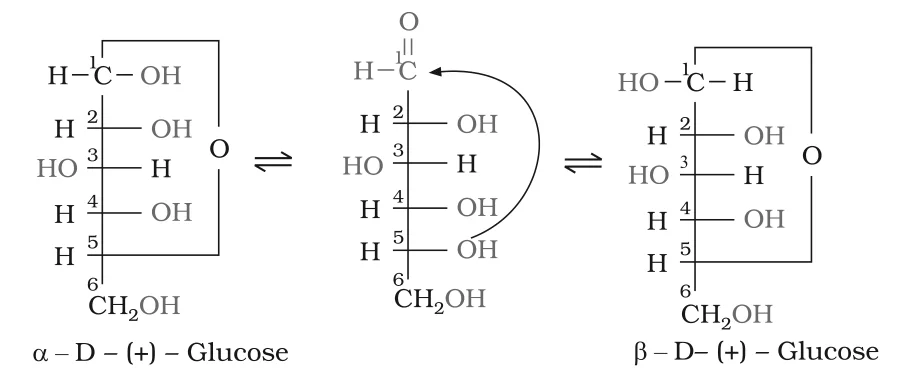
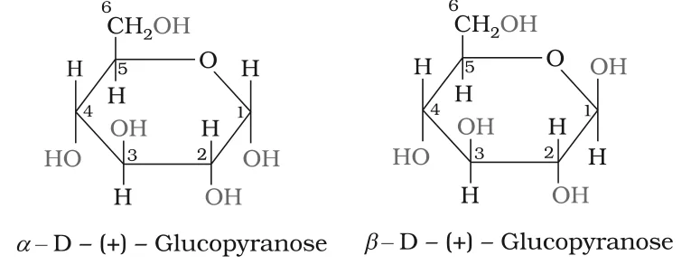
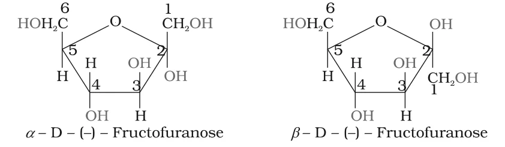

# [{ align=left, width=3.8% }](../../index.md)  Biomolecules | Structure of Glucose and Fructose

## Open Chain Structure of Glucose

Glucose was assigned the open chain structure CHO-(CHOH)4-CH2OH on the basis of the following evidences.

### 1. Molecular formula

* The molecular formula of glucose was found to be C6H12O6.

### 2. Straight chain of six carbons

* On prolonged heating with HI, glucose forms **n-hexane**. This shows that all six carbon atoms are linked in a straight chain.

!!! tip ""

    $$CHO-(CHOH)_4-CH_2OH \xrightarrow{HI,\ \Delta} \underset{n-Hexane}{CH_3-CH_2-CH_2-CH_2-CH_2-CH_3}$$

### 3. Presence of a carbonyl group

* Glucose reacts with hydroxylamine to form an **oxime** and adds a molecule of HCN to give a **cyanohydrin**. These reactions confirm the presence of a carbonyl group (>C=O).

!!! tip ""

    $$CHO-(CHOH)_4-CH_2OH \xrightarrow{NH_2OH} \underset{Oxime}{CH(=N-OH)-(CHOH)_4-CH_2OH}$$

    $$CHO-(CHOH)_4-CH_2OH \xrightarrow{HCN} \underset{Cyanohydrin}{CH(OH)(CN)-(CHOH)_4-CH_2OH}$$

### 4. Carbonyl group is an aldehyde

* A mild oxidising agent like **bromine water** oxidises glucose to a six-carbon carboxylic acid, **gluconic acid**. This shows the carbonyl group is an aldehydic group (ketones are not oxidised so easily).

!!! tip ""

    $$CHO-(CHOH)_4-CH_2OH \xrightarrow{Br_2\ water} \underset{Gluconic\ acid}{COOH-(CHOH)_4-CH_2OH}$$

### 5. Five -OH groups

* Acetylation of glucose with acetic anhydride gives **glucose pentaacetate**, which confirms the presence of five -OH groups.
* Since the pentaacetate is a stable compound, the five -OH groups must be attached to **different** carbon atoms (two -OH groups on one carbon are unstable).

!!! tip ""

    $$CHO-(CHOH)_4-CH_2OH \xrightarrow{Acetic\ anhydride} CHO-(CH-OCOCH_3)_4-CH_2-OCOCH_3$$

### 6. Primary alcoholic group

* On oxidation with **nitric acid**, both glucose and gluconic acid give the same dicarboxylic acid, **saccharic acid**. This shows the presence of a primary alcoholic (-CH2OH) group in glucose.

!!! tip ""

    $$\underset{Glucose}{CHO-(CHOH)_4-CH_2OH} \xrightarrow{HNO_3} \underset{Saccharic\ acid}{COOH-(CHOH)_4-COOH}$$

    $$\underset{Gluconic\ acid}{COOH-(CHOH)_4-CH_2OH} \xrightarrow{HNO_3} \underset{Saccharic\ acid}{COOH-(CHOH)_4-COOH}$$

### Fischer projection of glucose

* The exact spatial arrangement of the -OH groups was worked out by **Fischer**. Glucose (I), gluconic acid (II) and saccharic acid (III) are represented as:

!!! tip ""

    $$\underset{(I)\ Glucose}{\begin{array}{c} CHO \\ H-C-OH \\ HO-C-H \\ H-C-OH \\ H-C-OH \\ CH_2OH \end{array}} \qquad \underset{(II)\ Gluconic\ acid}{\begin{array}{c} COOH \\ H-C-OH \\ HO-C-H \\ H-C-OH \\ H-C-OH \\ CH_2OH \end{array}} \qquad \underset{(III)\ Saccharic\ acid}{\begin{array}{c} COOH \\ H-C-OH \\ HO-C-H \\ H-C-OH \\ H-C-OH \\ COOH \end{array}}$$

## D and L Configuration

* Glucose is correctly named **D-(+)-glucose**. 'D' represents its configuration and '(+)' represents its dextrorotatory nature.
* 'D' and 'L' have **no relation** with the optical activity (sign of rotation) of the compound.
* The letters D or L tell the **relative configuration** of a stereoisomer by comparing it with glyceraldehyde. Glyceraldehyde has one asymmetric carbon and exists as two enantiomers:

!!! tip ""

    $$\underset{(+)-Glyceraldehyde}{\begin{array}{c} CHO \\ H-C-OH \\ CH_2OH \end{array}} \qquad \underset{(-)-Glyceraldehyde}{\begin{array}{c} CHO \\ HO-C-H \\ CH_2OH \end{array}}$$

* Compounds that can be chemically correlated to (+)-glyceraldehyde have **D-configuration**; those correlated to (-)-glyceraldehyde have **L-configuration**.
* For monosaccharides, the structure is written with the most oxidised carbon (CHO) at the top, and the **lowest asymmetric carbon** (C-5 in glucose) is compared.
* In (+)-glucose, the -OH on the lowest asymmetric carbon is on the **right**, just like in (+)-glyceraldehyde. So it is assigned D-configuration.

## Cyclic Structure of Glucose

The open chain structure (I) explained most properties of glucose, but the following facts could not be explained by it:

1. Despite having an aldehyde group, glucose does **not** give the 2,4-DNP test or Schiff's test, and does not form a hydrogensulphite addition product with NaHSO3.
2. Glucose pentaacetate does **not** react with hydroxylamine, showing the absence of a free -CHO group.
3. Glucose exists in **two crystalline forms**, &alpha; and &beta;:
    * &alpha;-form (m.p. 419 K) is obtained by crystallisation from a concentrated solution of glucose at 303 K.
    * &beta;-form (m.p. 423 K) is obtained by crystallisation from a hot, saturated aqueous solution at 371 K.

* To explain these facts, it was proposed that one of the -OH groups adds to the -CHO group to form a **cyclic hemiacetal**.
* Glucose forms a **six-membered ring** in which the -OH at **C-5** is involved in ring formation. This explains the absence of a free -CHO group and the existence of two forms.
* The two cyclic forms exist in equilibrium with the open chain structure:

{loading=lazy}

### Anomers

* The two cyclic forms differ only in the configuration of the -OH group at **C-1**. This carbon (the aldehyde carbon before cyclisation) is called the **anomeric carbon**.
* Such isomers, i.e. the &alpha;-form and &beta;-form, are called **anomers**.
    * In &alpha;-D-glucose, the -OH at C-1 is on the right (same side as the ring oxygen in the Fischer form).
    * In &beta;-D-glucose, the -OH at C-1 is on the left.

### Pyranose structure and Haworth projection

* The six-membered ring of glucose (five carbons + one oxygen) is called the **pyranose** structure, by analogy with **pyran**, a cyclic compound with one oxygen and five carbon atoms in the ring.
* The cyclic structure is more correctly represented by the **Haworth structure**:

{loading=lazy}

!!! note "Note"

    In the Haworth structure, groups that are on the right in the Fischer projection are drawn below the ring, and groups on the left are drawn above it. In &alpha;-D-glucopyranose the C-1 -OH is below the ring; in &beta;-D-glucopyranose it is above the ring.

## Structure of Fructose

* Fructose is an important **ketohexose**. It is obtained along with glucose by hydrolysis of sucrose.
* It also has the molecular formula C6H12O6. Its reactions show a **ketonic group at C-2** and six carbons in a straight chain, as in glucose.
* It belongs to the D-series and is **laevorotatory**, so it is written as **D-(-)-fructose**.

!!! tip "Open chain structure of D-(-)-fructose"

    $$\begin{array}{c} CH_2OH \\ C=O \\ HO-C-H \\ H-C-OH \\ H-C-OH \\ CH_2OH \end{array}$$

* Fructose also exists in two cyclic forms, obtained by addition of the -OH at **C-5** to the >C=O group (at C-2).
* The ring formed is **five-membered** and is called **furanose**, by analogy with **furan**, a five-membered cyclic compound with one oxygen and four carbon atoms.
* C-2 is the anomeric carbon in fructose. The Haworth structures of the two anomers are:

{loading=lazy}

## Glucose vs Fructose

Property                    | Glucose                       | Fructose
----------------------------|-------------------------------|-------------------------------
Type                        | Aldohexose                    | Ketohexose
Carbonyl group              | -CHO at C-1                   | >C=O at C-2
Optical rotation            | Dextrorotatory, D-(+)         | Laevorotatory, D-(-)
Ring formed by -OH at       | C-5                           | C-5
Ring size                   | Six-membered (pyranose)       | Five-membered (furanose)
Anomeric carbon             | C-1                           | C-2
